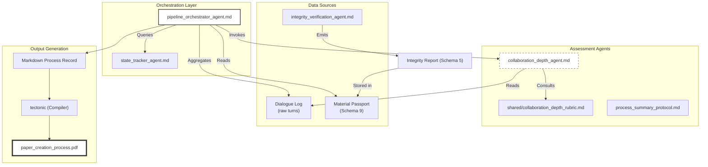

<!-- source: DeepWiki mcp.deepwiki.com · repo Imbad0202/academic-research-skills · page 2.5 Process Summary and Collaboration Quality · fetched 2026-10-30 -->

# Process Summary and Collaboration Quality

Relevant source files

The following files were used as context for generating this wiki page:

- [academic-paper/agents/visualization_agent.md](academic-paper/agents/visualization_agent.md)
- [academic-paper/references/vlm_figure_verification.md](academic-paper/references/vlm_figure_verification.md)
- [academic-pipeline/agents/collaboration_depth_agent.md](academic-pipeline/agents/collaboration_depth_agent.md)
- [academic-pipeline/references/score_trajectory_protocol.md](academic-pipeline/references/score_trajectory_protocol.md)
- [examples/figure_table_trace_example.md](examples/figure_table_trace_example.md)
- [scripts/check_684_review_criteria_binding.py](scripts/check_684_review_criteria_binding.py)
- [scripts/check_collaboration_depth_rubric.py](scripts/check_collaboration_depth_rubric.py)
- [scripts/check_content_coverage_advisory_integration.py](scripts/check_content_coverage_advisory_integration.py)
- [scripts/check_decision_contract.py](scripts/check_decision_contract.py)
- [scripts/check_tortured_phrase_screening_integration.py](scripts/check_tortured_phrase_screening_integration.py)
- [scripts/test_check_684_review_criteria_binding.py](scripts/test_check_684_review_criteria_binding.py)
- [scripts/test_check_collaboration_depth_rubric.py](scripts/test_check_collaboration_depth_rubric.py)
- [scripts/test_check_content_coverage_advisory_integration.py](scripts/test_check_content_coverage_advisory_integration.py)
- [scripts/test_check_cross_document_consistency_advisory_integration.py](scripts/test_check_cross_document_consistency_advisory_integration.py)
- [scripts/test_check_decision_contract.py](scripts/test_check_decision_contract.py)
- [scripts/test_check_tortured_phrase_screening_integration.py](scripts/test_check_tortured_phrase_screening_integration.py)

## Purpose and Scope

This page documents **Stage 6 PROCESS SUMMARY**, the final terminal stage of the `academic-pipeline` orchestrator. Upon completing paper finalization, the system automatically generates a comprehensive "Paper Creation Process Record" and an "AI Self-Reflection Report". It also conducts a post-hoc **Collaboration Quality Evaluation** and a theory-grounded **Collaboration Depth Assessment** via `collaboration_depth_agent`, alongside the criterion trajectory protocol.

**Sources:** [academic-pipeline/SKILL.md:563-679](), [academic-pipeline/agents/collaboration_depth_agent.md:19-25](), [academic-pipeline/references/score_trajectory_protocol.md:1-11]()

---

## Overview

Stage 6 executes automatically after user confirmation of the Stage 5 completion checkpoint (`FULL`) [academic-pipeline/references/process_summary_protocol.md:1-4](). It produces meta-level documentation evaluating the human-AI partnership and concludes the pipeline lifecycle [scripts/check_pipeline_boundary_semantics.py:27-32]().

The generated documentation package includes:
1. Complete session history record, capturing initial user instructions and verbatim key decisions [academic-pipeline/references/process_summary_protocol.md:15-22]().
2. Evidence-based **Collaboration Quality Evaluation** across six dimensions (scored 1–100) [academic-pipeline/references/process_summary_protocol.md:59-63]().
3. **AI Self-Reflection Report** tracking AI behavioral patterns, concession rates, and health alerts [academic-pipeline/references/process_summary_protocol.md:122-125]().
4. **Collaboration Depth Assessment** scoring partnership quality via the Wang & Zhang (2026) framework [academic-pipeline/agents/collaboration_depth_agent.md:27-29]().

**Sources:** [academic-pipeline/SKILL.md:563-569](), [academic-pipeline/references/process_summary_protocol.md:1-5](), [academic-pipeline/agents/pipeline_orchestrator_agent.md:120-125]()

---

## Stage 6 Workflow and Data Flow

The following diagram bridges natural language orchestration concepts to concrete codebase entities during Stage 6 execution.

**Diagram: Stage 6 Data Flow and Agent Integration**

**Sources:** [academic-pipeline/agents/collaboration_depth_agent.md:43-52](), [academic-pipeline/references/process_summary_protocol.md:24-31](), [academic-pipeline/agents/pipeline_orchestrator_agent.md:12-13]()

---

## Collaboration Depth Assessment (Wang & Zhang 2026)

The `collaboration_depth_agent` operates as a post-hoc **observer** [academic-pipeline/agents/collaboration_depth_agent.md:21-23](). It scores interaction depth against the canonical rubric located at `shared/collaboration_depth_rubric.md` [academic-pipeline/agents/collaboration_depth_agent.md:31-33]().

### The 3-Construct Rubric

| Dimension | Construct | Description |
|-----------|-----------|-------------|
| **Delegation Intensity** | Cognitive Offloading (CO) | Whole-category handoffs versus scattered micro-asks. [academic-pipeline/agents/collaboration_depth_agent.md:35]() |
| **Cognitive Vigilance** | Cognitive Vigilance (CV) | Critical evaluation, verification, and pushback on AI outputs ($\beta=0.437$). [academic-pipeline/agents/collaboration_depth_agent.md:36]() |
| **Cognitive Reallocation** | Human-GenAI Partnership (HGP) | Freed capacity reinvested in higher-order work. [academic-pipeline/agents/collaboration_depth_agent.md:37]() |

### Zone Classification

Scores are synthesized into a discrete zone label:
- **Zone 1**: Manual/No AI utilization.
- **Zone 2**: Shallow or Mid collaboration (Scattered interactions).
- **Zone 3**: Deep Partnership (High Intensity, Vigilance, and Reallocation).

**Sources:** [academic-pipeline/agents/collaboration_depth_agent.md:31-38](), [academic-pipeline/agents/collaboration_depth_agent.md:63-65]()

---

## Collaboration Quality Evaluation and Score Trajectory Protocol

### Collaboration Quality Evaluation

Distinct from pedagogical depth scoring, the **Collaboration Quality Evaluation** assesses performance from a research leadership perspective [academic-pipeline/references/process_summary_protocol.md:59-62](). It evaluates six dimensions on a 1–100 scale:
1. **Direction Setting**: Clarity, timing, and scope definition [academic-pipeline/references/process_summary_protocol.md:70-71]().
2. **Intellectual Contribution**: Insight depth and concept challenges [academic-pipeline/references/process_summary_protocol.md:73-75]().
3. **Quality Gatekeeping**: Visual inspection and formatting standards [academic-pipeline/references/process_summary_protocol.md:77-79]().
4. **Iteration Discipline**: Willingness to re-run pipeline stages without settling [academic-pipeline/references/process_summary_protocol.md:81-83]().
5. **Delegation Efficiency**: Instruction precision and checkpoint efficiency [academic-pipeline/references/process_summary_protocol.md:85-87]().
6. **Meta-Learning**: Requesting lesson recording and process awareness [academic-pipeline/references/process_summary_protocol.md:89-91]().

### Score / Criterion Trajectory Protocol

The criterion trajectory protocol (`academic-pipeline/references/score_trajectory_protocol.md`) tracks how revisions impact specific review criteria over time [academic-pipeline/references/score_trajectory_protocol.md:1-11](). 
- **Comparison Rule**: Evaluates evidence-anchored categorical judgements (`EXCEEDS`, `MEETS`, `PARTLY_MEETS`, `DOES_NOT_MEET`, `NOT_ASSESSED`) and determines change states (`IMPROVED`, `UNCHANGED`, `REGRESSED`, `NOT_COMPARABLE`) [academic-pipeline/references/score_trajectory_protocol.md:15-27]().
- **Regression Handling**: A `REGRESSED` status on decision-bearing items triggers a mandatory checkpoint requiring presentation of evidence, regression rationale, and mitigation options [academic-pipeline/references/score_trajectory_protocol.md:29-38]().
- **Early Stopping**: Permitted when zero P0 issues remain, no unresolved decision-bearing regressions exist, and author obligations under the revision contract are fulfilled [academic-pipeline/references/score_trajectory_protocol.md:42-49]().

**Sources:** [academic-pipeline/references/process_summary_protocol.md:59-94](), [academic-pipeline/references/score_trajectory_protocol.md:1-52]()

---

## AI Self-Reflection Report and Implementation Details

### AI Self-Reflection Report

The AI Self-Reflection Report tracks internal agent metrics [academic-pipeline/references/process_summary_protocol.md:122-125]():
- **DA Concession Rate**: Frequency of `devil_advocate_agent` conceding to user rebuttals [academic-pipeline/references/process_summary_protocol.md:121-122]().
- **Checkpoints Efficiency**: Ratio of SLIM versus FULL checkpoints and skipped gates [academic-pipeline/references/process_summary_protocol.md:127-128]().
- **Dialogue Health**: Counts of `[HEALTH-CHECK]` alerts (e.g., "Persistent Agreement" or "Conflict Loop") [academic-pipeline/references/process_summary_protocol.md:133-136]().
- **Integrity Performance**: Summary of citation hallucinations detected via the taxonomy [academic-pipeline/agents/integrity_verification_agent.md:27-35]().

### Implementation Details

- **Anti-Sycophancy Discipline**: The `collaboration_depth_agent` enforces **forced counter-enumeration**, requiring at least two turns where collaboration could have been deeper, preventing inflated scoring [academic-pipeline/agents/collaboration_depth_agent.md:60-62](). Short dialogue windows (< 5 turns) return `insufficient_evidence` [academic-pipeline/agents/collaboration_depth_agent.md:74-76]().
- **Non-Blocking Operation**: Depth assessments are strictly advisory and never block pipeline execution [academic-pipeline/agents/collaboration_depth_agent.md:23-25]().
- **Cross-Model Verification**: When `ARS_CROSS_MODEL` is set, secondary model scoring runs post-consent; dimension divergences > 2 points are flagged without silent averaging [academic-pipeline/agents/collaboration_depth_agent.md:67-68]().
- **Terminal Vocabulary**: Pipeline termination requires explicit user acknowledgment keywords (`finish`, `end`, `done`, `confirm`) [academic-pipeline/references/process_summary_protocol.md:39-40](), [scripts/check_pipeline_boundary_semantics.py:117-118]().

**Sources:** [academic-pipeline/agents/collaboration_depth_agent.md:1-76](), [academic-pipeline/references/process_summary_protocol.md:112-140](), [scripts/check_pipeline_boundary_semantics.py:27-32]()

---

