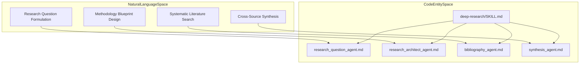
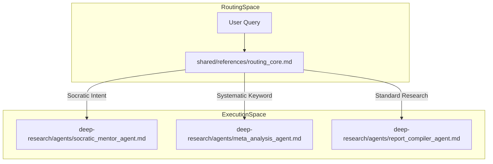

<!-- source: DeepWiki mcp.deepwiki.com · repo Imbad0202/academic-research-skills · page 3 Deep Research Skill · fetched 2026-10-30 -->

# Deep Research Skill

Relevant source files

The following files were used as context for generating this wiki page:

- [academic-paper-reviewer/SKILL.md](academic-paper-reviewer/SKILL.md)
- [academic-paper/SKILL.md](academic-paper/SKILL.md)
- [deep-research/SKILL.md](deep-research/SKILL.md)
- [docs/CONTROL_AVAILABILITY.md](docs/CONTROL_AVAILABILITY.md)
- [shared/references/routing_core.md](shared/references/routing_core.md)
- [tests/fixtures/issue_133_routing/CALIBRATION_LOG.md](tests/fixtures/issue_133_routing/CALIBRATION_LOG.md)
- [tests/fixtures/issue_133_routing/README.md](tests/fixtures/issue_133_routing/README.md)

The `deep-research` skill provides a domain-agnostic, 13-agent research team designed for rigorous academic investigation on any topic [deep-research/SKILL.md:3-17](). It executes through 8 operational modes and a 6-phase orchestration pipeline, producing APA 7.0 reports, systematic reviews, literature syntheses, and research question formulations.

**Scope and Child Pages**: This page provides a high-level overview of the deep-research skill architecture, operational modes, and agent composition. For detailed documentation, refer to the child pages:
- [Research Modes Overview](#3.1) — Detailed breakdown of the 8 modes (`full`, `quick`, `review`, `lit-review`, `fact-check`, `three-way-scan`, `socratic`, `systematic-review`), selection guidelines, and trigger keywords.
- [Six-Phase Orchestration Workflow](#3.2) — Execution flow across SCOPING, INVESTIGATION, ANALYSIS, COMPOSITION, REVIEW, and REVISION, including handoff schemas.
- [Socratic Research Mode](#3.3) — Dialogue architecture, convergence criteria, INSIGHT extraction, SCR loops, and Commitment Gates.
- [Systematic Review and PRISMA Compliance](#3.4) — PRISMA 2020 workflows, RoB 2, ROBINS-I, meta-analysis, and the `compliance_agent` protocol.
- [Deep Research Agent Team](#3.5) — Specifications for all 13 agents including `research_question_agent`, `bibliography_agent`, `synthesis_agent`, and `meta_analysis_agent`.

Sources: [deep-research/SKILL.md:1-17]()

---

## Architecture Overview and Code Mapping

The deep-research ecosystem bridges natural language research requests to concrete agent execution scripts and markdown role definitions located in the codebase. 

### Diagram: Deep Research Agent Architecture to Code Entities

Sources: [deep-research/SKILL.md:3-17](), [deep-research/agents/report_compiler_agent.md:1-15]()

---

## Operational Modes

The skill supports 8 distinct operational modes mapped via `deep-research/SKILL.md` [deep-research/SKILL.md:3]():

1. `full` — Comprehensive research report utilizing core agents.
2. `quick` — Fast research brief with essential bibliographic and verification steps.
3. `review` — Quality assessment of existing text via editorial and critical agents.
4. `lit-review` — Targeted literature synthesis without full report compilation.
5. `fact-check` — Focused verification of claims using `source_verification_agent`.
6. `three-way-scan` — Three-stage literature profiling and boundary analysis.
7. `socratic` — Guided research thinking and dialogue via `socratic_mentor_agent`.
8. `systematic-review` — PRISMA 2020 compliant review including `risk_of_bias_agent` and `meta_analysis_agent`.

For mode selection guidelines and trigger keywords, see [Research Modes Overview](#3.1).

Sources: [deep-research/SKILL.md:3-15]()

---

## Six-Phase Orchestration Workflow

The research pipeline processes through 6 mandatory phases [deep-research/SKILL.md:60-67]():

1. **Scoping**: Formulates FINER-scored research questions and methodology blueprints.
2. **Investigation**: Executes systematic literature searches and source verification.
3. **Analysis**: Conducts cross-source integration and bias checking.
4. **Composition**: Drafts the structured APA 7.0 report.
5. **Review**: Performs editorial, ethics, and vulnerability scans.
6. **Revision**: Applies final polishing (capped at 2 loops).

For detailed phase handoffs and schema requirements, see [Six-Phase Orchestration Workflow](#3.2).

Sources: [deep-research/SKILL.md:60-67](), [deep-research/agents/report_compiler_agent.md:15-20]()

---

## Socratic Research Mode & Systematic Reviews

- **Socratic Research Mode**: Engages users through structured dialogue when research directions are ambiguous. It relies on convergence criteria, INSIGHT extraction, and SCR loops. For details, see [Socratic Research Mode](#3.3).
- **Systematic Review and PRISMA Compliance**: Enforces PRISMA 2020 standards, RoB 2, ROBINS-I risk of bias evaluation, and optional meta-analysis workflows. For details, see [Systematic Review and PRISMA Compliance](#3.4).

Sources: [deep-research/SKILL.md:3-45]()

---

## Deep Research Agent Team

The execution team comprises 13 specialized roles, balancing core investigation with conditional specialized agents.

### Diagram: Mode Routing to Execution Pipeline

Sources: [deep-research/SKILL.md:3-17](), [shared/references/routing_core.md:1-32]()

For complete individual agent definitions, see [Deep Research Agent Team](#3.5).

Sources: [deep-research/SKILL.md:103-120]()

---

