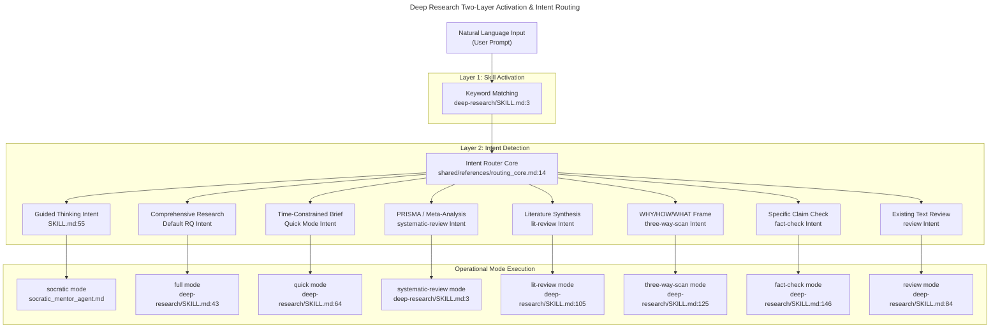
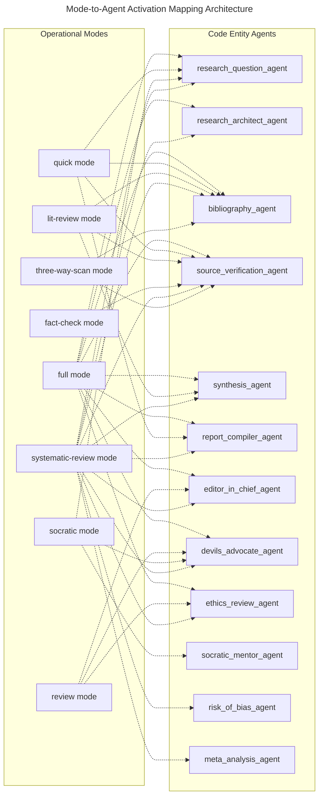

<!-- source: DeepWiki mcp.deepwiki.com · repo Imbad0202/academic-research-skills · page 3.1 Research Modes Overview · fetched 2026-10-30 -->

# Research Modes Overview

Relevant source files

The following files were used as context for generating this wiki page:

- [academic-paper-reviewer/SKILL.md](academic-paper-reviewer/SKILL.md)
- [academic-paper/SKILL.md](academic-paper/SKILL.md)
- [academic-paper/references/mode_selection_guide.md](academic-paper/references/mode_selection_guide.md)
- [deep-research/SKILL.md](deep-research/SKILL.md)
- [deep-research/references/mode_selection_guide.md](deep-research/references/mode_selection_guide.md)
- [docs/CONTROL_AVAILABILITY.md](docs/CONTROL_AVAILABILITY.md)
- [shared/references/routing_core.md](shared/references/routing_core.md)
- [tests/fixtures/issue_133_routing/CALIBRATION_LOG.md](tests/fixtures/issue_133_routing/CALIBRATION_LOG.md)
- [tests/fixtures/issue_133_routing/README.md](tests/fixtures/issue_133_routing/README.md)

## Purpose and Scope

This page details the eight operational modes supported by the `deep-research` skill (`full`, `quick`, `review`, `lit-review`, `three-way-scan`, `fact-check`, `socratic`, and `systematic-review`), the intent detection and routing mechanisms, and the associated agent activation topologies. 

Sources: `[deep-research/SKILL.md:3-13](), [deep-research/references/mode_selection_guide.md:1-6]()`

---

## Two-Layer Activation and Routing Architecture

The system implements a two-layer routing architecture to map natural language queries to the correct execution path. **Layer 1** utilizes bilingual trigger keywords defined in the skill frontmatter to activate the skill namespace `[deep-research/SKILL.md:3]`. **Layer 2** executes semantic intent analysis via the shared routing core to select the appropriate operational mode `[shared/references/routing_core.md:14-32]`.

### Diagram 1: Two-Layer Activation and Mode Routing

Sources: `[deep-research/SKILL.md:3-70](), [shared/references/routing_core.md:14-32]()`

---

## Eight Operational Modes Reference

The `deep-research` skill provides eight distinct execution paths tailored to different research stages and objectives `[deep-research/references/mode_selection_guide.md:5]`:

1. **`full` mode**: Comprehensive research from scratch, producing an APA 7.0 report (3,000–8,000 words) across 6 phases using 9 core agents `[deep-research/references/mode_selection_guide.md:43-52]`.
2. **`quick` mode**: Rapid research brief (500–1,500 words) under time constraints, activating 4 agents (`research_question_agent`, `bibliography_agent`, `source_verification_agent`, `report_compiler_agent`) `[deep-research/references/mode_selection_guide.md:64-74]`.
3. **`review` mode**: Professional evaluation of an existing manuscript or text, yielding an Editorial Verdict (Accept/Revise/Reject) via 3 agents (`editor_in_chief_agent`, `devils_advocate_agent`, `ethics_review_agent`) `[deep-research/references/mode_selection_guide.md:84-93]`.
4. **`lit-review` mode**: Systematic literature search and thematic synthesis yielding an annotated bibliography and evidence matrix (1,500–4,000 words) using 3 agents (`bibliography_agent`, `source_verification_agent`, `synthesis_agent`) `[deep-research/references/mode_selection_guide.md:105-114]`.
5. **`three-way-scan` mode**: Lighter comparative analysis of shortlisted papers structured in a stable WHY/HOW/WHAT frame, utilizing 2 agents (`bibliography_agent`, `source_verification_agent`) `[deep-research/references/mode_selection_guide.md:125-134]`.
6. **`fact-check` mode**: Verification of specific factual claims and source quality, executed by the `source_verification_agent` `[deep-research/references/mode_selection_guide.md:146-156]`.
7. **`socratic` mode**: Guided progressive dialogue for unformed research questions, using the `socratic_mentor_agent` alongside question and critique agents `[deep-research/SKILL.md:55-65]`, `[deep-research/references/mode_selection_guide.md:27-28]`.
8. **`systematic-review` mode**: PRISMA 2020 compliant review and optional meta-analysis utilizing 12 specialized agents including `risk_of_bias_agent` and `meta_analysis_agent` `[deep-research/SKILL.md:3]`, `[deep-research/references/mode_selection_guide.md:17-18]`.

Sources: `[deep-research/SKILL.md:3-70](), [deep-research/references/mode_selection_guide.md:5-182]()`

---

## Mode-to-Agent Activation Architecture

Each operational mode dynamically allocates specific subagents from the 13-agent repository pool to execute its workload.

### Diagram 2: Mode-to-Agent Activation Mapping Architecture

Sources: `[deep-research/SKILL.md:107-119](), [deep-research/references/mode_selection_guide.md:41-182]()`

---

## Mode Selection Trigger Keywords and Heuristics

Users trigger modes explicitly via slash commands, explicit phrasing, or implicit intent detected by the routing core. 

* **Explicit Trigger Directives:** Keywords such as `systematic review`, `meta-analysis`, `PRISMA` route directly to `systematic-review` mode `[deep-research/SKILL.md:3]`.
* **Ambiguity Handling:** When user intent is unstated or ambiguous without materials, the system defaults to clarification protocols `[deep-research/SKILL.md:38-40]`. When exploring nascent research topics, the system favors `socratic` mode to establish methodological soundness before generation `[deep-research/SKILL.md:55-65]`.

Sources: `[deep-research/SKILL.md:3-40](), [shared/references/routing_core.md:14-32]()`

---

