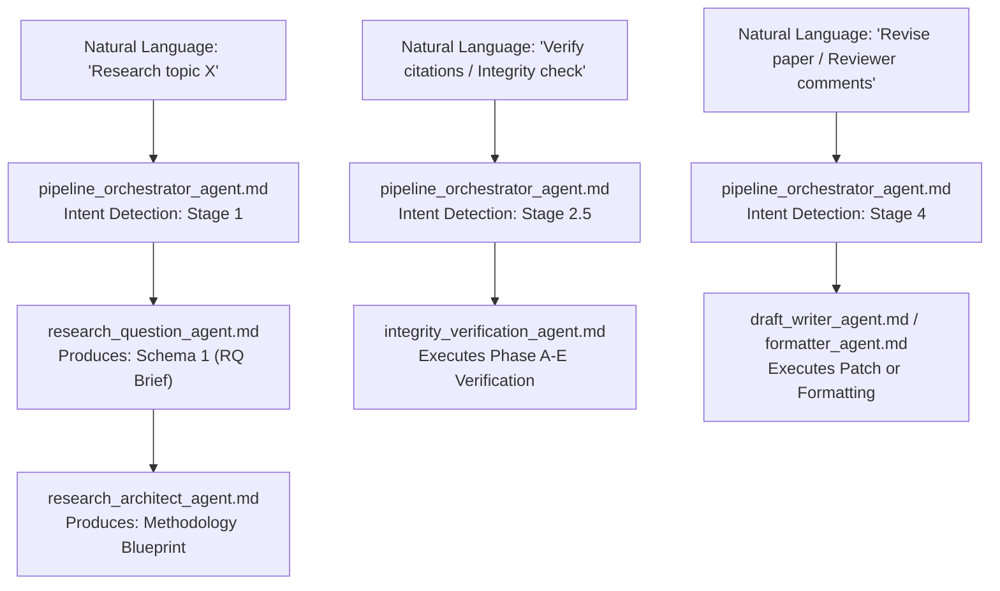
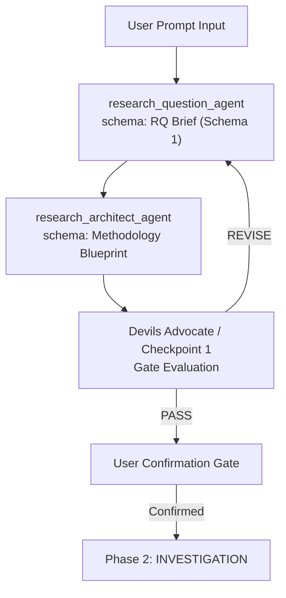

<!-- source: DeepWiki mcp.deepwiki.com · repo Imbad0202/academic-research-skills · page 3.2 Six-Phase Orchestration Workflow · fetched 2026-10-30 -->

# Six-Phase Orchestration Workflow

Relevant source files

The following files were used as context for generating this wiki page:

- [.github/workflows/spec-consistency.yml](.github/workflows/spec-consistency.yml)
- [CHANGELOG.md](CHANGELOG.md)
- [academic-paper/agents/draft_writer_agent.md](academic-paper/agents/draft_writer_agent.md)
- [academic-paper/agents/formatter_agent.md](academic-paper/agents/formatter_agent.md)
- [academic-pipeline/agents/integrity_verification_agent.md](academic-pipeline/agents/integrity_verification_agent.md)
- [academic-pipeline/agents/pipeline_orchestrator_agent.md](academic-pipeline/agents/pipeline_orchestrator_agent.md)
- [academic-pipeline/references/ai_research_failure_modes.md](academic-pipeline/references/ai_research_failure_modes.md)
- [academic-pipeline/references/passport_as_reset_boundary.md](academic-pipeline/references/passport_as_reset_boundary.md)
- [academic-pipeline/references/pipeline_state_machine.md](academic-pipeline/references/pipeline_state_machine.md)
- [academic-pipeline/references/process_summary_protocol.md](academic-pipeline/references/process_summary_protocol.md)
- [agents/report_compiler_agent.md](agents/report_compiler_agent.md)
- [agents/research_architect_agent.md](agents/research_architect_agent.md)
- [agents/synthesis_agent.md](agents/synthesis_agent.md)
- [deep-research/agents/ethics_review_agent.md](deep-research/agents/ethics_review_agent.md)
- [deep-research/agents/report_compiler_agent.md](deep-research/agents/report_compiler_agent.md)
- [deep-research/agents/research_architect_agent.md](deep-research/agents/research_architect_agent.md)
- [deep-research/agents/synthesis_agent.md](deep-research/agents/synthesis_agent.md)
- [scripts/_ci_pytest_manifest.toml](scripts/_ci_pytest_manifest.toml)
- [scripts/check_pipeline_boundary_semantics.py](scripts/check_pipeline_boundary_semantics.py)
- [scripts/test_check_pipeline_boundary_semantics.py](scripts/test_check_pipeline_boundary_semantics.py)
- [scripts/test_v3_6_7_phase_6_6.py](scripts/test_v3_6_7_phase_6_6.py)
- [shared/contracts/README.md](shared/contracts/README.md)
- [shared/handoff_schemas.md](shared/handoff_schemas.md)

This document details the core orchestration workflow used by the `deep-research` skill to execute research tasks across six sequential phases: SCOPING, INVESTIGATION, ANALYSIS, COMPOSITION, REVIEW, and REVISION. This workflow governs standard operational modes (such as `full`, `quick`, `lit-review`, and `systematic-review`), while Socratic mode utilizes a distinct dialogue architecture.

The workflow is coordinated by `pipeline_orchestrator_agent` [academic-pipeline/agents/pipeline_orchestrator_agent.md:6-12]() and consumes/produces structured data artifacts defined in `shared/handoff_schemas.md` [shared/handoff_schemas.md:1-15]().

---

## Workflow Overview and Phase Sequence

The six-phase orchestration pipeline functions as a quality-gated process where each phase passes serialized artifacts via explicit handoff schemas.

### Phase Transition Matrix

| Phase | Name | Primary Agents | Output Deliverable | Handoff Schema |
|-------|------|----------------|-------------------|----------------|
| 1 | SCOPING | `research_question_agent`, `research_architect_agent` | RQ Brief + Methodology Blueprint | Schema 1 [shared/handoff_schemas.md:25-28]() |
| 2 | INVESTIGATION | `bibliography_agent`, `source_verification_agent` | Annotated Bibliography + Quality Matrix | Schema 2 [shared/handoff_schemas.md:89-92]() |
| 3 | ANALYSIS | `synthesis_agent`, `devils_advocate_agent` | Synthesis Report + Gap Analysis | Schema 3 [shared/handoff_schemas.md:1-10]() |
| 4 | COMPOSITION | `report_compiler_agent`, `draft_writer_agent` | Full APA 7.0 Draft Report | Schema 4 [shared/handoff_schemas.md:1-10]() |
| 5 | REVIEW | `editor_in_chief_agent`, `ethics_review_agent` | Editorial Verdict + Ethics Clearance | Schema 11 [shared/handoff_schemas.md:1-10]() |
| 6 | REVISION | `report_compiler_agent` | Final Report (max 2 revision loops) | Schema 4 [shared/handoff_schemas.md:1-10]() |

Sources: [shared/handoff_schemas.md:1-15](), [academic-pipeline/agents/pipeline_orchestrator_agent.md:20-31]()

---

## Natural Language to Code Entity Mapping: Orchestration Dispatch

The following diagram bridges natural language intents to the underlying Python/Markdown agent entities and execution routes managed by `pipeline_orchestrator_agent`.

Title: "Orchestration Intent-to-Code Mapping"

Sources: [academic-pipeline/agents/pipeline_orchestrator_agent.md:18-32](), [academic-pipeline/agents/integrity_verification_agent.md:1-5]()

---

## Phase 1: SCOPING

Phase 1 transforms initial user inputs into a structured research question and architectural blueprint. It relies on interactive feedback loops before authorizing entry into Phase 2.

### Agent Execution and Validation Flow

Title: "Phase 1 Scoping Execution Flow"

Sources: [shared/handoff_schemas.md:25-53](), [deep-research/agents/research_architect_agent.md:1-30]()

- **Schema 1 (RQ Brief)**: Produced by `research_question_agent`, capturing FINER scores (`feasible`, `interesting`, `novel`, `ethical`, `relevant`), bounded scope (`in_scope`, `out_of_scope`), and optional sub-question bindings [shared/handoff_schemas.md:32-52]().
- **Methodology Blueprint**: Produced by `research_architect_agent`, specifying paradigms, validation criteria, and IRB plans.

Sources: [shared/handoff_schemas.md:25-53](), [deep-research/agents/research_architect_agent.md:12-28]()

---

## Phase 2: INVESTIGATION & Schema 2 Handoffs

Phase 2 executes systematic search strategies and populates the bibliography corpus.

- **Bibliography Agent**: Governed by `bibliography_agent`, consuming scoping parameters and producing **Schema 2 (Bibliography)** [shared/handoff_schemas.md:89-115]().
- **Source Constraints**: Requires a minimum of 15 sources for `full` mode and 5 sources for `quick` mode, accompanied by evidentiary tiering (1-7 scale) [shared/handoff_schemas.md:98-114]().

Sources: [shared/handoff_schemas.md:89-115](), [deep-research/agents/bibliography_agent.md:1-30]()

---

## Phase 3: ANALYSIS & Synthesis

Phase 3 synthesizes literature findings, resolves source contradictions, and generates analytical reports.

- **Synthesis Agent**: Operates via `synthesis_agent`, synthesizing multi-source findings into **Schema 3** structures.
- **Tension Inventory**: Implements cross-paper tension tracking to ensure conflicting empirical claims are explicitly analyzed rather than averaged out [shared/handoff_schemas.md:1-15]().

Sources: [shared/handoff_schemas.md:1-15](), [deep-research/agents/synthesis_agent.md:1-30]()

---

## Phase 4: COMPOSITION

Phase 4 compiles structured research outputs into complete manuscripts complying with formatting and academic standards.

- **Report Compilation**: Managed by `report_compiler_agent` and `draft_writer_agent` [academic-paper/agents/draft_writer_agent.md:1-10]().
- **Knowledge Isolation**: Enforces upstream material dependency to prevent generative hallucination [academic-paper/agents/draft_writer_agent.md:60-66]().

Sources: [academic-paper/agents/draft_writer_agent.md:1-35](), [deep-research/agents/report_compiler_agent.md:1-20]()

---

## Phase 5 & 6: REVIEW, REVISION, and Integrity Gates

The terminal phases involve rigorous multi-perspective review, integrity audits, and iterative patching.

- **Integrity Verification**: Handled by `integrity_verification_agent` across Stage 2.5 (pre-review) and Stage 4.5 (final verification) [academic-pipeline/agents/integrity_verification_agent.md:1-15]().
- **Patch Discipline**: Revisions in Phase 6 apply strict diff/patch tracking protocols via `draft_writer_agent` and `formatter_agent` [academic-paper/agents/draft_writer_agent.md:10-15](), [academic-paper/agents/formatter_agent.md:1-15]().

Sources: [academic-pipeline/agents/integrity_verification_agent.md:1-15](), [academic-paper/agents/draft_writer_agent.md:10-25]()

---

