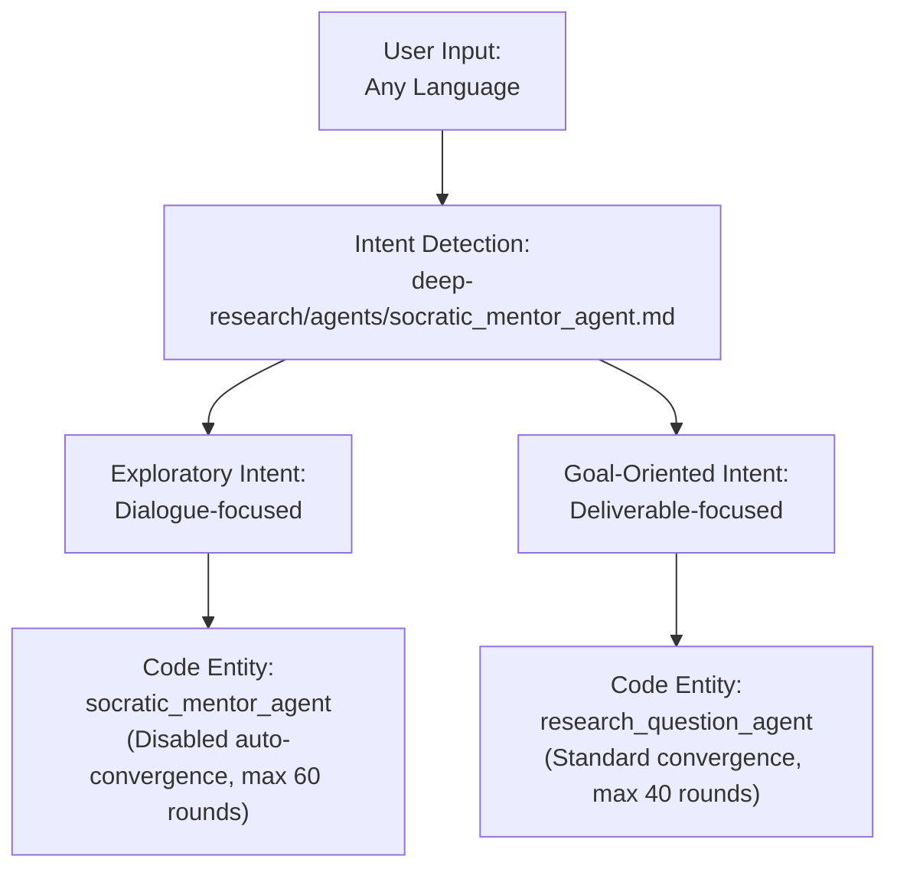
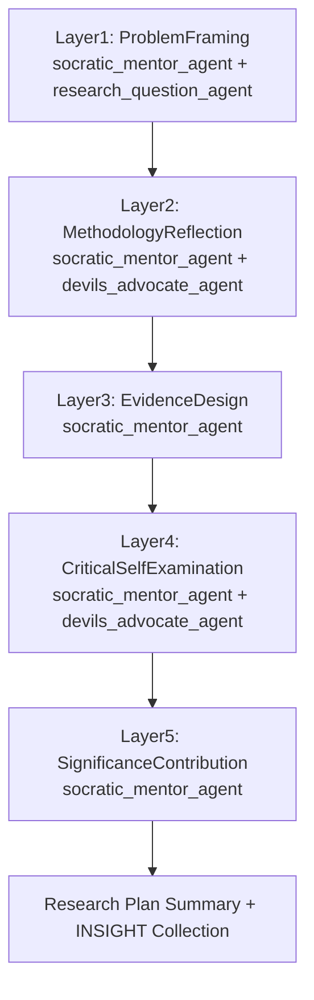

<!-- source: DeepWiki mcp.deepwiki.com · repo Imbad0202/academic-research-skills · page 3.3 Socratic Research Mode · fetched 2026-10-30 -->

# Socratic Research Mode

Relevant source files

The following files were used as context for generating this wiki page:

- [academic-paper/agents/socratic_mentor_agent.md](academic-paper/agents/socratic_mentor_agent.md)
- [academic-paper/references/academic_writing_style.md](academic-paper/references/academic_writing_style.md)
- [deep-research/agents/socratic_mentor_agent.md](deep-research/agents/socratic_mentor_agent.md)
- [deep-research/references/ethics_checklist.md](deep-research/references/ethics_checklist.md)
- [deep-research/references/failure_paths.md](deep-research/references/failure_paths.md)
- [deep-research/references/irb_decision_tree.md](deep-research/references/irb_decision_tree.md)
- [deep-research/references/socratic_mode_protocol.md](deep-research/references/socratic_mode_protocol.md)
- [deep-research/references/source_quality_hierarchy.md](deep-research/references/source_quality_hierarchy.md)
- [docs/design/2026-08-09-680-human-subjects-reference-migration-spec.md](docs/design/2026-08-09-680-human-subjects-reference-migration-spec.md)
- [evals/heldout/within_session_ideation_diversity/codebook.md](evals/heldout/within_session_ideation_diversity/codebook.md)
- [evals/heldout/within_session_ideation_diversity/heldout_set.json](evals/heldout/within_session_ideation_diversity/heldout_set.json)
- [evals/heldout/within_session_ideation_diversity/heldout_set.schema.json](evals/heldout/within_session_ideation_diversity/heldout_set.schema.json)
- [evals/heldout/within_session_ideation_diversity/nonproduction_variant.json](evals/heldout/within_session_ideation_diversity/nonproduction_variant.json)
- [scripts/check_human_subjects_output_contract.py](scripts/check_human_subjects_output_contract.py)
- [scripts/check_human_subjects_reference_migration.py](scripts/check_human_subjects_reference_migration.py)
- [scripts/test_check_human_subjects_output_contract.py](scripts/test_check_human_subjects_output_contract.py)
- [scripts/test_socratic_rq_non_generation_contract.py](scripts/test_socratic_rq_non_generation_contract.py)
- [scripts/test_validate_ideation_diversity_assets.py](scripts/test_validate_ideation_diversity_assets.py)

## Purpose and Scope

This page documents the Socratic research mode (`socratic`) within the `deep-research` skill, which provides guided research dialogue for users who lack a clear research question. This mode uses Socratic questioning implemented via `socratic_mentor_agent` to help users clarify their thinking through a 5-layer dialogue architecture, featuring internal mechanisms like the SCR (State-Challenge-Reflect) loop, Commitment Gates, Wording-Pattern Advisory (Kong #257), and the non-generation contract enforced by `scripts/test_socratic_rq_non_generation_contract.py`.

For general information about all deep-research modes, see [Research Modes Overview](3.1). For the standard 6-phase research workflow used in other modes, see [Six-Phase Orchestration Workflow](3.2). For information about the agent team, see [Deep Research Agent Team](3.5).

---

## Overview and Role Definition

Socratic mode activates when the user needs guided thinking rather than a direct research output. The mode implements a Q1 journal editor-in-chief persona (`socratic_mentor_agent`) that guides users through progressive layers of dialogue, extracting insights at each round and determining convergence through quantified criteria.

**Core Principle**: Never give direct conclusions while non-generation Socratic mode is active. Instead, use precise, layered questions to help users discover their own insights and reveal blind spots in their thinking [deep-research/agents/socratic_mentor_agent.md:10-18]().

**Key Distinction from Other Modes**:

| Mode | User Input | Primary Output | Agent Pattern |
|------|-----------|----------------|---------------|
| `full` | Clear research question | Full APA 7.0 report (3,000-8,000 words) | Core agents in 6-phase pipeline |
| `socratic` | Vague idea or uncertainty | Research Plan Summary + INSIGHT collection | `socratic_mentor_agent` + `research_question_agent` + `devils_advocate_agent` |

Sources: [deep-research/SKILL.md:245-310](), [deep-research/agents/socratic_mentor_agent.md:10-23]()

---

## Activation and Intent Detection

Socratic mode uses intent detection rather than simple keyword matching. The system classifies user intent into two primary categories: **Exploratory** (deep dialogue needed) and **Goal-Oriented** (deliverable-focused) [deep-research/agents/socratic_mentor_agent.md:70-76](). When intent is ambiguous, the system prefers `socratic` over `full` [deep-research/agents/socratic_mentor_agent.md:34-35]().

Diagram: Intent Routing and Agent Execution Map (NL Space to Code Entity Space)

Sources: [deep-research/agents/socratic_mentor_agent.md:67-120](), [deep-research/SKILL.md:45-60]()

---

## Five-Layer Dialogue Architecture

Socratic mode progresses through 5 layers, each corresponding to different phases of the standard research workflow. Each layer has minimum dialogue rounds and Commitment Gates [deep-research/references/socratic_mode_protocol.md:10-60]().

*   **Layer 1: Problem Framing** (Phase 1): Transformed vague topic into a clear, answerable research question via `socratic_mentor_agent` and `research_question_agent` [deep-research/references/socratic_mode_protocol.md:33-41]().
*   **Layer 2: Methodology Reflection** (Phase 1): Probes rationale for methodology choices using `socratic_mentor_agent` and challenges assumptions via `devils_advocate_agent` [deep-research/references/socratic_mode_protocol.md:43-50]().
*   **Layer 3: Evidence Design** (Phases 2-3): Clarifies evidence strategy and sufficiency criteria [deep-research/references/socratic_mode_protocol.md:52-58]().
*   **Layer 4: Critical Self-Examination** (Phase 5): Identifies limitations and vulnerabilities [deep-research/references/socratic_mode_protocol.md:60-67]().
*   **Layer 5: Significance & Contribution**: Establishes the "so what?" and research value [deep-research/references/socratic_mode_protocol.md:69-74]().

Diagram: Socratic 5-Layer Orchestration Flow

Sources: [deep-research/references/socratic_mode_protocol.md:10-78](), [deep-research/agents/socratic_mentor_agent.md:134-144]()

---

## Non-Generation Contract and Authorship Boundaries

Socratic mode is non-generation by default. Non-convergence, elapsed rounds, stagnation, or vague requests never authorize `socratic_mentor_agent` or `research_question_agent` to invent candidate RQs [deep-research/agents/socratic_mentor_agent.md:25-32]().

1.  **Summary Fallback**: Summarize only directions and preferences already expressed by the user; identify unresolved choices instead of filling them in [deep-research/agents/socratic_mentor_agent.md:33-38]().
2.  **Explicit Exit Contract**: The sole exception is an explicit user request that the system itself propose candidate research questions. Before any candidate appears, the system must emit this exact marker on a standalone line [deep-research/agents/socratic_mentor_agent.md:42-47]():
    `[SOCRATIC-NON-GENERATION-EXIT: explicit_user_request]`
3.  **Automated Contract Verification**: Contract compliance is enforced by `scripts/test_socratic_rq_non_generation_contract.py`, which validates file contents and marker presence across references and agent definitions [scripts/test_socratic_rq_non_generation_contract.py:1-68]().

Sources: [deep-research/agents/socratic_mentor_agent.md:25-54](), [scripts/test_socratic_rq_non_generation_contract.py:1-137]()

---

## The SCR Loop and Commitment Gates

The SCR protocol is an internal mechanism within `socratic_mentor_agent` designed to deepen user thinking by creating a gap between user predictions and reality [deep-research/agents/socratic_mentor_agent.md:125-127]().

1.  **Commitment Gate**: Before transitioning layers, the agent forces the user to make a prediction or judgment, tagged as `[COMMITMENT: ...]` [deep-research/agents/socratic_mentor_agent.md:134-144]().
2.  **Divergence Reveal**: The agent introduces information (counterpoints or contradictory findings) that tests the user's commitment [deep-research/agents/socratic_mentor_agent.md:146-152]().
3.  **Certainty-Triggered Contradiction**: If the user uses high-certainty markers, the agent introduces a contradictory perspective [deep-research/agents/socratic_mentor_agent.md:153-159]().

Sources: [deep-research/agents/socratic_mentor_agent.md:125-161](), [deep-research/references/socratic_questioning_framework.md:1-20]()

---

## Wording-Pattern Advisory (Kong #257)

The Socratic Mentor includes a Wording-Pattern Advisory layer to detect AI-typical "research-question shells" that survive a noun-swap test [deep-research/agents/socratic_mentor_agent.md:25-56]().

*   **Trigger Rule**: Compares user wording against reference patterns (WP01 to WP20) such as impact frames or relationship frames [deep-research/agents/socratic_mentor_agent.md:35-85]().
*   **Narrow Exemption**: Stays silent if the user provides a named or operationalized specific (e.g., named scale, theory, specified causal pathway, or named site) [deep-research/agents/socratic_mentor_agent.md:57]().
*   **Advisory Output**: Surfaces `[WORDING_PATTERN_ADVISORY]` without rewriting the user's text or blocking progression [deep-research/agents/socratic_mentor_agent.md:59-66]().

Sources: [deep-research/agents/socratic_mentor_agent.md:25-66](), [audits/rq-advisory-505-exemption-sharpening-2026-07-11.md:1-38]()

---

## Optional Reading Probe Layer (v3.5.1)

For goal-oriented users, `socratic_mentor_agent` can activate an optional reading probe (`ARS_SOCRATIC_READING_PROBE=1`) [deep-research/references/socratic_mode_protocol.md:96-102]().

*   **Mechanism**: Inserts a subtle reading-check probe into a question to verify engagement [deep-research/references/socratic_mode_protocol.md:98-100]().
*   **Logging**: Tagged with `[READING-PROBE: ...]` and recorded for collaboration quality assessment [deep-research/references/socratic_mode_protocol.md:100-102]().

Sources: [deep-research/references/socratic_mode_protocol.md:96-102](), [scripts/test_reading_probe_lint.py:1-150]()

---

## Failure Paths and Convergence Recovery

Failure paths F1 and F6 govern non-convergence in Socratic mode (`deep-research/references/failure_paths.md:30-76`, `deep-research/references/failure_paths.md:110-130`). If Socratic dialogue does not converge, the system summarizes user-expressed directions, suggests literature exploration (`lit-review`), or prompts an explicit mode switch without generating unprompted candidate RQs [deep-research/references/failure_paths.md:51-76]().

Sources: [deep-research/references/failure_paths.md:30-76](), [scripts/test_socratic_rq_non_generation_contract.py:1-137]()

---

