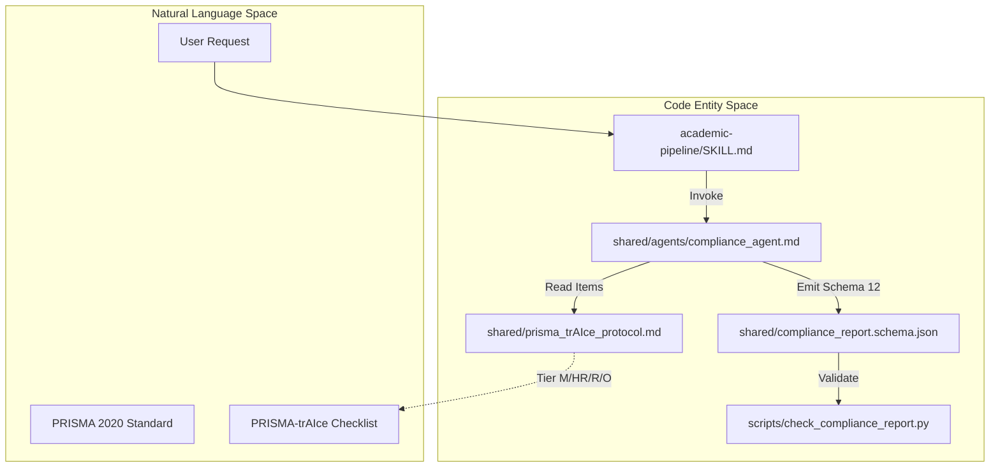
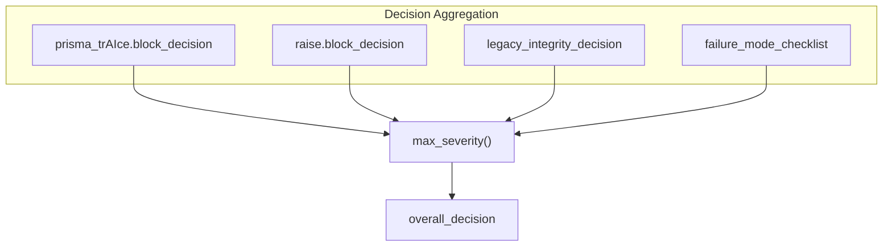

<!-- source: DeepWiki mcp.deepwiki.com · repo Imbad0202/academic-research-skills · page 3.4 Systematic Review and PRISMA Compliance · fetched 2026-10-30 -->

# Systematic Review and PRISMA Compliance

Relevant source files

The following files were used as context for generating this wiki page:

- [academic-paper/references/anti_leakage_protocol.md](academic-paper/references/anti_leakage_protocol.md)
- [academic-pipeline/references/integrity_review_protocol.md](academic-pipeline/references/integrity_review_protocol.md)
- [deep-research/agents/editor_in_chief_agent.md](deep-research/agents/editor_in_chief_agent.md)
- [deep-research/agents/meta_analysis_agent.md](deep-research/agents/meta_analysis_agent.md)
- [deep-research/agents/risk_of_bias_agent.md](deep-research/agents/risk_of_bias_agent.md)
- [docs/design/2026-04-30-ars-v3.6.8-trust-provenance-and-drift-transparency-spec.md](docs/design/2026-04-30-ars-v3.6.8-trust-provenance-and-drift-transparency-spec.md)
- [docs/design/2026-05-12-ars-v3.7.3-claim-faithfulness-and-contaminated-source-spec.md](docs/design/2026-05-12-ars-v3.7.3-claim-faithfulness-and-contaminated-source-spec.md)
- [docs/design/2026-05-17-ars-v3.9.0-cross-index-triangulation-measurement-spec.md](docs/design/2026-05-17-ars-v3.9.0-cross-index-triangulation-measurement-spec.md)
- [examples/compliance/fixture_primary_raise_weak.yaml](examples/compliance/fixture_primary_raise_weak.yaml)
- [examples/compliance/fixture_sr_full_compliant.yaml](examples/compliance/fixture_sr_full_compliant.yaml)
- [examples/compliance/fixture_sr_missing_M4.yaml](examples/compliance/fixture_sr_missing_M4.yaml)
- [scripts/check_v3_6_8_cite_provenance_pipeline.py](scripts/check_v3_6_8_cite_provenance_pipeline.py)
- [scripts/test_check_v3_6_8_cite_provenance_pipeline.py](scripts/test_check_v3_6_8_cite_provenance_pipeline.py)
- [shared/agents/compliance_agent.md](shared/agents/compliance_agent.md)
- [shared/compliance_checkpoint_protocol.md](shared/compliance_checkpoint_protocol.md)
- [shared/prisma_trAIce_protocol.md](shared/prisma_trAIce_protocol.md)
- [shared/templates/codex_audit_multifile_template.md](shared/templates/codex_audit_multifile_template.md)

This page documents the systematic review capabilities of the `deep-research` skill, specifically the `systematic-review` mode. This mode implements PRISMA 2020 (Preferred Reporting Items for Systematic Reviews and Meta-Analyses) compliant systematic literature reviews with optional meta-analysis, risk of bias assessment using Cochrane tools (RoB 2, ROBINS-I), and GRADE evidence quality rating.

Additionally, this page covers the **PRISMA-trAIce** and **RAISE** compliance frameworks implemented via the `compliance_agent` [shared/agents/compliance_agent.md](), which ensure transparent reporting of AI use in systematic reviews.

---

## Purpose and Scope

The `systematic-review` mode extends the standard deep-research pipeline with specialized agents and protocols to produce systematic reviews that meet international reporting standards. This mode is designed for:

- **PRISMA 2020 compliance**: All 27 checklist items mapped to report sections.
- **Protocol-driven research**: Pre-specified search strategies and eligibility criteria following PRISMA-P 2015.
- **Risk of bias assessment**: Systematic quality appraisal using RoB 2 or ROBINS-I.
- **Quantitative synthesis**: Meta-analysis with forest plots and heterogeneity assessment.
- **Reporting Transparency**: Compliance with **PRISMA-trAIce** (Transparent Reporting of AI in Systematic Literature Reviews) [shared/prisma_trAIce_protocol.md]().

This mode activates specialized agents: `risk_of_bias_agent`, `meta_analysis_agent`, and the `compliance_agent` [shared/agents/compliance_agent.md:6-10]().

**Sources**: [deep-research/SKILL.md:313-407](), [shared/agents/compliance_agent.md:1-25]()

---

## PRISMA-trAIce and RAISE Compliance

The ARS system implements the **PRISMA-trAIce** protocol (v3.4.0 snapshot) [shared/prisma_trAIce_protocol.md:2-5]() and the **RAISE** framework to ensure AI-assisted research remains transparent and reproducible.

### Compliance Agent Orchestration
The `compliance_agent` runs at Stage 2.5 (Integrity Gate) and Stage 4.5 (Final Integrity Gate) of the pipeline [shared/agents/compliance_agent.md:21-23]().

**Sources**: [shared/agents/compliance_agent.md:1-18](), [shared/prisma_trAIce_protocol.md:10-15](), [shared/compliance_report.schema.json:1-10]()

### The PRISMA-trAIce Protocol
The protocol consists of 17 items divided into stages [shared/prisma_trAIce_protocol.md:37-43]().

| Stage | Item IDs | Focus |
|-------|----------|-------|
| **Stage 2.5 (Methods)** | M1 - M10 | Protocol registration (M1), Tool identification (M2), Purpose (M3), Input data (M4), Output data (M5), Prompt engineering (M6), Human-AI interaction (M8) |
| **Stage 4.5 (Reporting)** | T1, A1, I1, R1, R2, D1, D2 | Title (T1), Abstract (A1), Introduction (I1), Results (R1), Discussion (D1) |

**Tier-based Blocking Logic**:
- **Mandatory (M)**: Failure results in a `block_decision = block` [shared/prisma_trAIce_protocol.md:30]().
- **Highly Recommended (HR)**: Results in a `warn` [shared/prisma_trAIce_protocol.md:31]().
- **Recommended/Optional (R/O)**: Results in `info` only [shared/prisma_trAIce_protocol.md:32-33]().

**Sources**: [shared/prisma_trAIce_protocol.md:28-43](), [shared/agents/compliance_agent.md:70-75]()

---

## Systematic Review Workflow Adaptation

The systematic-review mode modifies the standard six-phase deep-research pipeline with specialized steps.

### Phase 1: SCOPING → Protocol Generation
The `research_question_agent` uses the **PICOS** (Population, Intervention, Comparator, Outcome, Study design) structure instead of FINER criteria [deep-research/SKILL.md:323-341]().

### Phase 2: INVESTIGATION → PRISMA Flow + Risk of Bias
The `bibliography_agent` executes a search across ≥2 databases and generates a **PRISMA 2020 Flow Diagram** [deep-research/SKILL.md:345-350]().
The `risk_of_bias_agent` performs per-study quality assessments using RoB 2 (RCTs) or ROBINS-I (observational studies) [deep-research/agents/risk_of_bias_agent.md]().

### Phase 3: ANALYSIS → Meta-Analysis
The `meta_analysis_agent` assesses pooling feasibility. If I² > 50%, the agent explores sources of heterogeneity or switches to a narrative synthesis (SWiM framework) [deep-research/SKILL.md:360-367]().

**Sources**: [deep-research/SKILL.md:343-377](), [shared/prisma_trAIce_protocol.md:46-110]()

---

## Compliance Checkpoint Protocol (Dual-Gate)

The `compliance_agent` participates in Stage 2.5 and 4.5 Integrity Gates [shared/compliance_checkpoint_protocol.md:6-10]().

### Decision Precedence
Decisions aggregate using `max_severity` (pass < warn < block) [shared/compliance_checkpoint_protocol.md:30-38]().

**Sources**: [shared/compliance_checkpoint_protocol.md:25-38]()

### Override Ladder (3-Round Friction)
If a user encounters a `block`, they may use the "Acknowledge Limitation" override, which increases in friction [shared/compliance_checkpoint_protocol.md:80-92]():
1. **1st Round**: Warning; rationale optional [shared/compliance_checkpoint_protocol.md:88]().
2. **2nd Round**: Rationale string required [shared/compliance_checkpoint_protocol.md:89]().
3. **3rd Round**: Rationale ≥ 100 characters required [shared/compliance_checkpoint_protocol.md:90]().

Successful overrides trigger an **auto-injected `disclosure_addendum`** in the manuscript [shared/compliance_checkpoint_protocol.md:94-96]().

**Sources**: [shared/compliance_checkpoint_protocol.md:80-112]()

---

## Infrastructure and Validation

### Schema 12: Compliance Report
The system emits a `compliance_report` conforming to `shared/compliance_report.schema.json`. This schema enforces cross-field rules, such as requiring a `prisma_trAIce` object when `mode` is `systematic_review` [shared/compliance_report.schema.json:116-124]().

### Script Validators
- `scripts/check_compliance_report.py`: Validates reports against Schema 12 and checks for sycophancy risks (e.g., all items pass with empty evidence) [scripts/check_compliance_report.py:39-50]().
- `scripts/check_prisma_trAIce_freshness.py`: Ensures the local `shared/prisma_trAIce_protocol.md` is not older than 180 days relative to the upstream source [scripts/check_prisma_trAIce_freshness.py:21-22]().

### CI/CD Integration
The `PRISMA-trAIce Freshness` workflow runs to detect upstream drift. The script `scripts/check_prisma_trAIce_freshness.py` parses the `snapshot_date` from the YAML frontmatter of the protocol file [scripts/check_prisma_trAIce_freshness.py:25-41]().

**Sources**: [shared/compliance_report.schema.json:1-132](), [scripts/check_compliance_report.py:1-108](), [scripts/check_prisma_trAIce_freshness.py:1-84](), [shared/prisma_trAIce_protocol.md:1-8]()

---

