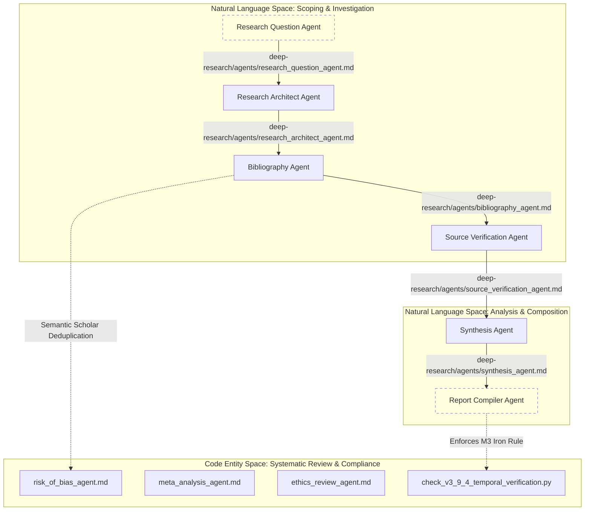
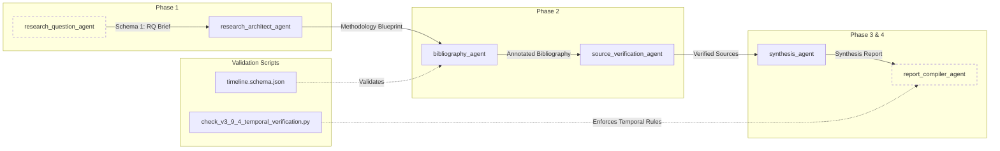

<!-- source: DeepWiki mcp.deepwiki.com · repo Imbad0202/academic-research-skills · page 3.5 Deep Research Agent Team · fetched 2026-10-30 -->

# Deep Research Agent Team

Relevant source files

The following files were used as context for generating this wiki page:

- [academic-paper/agents/abstract_bilingual_agent.md](academic-paper/agents/abstract_bilingual_agent.md)
- [academic-paper/agents/citation_compliance_agent.md](academic-paper/agents/citation_compliance_agent.md)
- [academic-paper/agents/draft_writer_agent.md](academic-paper/agents/draft_writer_agent.md)
- [academic-paper/agents/formatter_agent.md](academic-paper/agents/formatter_agent.md)
- [academic-paper/agents/literature_strategist_agent.md](academic-paper/agents/literature_strategist_agent.md)
- [academic-paper/agents/structure_architect_agent.md](academic-paper/agents/structure_architect_agent.md)
- [agents/report_compiler_agent.md](agents/report_compiler_agent.md)
- [agents/research_architect_agent.md](agents/research_architect_agent.md)
- [agents/synthesis_agent.md](agents/synthesis_agent.md)
- [deep-research/agents/bibliography_agent.md](deep-research/agents/bibliography_agent.md)
- [deep-research/agents/editor_in_chief_agent.md](deep-research/agents/editor_in_chief_agent.md)
- [deep-research/agents/ethics_review_agent.md](deep-research/agents/ethics_review_agent.md)
- [deep-research/agents/meta_analysis_agent.md](deep-research/agents/meta_analysis_agent.md)
- [deep-research/agents/report_compiler_agent.md](deep-research/agents/report_compiler_agent.md)
- [deep-research/agents/research_architect_agent.md](deep-research/agents/research_architect_agent.md)
- [deep-research/agents/research_question_agent.md](deep-research/agents/research_question_agent.md)
- [deep-research/agents/risk_of_bias_agent.md](deep-research/agents/risk_of_bias_agent.md)
- [deep-research/agents/source_verification_agent.md](deep-research/agents/source_verification_agent.md)
- [deep-research/agents/synthesis_agent.md](deep-research/agents/synthesis_agent.md)
- [scripts/check_v3_9_4_temporal_verification.py](scripts/check_v3_9_4_temporal_verification.py)

This page provides full technical documentation for the deep-research agent team within the Academic Research Skills (ARS) system. It details the role definitions, phase boundaries, implementation files, specialized protocols, and data flows for the core and systematic review agents: `research_question_agent`, `research_architect_agent`, `bibliography_agent`, `synthesis_agent`, `report_compiler_agent`, `source_verification_agent`, `ethics_review_agent`, `risk_of_bias_agent`, and `meta_analysis_agent`.

Sources: [deep-research/agents/research_question_agent.md:1](), [deep-research/agents/bibliography_agent.md:1](), [deep-research/agents/synthesis_agent.md:1]()

---

## Agent Architecture and Code Entity Mapping

The deep-research agents operate across six orchestration phases (SCOPING, INVESTIGATION, ANALYSIS, COMPOSITION, REVIEW, and REVISION). Each agent is bound to strict single-phase boundaries enforced by prompt-level fences and pipeline verifiers.

Diagram: Deep Research Agent Code Entity Mapping

Sources: [deep-research/agents/research_question_agent.md:12-26](), [deep-research/agents/bibliography_agent.md:12-27](), [scripts/check_v3_9_4_temporal_verification.py:1-15]()

---

## Core Deep Research Agents

### 1. Research Question Agent (`research_question_agent`)
* **Implementation File**: `deep-research/agents/research_question_agent.md`
* **Active Phase**: Phase 1 (SCOPING) [deep-research/agents/research_question_agent.md:14]().
* **Role**: Transforms vague topics into precise, FINER-evaluated researchable questions [deep-research/agents/research_question_agent.md:10]().
* **Mechanics**: Evaluates candidate questions against Feasibility, Interest, Novelty, Ethics, and Relevance (FINER scale 1-5, requiring an average score $\ge 3.0$ with no single criterion below 2) [deep-research/agents/research_question_agent.md:31-45](). It emits explicit scope boundaries (population, timeframe, geography, domain) and sub-question bindings [deep-research/agents/research_question_agent.md:77-130]().

Sources: [deep-research/agents/research_question_agent.md:10-45]()

### 2. Research Architect Agent (`research_architect_agent`)
* **Implementation File**: `deep-research/agents/research_architect_agent.md`
* **Active Phase**: Phase 1 (SCOPING) [deep-research/agents/research_architect_agent.md:16]().
* **Role**: Designs the methodological blueprint, selecting research paradigms (Positivist, Interpretivist, Pragmatist, Critical), methods, data strategies, and analytical frameworks [deep-research/agents/research_architect_agent.md:10-77]().
* **Mechanics**: Includes mandatory human-subjects administrative planning and integration with institutional review boards via portable navigation rules [deep-research/agents/research_architect_agent.md:104-111]().

Sources: [deep-research/agents/research_architect_agent.md:10-111]()

### 3. Bibliography Agent (`bibliography_agent`)
* **Implementation File**: `deep-research/agents/bibliography_agent.md`
* **Active Phase**: Phase 2 (INVESTIGATION) [deep-research/agents/bibliography_agent.md:14]().
* **Role**: Conducts systematic, reproducible literature searches, applies inclusion/exclusion criteria, and generates annotated bibliographies in APA 7.0 format [deep-research/agents/bibliography_agent.md:10]().
* **Mechanics**: Executes Semantic Scholar deduplication to map source IDs and runs distributional skew analyses across time, geography, and methodology dimensions [deep-research/agents/bibliography_agent.md:90-126]().

Sources: [deep-research/agents/bibliography_agent.md:10-126]()

### 4. Source Verification Agent (`source_verification_agent`)
* **Implementation File**: `deep-research/agents/source_verification_agent.md`
* **Active Phase**: Phase 2 (INVESTIGATION).
* **Role**: Validates evidence quality, performs DOI verification, screens out predatory venues, and assigns evidence hierarchy grades (Levels I–VII).
* **Mechanics**: Operates as a strict gatekeeper ensuring all retrieved references meet evidentiary standards before downstream synthesis.

Sources: [deep-research/agents/bibliography_agent.md:20-25]()

### 5. Synthesis Agent (`synthesis_agent`)
* **Implementation File**: `deep-research/agents/synthesis_agent.md`
* **Active Phase**: Phase 3 (ANALYSIS) [deep-research/agents/synthesis_agent.md:16]().
* **Role**: Integrates findings across multiple sources, resolves evidence conflicts, and maps knowledge gaps [deep-research/agents/synthesis_agent.md:12]().
* **Mechanics**: Forbids sequential summarization ("Study A found X") in favor of thematic and framework synthesis [deep-research/agents/synthesis_agent.md:54-96](). Implements the Cross-Paper Tension Inventory to expose contradictions between source claims [deep-research/agents/synthesis_agent.md:110-126]().

Sources: [deep-research/agents/synthesis_agent.md:12-126]()

### 6. Report Compiler Agent (`report_compiler_agent`)
* **Implementation File**: `deep-research/agents/report_compiler_agent.md`
* **Active Phase**: Phase 4 (COMPOSITION) and Phase 6 (REVISION) [deep-research/agents/report_compiler_agent.md:11]().
* **Role**: Transforms research findings into polished APA 7.0 academic reports [deep-research/agents/report_compiler_agent.md:11]().
* **Mechanics**: Enforces Knowledge Isolation (prioritizing upstream artifacts over parametric memory) and the Temporal Integrity Iron Rule (M3) which requires arithmetic date verification for causal claims against `timeline.yaml` [deep-research/agents/report_compiler_agent.md:20-26, 103-144]().

Sources: [deep-research/agents/report_compiler_agent.md:11-144]()

### 7. Ethics Review Agent (`ethics_review_agent`)
* **Implementation File**: `deep-research/agents/ethics_review_agent.md`
* **Active Phase**: Phase 5 (REVIEW).
* **Role**: Validates AI disclosure compliance, human-subjects protection alignment, and attribution integrity.
* **Mechanics**: Reviews drafts against institutional and journal-specific ethical guidelines, flagging unaddressed conflicts or missing participant consent declarations.

Sources: [deep-research/agents/report_compiler_agent.md:10-15]()

---

## Systematic Review and Special Agents

### 8. Risk of Bias Agent (`risk_of_bias_agent`)
* **Active Mode**: Systematic Review.
* **Role**: Assesses study-level methodological bias using standardized instruments such as RoB 2 (for randomized trials) or ROBINS-I (for non-randomized studies).
* **Mechanics**: Structured evaluation across domains (e.g., confounding, selection, measurement deviations) to assign an overall bias tier.

Sources: [deep-research/agents/synthesis_agent.md:30-40]()

### 9. Meta Analysis Agent (`meta_analysis_agent`)
* **Active Mode**: Systematic Review.
* **Role**: Executes quantitative meta-analyses.
* **Mechanics**: Calculates pooled effect sizes, heterogeneity metrics ($I^2$), and generates forest plots from included empirical study data under strict statistical verification protocols.

Sources: [deep-research/agents/bibliography_agent.md:85-110]()

---

## Data Flow and Pipeline Integration

The agent team coordinates data production and consumption via serialized JSON schemas and YAML ledgers.

Diagram: Deep Research Data Flow Architecture

Sources: [scripts/check_v3_9_4_temporal_verification.py:4-15](), [deep-research/agents/bibliography_agent.md:12-25](), [deep-research/agents/report_compiler_agent.md:11-25]()

---

