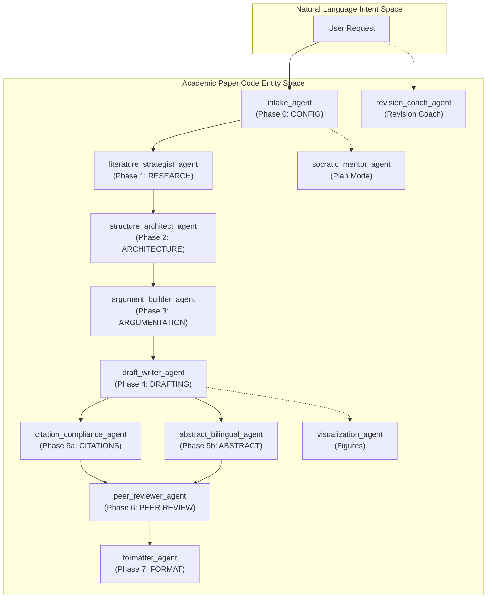
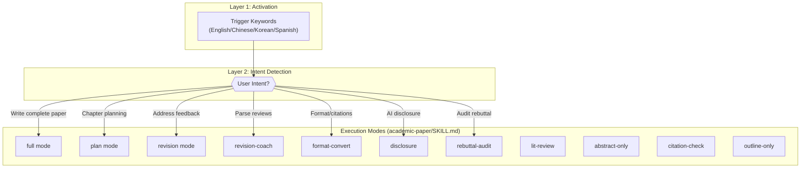

<!-- source: DeepWiki mcp.deepwiki.com · repo Imbad0202/academic-research-skills · page 4 Academic Paper Skill · fetched 2026-10-30 -->

# Academic Paper Skill

Relevant source files

The following files were used as context for generating this wiki page:

- [academic-paper-reviewer/SKILL.md](academic-paper-reviewer/SKILL.md)
- [academic-paper/SKILL.md](academic-paper/SKILL.md)
- [deep-research/SKILL.md](deep-research/SKILL.md)
- [docs/CONTROL_AVAILABILITY.md](docs/CONTROL_AVAILABILITY.md)
- [shared/references/routing_core.md](shared/references/routing_core.md)
- [tests/fixtures/issue_133_routing/CALIBRATION_LOG.md](tests/fixtures/issue_133_routing/CALIBRATION_LOG.md)
- [tests/fixtures/issue_133_routing/README.md](tests/fixtures/issue_133_routing/README.md)

The `academic-paper` skill (`academic-paper/SKILL.md:2`) is a 12-agent academic paper writing pipeline designed to transform research materials into publication-ready manuscripts. It supports 11 operational modes covering the full writing lifecycle—from Socratic chapter planning to multi-format output generation (Markdown, DOCX via Pandoc, LaTeX, PDF) with citation format conversion between APA 7.0, Chicago, MLA, IEEE, and Vancouver styles. The skill supports 6 paper structure types and produces bilingual abstracts in English and Traditional Chinese [academic-paper/SKILL.md:1-11]().

For details on specific modes, see [Writing Modes Overview](#4.1). For the execution workflow, see [Eight-Phase Orchestration Pipeline](#4.2). For peer review of completed papers, see [Academic Paper Reviewer Skill](#5).

**Sources**: [academic-paper/SKILL.md:1-11]()

---

## Agent Architecture and Team

The skill consists of 12 specialized agents distributed across its execution phases. Each agent fulfills a role-scoped contract within the pipeline architecture.

Diagram: Academic Paper Agent Ecosystem (Natural Language Space to Code Entity Space)

**Sources**: [academic-paper/SKILL.md:1-11]()

For a comprehensive breakdown of agent responsibilities, see [Academic Paper Agent Team](#4.7).

---

## Operational Modes

The skill supports 11 distinct modes [academic-paper/SKILL.md:2-3]. Mode selection relies on a two-layer routing architecture, utilizing bilingual trigger keywords for skill activation and intent signals for mode selection [academic-paper/SKILL.md:24-45].

Diagram: Mode Routing and Workflow Spectrum

**Sources**: [academic-paper/SKILL.md:2-3](), [academic-paper/SKILL.md:24-45]()

For detailed descriptions of all 11 modes, see [Writing Modes Overview](#4.1).

---

## Eight-Phase Orchestration Pipeline

The `academic-paper` skill executes an 8-phase pipeline enforcing strict phase boundaries and checkpoints [academic-paper/SKILL.md:47-67].

| Phase | Agent | Key Output |
|-------|-------|------------|
| 0: CONFIG | `intake_agent` | Paper Configuration Record [academic-paper/SKILL.md:59] |
| 1: RESEARCH | `literature_strategist_agent` | Annotated Bibliography [academic-paper/SKILL.md:60] |
| 2: ARCHITECTURE | `structure_architect_agent` | Detailed Outline [academic-paper/SKILL.md:61] |
| 3: ARGUMENTATION | `argument_builder_agent` | Claim-Evidence Chains [academic-paper/SKILL.md:62] |
| 4: DRAFTING | `draft_writer_agent` | Full Manuscript Draft [academic-paper/SKILL.md:63] |
| 5: CITATIONS/ABSTRACT | `citation_compliance_agent` / `abstract_bilingual_agent` | Verified Citations & Bilingual Abstract [academic-paper/SKILL.md:64] |
| 6: PEER REVIEW | `peer_reviewer_agent` | 5-Dimension Review Report [academic-paper/SKILL.md:65] |
| 7: FORMAT | `formatter_agent` | Final LaTeX/DOCX/PDF Package [academic-paper/SKILL.md:66] |

**Sources**: [academic-paper/SKILL.md:47-67]()

For deep technical details on phase boundary enforcement and pipeline flow, see [Eight-Phase Orchestration Pipeline](#4.2).

---

## Specialized Capabilities

### Plan Mode: Chapter-by-Chapter Guidance
Plan mode engages the `socratic_mentor_agent` to guide authors through thesis crystallization, structural outlining, and argument stress testing prior to draft generation. For details, see [Plan Mode: Chapter-by-Chapter Guidance](#4.3).

### Revision and Revision Coach
The `revision_coach_agent` parses external reviewer feedback into structured revision roadmaps, while `revision` mode manages diff-level patch discipline and R&R Traceability Matrices. For details, see [Revision and Revision Coach](#4.4).

### Format Conversion and Output Generation
The `formatter_agent` manages multi-format conversions, journal style adoptions, and verifies packages against the Cite-Time Provenance hard gate. For details, see [Format Conversion and Output Generation](#4.5).

### LaTeX and APA 7.0 Generation
The pipeline supports native LaTeX generation using the `apa7` document class, handling table widths, bilingual abstracts, `tectonic` compilation, and `xeCJK` font stacks. For technical specifications, see [LaTeX and APA 7.0 Generation](#4.6).

**Sources**: [academic-paper/SKILL.md:1-11]()

---

