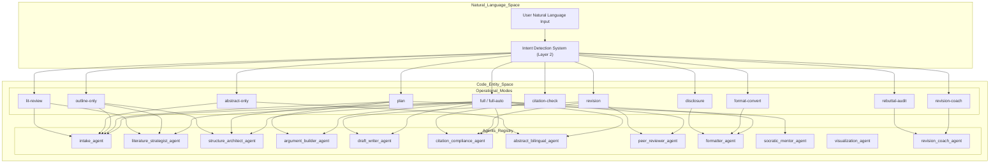
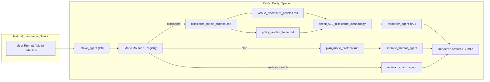

<!-- source: DeepWiki mcp.deepwiki.com · repo Imbad0202/academic-research-skills · page 4.1 Writing Modes Overview · fetched 2026-10-30 -->

# Writing Modes Overview

Relevant source files

The following files were used as context for generating this wiki page:

- [academic-paper/references/disclosure_mode_protocol.md](academic-paper/references/disclosure_mode_protocol.md)
- [academic-paper/references/mode_selection_guide.md](academic-paper/references/mode_selection_guide.md)
- [academic-paper/references/policy_anchor_disclosure_protocol.md](academic-paper/references/policy_anchor_disclosure_protocol.md)
- [academic-paper/references/venue_disclosure_policies.md](academic-paper/references/venue_disclosure_policies.md)
- [audits/external-contribution-audit-prompt.md](audits/external-contribution-audit-prompt.md)
- [deep-research/references/mode_selection_guide.md](deep-research/references/mode_selection_guide.md)
- [scripts/check_619_disclosure_closeout.py](scripts/check_619_disclosure_closeout.py)
- [scripts/test_check_619_disclosure_closeout.py](scripts/test_check_619_disclosure_closeout.py)

## Purpose and Scope

This page provides full technical documentation for the operational modes of the `academic-paper` skill. The skill supports twelve specialized writing and verification modes—`plan`, `full`, `revision`, `revision-coach`, `abstract-only`, `lit-review`, `format-convert`, `citation-check`, `disclosure`, `rebuttal-audit`, `outline-only`, and `writing-polish`—alongside an integrated AI-usage disclosure policy database (v2) covering 15 core venues and medical-publishing frameworks (ICLR, NeurIPS, Nature, Science, ACL, EMNLP, ICMJE, BMJ, JAMA, The Lancet, NEJM, PLOS, Frontiers, Chinese Nursing Journals Publishing House 中华护理杂志社, and International Eye Science 国际眼科杂志).

Sources: [academic-paper/SKILL.md:1-14](), [academic-paper/references/venue_disclosure_policies.md:1-16]()

---

## Mode Architecture and Agent Mapping

The `academic-paper` skill implements a mode-based activation architecture where user intent maps to specific workflow configurations, activating subsets of the 12-agent team.

Diagram 1 bridges Natural Language Space to Code Entity Space, mapping natural language prompts to code-level agent definitions and protocol files.

**Implementation Details:**
- **Agent Specialization**: `revision_coach_agent` parses unstructured reviewer comments into a structured "Revision Roadmap" [academic-paper/SKILL.md:102]().
- **Socratic Integration**: `socratic_mentor_agent` drives `plan` mode dialogues using a specialized question taxonomy [academic-paper/SKILL.md:100]().
- **Disclosure Routing**: `disclosure` mode invokes `formatter_agent` [academic-paper/SKILL.md:99]() guided by `disclosure_mode_protocol.md`.

Sources: [academic-paper/SKILL.md:87-103](), [academic-paper/references/disclosure_mode_protocol.md:5-18]()

---

## Comprehensive Mode Inventory

The `academic-paper` skill exposes twelve distinct operational modes tailored to different stages of academic production.

| Mode Name | Purpose | Key Activated Agents | Expected Output |
| :--- | :--- | :--- | :--- |
| `full` | Complete research-to-paper generation from scratch | All 9 core agents + formatting | Full APA 7.0 manuscript + bilingual abstract + review report [academic-paper/references/mode_selection_guide.md:42-55]() |
| `plan` | Socratic chapter-by-chapter guided planning | `intake_agent`, `socratic_mentor_agent`, `structure_architect_agent`, `argument_builder_agent` | Chapter Plan + INSIGHT Collection [academic-paper/references/mode_selection_guide.md:76-93]() |
| `revision` | Revise an existing draft using peer feedback | `peer_reviewer_agent`, `draft_writer_agent`, `citation_compliance_agent` | Revised paper + change log [academic-paper/references/mode_selection_guide.md:100-114]() |
| `revision-coach` | Triage reviewer comments into a roadmap | `revision_coach_agent` | Revision Roadmap & Response Letter Skeleton [academic-paper/references/mode_selection_guide.md:186-191]() |
| `outline-only` | Generate structural outline quickly | `intake_agent`, `literature_strategist_agent`, `structure_architect_agent` | Detailed outline + word count estimates [academic-paper/references/mode_selection_guide.md:59-73]() |
| `abstract-only` | Produce bilingual abstracts and keywords | `intake_agent`, `abstract_bilingual_agent` | Bilingual abstract (e.g., zh-TW + EN) [academic-paper/references/mode_selection_guide.md:119-132]() |
| `lit-review` | Literature matrix and synthesis analysis | `intake_agent`, `literature_strategist_agent` | Annotated bibliography + matrix [academic-paper/references/mode_selection_guide.md:135-149]() |
| `citation-check` | Validate and fix bibliographic citations | `citation_compliance_agent` | Citation error report + auto-fixes [academic-paper/references/mode_selection_guide.md:169-183]() |
| `format-convert` | Convert Markdown to LaTeX, DOCX, or PDF | `formatter_agent` | Formatted output document [academic-paper/references/mode_selection_guide.md:152-166]() |
| `disclosure` | Generate venue-specific AI-usage statements | `formatter_agent` + protocol files | Venue AI-usage disclosure bundle [academic-paper/references/disclosure_mode_protocol.md:1-18]() |
| `rebuttal-audit` | Audit and refine existing rebuttal drafts | `revision_coach_agent` + verification | Audited response letter & trace matrix [academic-paper/references/mode_selection_guide.md:32]() |

Sources: [academic-paper/references/mode_selection_guide.md:40-191](), [academic-paper/references/disclosure_mode_protocol.md:1-18]()

---

## AI Disclosure Mode and Venue Policy Database

The `disclosure` mode is a fidelity-heavy mode designed to generate AI-usage disclosures compliant with specific journals or policy frameworks [academic-paper/references/disclosure_mode_protocol.md:1-7].

### Two Parallel Tracks
1. **Venue Track (`--venue=<v>`)**: Looks up policies in `venue_disclosure_policies.md` [academic-paper/references/disclosure_mode_protocol.md:12-16](). Supports 15 targets as of v2: ICLR, NeurIPS, Nature, Science, ACL, EMNLP, ICMJE, NEJM, The Lancet, JAMA, BMJ, PLOS, Frontiers, Chinese Nursing Journals Publishing House 中华护理杂志社, and International Eye Science 国际眼科杂志 [academic-paper/references/venue_disclosure_policies.md:1-4]().
2. **Policy Anchor Track (`--policy-anchor=<a>`)**: Targets broader frameworks (`prisma-trAIce`, `icmje`, `nature`, `ieee`) using `policy_anchor_table.md` [academic-paper/references/disclosure_mode_protocol.md:17]().

### Conflict Resolution & Invariants
- **Selector Exclusivity**: Supplying both `--venue` and `--policy-anchor` is rejected unless it is a consistent pair (e.g., `--venue=Nature` + `--policy-anchor=nature`) [academic-paper/references/disclosure_mode_protocol.md:19-25]().
- **Auto-Promotion Forbiddance**: Categories marked `UNCERTAIN` must never be silently promoted to `USED` [scripts/policy_anchor_disclosure_referee.py:76-79]().

Sources: [academic-paper/references/disclosure_mode_protocol.md:1-58](), [academic-paper/references/venue_disclosure_policies.md:1-57](), [academic-paper/references/policy_anchor_disclosure_protocol.md:1-30]()

---

## Technical Data Flow: Mode Execution

Diagram 2 illustrates the execution and data flow from natural language user input, through routing logic and protocol validation, to final rendering.

**Implementation Guards in Validation Scripts:**
- `check_619_disclosure_closeout.py` enforces fail-closed checks on Frontiers action matrices and venue policy structures [scripts/check_619_disclosure_closeout.py:1-40]().
- Missing required fields or malformed action tables cause immediate pipeline halts rather than silent fallbacks.

Sources: [scripts/check_619_disclosure_closeout.py:1-40](), [academic-paper/references/disclosure_mode_protocol.md:10-28]()

---

