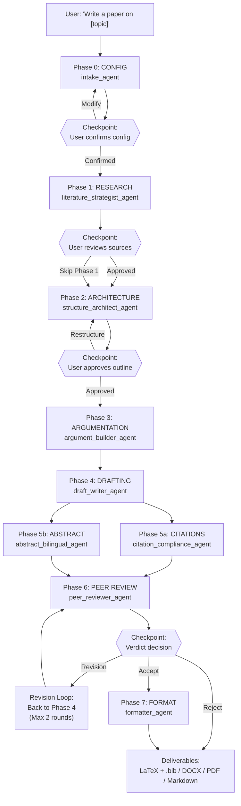
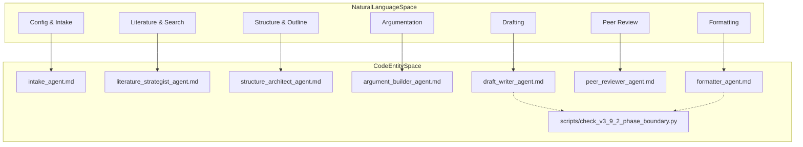

<!-- source: DeepWiki mcp.deepwiki.com · repo Imbad0202/academic-research-skills · page 4.2 Eight-Phase Orchestration Pipeline · fetched 2026-10-30 -->

# Eight-Phase Orchestration Pipeline

Relevant source files

The following files were used as context for generating this wiki page:

- [academic-paper-reviewer/templates/editorial_decision_template.md](academic-paper-reviewer/templates/editorial_decision_template.md)
- [academic-paper/agents/draft_writer_agent.md](academic-paper/agents/draft_writer_agent.md)
- [academic-paper/agents/formatter_agent.md](academic-paper/agents/formatter_agent.md)
- [academic-paper/references/workflow_phase_details.md](academic-paper/references/workflow_phase_details.md)
- [academic-paper/references/writing_quality_check.md](academic-paper/references/writing_quality_check.md)
- [agents/report_compiler_agent.md](agents/report_compiler_agent.md)
- [agents/research_architect_agent.md](agents/research_architect_agent.md)
- [agents/synthesis_agent.md](agents/synthesis_agent.md)
- [deep-research/agents/ethics_review_agent.md](deep-research/agents/ethics_review_agent.md)
- [deep-research/agents/report_compiler_agent.md](deep-research/agents/report_compiler_agent.md)
- [deep-research/agents/research_architect_agent.md](deep-research/agents/research_architect_agent.md)
- [deep-research/agents/synthesis_agent.md](deep-research/agents/synthesis_agent.md)
- [scripts/check_acronyms.py](scripts/check_acronyms.py)
- [scripts/check_degradation_registry.py](scripts/check_degradation_registry.py)
- [scripts/check_v3_9_2_phase_boundary.py](scripts/check_v3_9_2_phase_boundary.py)
- [scripts/test_check_acronyms.py](scripts/test_check_acronyms.py)
- [scripts/test_check_v3_9_2_phase_boundary.py](scripts/test_check_v3_9_2_phase_boundary.py)
- [shared/contracts/degradation_registry.json](shared/contracts/degradation_registry.json)

## Purpose and Scope

This document describes the **eight-phase orchestration pipeline** that governs the `academic-paper` skill's `full` mode execution. This pipeline transforms a research topic into a complete, publication-ready academic paper through sequential agent coordination, strict phase boundary enforcement, and user checkpoints.

**Scope**: This page covers the Phase 0 through Phase 7 workflow, agent dispatch logic, checkpoint rules, phase boundary security (v3.9.2), and parallel execution patterns. For information about:
- The six-phase research workflow in `deep-research`, see [Six-Phase Orchestration Workflow](#3.2)
- The ten-stage full pipeline that orchestrates multiple skills, see [Pipeline Stages Reference](#2.1)
- Individual agent implementation details, see [Academic Paper Agent Team](#4.7)
- Operational mode selection, see [Writing Modes Overview](#4.1)

Sources: [academic-paper/SKILL.md:115-207](), [academic-paper/agents/pipeline_orchestrator_agent.md:6-30]()

---

## Pipeline Architecture Overview

The eight-phase pipeline follows a **sequential execution model** with mandatory user checkpoints and strict code-entity enforcement. Phases 5a and 5b execute in parallel. The pipeline is stateful, consuming structured records across agent boundaries.

### Phase Execution Flow Diagram

Sources: [academic-paper/SKILL.md:37-46](), [academic-paper/agents/pipeline_orchestrator_agent.md:100-112]()

---

## Phase Boundary and Write-Scope Enforcement (v3.9.2)

Each agent in the pipeline is bound to a single phase and specific write-scope restrictions enforced by prompt-level fences and advisory verifiers (`scripts/check_pipeline_integrity.py` and `scripts/check_v3_9_2_phase_boundary.py`) [academic-paper/agents/draft_writer_agent.md:12-27](), [academic-paper/agents/formatter_agent.md:12-27]():

1. **Single-Phase Scope**: Agents must not write files in `phase{M}_*/` directories where $M \neq \text{assigned phase}$ (no inflate or regress) [academic-paper/agents/draft_writer_agent.md:16-17](), [academic-paper/agents/formatter_agent.md:16-17]().
2. **Deliverable Isolation**: Agents must not produce content classified as downstream or upstream deliverable types [academic-paper/agents/draft_writer_agent.md:18-20](), [academic-paper/agents/formatter_agent.md:16-20]().
3. **PreToolUse Write-Scope Guard**: When running as a separately dispatched subagent under the plugin install, write actions are strictly bounded by `scripts/ars_write_scope_guard.py` [academic-paper/agents/draft_writer_agent.md:26](), [academic-paper/agents/formatter_agent.md:26]().

Sources: [academic-paper/agents/draft_writer_agent.md:12-27](), [academic-paper/agents/formatter_agent.md:12-27]()

---

## Phase 0: CONFIG (Interactive Configuration)

**Code Entity**: `intake_agent`  
**Mode**: Interactive configuration interview  
**Exit Condition**: User confirms Paper Configuration Record

Phase 0 establishes structural and formatting parameters through a configuration interview managed by `intake_agent`:
1. **Material Handoff Detection**: Automatically detects upstream materials via the `Material Passport` [academic-paper/agents/intake_agent.md:23-59]().
2. **Paper Type Selection**: IMRaD, Literature Review, Theoretical, Case Study, Policy Brief [academic-paper/agents/intake_agent.md:117-130]().
3. **Citation Format**: APA 7th (default), Chicago, MLA, IEEE, Vancouver [academic-paper/agents/intake_agent.md:136-145]().
4. **Style Calibration**: Extracts dimensions from user samples [academic-paper/agents/intake_agent.md:184-194]().

### Checkpoint Rule
**Type**: MANDATORY — User must explicitly confirm parameters before progression [academic-paper/agents/intake_agent.md:11-18]().

Sources: [academic-paper/SKILL.md:91](), [academic-paper/agents/intake_agent.md:6-200]()

---

## Phase 1: RESEARCH (Literature Search and Synthesis)

**Code Entity**: `literature_strategist_agent`  
**Inputs**: Paper Configuration Record, research topic  
**Outputs**: Search Strategy, Annotated Bibliography, Literature Matrix

Phase 1 executes systematic literature search and screening, producing structured bibliographies [shared/handoff_schemas.md:77-80](). It can be skipped if pre-existing literature corpora or passport materials are detected [academic-paper/agents/intake_agent.md:37-59]().

Sources: [academic-paper/SKILL.md:92](), [shared/handoff_schemas.md:77-115]()

---

## Phase 2: ARCHITECTURE (Structure and Outline Design)

**Code Entity**: `structure_architect_agent`  
**Inputs**: Paper Configuration Record, Annotated Bibliography  
**Outputs**: Paper Outline, Word Count Allocation, Evidence-to-Section Map

Phase 2 selects the structural template and allocates word counts across sections.

### Checkpoint Rule
**Type**: MANDATORY — User approval required before Phase 3 [academic-paper/SKILL.md:40]().

Sources: [academic-paper/SKILL.md:93](), [academic-paper/agents/draft_writer_agent.md:43]()

---

## Phase 3: ARGUMENTATION (Claim-Evidence Chain Construction)

**Code Entity**: `argument_builder_agent`  
**Inputs**: Paper Outline, Evidence-to-Section Map  
**Outputs**: Argument Blueprint, Logical Flow Diagram

Phase 3 constructs the argumentative skeleton using Claim-Evidence-Reasoning (CER) chains to verify logical coherence prior to prose drafting [academic-paper/agents/draft_writer_agent.md:44]().

Sources: [academic-paper/SKILL.md:94](), [academic-paper/agents/draft_writer_agent.md:28-29]()

---

## Phase 4: DRAFTING (Section-by-Section Writing)

**Code Entity**: `draft_writer_agent`  
**Inputs**: Paper Outline, Argument Blueprint, Annotated Bibliography  
**Outputs**: Complete Draft

Phase 4 executes full-text drafting section-by-section under strict phase-boundary controls [academic-paper/agents/draft_writer_agent.md:6-155]():
- **Style Calibration**: Applies style profile traits while prioritizing discipline norms [academic-paper/agents/draft_writer_agent.md:61]().
- **Knowledge Isolation**: Enforces the anti-leakage directive to rely on upstream annotated sources over model memory [academic-paper/agents/draft_writer_agent.md:49]().
- **Writing Quality Check**: Sweeps prose against high-frequency AI terminology, em dash constraints, and burstiness metrics [academic-paper/agents/draft_writer_agent.md:70-74]().

Sources: [academic-paper/agents/draft_writer_agent.md:6-155](), [academic-paper/SKILL.md:20-23]()

---

## Phase 5: CITATIONS + ABSTRACT (Parallel Execution)

### Phase 5a: Citation Compliance
**Code Entity**: `citation_compliance_agent`  
Performs cross-checks between in-text citations and reference lists, eliminating orphans and aligning formats [academic-paper/SKILL.md:96]().

### Phase 5b: Bilingual Abstract
**Code Entity**: `abstract_bilingual_agent`  
Generates synchronized English and Traditional Chinese abstracts with keyword tags [academic-paper/SKILL.md:97]().

Sources: [academic-paper/SKILL.md:173-188](), [academic-paper/agents/draft_writer_agent.md:19]()

---

## Phase 6: PEER REVIEW (Simulated Review & Generator-Evaluator Contract)

**Code Entity**: `peer_reviewer_agent`, `editorial_synthesizer_agent`  
**Inputs**: Complete Draft  
**Outputs**: Review Report, Revision Instructions, Editorial Decision

Phase 6 simulates a 5-person peer review panel (EIC, 3 Peer Reviewers, Devil's Advocate) [academic-paper-reviewer/SKILL.md:15-22](). 

### Generator-Evaluator Contract & Revision Loops
To prevent sycophancy drift, the panel operates under strict separation between generation and evaluation roles. Revisions are structured via the `revision_coach_agent` into a `Revision Roadmap` and looped back to `draft_writer_agent` (maximum 2 rounds) [academic-paper/agents/draft_writer_agent.md:10-14]().

Sources: [academic-paper/SKILL.md:98](), [academic-paper-reviewer/agents/editorial_synthesizer_agent.md:6-70]()

---

## Phase 7: FORMAT (Output Generation and Formatting)

**Code Entity**: `formatter_agent`  
**Inputs**: Final Draft, Paper Configuration Record  
**Outputs**: Formatted Manuscript, Cover Letter, AI Disclosure [academic-paper/agents/formatter_agent.md:10-14]()

The `formatter_agent` converts output into LaTeX, DOCX, or Markdown formats while preserving format fidelity [academic-paper/agents/formatter_agent.md:60-118](). It enforces the **Cite-Time Provenance Hard Gate** to block unverified citations and handles specialized XeCJK/APA7 compilation stacks [academic-paper/SKILL.md:106-207]().

Sources: [academic-paper/agents/formatter_agent.md:6-180](), [academic-paper/SKILL.md:99]()

---

## Code Entity Space Integration

The following diagram associates the natural language pipeline phases directly with their implementing code entities (agents and verification scripts).

Sources: [academic-paper/SKILL.md:89-102](), [academic-paper/agents/draft_writer_agent.md:12-27](), [academic-paper/agents/formatter_agent.md:12-27]()

---

