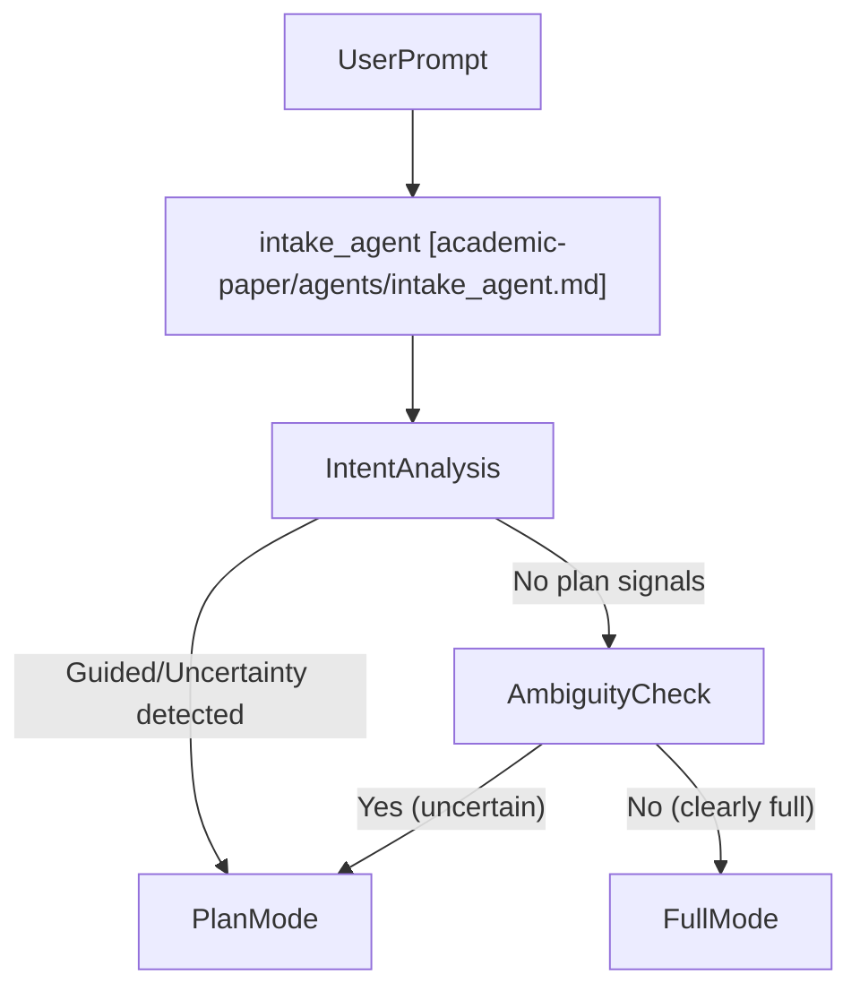
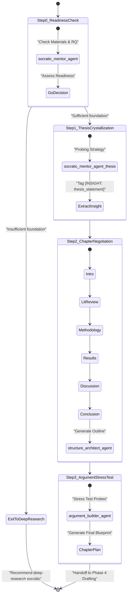
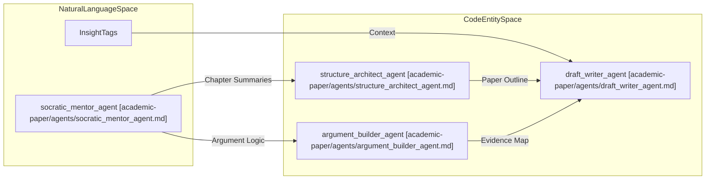

<!-- source: DeepWiki mcp.deepwiki.com · repo Imbad0202/academic-research-skills · page 4.3 Plan Mode: Chapter-by-Chapter Guidance · fetched 2026-10-30 -->

# Plan Mode: Chapter-by-Chapter Guidance

Relevant source files

The following files were used as context for generating this wiki page:

- [academic-paper/agents/socratic_mentor_agent.md](academic-paper/agents/socratic_mentor_agent.md)
- [academic-paper/references/academic_writing_style.md](academic-paper/references/academic_writing_style.md)
- [deep-research/agents/socratic_mentor_agent.md](deep-research/agents/socratic_mentor_agent.md)
- [docs/design/2026-06-18-socratic-adjacent-framing-probe-spec.md](docs/design/2026-06-18-socratic-adjacent-framing-probe-spec.md)
- [evals/heldout/within_session_ideation_diversity/codebook.md](evals/heldout/within_session_ideation_diversity/codebook.md)
- [evals/heldout/within_session_ideation_diversity/heldout_set.json](evals/heldout/within_session_ideation_diversity/heldout_set.json)
- [evals/heldout/within_session_ideation_diversity/heldout_set.schema.json](evals/heldout/within_session_ideation_diversity/heldout_set.schema.json)
- [evals/heldout/within_session_ideation_diversity/nonproduction_variant.json](evals/heldout/within_session_ideation_diversity/nonproduction_variant.json)
- [scripts/test_adjacent_framing_probe_lint.py](scripts/test_adjacent_framing_probe_lint.py)
- [scripts/test_reading_probe_lint.py](scripts/test_reading_probe_lint.py)
- [scripts/test_validate_ideation_diversity_assets.py](scripts/test_validate_ideation_diversity_assets.py)

## Purpose and Scope

Plan mode is a Socratic dialogue-based workflow in the `academic-paper` skill that guides users through chapter-by-chapter paper planning before any writing occurs. Instead of directly producing a draft, `plan` mode uses `socratic_mentor_agent` to help users crystallize their thesis, structure their arguments, and map evidence to chapters through iterative questioning.

This mode is designed for users who need structured guidance to think through their paper's logic and organization, particularly first-time paper writers or researchers who have data but are uncertain how to transform it into a coherent narrative.

**Key distinction**: Plan mode does **not** write content—it produces a Chapter Plan that can then be fed into `full` mode for actual drafting. The output is a structured blueprint, not a paper draft.

Sources: [academic-paper/SKILL.md:59-103](), [academic-paper/agents/socratic_mentor_agent.md:8-16]()

---

## Mode Activation: Intent-Based Detection

### Activation Mechanism

Plan mode uses **intent-based activation**, meaning the system detects the user's underlying need rather than matching exact keywords. This approach is language-agnostic and works regardless of the user's language.

The intake logic evaluates whether any of the following **intent signals** are present:

| Intent Signal | Description |
|---------------|-------------|
| Guided thinking | User asks to be "led", "guided", or "mentored" |
| Uncertainty | User expresses uncertainty about paper structure or where to start |
| Brainstorming | User wants to explore or clarify a research direction |
| Vague Interest | User describes an interest without a specific, answerable question |

**Default rule**: When the user's intent is ambiguous between `plan` and `full` mode, the system **prefers `plan`** mode. Rationale: it is safer to guide a user who might need help than to produce a complete paper they cannot use.

Sources: [academic-paper/SKILL.md:59-63](), [deep-research/SKILL.md:59-71]()

### Activation Logic Diagram

Title: "Plan Mode Intent Activation Flow"

Sources: [academic-paper/SKILL.md:59-63](), [deep-research/SKILL.md:59-71]()

---

## Workflow Overview: Four-Step Process

Plan mode executes in **4 sequential steps**, primarily driven by `socratic_mentor_agent` [academic-paper/agents/socratic_mentor_agent.md:1-10]():

| Step | Name | Primary Agent | Purpose |
|------|------|---------------|---------|
| 0 | Research Readiness Check | `socratic_mentor_agent` [academic-paper/agents/socratic_mentor_agent.md:1-10]() | Verify user has sufficient research foundation |
| 1 | Thesis Crystallization | `socratic_mentor_agent` [academic-paper/agents/socratic_mentor_agent.md:1-10]() | Extract and refine the paper's core argument |
| 2 | Chapter Negotiation | `socratic_mentor_agent` [academic-paper/agents/socratic_mentor_agent.md:1-10]() | Define purpose and content of each chapter |
| 3 | Argument Stress Test | `argument_builder_agent` [academic-paper/agents/argument_builder_agent.md:1-10]() | Probe evidence chains and logical vulnerabilities |

Sources: [academic-paper/agents/socratic_mentor_agent.md:77-110](), [academic-paper/SKILL.md:87-103]()

### State Machine Diagram

Title: "Plan Mode Workflow State Machine"

Sources: [academic-paper/agents/socratic_mentor_agent.md:77-110](), [academic-paper/SKILL.md:87-103]()

---

## Step 0: Research Readiness Check

The `socratic_mentor_agent` [academic-paper/agents/socratic_mentor_agent.md:1-10]() verifies research foundation using three mandatory questions:
1. "What research materials do you currently have? (literature, data, analysis results)"
2. "Is your research question finalized? Can you state it clearly in one sentence?"
3. "Have you done a systematic literature search?"

If the user has nothing, the agent issues a **Deep Research Referral** to run `deep-research` in Socratic mode first.

Sources: [academic-paper/agents/socratic_mentor_agent.md:77-88]()

---

## Step 1: Thesis Crystallization

The agent uses a 3-round probing strategy to move from vague ideas to a specific thesis:
*   **Round 1**: "What is your paper arguing? State it in one sentence."
*   **Round 2 (Stress Test)**: "How would someone who disagrees with you respond?"
*   **Round 3 (Refinement)**: "What is the scope of applicability for your argument?"

Key decisions are captured using the `[INSIGHT: thesis_statement]` tag to ensure they persist through the pipeline.

Sources: [academic-paper/agents/socratic_mentor_agent.md:10-25](), [deep-research/agents/socratic_mentor_agent.md:10-24]()

---

## Step 2: Chapter-by-Chapter Negotiation

The agent negotiates each chapter (Intro, Lit Review, Method, Results, Discussion, Conclusion) with a focus on writing strategy.

### Chapter-Level Commitment Gates (SCR Protocol)
Before questions begin for a chapter, the user must provide a commitment (prediction) via the SCR (State-Challenge-Reflect) loop defined in `academic-paper/agents/socratic_mentor_agent.md:68-83]`:
*   **Methodology**: "If you were a reviewer, what would be your first criticism of your method?"
*   **Results**: "Which of your findings do you think is strongest? Which is weakest?"

The agent then uses **Challenge via Chapter Progression** to reveal gaps between the user's commitment and the actual logical requirements of the chapter.

Sources: [academic-paper/agents/socratic_mentor_agent.md:68-83](), [academic-paper/agents/socratic_mentor_agent.md:17-25]()

---

## Step 3: Argument Stress Test

Handled by `argument_builder_agent` [academic-paper/agents/argument_builder_agent.md:1-10](), this step probes the logical integrity of the plan:
1.  **Claim-Evidence Chains**: Validating that every claim has mapped data/literature.
2.  **Counter-Argument Handling**: Ensuring the paper addresses opposing views.
3.  **Logical Flow**: Checking the transitions between negotiated chapters.

Sources: [academic-paper/SKILL.md:37-41](), [academic-paper/SKILL.md:94]()

---

## Wording-Pattern Advisory (Kong #257)

During Plan Mode, `socratic_mentor_agent` [academic-paper/agents/socratic_mentor_agent.md:26-66]() monitors for "AI-typical" phrasing that lacks disciplinary specificity. If a user proposes a thesis or RQ using generic frames, the agent triggers a **Wording-Pattern Advisory**.

| ID | Pattern Family | Common Surface Form |
|----|----------------|---------------------|
| WP01 | impact/effect frame | "exploring the impact/effect of X on Y" |
| WP02 | relationship frame | "investigating the relationship between A and B" |
| WP05 | generic factors frame | "exploring factors influencing Y" |

The advisory prompts the user to replace generic connectives with field-specific mechanisms or tensions.

Sources: [academic-paper/agents/socratic_mentor_agent.md:26-66]()

---

## Output and Handoff

The final output of Plan Mode is the **INSIGHT Collection** and a **Chapter Plan**. This plan is consumed by `structure_architect_agent` [academic-paper/agents/structure_architect_agent.md:1-10]() to create the final paper outline and then by `draft_writer_agent` [academic-paper/agents/draft_writer_agent.md:1-10]() for Phase 4 drafting.

Title: "Plan Mode to Code Entity Handoff"

Sources: [academic-paper/SKILL.md:87-103](), [academic-paper/agents/socratic_mentor_agent.md:23]()

---

