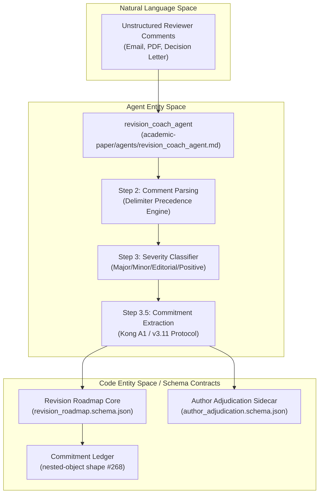
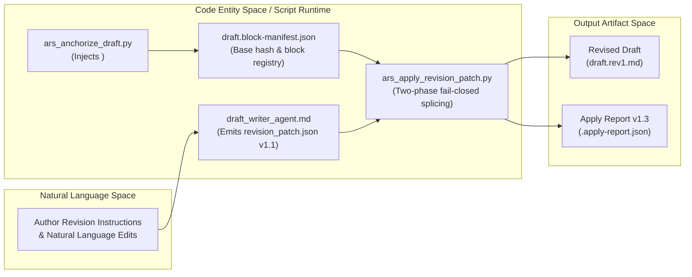

<!-- source: DeepWiki mcp.deepwiki.com · repo Imbad0202/academic-research-skills · page 4.4 Revision and Revision Coach · fetched 2026-10-30 -->

# Revision and Revision Coach

<details>
<summary>Relevant source files</summary>

The following files were used as context for generating this wiki page:

- [academic-paper-reviewer/references/re_review_mode_protocol.md](academic-paper-reviewer/references/re_review_mode_protocol.md)
- [academic-paper/agents/revision_coach_agent.md](academic-paper/agents/revision_coach_agent.md)
- [academic-paper/examples/commitment_ledger_example.md](academic-paper/examples/commitment_ledger_example.md)
- [academic-paper/references/committee_correspondence_protocol.md](academic-paper/references/committee_correspondence_protocol.md)
- [academic-paper/references/revision_patch_protocol.md](academic-paper/references/revision_patch_protocol.md)
- [academic-paper/templates/revision_tracking_template.md](academic-paper/templates/revision_tracking_template.md)
- [academic-pipeline/references/two_stage_review_protocol.md](academic-pipeline/references/two_stage_review_protocol.md)
- [docs/design/2026-05-31-ars-268-schema11-nested-commitment-ledger-spec.md](docs/design/2026-05-31-ars-268-schema11-nested-commitment-ledger-spec.md)
- [docs/design/2026-06-10-390-diff-patch-revision-mode-spec.md](docs/design/2026-06-10-390-diff-patch-revision-mode-spec.md)
- [docs/design/2026-07-27-576-spec-b-re-review-precommitment-contract-spec.md](docs/design/2026-07-27-576-spec-b-re-review-precommitment-contract-spec.md)
- [evals/calibration/commitment_ledger_seed.yaml](evals/calibration/commitment_ledger_seed.yaml)
- [plugin-evals/03-iclr-rebuttal-en/graders/no-committee-branch.md](plugin-evals/03-iclr-rebuttal-en/graders/no-committee-branch.md)
- [plugin-evals/03-iclr-rebuttal-en/graders/no-fabrication.md](plugin-evals/03-iclr-rebuttal-en/graders/no-fabrication.md)
- [plugin-evals/03-iclr-rebuttal-en/graders/pushback-per-reviewer.md](plugin-evals/03-iclr-rebuttal-en/graders/pushback-per-reviewer.md)
- [plugin-evals/README.md](plugin-evals/README.md)
- [scripts/ars_apply_revision_patch.py](scripts/ars_apply_revision_patch.py)
- [scripts/check_268_nested_commitment_ledger.py](scripts/check_268_nested_commitment_ledger.py)
- [scripts/check_390_revision_patch_discipline.py](scripts/check_390_revision_patch_discipline.py)
- [scripts/check_670_revision_roadmap_integration.py](scripts/check_670_revision_roadmap_integration.py)
- [scripts/check_re_review_synthesis.py](scripts/check_re_review_synthesis.py)
- [scripts/test_ars_apply_revision_patch.py](scripts/test_ars_apply_revision_patch.py)
- [scripts/test_check_268_nested_commitment_ledger.py](scripts/test_check_268_nested_commitment_ledger.py)
- [scripts/test_check_390_revision_patch_discipline.py](scripts/test_check_390_revision_patch_discipline.py)
- [scripts/test_check_committee_correspondence.py](scripts/test_check_committee_correspondence.py)
- [scripts/test_check_re_review_synthesis.py](scripts/test_check_re_review_synthesis.py)
- [shared/contracts/re_review/input_manifest.schema.json](shared/contracts/re_review/input_manifest.schema.json)
- [shared/contracts/re_review/precommitment.schema.json](shared/contracts/re_review/precommitment.schema.json)
- [shared/contracts/re_review/traceability.schema.json](shared/contracts/re_review/traceability.schema.json)

</details>


**Purpose**: This page documents the comprehensive revision capabilities in the `academic-paper` skill: the `revision` mode for executing updates using the block-anchored patch protocol, the `revision_coach_agent` for transforming unstructured feedback into a structured Commitment Ledger, the committee-correspondence variant, the R&R Traceability Matrix, and the three-gate re-review verification contract.

**Scope**: Explores the implementation, parsing logic, patch application scripts (`[scripts/ars_apply_revision_patch.py:1-60]()`, `[scripts/revision_roadmap.py:1-50]()`), data flow, and verification protocols governing revision workflows.

Sources: [academic-paper/SKILL.md:1-14](), [academic-paper/agents/revision_coach_agent.md:6-12]()

---

## 1. Revision Coach Agent and Unstructured Comment Parsing

The `revision_coach_agent` (`[academic-paper/agents/revision_coach_agent.md:1-129]()`) acts as the entry point for unstructured feedback. It parses raw input from email text, pasted PDFs, bullet lists, or free-form review paragraphs into a source-accounted Revision Roadmap core, isolating author adjudication into a hash-bound sidecar.

### Natural Language Space to Code Entity Space: Revision Coaching Pipeline



**Diagram 1: Natural Language to Code Entity Mapping in Revision Coaching**

Sources: [academic-paper/agents/revision_coach_agent.md:22-110](), [academic-paper/templates/revision_tracking_template.md:35-37]()

### Committee-Correspondence Variant (#668)

When users supply real committee or institutional review office documentation rather than peer review, the orchestrator invokes the committee-correspondence variant via `[academic-paper/references/committee_correspondence_protocol.md]()` (`[academic-paper/agents/revision_coach_agent.md:55-70]()`). This branch operates under strict constraints:
- It uses the `committee-correspondence/1.0` concern tracker, preserving raw letter structures.
- It never emits Schema 11 peer-review metadata, reviewer severity/obligation classes, or claims of resolution/authorization (`[academic-paper/agents/revision_coach_agent.md:64-70]()`).
- It applies the instruction-data boundary (`[shared/ground_truth_isolation_pattern.md]()`), treating external text as data rather than directives (`[academic-paper/agents/revision_coach_agent.md:22-44]()`).

Sources: [academic-paper/agents/revision_coach_agent.md:55-70](), [plugin-evals/README.md:1-35]()

---

## 2. Revision Patch Protocol and Diff Discipline (#390)

To avoid silent text distortion during revision rounds, ARS uses a deterministic block-anchored patch protocol (`[academic-paper/references/revision_patch_protocol.md:1-74](), [scripts/ars_apply_revision_patch.py:1-60]()`). 

### Natural Language Space to Code Entity Space: Patch Application



**Diagram 2: Patch Application Pipeline and Artifact Generation**

Sources: [academic-paper/references/revision_patch_protocol.md:11-27](), [scripts/ars_apply_revision_patch.py:1-58]()

### Execution Mechanics

1. **Anchoring**: `[scripts/ars_anchorize_draft.py]()` ensures every block is uniquely identified with `<!--block:BNNNN-->` markers and a corresponding block manifest (`[academic-paper/references/revision_patch_protocol.md:13-16]()`).
2. **Phase 1 Validation**: `[scripts/ars_apply_revision_patch.py:8-16]()` performs schema validation, verifies `base_draft_hash` against raw bytes, and ensures each block ID appears in at most one operation. Any mismatch rejects the patch (`Exit Code 2`) without modifying the file.
3. **Phase 2 Splicing**: The base byte stream is spliced at validated spans. Untouched marker lines and inter-block bytes are copied verbatim (`[scripts/ars_apply_revision_patch.py:17-24]()`).
4. **Structural Safeguards**: If the touched block ratio exceeds `--touched-ratio-threshold` (default `0.6`, `[scripts/ars_apply_revision_patch.py:25-33]()`) or modifies heading blocks without explicit acknowledgment (`--acknowledge-structural`), the script triggers a structural refusal (`Exit Code 3`).

Sources: [academic-paper/references/revision_patch_protocol.md:30-74](), [scripts/ars_apply_revision_patch.py:8-48]()

---

## 3. R&R Traceability Matrix and Commitment Ledger (Kong A1 / v3.11)

The R&R Traceability Matrix and Commitment Ledger establish lifecycle tracking for every reviewer concern (`[academic-paper/templates/revision_tracking_template.md:35-62]()`).

### Nested-Object Lifecycle Shape (#268)

To prevent index desynchronization between status cells and descriptions, commitments use a nested YAML block structure where fulfillment metadata resides directly within the commitment object (`[academic-paper/templates/revision_tracking_template.md:35-37]()`):

```yaml
- concern_id: <R1-1>
  commitment_extracted:
    - commitment_text: "<commitment text>"
      commitment_type: <add_experiment | add_analysis | add_clarification | add_citation | restructure | other>
      required_evidence_type: <new_section | new_figure | new_table | new_citation | methods_paragraph | discussion_paragraph | prose_edit | acknowledgment_only | other>
      fulfillment_status: <fulfilled | partial | not-fulfilled | explicitly-rejected-with-rationale>
      # unfulfilled_rationale: "..." required iff non-fulfilled
```

### Resolution Categories

Reviewer points are mapped to standardized outcome states:
- **RESOLVED**: Change made and verified at specific manuscript locations (`[academic-paper/templates/revision_tracking_template.md:68-73]()`).
- **DELIBERATE_LIMITATION**: Acknowledged boundary condition discussed in the limitations section (`[academic-paper/templates/revision_tracking_template.md:74-79]()`).
- **UNRESOLVABLE**: Requires fundamental research design changes beyond scope (`[academic-paper/templates/revision_tracking_template.md:80-85]()`).
- **REVIEWER_DISAGREE**: Evidence-based rebuttal provided with citations (`[academic-paper/templates/revision_tracking_template.md:86-91]()`).

Sources: [academic-paper/templates/revision_tracking_template.md:1-115](), [evals/calibration/commitment_ledger_seed.yaml:1-48]()

---

## 4. Re-Review Verification Protocol and Three-Gate Contract (#576 Spec B)

Pipeline Stage 3' (Re-Review) verifies whether revisions adequately address first-round comments under a strict three-gate evidence-before-persuasion contract (`[academic-paper-reviewer/references/re_review_mode_protocol.md:3-37]()`).

### The Three-Gate Sequence

1. **Phase 1 (Criteria Commitment - Revision-Blind)**: Verifier commits to operationalized verification criteria based on Schema 7 and the editorial decision letter, without viewing the revised manuscript (`[academic-paper-reviewer/references/re_review_mode_protocol.md:57-67]()`).
2. **Phase 2A (Evidence Verdict - Persuasion-Blind)**: Verifier checks the revised manuscript and apply reports against pre-commitments, without reading the author's Response to Reviewers (`[academic-paper-reviewer/references/re_review_mode_protocol.md:24]()`).
3. **Phase 2B (Claim Matching)**: The Response to Reviewers is unmasked to reconcile author explanations with evidence verdicts, generating the final `traceability.schema.json` and `verdict_record.schema.json` (`[academic-paper-reviewer/references/re_review_mode_protocol.md:25]()`).

### Verification Checker Script

The re-review synthesis is validated deterministically by `[scripts/check_re_review_synthesis.py:1-70]()`. It validates schema compliance, checks cryptographic hash chains (`input_manifest_hash` -> `precommitment_hash` -> `verdict_record_hash`), and verifies the consumer-side apply-chain witness (`[scripts/check_re_review_synthesis.py:14-31]()`).

Sources: [academic-paper-reviewer/references/re_review_mode_protocol.md:1-68](), [scripts/check_re_review_synthesis.py:1-70](), [academic-pipeline/references/two_stage_review_protocol.md:16-27]()

---

## 5. Summary of Revision Components and Agents

| Component / Agent | File Location | Role & Responsibility |
|-------------------|---------------|------------------------|
| `revision_coach_agent` | `[academic-paper/agents/revision_coach_agent.md]()` | Parses unstructured reviews into Revision Roadmaps and Commitment Ledgers |
| Revision Patch Protocol | `[academic-paper/references/revision_patch_protocol.md]()` | Defines block manifest rules, patch syntax (v1.1), and safety thresholds |
| Patch Applier | `[scripts/ars_apply_revision_patch.py]()` | Executes two-phase fail-closed byte-span splicing and structural checks |
| Re-Review Protocol | `[academic-paper-reviewer/references/re_review_mode_protocol.md]()` | Enforces the three-gate criteria commitment and evidence verification contract |
| Re-Review Synthesis Checker | `[scripts/check_re_review_synthesis.py]()` | Performs deterministic recomputation of verdicts, hash chains, and apply witnesses |

Sources: [academic-paper/agents/revision_coach_agent.md:1-129](), [academic-paper/references/revision_patch_protocol.md:1-74](), [scripts/ars_apply_revision_patch.py:1-60](), [scripts/check_re_review_synthesis.py:1-70]()

---

