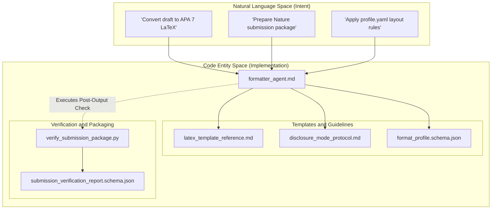
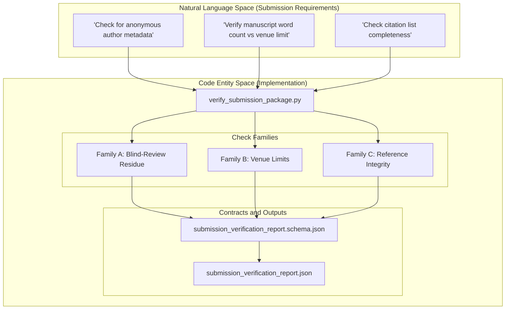

<!-- source: DeepWiki mcp.deepwiki.com · repo Imbad0202/academic-research-skills · page 4.5 Format Conversion and Output Generation · fetched 2026-10-30 -->

# Format Conversion and Output Generation

Relevant source files

The following files were used as context for generating this wiki page:

- [academic-paper/agents/draft_writer_agent.md](academic-paper/agents/draft_writer_agent.md)
- [academic-paper/agents/formatter_agent.md](academic-paper/agents/formatter_agent.md)
- [agents/report_compiler_agent.md](agents/report_compiler_agent.md)
- [agents/research_architect_agent.md](agents/research_architect_agent.md)
- [agents/synthesis_agent.md](agents/synthesis_agent.md)
- [deep-research/agents/ethics_review_agent.md](deep-research/agents/ethics_review_agent.md)
- [deep-research/agents/report_compiler_agent.md](deep-research/agents/report_compiler_agent.md)
- [deep-research/agents/research_architect_agent.md](deep-research/agents/research_architect_agent.md)
- [deep-research/agents/synthesis_agent.md](deep-research/agents/synthesis_agent.md)
- [docs/design/2026-06-10-394-family-d-repro-lock-assessment.md](docs/design/2026-06-10-394-family-d-repro-lock-assessment.md)
- [docs/design/2026-06-10-394-submission-package-verifier-spec.md](docs/design/2026-06-10-394-submission-package-verifier-spec.md)
- [scripts/fixtures/submission_package/profiles/full.yaml](scripts/fixtures/submission_package/profiles/full.yaml)
- [scripts/test_verify_submission_package.py](scripts/test_verify_submission_package.py)
- [scripts/verify_submission_package.py](scripts/verify_submission_package.py)
- [shared/contracts/submission/submission_verification_report.schema.json](shared/contracts/submission/submission_verification_report.schema.json)
- [shared/contracts/submission/venue_profile.schema.json](shared/contracts/submission/venue_profile.schema.json)

This page documents the format conversion and output generation capabilities of the academic-paper skill, implemented primarily by the `formatter_agent` [academic-paper/agents/formatter_agent.md:1-10](). This agent converts finalized paper drafts into multiple output formats (Markdown, LaTeX, DOCX, PDF), performs citation format conversion, applies journal-specific formatting requirements, and executes the **Cite-Time Provenance Hard Gate** to ensure no unverified citations reach the final output.

**Scope**: This page covers the `formatter_agent`'s conversion capabilities, output packaging, and quality assurance processes, including the deterministic **Submission-Package Verifier** (`scripts/verify_submission_package.py`) [docs/design/2026-06-10-394-submission-package-verifier-spec.md:1-20](). For detailed LaTeX technical specifications and APA 7.0 compilation rules, see [4.6 LaTeX and APA 7.0 Generation](). For the complete academic-paper agent team, see [4.7 Academic Paper Agent Team]().

---

## The formatter_agent Role

The `formatter_agent` [academic-paper/agents/formatter_agent.md:1-10]() is activated in **Phase 7** — the terminal phase of the academic-paper pipeline [academic-paper/agents/formatter_agent.md:10-15](). It operates on the principle of **format fidelity with content preservation** — formatting changes must never alter content or meaning [academic-paper/agents/formatter_agent.md:60-65]().

### Phase Boundary (v3.9.2)
As a single-phase agent, the formatter is strictly prohibited from writing files in any prior phase directories (`phase0_*` through `phase6_*`) [academic-paper/agents/formatter_agent.md:16-17](). It may read all upstream artifacts (`phase0_*` to `phase6_*`) but must raise quality issues to the caller rather than silently revising content [academic-paper/agents/formatter_agent.md:22-25]().

### System-to-Code Entity Mapping: Formatter Pipeline

The following diagram bridges high-level user formatting intent to the underlying code entities and modules in the repository.

**Sources**: [academic-paper/agents/formatter_agent.md:1-25](), [academic-paper/agents/formatter_agent.md:90-115](), [scripts/verify_submission_package.py:1-43]()

---

## Supported Output Formats

The `formatter_agent` supports multiple output formats, ensuring compatibility with various publishing pipelines and review workflows [academic-paper/agents/formatter_agent.md:84-118]().

### Format Specifications

| Format | File Extension | Implementation / Tooling | Primary Use Case |
|--------|----------------|--------------------------|------------------|
| **Markdown** | `.md` | Native output generation [academic-paper/agents/formatter_agent.md:86-91]() | Clean readable draft, repositories, web preview |
| **LaTeX** | `.tex` + `.bib` | Direct template mapping [academic-paper/agents/formatter_agent.md:92-108]() | Journal submission, BibTeX bibliography |
| **DOCX** | `.docx` | Pandoc via `--reference-doc` [academic-paper/agents/formatter_agent.md:109-116]() | Editorial review, standard office distribution |
| **PDF** | `.pdf` | LaTeX compilation or Pandoc [academic-paper/agents/formatter_agent.md:117-118]() | Final visual proofing, direct archive |

**Sources**: [academic-paper/agents/formatter_agent.md:84-118]()

---

## Format Profiles and Journal Adaptation (#439)

The system supports scholar-declared layouts via format profile records and venue guides [academic-paper/agents/formatter_agent.md:30-45](). 

### Profile Validation Protocol
When a target format profile is supplied, the agent enforces strict adherence rules:
*   **Missing or Unreadable File**: Halts execution immediately to prevent malformed outputs.
*   **Schema Validation**: Verifies structure against `shared/contracts/submission/venue_profile.schema.json`.
*   **No-Inference Rule**: The formatter never infers layout limits or constraints from journal names or unverified strings; declared values are strictly required [docs/design/2026-06-10-394-submission-package-verifier-spec.md:42-45]().

**Sources**: [academic-paper/agents/formatter_agent.md:28-59](), [docs/design/2026-06-10-394-submission-package-verifier-spec.md:40-45]()

---

## Deterministic Submission Verification (#394)

Post-formatting, the repository executes `scripts/verify_submission_package.py` to perform mechanical checks on output packages, avoiding high-embarrassment-cost submission errors [docs/design/2026-06-10-394-submission-package-verifier-spec.md:7-21]().

### System-to-Code Entity Mapping: Submission Verifier

**Sources**: [docs/design/2026-06-10-394-submission-package-verifier-spec.md:1-50](), [scripts/verify_submission_package.py:1-43]()

### Check Families and Signal Classes
The verifier divides checks into distinct families and signal classes [docs/design/2026-06-10-394-submission-package-verifier-spec.md:46-70]():
*   **Family A (Blind-Review Residue)**: Scans PDF/DOCX metadata author fields, tracked changes, and comments for de-anonymizing data [docs/design/2026-06-10-394-submission-package-verifier-spec.md:48-55]().
*   **Family B (Venue Limits)**: Verifies word counts, abstract lengths, keyword ranges, and required sections against declared profile constraints [docs/design/2026-06-10-394-submission-package-verifier-spec.md:62-66]().
*   **Family C (Reference Integrity)**: Conducts a two-way check between in-text citation markers and reference list entries [docs/design/2026-06-10-394-submission-package-verifier-spec.md:68-70]().

**Sources**: [docs/design/2026-06-10-394-submission-package-verifier-spec.md:46-75](), [scripts/verify_submission_package.py:138-150]()

---

## Cite-Time Provenance Hard Gate

Implemented via orchestrator hooks and validation runners, the **Cite-Time Provenance Hard Gate** ensures that no unverified citations, ghost references, or contaminated entries bypass the final package assembly [docs/design/2026-06-10-394-submission-package-verifier-spec.md:35-45]().

*   **Terminal Policies**: Terminal behavior is governed by `terminal_policies.submission_package ∈ {advisory, strict}` [docs/design/2026-06-10-394-submission-package-verifier-spec.md:38-40]().
*   **Fingerprint Verification**: `package_fingerprint` validation ensures the verification report corresponds directly to the exact manuscript byte-state being delivered [scripts/verify_submission_package.py:35-40]().

**Sources**: [docs/design/2026-06-10-394-submission-package-verifier-spec.md:35-45](), [scripts/verify_submission_package.py:30-43]()

---

