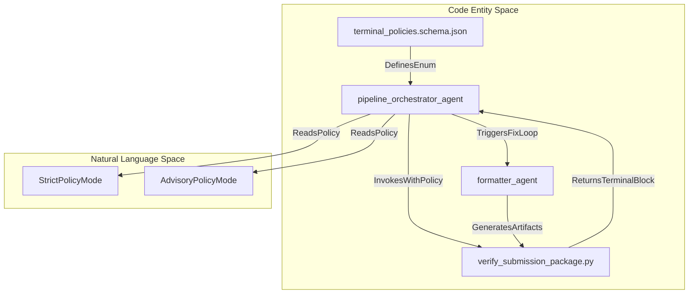
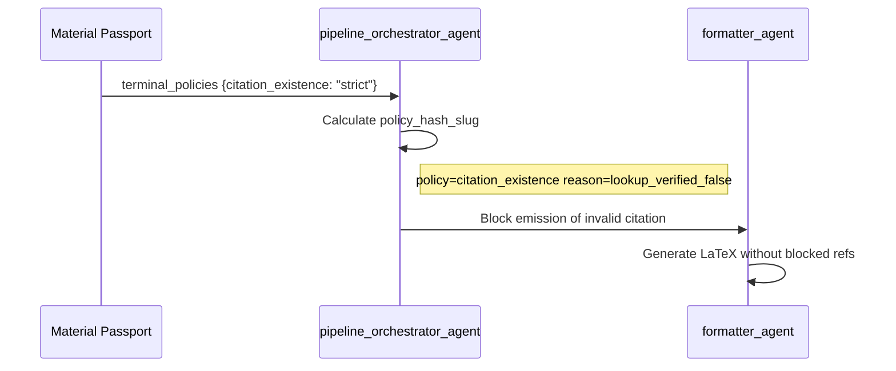

<!-- source: DeepWiki mcp.deepwiki.com · repo Imbad0202/academic-research-skills · page 4.6 LaTeX and APA 7.0 Generation · fetched 2026-10-30 -->

# LaTeX and APA 7.0 Generation

<details>
<summary>Relevant source files</summary>

The following files were used as context for generating this wiki page:

- [academic-paper/agents/draft_writer_agent.md](academic-paper/agents/draft_writer_agent.md)
- [academic-paper/agents/formatter_agent.md](academic-paper/agents/formatter_agent.md)
- [academic-paper/examples/chinese_paper_example.md](academic-paper/examples/chinese_paper_example.md)
- [academic-paper/references/journal_submission_guide.md](academic-paper/references/journal_submission_guide.md)
- [academic-paper/templates/funding_statement_template.md](academic-paper/templates/funding_statement_template.md)
- [agents/report_compiler_agent.md](agents/report_compiler_agent.md)
- [agents/research_architect_agent.md](agents/research_architect_agent.md)
- [agents/synthesis_agent.md](agents/synthesis_agent.md)
- [deep-research/agents/ethics_review_agent.md](deep-research/agents/ethics_review_agent.md)
- [deep-research/agents/report_compiler_agent.md](deep-research/agents/report_compiler_agent.md)
- [deep-research/agents/research_architect_agent.md](deep-research/agents/research_architect_agent.md)
- [deep-research/agents/synthesis_agent.md](deep-research/agents/synthesis_agent.md)
- [deep-research/examples/fact_check_mode.md](deep-research/examples/fact_check_mode.md)

</details>


## Purpose and Scope

This page documents the LaTeX and APA 7.0 generation subsystem within the `academic-paper` skill. It focuses on critical technical fixes for the `apa7` document class, including text justification, table column widths, bilingual abstracts, tectonic compilation, the `xeCJK` Chinese font stack, journal-specific adaptations, and concrete Chinese paper examples. It also details the Phase 7 boundary and terminal policy gates governing final document emission.

Sources: [academic-paper/agents/formatter_agent.md:1-118]()

---

## System Overview

The LaTeX and APA 7.0 generation system is implemented by the `formatter_agent` [academic-paper/agents/formatter_agent.md:2-10](), which operates in **Phase 7 (Formatting)** — the terminal phase of the writing pipeline [academic-paper/agents/formatter_agent.md:12-14](). The agent converts reviewed drafts into LaTeX `.tex` and BibTeX `.bib` files, applying specific hardening to ensure compliance with the APA 7th edition.

### Phase 7 Boundary and Enforcement
As of v3.9.2, the `formatter_agent` is strictly a single-phase agent [academic-paper/agents/formatter_agent.md:12-15]().
- **Write Scope:** It MUST NOT write files in `phase{M}_*/` where M ≠ 7 [academic-paper/agents/formatter_agent.md:16-17]().
- **Content Integrity:** It is a format-only agent; it MUST NOT rewrite drafts or regenerate abstracts [academic-paper/agents/formatter_agent.md:18-24]().
- **Enforcement:** Enforced by the `scripts/check_pipeline_integrity.py` verifier and a deterministic PreToolUse write-scope guard [academic-paper/agents/formatter_agent.md:25-27]().

Sources: [academic-paper/agents/formatter_agent.md:2-27]()

---

## APA 7.0 Document Class: Why `apa7` is Mandatory

The system mandates the `apa7` document class for all APA 7th edition papers [academic-paper/references/latex_template_reference.md:109-111](). This class automates APA-specific requirements like running heads (`\shorttitle`) and heading levels but requires explicit overrides for standard document behavior like text justification.

### Key Differences: `apa7` vs `article`

| Feature | `apa7` class | `article` class |
|---------|-------------|-----------------|
| Running head | Automatic via `\shorttitle` | Manual via `fancyhdr` |
| Title page | Built-in `\maketitle` | Manual `titlepage` environment |
| Abstract | `\abstract{}` in preamble | `\begin{abstract}` in body |
| **Text alignment** | **Ragged-right (MUST override)** | **Justified by default** |

Sources: [academic-paper/references/latex_template_reference.md:177-187]()

---

## Critical Fix 1: Text Justification

The `apa7` class in `man` (manuscript) mode defaults to `\raggedright`. The `formatter_agent` applies a three-part fix using `ragged2e` and `etoolbox` to restore standard justification [academic-paper/references/latex_template_reference.md:137-141]().

### Implementation
```latex
\usepackage{ragged2e}
\usepackage{etoolbox}
\AtBeginDocument{\justifying}
\apptocmd{\maketitle}{\justifying}{}{}
\let\oldraggedright\raggedright
\renewcommand{\raggedright}{\justifying}
```
1. `\AtBeginDocument{\justifying}`: Overrides the class default [academic-paper/references/latex_template_reference.md:140]().
2. `\apptocmd`: Re-applies justification immediately after the title page block [academic-paper/references/latex_template_reference.md:141]().
3. Redefinition: Prevents internal `apa7` macros from reverting the alignment [academic-paper/references/latex_template_reference.md:142-143]().

Sources: [academic-paper/references/latex_template_reference.md:137-144]()

---

## Critical Fix 2: Table Column Width Formula

To prevent table overflow in `longtable` or `tabular` environments, column widths must account for inter-column padding (`\tabcolsep`) [academic-paper/references/latex_template_reference.md:188-192]().

### The Formula
`Column width = (\linewidth - N\tabcolsep) * \real{proportion}`
Where `N = (number_of_columns - 1) × 2`.

Sources: [academic-paper/references/latex_template_reference.md:188-201]()

---

## Critical Fix 3: Bilingual Abstract Placement

For bilingual papers (e.g., Chinese and English), the `apa7` class requires abstracts in the preamble. The system nests both abstracts in a single `\abstract{}` block separated by a `\newpage` [academic-paper/references/latex_template_reference.md:156-165]().

Sources: [academic-paper/references/latex_template_reference.md:156-165]()

---

## Critical Fix 4: xeCJK Chinese Stack

For zh-TW content, the system uses the `xeCJK` stack compiled via `tectonic` or `xelatex` [academic-paper/references/latex_template_reference.md:24-28]().

```latex
\usepackage{fontspec}
\setmainfont{Times New Roman}
\usepackage{xeCJK}
\setCJKmainfont{Source Han Serif TC VF}
```

Sources: [academic-paper/references/latex_template_reference.md:24-28](), [academic-paper/references/latex_template_reference.md:116-122]()

---

## Journal-Specific Adaptations and Chinese Paper Examples

The generator supports specialized layouts, including TSSCI (Taiwan Social Science Citation Index) and APA 7.0 bilingual formatting. 

### Bilingual Paper Example Structure
As demonstrated in `academic-paper/examples/chinese_paper_example.md`, a bilingual submission contains:
1. Title and Abstract in Traditional Chinese (`## 摘要`) [academic-paper/examples/chinese_paper_example.md:36-41]()
2. Title and Abstract in English (`## Abstract`) [academic-paper/examples/chinese_paper_example.md:44-49]()
3. IMRaD structured body sections with APA 7.0 parenthetical citations [academic-paper/examples/chinese_paper_example.md:52-170]()
4. Institutional disclosures, AI usage statements [academic-paper/examples/chinese_paper_example.md:32](), and funding acknowledgments conforming to NSTC/MOE standards [academic-paper/templates/funding_statement_template.md:151-177]().

Sources: [academic-paper/examples/chinese_paper_example.md:1-170](), [academic-paper/templates/funding_statement_template.md:151-177]()

---

## Submission Package Terminal Gate

Post-formatting, the pipeline orchestrator executes a package-level terminal gate (Issue #394) [shared/contracts/passport/terminal_policies.schema.json:33-35]().

### Terminal Policy Data Flow (Natural Language to Code Entities)



Sources: [shared/contracts/passport/terminal_policies.schema.json:33-40](), [scripts/check_394_submission_policy.py:55-90](), [scripts/test_v3_6_7_phase_6_6.py:114-122]()

---

## Citation Existence and Terminal Policies

The system implements a deterministic `citation_existence` policy (Delta 3 / INVARIANT C-V6) to block fabricated references [shared/contracts/passport/terminal_policies.schema.json:18-20]().

### Policy Oracle Sequence (Natural Language to Code Entities)



Sources: [shared/contracts/passport/terminal_policies.schema.json:18-25](), [scripts/test_citation_existence_policy.py:74-116](), [scripts/check_394_submission_policy.py:11-30]()

---

## Mapping Markdown to LaTeX Elements

The `formatter_agent` performs the following transformations during the Phase 7 stage [academic-paper/agents/formatter_agent.md:10]().

| Markdown | LaTeX Command | Context |
|----------|---------------|---------|
| `# Title` | `\section{...}` | APA Level 1 |
| `## Sub` | `\subsection{...}` | APA Level 2 |
| `Table` | `\begin{longtable}` | Using `booktabs` [academic-paper/references/latex_template_reference.md:18]() |
| `(Author, 2024)` | `\citep{Author2024}` | BibTeX Key Mapping |

Sources: [academic-paper/references/latex_template_reference.md:57-88](), [academic-paper/agents/formatter_agent.md:131-147]()

---

