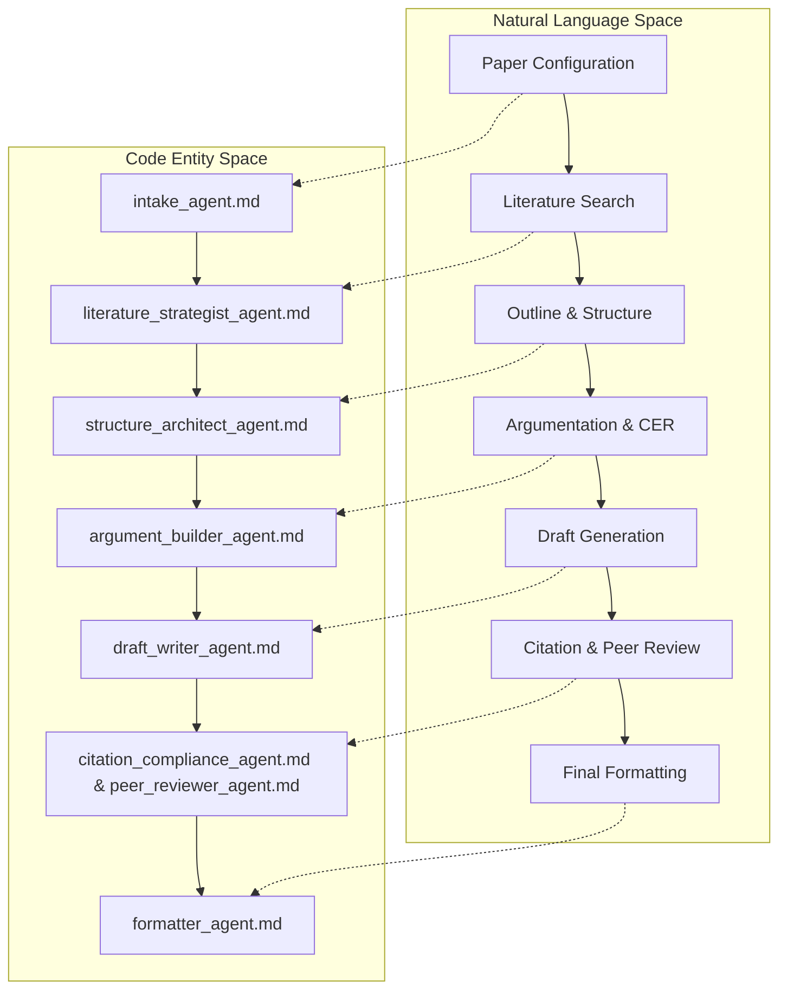
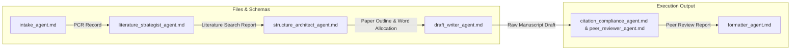

<!-- source: DeepWiki mcp.deepwiki.com · repo Imbad0202/academic-research-skills · page 4.7 Academic Paper Agent Team · fetched 2026-10-30 -->

# Academic Paper Agent Team

Relevant source files

The following files were used as context for generating this wiki page:

- [academic-paper/agents/abstract_bilingual_agent.md](academic-paper/agents/abstract_bilingual_agent.md)
- [academic-paper/agents/citation_compliance_agent.md](academic-paper/agents/citation_compliance_agent.md)
- [academic-paper/agents/intake_agent.md](academic-paper/agents/intake_agent.md)
- [academic-paper/agents/literature_strategist_agent.md](academic-paper/agents/literature_strategist_agent.md)
- [academic-paper/agents/peer_reviewer_agent.md](academic-paper/agents/peer_reviewer_agent.md)
- [academic-paper/agents/structure_architect_agent.md](academic-paper/agents/structure_architect_agent.md)
- [academic-paper/references/domain_evidence_profiles.md](academic-paper/references/domain_evidence_profiles.md)
- [deep-research/agents/bibliography_agent.md](deep-research/agents/bibliography_agent.md)
- [deep-research/agents/research_question_agent.md](deep-research/agents/research_question_agent.md)
- [deep-research/agents/source_verification_agent.md](deep-research/agents/source_verification_agent.md)
- [docs/design/2026-05-29-kong-259-domain-evidence-profiles-spec.md](docs/design/2026-05-29-kong-259-domain-evidence-profiles-spec.md)
- [docs/design/2026-05-30-kong-259-domain-evidence-profiles-plan.md](docs/design/2026-05-30-kong-259-domain-evidence-profiles-plan.md)
- [scripts/check_392_citation_verification_intake.py](scripts/check_392_citation_verification_intake.py)
- [scripts/check_domain_evidence_profile.py](scripts/check_domain_evidence_profile.py)
- [scripts/check_v3_9_4_temporal_verification.py](scripts/check_v3_9_4_temporal_verification.py)
- [scripts/test_check_392_citation_verification_intake.py](scripts/test_check_392_citation_verification_intake.py)
- [scripts/test_check_domain_evidence_profile.py](scripts/test_check_domain_evidence_profile.py)

This page documents the agent architecture of the `academic-paper` skill in the Academic Research Skills (ARS) system (v3.23.x). It details the roles, phase boundaries, activation conditions, and implementation patterns for the specialized agents comprising the academic writing pipeline: `intake_agent`, `literature_strategist_agent`, `structure_architect_agent`, `argument_builder_agent`, `draft_writer_agent`, `citation_compliance_agent`, `abstract_bilingual_agent`, `peer_reviewer_agent`, `formatter_agent`, and `visualization_agent`.

---

## 1. Agent Inventory and Phase Mapping

The `academic-paper` skill distributes responsibilities across 8 sequential phases (Phase 0 through Phase 7). Each agent is bound to a strict phase boundary to prevent downstream drift (such as writing drafts during literature review).

| Agent Name | File Path | Primary Phase | Activation Condition |
|---|---|---|---|
| `intake_agent` | `academic-paper/agents/intake_agent.md` [academic-paper/agents/intake_agent.md:1-10]() | Phase 0 (CONFIG) | Always (Pipeline Entry) [academic-paper/agents/intake_agent.md:10-11]() |
| `literature_strategist_agent` | `academic-paper/agents/literature_strategist_agent.md` [academic-paper/agents/literature_strategist_agent.md:1-10]() | Phase 1 (RESEARCH) | When no deep-research handoff materials are present [academic-paper/agents/literature_strategist_agent.md:10-15]() |
| `structure_architect_agent` | `academic-paper/agents/structure_architect_agent.md` [academic-paper/agents/structure_architect_agent.md:1-10]() | Phase 2 (ARCHITECTURE) | All standard writing modes [academic-paper/agents/structure_architect_agent.md:10-15]() |
| `argument_builder_agent` | `academic-paper/agents/argument_builder_agent.md` | Phase 3 (ARGUMENTATION) | Full pipeline & plan mode execution [academic-paper/agents/argument_builder_agent.md:1-10]() |
| `draft_writer_agent` | `academic-paper/agents/draft_writer_agent.md` [academic-paper/agents/draft_writer_agent.md:1-10]() | Phase 4 (DRAFTING) | All drafting and generation modes [academic-paper/agents/draft_writer_agent.md:1-10]() |
| `visualization_agent` | `academic-paper/agents/visualization_agent.md` | Phase 4 / 7 | Quantitative papers with empirical figures |
| `citation_compliance_agent` | `academic-paper/agents/citation_compliance_agent.md` [academic-paper/agents/citation_compliance_agent.md:1-10]() | Phase 5a (CITATIONS) | All modes with bibliographic references [academic-paper/agents/citation_compliance_agent.md:10-15]() |
| `abstract_bilingual_agent` | `academic-paper/agents/abstract_bilingual_agent.md` [academic-paper/agents/abstract_bilingual_agent.md:1-10]() | Phase 5b (ABSTRACT) | All modes except `abstract-only` [academic-paper/agents/abstract_bilingual_agent.md:10-15]() |
| `peer_reviewer_agent` | `academic-paper/agents/peer_reviewer_agent.md` [academic-paper/agents/peer_reviewer_agent.md:1-10]() | Phase 6 (PEER REVIEW) | Full pipeline & revision workflows [academic-paper/agents/peer_reviewer_agent.md:10-15]() |
| `formatter_agent` | `academic-paper/agents/formatter_agent.md` [academic-paper/agents/formatter_agent.md:1-10]() | Phase 7 (FORMAT) | All output-generating workflows [academic-paper/agents/formatter_agent.md:10-15]() |

### Diagram: Natural Language Space to Code Entity Mapping (Pipeline Execution)

Sources: `[academic-paper/agents/intake_agent.md:1-10]()`, `[academic-paper/agents/literature_strategist_agent.md:1-15]`, `[academic-paper/agents/structure_architect_agent.md:1-15]`, `[academic-paper/agents/draft_writer_agent.md:1-10]`, `[academic-paper/agents/formatter_agent.md:1-10]()`

---

## 2. Configuration and Literature Agents

### `intake_agent`
Defined in `[academic-paper/agents/intake_agent.md:1-10]`, the `intake_agent` administers the Phase 0 configuration interview. It detects upstream materials from the `deep-research` skill (such as Research Question Briefs and Annotated Bibliographies) to auto-populate parameters and bypass redundant prompts `[academic-paper/agents/intake_agent.md:23-59]`. It also resolves the `domain_evidence_profile` row from the Paper Configuration Record (PCR) to establish admissibility standards for downstream screening `[academic-paper/agents/intake_agent.md:136-143]()`.

### `literature_strategist_agent`
Defined in `[academic-paper/agents/literature_strategist_agent.md:1-15]`, the `literature_strategist_agent` executes Phase 1 research strategy design and source screening. It consumes the `domain_evidence_profile` (e.g., `cs_ml`, `humanities_interpretive`, `general_social_science`, or `unknown_user_defined`) to adjust relevance and methodological inclusion thresholds while enforcing universal gating rules `[academic-paper/agents/literature_strategist_agent.md:45-73]()`. It emits distributional skew advisories if source concentration exceeds thresholds `[academic-paper/agents/literature_strategist_agent.md:104-124]()`.

Sources: `[academic-paper/agents/intake_agent.md:1-193]()`, `[academic-paper/agents/literature_strategist_agent.md:1-162]()`

---

## 3. Structure, Argumentation and Drafting Agents

### `structure_architect_agent`
Defined in `[academic-paper/agents/structure_architect_agent.md:1-15]`, the `structure_architect_agent` operates in Phase 2 to select paper structure patterns (IMRaD, Thematic Literature Review, Theoretical Analysis, Case Study, Policy Brief, Conference Paper) and allocate word counts per section `[academic-paper/agents/structure_architect_agent.md:40-105]()`. It maps literature sources to specific outline nodes and binds review criteria pointers without inventing content `[academic-paper/agents/structure_architect_agent.md:126-145]()`.

### `argument_builder_agent`
Operates in Phase 3 to construct logical frameworks using Claim-Evidence-Reasoning (CER) chains. It analyzes the structural flow and ensures that primary research questions map directly into supporting arguments and counter-rebuttals.

### `draft_writer_agent`
Defined in `[academic-paper/agents/draft_writer_agent.md:1-11]`, the `draft_writer_agent` executes Phase 4 draft composition. It enforces anti-leakage isolation protocols when prior synthesis is provided, and applies writing quality checks to eliminate colloquialisms and control sentence length variation `[academic-paper/agents/draft_writer_agent.md:49-77]()`. During Phase 6 revision loops, it outputs targeted patch documents rather than re-emitting the entire manuscript `[academic-paper/agents/draft_writer_agent.md:12-24]()`.

Sources: `[academic-paper/agents/structure_architect_agent.md:1-150]()`, `[academic-paper/agents/draft_writer_agent.md:1-144]()`

---

## 4. Compliance, Abstract and Review Agents

### `citation_compliance_agent`
Defined in `[academic-paper/agents/citation_compliance_agent.md:1-15]`, the `citation_compliance_agent` executes Phase 5a citation auditing. It verifies that in-text citations map correctly to reference lists (zero orphans), checks DOI formatting and resolution states, monitors self-citation ratios (<15%), and flags citation density anomalies `[academic-paper/agents/citation_compliance_agent.md:30-136]()`.

### `abstract_bilingual_agent`
Defined in `[academic-paper/agents/abstract_bilingual_agent.md:1-15]`, the `abstract_bilingual_agent` handles Phase 5b bilingual abstract generation. Operating on the run's declared output language pair (defaulting to `zh-tw-en`), it composes abstracts independently in both languages rather than relying on mechanical translation `[academic-paper/agents/abstract_bilingual_agent.md:10-34]()`. It adheres to structure length regimes and preserves protected hedge markers from the draft `[academic-paper/agents/abstract_bilingual_agent.md:45-79]()`.

### `peer_reviewer_agent`
Defined in `[academic-paper/agents/peer_reviewer_agent.md:1-15]`, the `peer_reviewer_agent` runs Phase 6 simulated peer review. It evaluates manuscripts across five core dimensions (Originality, Methodological Rigor, Evidence Sufficiency, Argument Coherence, Writing Quality) and derives structured verdicts (Accept, Minor Revision, Major Revision, Reject) accompanied by line-level feedback `[academic-paper/agents/peer_reviewer_agent.md:10-120]()`.

Sources: `[academic-paper/agents/citation_compliance_agent.md:1-137]()`, `[academic-paper/agents/abstract_bilingual_agent.md:1-152]()`, `[academic-paper/agents/peer_reviewer_agent.md:1-124]()`

---

## 5. Formatting and Visualization Agents

### `formatter_agent`
Defined in `[academic-paper/agents/formatter_agent.md:1-11]`, the `formatter_agent` governs Phase 7 output generation. It executes citation format conversions (APA 7th, Chicago, MLA, IEEE, Vancouver) and handles LaTeX compilation specifics (such as `apa7` document classes and CJK font integration).

### `visualization_agent`
Operates during Phase 4 and Phase 7 for quantitative and empirical manuscripts. It transforms tabular data and statistical findings into properly formatted figures, ensuring caption compliance, source attribution, and proper cross-referencing within the draft text.

Sources: `[academic-paper/agents/formatter_agent.md:1-15]()`

---

## 6. Data Flow and Code Entity Interoperability

### Diagram: Agent Handoffs and Schema Boundaries

Sources: `[academic-paper/agents/intake_agent.md:10-59]()`, `[academic-paper/agents/literature_strategist_agent.md:10-25]()`, `[academic-paper/agents/structure_architect_agent.md:10-25]()`, `[academic-paper/agents/draft_writer_agent.md:10-24]()`

---

