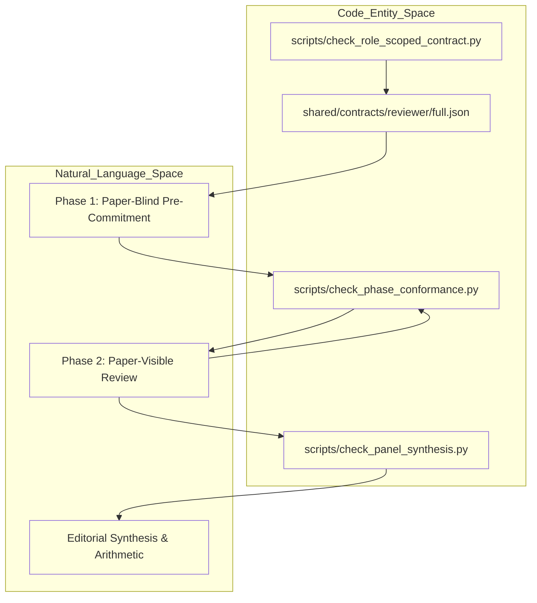
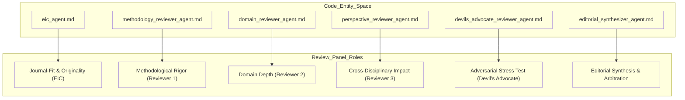

<!-- source: DeepWiki mcp.deepwiki.com · repo Imbad0202/academic-research-skills · page 5 Academic Paper Reviewer Skill · fetched 2026-10-30 -->

# Academic Paper Reviewer Skill

Relevant source files

The following files were used as context for generating this wiki page:

- [academic-paper-reviewer/agents/devils_advocate_reviewer_agent.md](academic-paper-reviewer/agents/devils_advocate_reviewer_agent.md)
- [academic-paper-reviewer/agents/domain_reviewer_agent.md](academic-paper-reviewer/agents/domain_reviewer_agent.md)
- [academic-paper-reviewer/agents/editorial_synthesizer_agent.md](academic-paper-reviewer/agents/editorial_synthesizer_agent.md)
- [academic-paper-reviewer/agents/eic_agent.md](academic-paper-reviewer/agents/eic_agent.md)
- [academic-paper-reviewer/agents/methodology_reviewer_agent.md](academic-paper-reviewer/agents/methodology_reviewer_agent.md)
- [academic-paper-reviewer/agents/perspective_reviewer_agent.md](academic-paper-reviewer/agents/perspective_reviewer_agent.md)
- [academic-paper-reviewer/references/reviewer_sprint_prompt_source.md](academic-paper-reviewer/references/reviewer_sprint_prompt_source.md)
- [academic-paper-reviewer/references/sprint_contract_protocol.md](academic-paper-reviewer/references/sprint_contract_protocol.md)
- [scripts/check_panel_synthesis.py](scripts/check_panel_synthesis.py)
- [scripts/check_phase_conformance.py](scripts/check_phase_conformance.py)
- [scripts/check_reviewer_sprint_prompt_sync.py](scripts/check_reviewer_sprint_prompt_sync.py)
- [scripts/check_role_scoped_contract.py](scripts/check_role_scoped_contract.py)
- [scripts/test_check_panel_synthesis.py](scripts/test_check_panel_synthesis.py)
- [scripts/test_check_phase_conformance.py](scripts/test_check_phase_conformance.py)
- [scripts/test_check_role_scoped_contract.py](scripts/test_check_role_scoped_contract.py)

## Purpose and Scope

The `academic-paper-reviewer` skill simulates a comprehensive multi-perspective peer review process for academic manuscripts. It automatically identifies the manuscript's discipline, configures a 5-person review panel, executes a two-phase evaluation under the Sprint Contract Protocol, and produces a structured editorial decision with a prioritized revision roadmap `[academic-paper-reviewer/agents/editorial_synthesizer_agent.md:6-14](), [academic-paper-reviewer/references/sprint_contract_protocol.md:1-17]()`. 

This page provides a high-level parent overview of the review subsystem. For granular technical specifications, refer to the child pages:
- Review modes and selection logic: [Review Modes Overview](#5.1)
- Panel seats, role contracts, and validation scripts: [5-Person Review Panel Architecture](#5.2)
- Rubrics, scoring dimensions, and decision mapping: [Quality Rubrics and 0-100 Scoring](#5.3)
- Stage 3' verification protocols and Schema 11 ledgers: [Re-Review and Verification Protocol](#5.4)
- Socratic progressive review dialogue: [Guided Review Mode](#5.5)
- Devil's Advocate challenge framework and veto mechanics: [Devil's Advocate Special Role](#5.6)

Sources: `[academic-paper-reviewer/agents/editorial_synthesizer_agent.md:6-14]()`, `[academic-paper-reviewer/references/sprint_contract_protocol.md:1-17]()`

---

## System Architecture & Sprint Contract Protocol

The review system relies on Schema 13.2 contracts and is governed by python validation harnesses (`[scripts/check_phase_conformance.py:1-10]()`, `[scripts/check_panel_synthesis.py:1-10]()`, `[scripts/check_role_scoped_contract.py:1-10]()`). To prevent post-hoc scoring rationalization, reviewers operate under a strict **two-phase sprint contract protocol** `[academic-paper-reviewer/references/sprint_contract_protocol.md:16-22]()`.

**Diagram: Natural Language Space to Code Entity Space (Validation Pipeline)**

Sources: `[scripts/check_phase_conformance.py:1-10]()`, `[scripts/check_panel_synthesis.py:1-10]()`, `[scripts/check_role_scoped_contract.py:1-10]()`, `[academic-paper-reviewer/references/sprint_contract_protocol.md:16-22]()`

---

## 5-Person Review Panel & Agent Team

The review panel consists of five role-scoped reviewer seats and an editorial synthesizer, orchestrated via specialized agent definitions in the codebase `[academic-paper-reviewer/agents/editorial_synthesizer_agent.md:16-32]()`.

**Diagram: Reviewer Agent Mapping to Panel Roles**

For detailed role contracts, seat scopes, and phase conformance requirements, see [5-Person Review Panel Architecture](#5.2). For details on the Devil's Advocate specifically, see [Devil's Advocate Special Role](#5.6).

Sources: `[academic-paper-reviewer/agents/editorial_synthesizer_agent.md:16-32]()`, `[academic-paper-reviewer/agents/methodology_reviewer_agent.md:18-32]()`, `[academic-paper-reviewer/agents/devils_advocate_reviewer_agent.md:16-33]()`

---

## Review Modes Overview

The skill supports multiple execution modes designed for different research workflows and verification stages:
- **Full Review**: Standard 5-person panel evaluation across all quality dimensions.
- **Re-Review**: Stage 3' verification protocol evaluating author revisions against prior reviewer notes.
- **Quick Mode**: Accelerated single-pass evaluation for rapid feedback.
- **Methodology-Focus**: Specialized review targeting statistical rigor and research design.
- **Guided Review**: Socratic, interactive walkthrough for author comprehension.
- **Calibration Mode**: Benchmark evaluation measuring AI review accuracy against gold standard datasets.

For configuration flags, prompt variations, and mode selection criteria, see [Review Modes Overview](#5.1).

Sources: `[academic-paper-reviewer/SKILL.md:61-75]()`

---

## Quality Rubrics and Scoring

Scoring operates on dimensional criteria governed by Schema 13.2 contracts. Panel synthesis aggregates per-seat scores into an overall editorial verdict:
- **Accept**: Score ≥ 80
- **Minor Revision**: Score 65–79
- **Major Revision**: Score 50–64
- **Reject**: Score < 50

For a complete breakdown of scoring dimensions, behavioral indicators, and failure condition arithmetic, see [Quality Rubrics and 0-100 Scoring](#5.3).

Sources: `[academic-paper-reviewer/references/sprint_contract_protocol.md:38-44]()`, `[scripts/check_panel_synthesis.py:1-50]()`

---

## Re-Review and Verification Protocol

When manuscripts enter Stage 3' (Re-Review), the system enforces a strict three-gate contract (`[scripts/check_phase_conformance.py:1-50]()`). This ensures yardstick continuity, prevents goalpost shifting between review rounds, and utilizes nested commitment ledgers (Schema 11) for tracking revision claims.

For implementation details, see [Re-Review and Verification Protocol](#5.4).

Sources: `[scripts/check_phase_conformance.py:1-50]()`

---

## Child Pages

- [Review Modes Overview](#5.1)
- [5-Person Review Panel Architecture](#5.2)
- [Quality Rubrics and 0-100 Scoring](#5.3)
- [Re-Review and Verification Protocol](#5.4)
- [Guided Review Mode](#5.5)
- [Devil's Advocate Special Role](#5.6)

---

