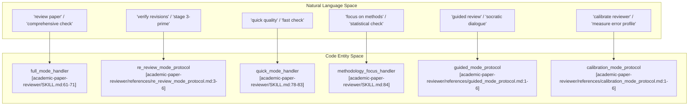
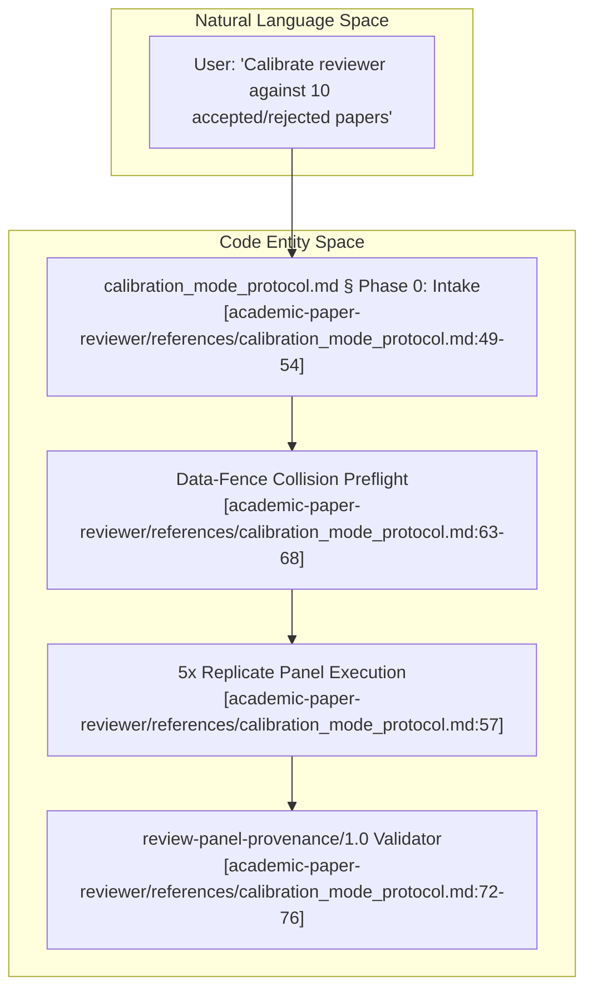

<!-- source: DeepWiki mcp.deepwiki.com · repo Imbad0202/academic-research-skills · page 5.1 Review Modes Overview · fetched 2026-10-30 -->

# Review Modes Overview

Relevant source files

The following files were used as context for generating this wiki page:

- [academic-paper-reviewer/references/calibration_mode_protocol.md](academic-paper-reviewer/references/calibration_mode_protocol.md)
- [academic-paper-reviewer/references/guided_mode_protocol.md](academic-paper-reviewer/references/guided_mode_protocol.md)
- [docs/design/2026-06-08-273-rubric-aware-calibration-note-design.md](docs/design/2026-06-08-273-rubric-aware-calibration-note-design.md)

This page provides full technical detail on the six operational modes available in the `academic-paper-reviewer` skill: `full`, `re-review`, `quick`, `methodology-focus`, `guided`, and `calibration`. It covers agent activation patterns, workflow stages, the Socratic dialogue model, and the accuracy-measurement calibration protocol including rubric-aware evaluation risks.

---

## 1. Mode Comparison and Selection Architecture

The `academic-paper-reviewer` skill maps natural language intents and pipeline stages to specific agent combinations and review protocols.

| Mode | Primary Use Case | Agents Activated | Output Structure | Typical Duration |
|------|------------------|------------------|------------------|------------------|
| `full` | Pre-submission comprehensive review | `field_analyst_agent`, `eic_agent`, `methodology_reviewer_agent`, `domain_reviewer_agent`, `perspective_reviewer_agent`, `devils_advocate_reviewer_agent`, `editorial_synthesizer_agent` | 5 review reports + Editorial Decision + Revision Roadmap | 30-45 minutes |
| `re-review` | Post-revision verification (Pipeline Stage 3') | `field_analyst_agent`, `eic_agent`, `editorial_synthesizer_agent` | Revision checklist + residual issues + new Decision | 15-20 minutes |
| `quick` | Rapid quality assessment | `field_analyst_agent`, `eic_agent` | EIC quick assessment + key issues list | 15 minutes |
| `methodology-focus` | Statistical and methodological deep dive | `field_analyst_agent`, `methodology_reviewer_agent` | In-depth methodology review report | 20-25 minutes |
| `guided` | Socratic pedagogical review | All 7 agents (dialogue mode) | Progressive issue revelation + final Revision Roadmap | 40-60 minutes |
| `calibration` | Measuring FNR/FPR accuracy | All 7 agents (5x ensemble) | Calibration Report + Session Confidence Disclosure | 60+ minutes |

### Natural Language Space to Code Entity Space: Mode Dispatch

The following diagram bridges natural language input keywords to internal mode identifiers and Python/Markdown agent routing structures within `academic-paper-reviewer`.

Sources: [academic-paper-reviewer/SKILL.md:61-89](), [academic-paper-reviewer/references/re_review_mode_protocol.md:3-6](), [academic-paper-reviewer/references/calibration_mode_protocol.md:1-6]()

---

## 2. Core Operational Modes (`full`, `quick`, `methodology-focus`, `re-review`)

### Full Mode
Simulates a complete journal peer review process using all seven agent seats across three phases:
1. **Phase 0 (Field Analysis):** `field_analyst_agent` classifies disciplines and configures reviewer personas [academic-paper-reviewer/SKILL.md:97-107]().
2. **Phase 1 (Parallel Review):** Independent evaluations are generated across journal fit, methodology, domain contribution, and core arguments [academic-paper-reviewer/SKILL.md:111-135]().
3. **Phase 2 (Editorial Synthesis):** `editorial_synthesizer_agent` arbitrates conflicts and compiles the Editorial Decision Letter [academic-paper-reviewer/SKILL.md:137-143]().

### Quick Mode
Invokes only `field_analyst_agent` and `eic_agent` to deliver a rapid initial assessment and key issues list without spawning the full 5-reviewer panel [academic-paper-reviewer/SKILL.md:78-83]().

### Methodology-Focus Mode
Executes a targeted inspection pairing `field_analyst_agent` with `methodology_reviewer_agent` to audit study design, sampling strategies, effect sizes, and data transparency [academic-paper-reviewer/SKILL.md:84,118-122]().

### Re-Review Mode
Operates during Pipeline Stage 3' to verify post-revision changes under a strict three-gate evidence-before-persuasion contract involving `field_analyst_agent`, `eic_agent`, and `editorial_synthesizer_agent` [academic-paper-reviewer/references/re_review_mode_protocol.md:1-24]().

Sources: [academic-paper-reviewer/SKILL.md:61-143](), [academic-paper-reviewer/references/re_review_mode_protocol.md:1-24]()

---

## 3. Guided Mode and Socratic Protocol

Guided mode shifts the review dynamic from passive instruction absorption to progressive Socratic discovery [academic-paper-reviewer/references/guided_mode_protocol.md:1-3]().

### Dialogue Architecture
1. **Phase 0–1:** The system runs the standard 5-reviewer panel execution in the background, withholding full reports from immediate display [academic-paper-reviewer/references/guided_mode_protocol.md:8-9]().
2. **Dialogue Initiation:** The `eic_agent` opens by acknowledging core strengths (1–2 genuine strengths when present) and raises the primary structural hurdle [academic-paper-reviewer/references/guided_mode_protocol.md:15]().
3. **Progressive Revelation:** Based on the author's responses, the session introduces specialized perspectives from methodology, domain expertise, cross-disciplinary challenges, and finally the Devil's Advocate [academic-paper-reviewer/references/guided_mode_protocol.md:16-21]().
4. **Constraints:** Responses are bounded to 200–400 words, relying on probing questions rather than imperative commands [academic-paper-reviewer/references/guided_mode_protocol.md:25-29]().

> **Sprint Contract Note:** v3.6.2 introduced sprint contracts for `reviewer_full` and `reviewer_methodology_focus` only; guided mode executes without strict contract enforcement until subsequent patches [academic-paper-reviewer/references/guided_mode_protocol.md:32-34]().

Sources: [academic-paper-reviewer/references/guided_mode_protocol.md:1-34]()

---

## 4. Calibration Mode and Accuracy Measurement

Calibration mode measures bounded decision-error profiles (False-Negative Rate and False-Positive Rate) against a user-adjudicated gold target set [academic-paper-reviewer/references/calibration_mode_protocol.md:1-5]().

### Natural Language Space to Code Entity Space: Calibration Pipeline

Sources: [academic-paper-reviewer/references/calibration_mode_protocol.md:1-93]()

### Epistemic Status and Limitations
Standard calibration yields `calibration_status: NOT_CALIBRATED` unless executed via the full tier against a closed target set with an identical `execution_topology_sha256` [academic-paper-reviewer/references/calibration_mode_protocol.md:7-19](). 

### Rubric-Aware Judging and Same-Source Risk (#273)
When model-generated work is evaluated under rubric-aware settings within the same model family, measured calibration error can be an **under-estimate** because the evaluator model optimizes toward anticipated rubric rewards [docs/design/2026-06-08-273-rubric-aware-calibration-note-design.md:11-16](). To counteract this, calibration mode defaults `ARS_CROSS_MODEL` to active when configured, ensuring cross-model evaluation where available [academic-paper-reviewer/references/calibration_mode_protocol.md:61-62](), [docs/design/2026-06-08-273-rubric-aware-calibration-note-design.md:41-44]().

Sources: [academic-paper-reviewer/references/calibration_mode_protocol.md:1-93](), [docs/design/2026-06-08-273-rubric-aware-calibration-note-design.md:1-73]()

---

