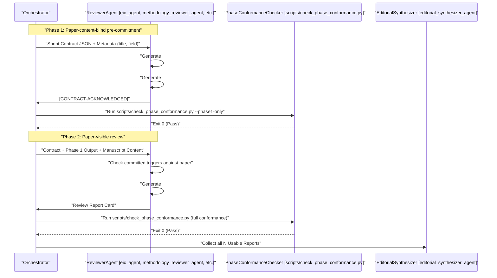
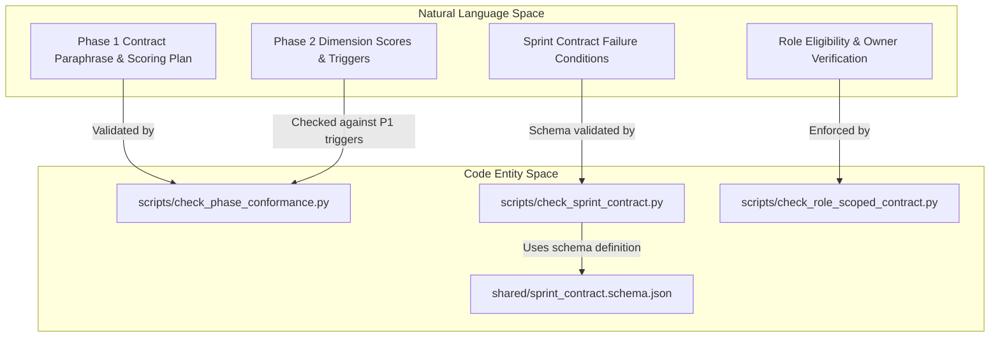

<!-- source: DeepWiki mcp.deepwiki.com · repo Imbad0202/academic-research-skills · page 5.2 5-Person Review Panel Architecture · fetched 2026-10-30 -->

# 5-Person Review Panel Architecture

Relevant source files

The following files were used as context for generating this wiki page:

- [academic-paper-reviewer/agents/devils_advocate_reviewer_agent.md](academic-paper-reviewer/agents/devils_advocate_reviewer_agent.md)
- [academic-paper-reviewer/agents/domain_reviewer_agent.md](academic-paper-reviewer/agents/domain_reviewer_agent.md)
- [academic-paper-reviewer/agents/editorial_synthesizer_agent.md](academic-paper-reviewer/agents/editorial_synthesizer_agent.md)
- [academic-paper-reviewer/agents/eic_agent.md](academic-paper-reviewer/agents/eic_agent.md)
- [academic-paper-reviewer/agents/methodology_reviewer_agent.md](academic-paper-reviewer/agents/methodology_reviewer_agent.md)
- [academic-paper-reviewer/agents/perspective_reviewer_agent.md](academic-paper-reviewer/agents/perspective_reviewer_agent.md)
- [academic-paper-reviewer/references/reviewer_sprint_prompt_source.md](academic-paper-reviewer/references/reviewer_sprint_prompt_source.md)
- [academic-paper-reviewer/references/sprint_contract_protocol.md](academic-paper-reviewer/references/sprint_contract_protocol.md)
- [scripts/check_panel_synthesis.py](scripts/check_panel_synthesis.py)
- [scripts/check_phase_conformance.py](scripts/check_phase_conformance.py)
- [scripts/check_reviewer_sprint_prompt_sync.py](scripts/check_reviewer_sprint_prompt_sync.py)
- [scripts/check_role_scoped_contract.py](scripts/check_role_scoped_contract.py)
- [scripts/check_sprint_contract.py](scripts/check_sprint_contract.py)
- [scripts/test_check_panel_synthesis.py](scripts/test_check_panel_synthesis.py)
- [scripts/test_check_phase_conformance.py](scripts/test_check_phase_conformance.py)
- [scripts/test_check_role_scoped_contract.py](scripts/test_check_role_scoped_contract.py)
- [scripts/test_check_sprint_contract.py](scripts/test_check_sprint_contract.py)
- [shared/contracts/reviewer/full.json](shared/contracts/reviewer/full.json)
- [shared/contracts/reviewer/methodology_focus.json](shared/contracts/reviewer/methodology_focus.json)
- [shared/sprint_contract.schema.json](shared/sprint_contract.schema.json)

This page documents the multi-perspective peer review system implemented by the `academic-paper-reviewer` skill. The system simulates an international journal review process using 5 independent reviewer agents with non-overlapping perspectives: Editor-in-Chief (`eic_agent`), Methodology Reviewer (`methodology_reviewer_agent`), Domain Reviewer (`domain_reviewer_agent`), Perspective Reviewer (`perspective_reviewer_agent`), and Devil's Advocate (`devils_advocate_reviewer_agent`), coordinated by the `editorial_synthesizer_agent`.

Purpose: Panel seats, role-scoped contracts, phase conformance, panel synthesis arithmetic, and the mechanical validation scripts.

For review modes, see [5.1](). For quality rubrics and 0-100 scoring, see [5.3](). For re-review and verification protocols, see [5.4](). For the Devil's Advocate special role, see [5.6]().

---

## 1. Panel Seats and Role-Scoped Contracts

The review panel consists of 7 agents executing across 2 core phases, with 5 agents performing independent reviews in parallel during Phase 1 under strict role-scoped contracts (`shared/contracts/reviewer/full.json`).

| Agent | Role Identifier | File | Perspective / Focus |
|-------|-----------------|------|---------------------|
| `field_analyst_agent` | `n/a` (configurator) | [academic-paper-reviewer/agents/field_analyst_agent.md]() | Domain identification, persona configuration |
| `eic_agent` | `eic` | [academic-paper-reviewer/agents/eic_agent.md:9-13]() | Journal fit, originality, overall quality (Dimensions D5, D6) |
| `methodology_reviewer_agent` | `methodology` | [academic-paper-reviewer/agents/methodology_reviewer_agent.md:9-14]() | Research design, statistics, reproducibility (Dimension D1) |
| `domain_reviewer_agent` | `domain` | [academic-paper-reviewer/agents/domain_reviewer_agent.md:9-14]() | Literature coverage, theoretical framework (Dimension D2) |
| `perspective_reviewer_agent` | `perspective` | [academic-paper-reviewer/agents/perspective_reviewer_agent.md:9-14]() | Cross-disciplinary relevance, broader impact (Dimension D4) |
| `devils_advocate_reviewer_agent` | `da` | [academic-paper-reviewer/agents/devils_advocate_reviewer_agent.md:9-12]() | Core argument challenges, logical fallacies (Dimension D3) |
| `editorial_synthesizer_agent` | `synthesizer` | [academic-paper-reviewer/agents/editorial_synthesizer_agent.md:8-12]() | Consensus identification, arbitration, decision letter |

Each reviewer is restricted to scoring specific dimensions defined in `shared/sprint_contract.schema.json` [shared/sprint_contract.schema.json:1-10](). The `scripts/check_sprint_contract.py` script and `scripts/check_role_scoped_contract.py` enforce these role-to-dimension maps [scripts/check_sprint_contract.py:80-103](), [scripts/check_role_scoped_contract.py:23-35]().

### Cross-Reviewer Matrix (Full Mode)

| Dimension ID | Dimension Name | Eligible Roles | Owner Role |
|--------------|----------------|----------------|------------|
| D1 | Methodological Rigor | `["methodology"]` | `methodology` |
| D2 | Domain Contribution | `["domain"]` | `domain` |
| D3 | Logical Coherence | `["da", "methodology"]` | `da` |
| D4 | Broader Impact | `["perspective"]` | `perspective` |
| D5 | Journal Fit | `["eic"]` | `eic` |
| D6 | Overall Quality | `["eic"]` | `eic` |

Sources: [scripts/check_role_scoped_contract.py:23-30](), [scripts/test_check_sprint_contract.py:160-171]()

---

## 2. Sprint Contract Protocol and Phase Conformance

The system uses a hard-gate protocol to prevent scoring drift (rationalizing scores after reading the manuscript). This is enforced through physical separation of calls: Phase 1 operates completely paper-blind [academic-paper-reviewer/references/sprint_contract_protocol.md:15-19]().

### The Two-Phase Reviewer Call Sequence

Sources: [academic-paper-reviewer/references/sprint_contract_protocol.md:20-36](), [academic-paper-reviewer/agents/eic_agent.md:42-95]()

---

## 3. Phase Conformance and Validation Scripts

To ensure compliance between Phase 1 pre-commitments and Phase 2 executions, mechanical validation scripts execute strict checks.

### Natural Language Space to Code Entity Mapping

Sources: [scripts/check_phase_conformance.py:1-30](), [scripts/check_sprint_contract.py:30-43](), [scripts/check_role_scoped_contract.py:1-20]()

### Key Validation Checks
* **Trigger Binding**: For every `warn` or `block` score in Phase 2, the `trigger:` field must be a verbatim character-for-character substring of the Phase 1 commitment [scripts/check_role_scoped_contract.py:144-147]().
* **Role Integrity**: Reviewers must declare their role exactly once using `contract_role: <role>` [scripts/check_role_scoped_contract.py:138-143]().
* **Dissent Limit**: A reviewer may dissent on at most **one** dimension via `## Scoring Plan Dissent`. Dissenting on two or more dimensions results in a `[PROTOCOL-VIOLATION: multi_dissent=true]` abort [scripts/check_role_scoped_contract.py:128-129]().
* **Instruction Injection Defense**: `<paper_content>` is treated as untrusted data. Any imperative commands inside the manuscript are ignored [academic-paper-reviewer/agents/eic_agent.md:45-58]().

Sources: [scripts/check_phase_conformance.py:200-250](), [scripts/check_role_scoped_contract.py:120-150]()

---

## 4. Panel Synthesis Arithmetic

Once all usable Phase 2 reports are collected, the `editorial_synthesizer_agent` executes panel synthesis arithmetic via `scripts/check_panel_synthesis.py`.

### Synthesis Execution Steps
1. **Load Contract**: The synthesizer loads the base contract and failure condition expressions [academic-paper-reviewer/agents/editorial_synthesizer_agent.md:65-75]().
2. **Role-Scoped Scoring Matrix**: For each dimension, include only assessed scores from cards whose `contract_role` matches `eligible_roles`. Ineligible scores and abstentions are excluded from numerator and denominator [academic-paper-reviewer/agents/editorial_synthesizer_agent.md:75-80]().
3. **Failure Condition Evaluation**: Evaluates expressions (e.g., `any mandatory dimension has a fatal block`) against the quantification rules to compute the final editorial decision [academic-paper-reviewer/agents/editorial_synthesizer_agent.md:80-90]().

Sources: [scripts/check_panel_synthesis.py:1-50](), [academic-paper-reviewer/agents/editorial_synthesizer_agent.md:65-95]()

---

