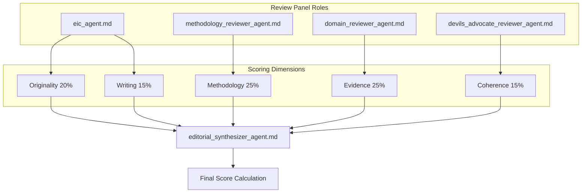
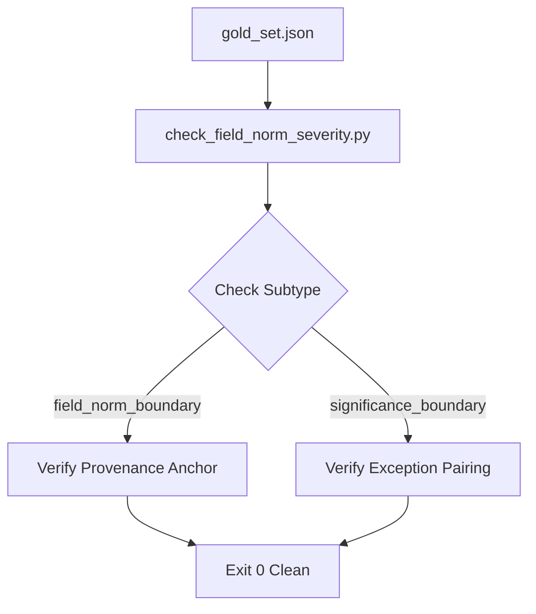
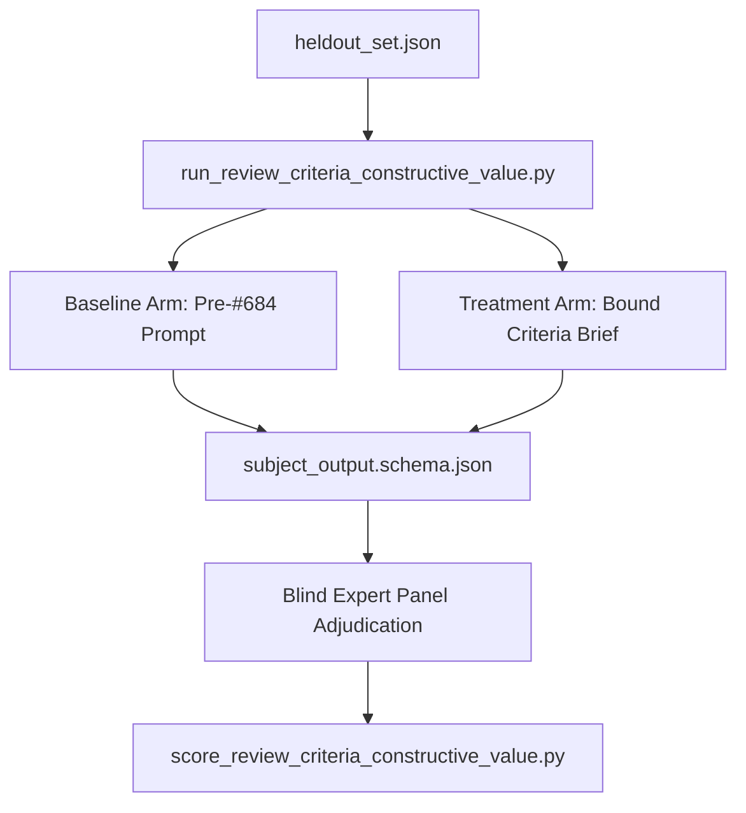

<!-- source: DeepWiki mcp.deepwiki.com · repo Imbad0202/academic-research-skills · page 5.3 Quality Rubrics and 0-100 Scoring · fetched 2026-10-30 -->

# Quality Rubrics and 0-100 Scoring

Relevant source files

The following files were used as context for generating this wiki page:

- [docs/design/2026-08-11-684-review-criteria-consumer-binding-spec.md](docs/design/2026-08-11-684-review-criteria-consumer-binding-spec.md)
- [evals/gold/field_norm_severity/README.md](evals/gold/field_norm_severity/README.md)
- [evals/gold/field_norm_severity/gold_set.json](evals/gold/field_norm_severity/gold_set.json)
- [evals/gold/field_norm_severity/manifest.yaml](evals/gold/field_norm_severity/manifest.yaml)
- [evals/heldout/review_criteria_constructive_value/README.md](evals/heldout/review_criteria_constructive_value/README.md)
- [evals/heldout/review_criteria_constructive_value/heldout_set.json](evals/heldout/review_criteria_constructive_value/heldout_set.json)
- [evals/heldout/review_criteria_constructive_value/measurement_plan.md](evals/heldout/review_criteria_constructive_value/measurement_plan.md)
- [evals/heldout/review_criteria_constructive_value/paired_adjudication.schema.json](evals/heldout/review_criteria_constructive_value/paired_adjudication.schema.json)
- [evals/heldout/review_criteria_constructive_value/subject_output.schema.json](evals/heldout/review_criteria_constructive_value/subject_output.schema.json)
- [evals/heldout/review_criteria_constructive_value/suite_lock.json](evals/heldout/review_criteria_constructive_value/suite_lock.json)
- [scripts/check_215_field_norm.py](scripts/check_215_field_norm.py)
- [scripts/check_field_norm_severity.py](scripts/check_field_norm_severity.py)
- [scripts/run_review_criteria_constructive_value.py](scripts/run_review_criteria_constructive_value.py)
- [scripts/score_review_criteria_constructive_value.py](scripts/score_review_criteria_constructive_value.py)
- [scripts/test_check_field_norm_severity.py](scripts/test_check_field_norm_severity.py)
- [scripts/test_run_review_criteria_constructive_value.py](scripts/test_run_review_criteria_constructive_value.py)

This page documents the calibrated 0-100 scoring system, evaluation dimensions, field-norm severity calibration routines, and constructive value measurement protocols used by the `academic-paper-reviewer` skill and its associated validation toolchains.

---

## Purpose and Scope

The scoring infrastructure provides a deterministic framework for evaluating academic manuscripts across five core dimensions, mapping scores to editorial decisions, and enforcing severity calibration against documented failure modes (such as field-norm boundaries and significance misclassifications). It governs how individual reviewer panels produce quantitative evaluations and how validation harnesses like `scripts/check_field_norm_severity.py` and `scripts/run_review_criteria_constructive_value.py` measure review quality.

---

## The Five Scoring Dimensions and Aggregation

The review system evaluates papers across five weighted dimensions. Individual panel seats assign scores based on role-scoped contracts, and the synthesizer agent aggregates these values into a final score.

### Dimension Weights and Calculation

*   **Originality (20%)**: Evaluates the novelty of the research question and contribution [academic-paper-reviewer/references/quality_rubrics.md:31-35]().
*   **Methodological Rigor (25%)**: Evaluates design alignment, validity controls, and statistical soundness [academic-paper-reviewer/references/quality_rubrics.md:43-47]().
*   **Evidence Sufficiency (25%)**: Evaluates the depth, currency, and source quality of the literature corpus [academic-paper-reviewer/references/quality_rubrics.md:55-59]().
*   **Argument Coherence (15%)**: Evaluates logical flow and pre-emption of counter-arguments [academic-paper-reviewer/references/quality_rubrics.md:67-71]().
*   **Writing Quality (15%)**: Evaluates academic register, grammar, and terminology precision [academic-paper-reviewer/references/quality_rubrics.md:74-78]().

Sources: [academic-paper-reviewer/references/quality_rubrics.md:30-78](), [academic-paper-reviewer/agents/eic_agent.md:88-90]()

---

## Decision Mapping and Thresholds

The aggregated 0-100 score maps directly to standardized journal decision states.

| Score Range | Editorial Decision | Pipeline Behavior |
| :--- | :--- | :--- |
| **≥ 80** | **Accept** | Advance to Final Integrity and Submission stages [academic-paper-reviewer/references/quality_rubrics.md:21-26](). |
| **65–79** | **Minor Revision** | Trigger `REVISE` stage; verification handled by EIC [academic-paper-reviewer/references/quality_rubrics.md:21-26](). |
| **50–64** | **Major Revision** | Trigger `REVISE` and mandatory `RE-REVIEW` stages [academic-paper-reviewer/references/quality_rubrics.md:21-26](). |
| **< 50** | **Reject** | Pipeline halt; material requires fundamental restructuring [academic-paper-reviewer/references/quality_rubrics.md:21-26](). |

Sources: [academic-paper-reviewer/references/quality_rubrics.md:21-26]()

---

## Field-Norm Severity Calibration (Issue #215)

The system guards against severity miscalibration using regression fixtures extracted from Kim et al. (arXiv:2605.20668v1) [evals/gold/field_norm_severity/manifest.yaml:1-10](). Because determining field-norm severity requires domain judgment rather than a purely deterministic predictor, the validation script `scripts/check_field_norm_severity.py` enforces structural completeness and first-party provenance integrity rather than computing distributional FNR/FPR [scripts/check_field_norm_severity.py:1-16]().

### Documented Failure Subtypes

*   **field_norm_boundary**: Critiques that are content-correct against a discipline-neutral standard but mis-rated because the model lacks subfield accepted-practice priors (e.g., CERN/LHCb internal artifact norms) [evals/gold/field_norm_severity/gold_set.json:13-14]().
*   **significance_boundary**: Miscalibrations stemming from the meta-reviewer's heuristic formula ("would addressing this change the core result?"), which often under-weights methodological rigor while over-weighting presentational polish [evals/gold/field_norm_severity/gold_set.json:15-16]().

Sources: [scripts/check_field_norm_severity.py:1-133](), [evals/gold/field_norm_severity/gold_set.json:1-17]()

---

## Review-Criteria Constructive Value Measurement (Issue #684)

Issue #684 introduces consumer bindings and constructive-value checks for reviewer prompts, measuring whether Target Criteria Briefs and parallel-conflict disciplines improve review utility [evals/heldout/review_criteria_constructive_value/measurement_plan.md:1-5]().

### Paired Evaluation Architecture

The measurement harness (`scripts/run_review_criteria_constructive_value.py`) executes a paired design comparing a baseline prompt against a treatment prompt across sealed scenarios [evals/heldout/review_criteria_constructive_value/README.md:9-17]().

Sources: [scripts/run_review_criteria_constructive_value.py:1-55](), [evals/heldout/review_criteria_constructive_value/README.md:1-35]()

---

## Sprint Contract Protocol

To prevent scoring drift where reviewers alter standards mid-evaluation, the system enforces a two-phase pre-commitment contract [academic-paper-reviewer/references/sprint_contract_protocol.md:1-16]().

1.  **Phase 1 (Blind)**: Reviewers receive paper metadata only and must output explicit scoring trigger definitions (`what_triggers_block`, `what_triggers_warn`) [academic-paper-reviewer/references/sprint_contract_protocol.md:47-51]().
2.  **Phase 2 (Visible)**: Reviewers evaluate the manuscript content against their Phase 1 pre-commitments, passing conformance checks in `scripts/check_phase_conformance.py` [academic-paper-reviewer/references/sprint_contract_protocol.md:91-92]().

Sources: [academic-paper-reviewer/references/sprint_contract_protocol.md:1-32](), [scripts/check_phase_conformance.py:25-27]()

---

