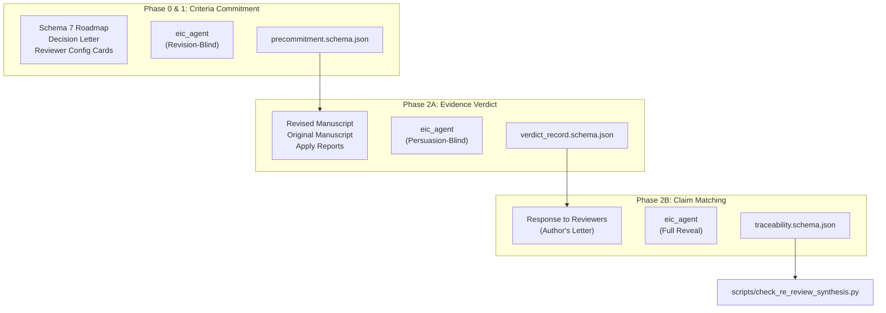

<!-- source: DeepWiki mcp.deepwiki.com · repo Imbad0202/academic-research-skills · page 5.4 Re-Review and Verification Protocol · fetched 2026-10-30 -->

# Re-Review and Verification Protocol

Relevant source files

The following files were used as context for generating this wiki page:

- [academic-paper-reviewer/references/re_review_mode_protocol.md](academic-paper-reviewer/references/re_review_mode_protocol.md)
- [academic-paper/agents/revision_coach_agent.md](academic-paper/agents/revision_coach_agent.md)
- [academic-paper/examples/commitment_ledger_example.md](academic-paper/examples/commitment_ledger_example.md)
- [academic-paper/templates/revision_tracking_template.md](academic-paper/templates/revision_tracking_template.md)
- [academic-pipeline/references/two_stage_review_protocol.md](academic-pipeline/references/two_stage_review_protocol.md)
- [docs/design/2026-05-31-ars-268-schema11-nested-commitment-ledger-spec.md](docs/design/2026-05-31-ars-268-schema11-nested-commitment-ledger-spec.md)
- [evals/calibration/commitment_ledger_seed.yaml](evals/calibration/commitment_ledger_seed.yaml)
- [evals/heldout/measurement_report.schema.json](evals/heldout/measurement_report.schema.json)
- [evals/heldout/pipeline_behavior_robustness/README.md](evals/heldout/pipeline_behavior_robustness/README.md)
- [evals/heldout/pipeline_behavior_robustness/heldout_set.json](evals/heldout/pipeline_behavior_robustness/heldout_set.json)
- [evals/heldout/re_review_persuasion_invariance/README.md](evals/heldout/re_review_persuasion_invariance/README.md)
- [evals/heldout/revision_claim_drift/README.md](evals/heldout/revision_claim_drift/README.md)
- [scripts/bibliographic_integrity_signals.py](scripts/bibliographic_integrity_signals.py)
- [scripts/check_268_nested_commitment_ledger.py](scripts/check_268_nested_commitment_ledger.py)
- [scripts/check_670_revision_roadmap_integration.py](scripts/check_670_revision_roadmap_integration.py)
- [scripts/check_bibliographic_integrity_signals.py](scripts/check_bibliographic_integrity_signals.py)
- [scripts/check_heldout_measurement_report.py](scripts/check_heldout_measurement_report.py)
- [scripts/check_re_review_synthesis.py](scripts/check_re_review_synthesis.py)
- [scripts/test_check_268_nested_commitment_ledger.py](scripts/test_check_268_nested_commitment_ledger.py)
- [scripts/test_check_bibliographic_integrity_signals.py](scripts/test_check_bibliographic_integrity_signals.py)
- [scripts/test_check_heldout_measurement_report.py](scripts/test_check_heldout_measurement_report.py)
- [scripts/test_check_re_review_synthesis.py](scripts/test_check_re_review_synthesis.py)
- [shared/bibliographic_integrity_signals.md](shared/bibliographic_integrity_signals.md)
- [shared/contracts/passport/bibliographic_integrity_signal.schema.json](shared/contracts/passport/bibliographic_integrity_signal.schema.json)

## Purpose and Scope

The re-review mode (also called "verification review") is the dedicated protocol for **Pipeline Stage 3'**, designed to verify whether revised manuscripts adequately address feedback from the initial review cycle [academic-paper-reviewer/references/re_review_mode_protocol.md:1-3](). Unlike the full review process documented in [5.2](), re-review uses a **three-gate evidence-before-persuasion contract** (`shared/contracts/re_review/` + `scripts/check_re_review_synthesis.py`) to prevent rubber-stamp approvals and ensure that author persuasion does not anchor the verification of actual manuscript changes [academic-paper-reviewer/references/re_review_mode_protocol.md:5]().

This page documents:
- The three-gate orchestration (Criteria Commitment, Evidence Verdict, and Claim Matching).
- Yardstick continuity and reviewer configuration freeze policies.
- The nested commitment ledger (Schema 11) and lifecycle status tracking.
- Goalpost guards and persuasion-invariance paired controls.
- Integration with the revision patch toolchain, hash-bound provenance, and residual coaching.

Sources: [academic-paper-reviewer/SKILL.md:15-22](), [academic-paper-reviewer/references/re_review_mode_protocol.md:1-6](), [docs/design/2026-07-27-576-spec-b-re-review-precommitment-contract-spec.md:11-22]()

---

## Three-Gate Orchestration Architecture

To eliminate shared-bias blind spots and prevent the "read-then-rationalize" anti-pattern, the system enforces a strict withholding matrix across sequential phases dispatched by the orchestrating layer (`scripts/check_re_review_synthesis.py`) [academic-paper-reviewer/references/re_review_mode_protocol.md:37]().

### Data Flow and Code Entities

**Persistence Logic and Withholding**:
- **Phase 0**: The dispatching layer emits the input manifest containing exactly eleven artifact keys [academic-paper-reviewer/references/re_review_mode_protocol.md:20]().
- **Phase 1**: Criteria commitment (revision-blind). The agent operationalizes inherited criteria from the roadmap and decision letter without seeing the revised text [academic-paper-reviewer/references/re_review_mode_protocol.md:23,57-65]().
- **Phase 2A**: Evidence verdict (persuasion-blind). The agent evaluates manuscript changes against pre-committed criteria before reading the response letter [academic-paper-reviewer/references/re_review_mode_protocol.md:24]().
- **Phase 2B**: Claim matching (letter revealed). The response to reviewers is unmasked to check claim concordance and "acknowledgment-only" items [academic-paper-reviewer/references/re_review_mode_protocol.md:25]().

Sources: [academic-paper-reviewer/references/re_review_mode_protocol.md:20-56](), [docs/design/2026-07-27-576-spec-b-re-review-precommitment-contract-spec.md:55-63]()

---

## Yardstick Continuity and Reviewer Configuration Freeze

Re-review MUST reuse the Round-1 Reviewer Configuration Cards whenever they are available [academic-paper-reviewer/references/re_review_mode_protocol.md:31](). 

1. **Reviewer Configuration Freeze**: The `field_analyst_agent` is **not** re-invoked at Stage 3' [academic-paper-reviewer/references/re_review_mode_protocol.md:31](). Re-running it over the revised manuscript would silently change the yardstick between rounds, invalidating the continuity of the Roadmap [academic-paper-reviewer/references/re_review_mode_protocol.md:31]().
2. **Fallback Mechanism**: When Round-1 cards are unavailable, `field_analyst_agent` may be re-run over the ORIGINAL (pre-revision) manuscript, and the Judge Record must carry the marker `[YARDSTICK-REGENERATED: original manuscript — <reason>]` [academic-paper-reviewer/references/re_review_mode_protocol.md:33](). Silent regeneration is a protocol violation [academic-paper-reviewer/references/re_review_mode_protocol.md:33]().
3. **Hash-Bound Provenance**: Verification checks the `apply_chain_witness` (`scripts/check_re_review_synthesis.py`) ensuring output draft hashes align with apply reports [scripts/check_re_review_synthesis.py:14-22]().

Sources: [academic-paper-reviewer/references/re_review_mode_protocol.md:29-33](), [scripts/check_re_review_synthesis.py:12-22]()

---

## Nested Commitment Ledger (Schema 11)

Per Schema 11 v3.11, the commitment ledger adopts a **nested-object shape** where each concern's commitments are structured as a single YAML block keyed by `concern_id` [academic-paper/templates/revision_tracking_template.md:35](). Lifecycle fields (`fulfillment_status` and optional `unfulfilled_rationale`) are nested **inside** each commitment object rather than maintained in parallel arrays, preventing index desynchronization [academic-paper/templates/revision_tracking_template.md:35]().

### Fulfillment Status Taxonomy

| Status | Definition | Verification Site / Rationale Requirement |
|--------|------------|---------------------------------------------|
| **fulfilled** | Required evidence is present and substantively addresses the commitment. | Verified at `revision_location` (manuscript-evidence types or response letter for `acknowledgment_only`) [academic-paper/templates/revision_tracking_template.md:98-102](). |
| **partial** | Evidence exists but does not fully address the commitment. | Requires `unfulfilled_rationale` explaining the gap [academic-paper/templates/revision_tracking_template.md:104-105](). |
| **not-fulfilled** | Required evidence is absent. | Requires `unfulfilled_rationale` (`done-elsewhere`, `rejected`, or `deferred`) [academic-paper/templates/revision_tracking_template.md:107-111](). |
| **explicitly-rejected-with-rationale** | Author explicitly declines the suggestion with justification. | Requires formal rationale [academic-paper/templates/revision_tracking_template.md:115](). |

**Advisories**:
- **`COMMITMENT_GAP`**: Triggers if a commitment object's status is non-fulfilled without a valid rationale [evals/calibration/commitment_ledger_seed.yaml:38-40]().
- **`EVIDENCE_TYPE_UNSPECIFIED`**: Triggers if `required_evidence_type == other`, prompting the author to specify the evidence location [academic-paper/templates/revision_tracking_template.md:102]().

Sources: [academic-paper/templates/revision_tracking_template.md:35-115](), [evals/calibration/commitment_ledger_seed.yaml:1-48](), [academic-paper/examples/commitment_ledger_example.md:1-137]()

---

## Goalpost Guard and Persuasion-Invariance Controls

1. **Goalpost Guard**: The frozen new-issue set is byte-identical across validation phases, ensuring that reviewers cannot introduce brand-new, unrelated requirements during re-review unless they meet strict regression criteria [scripts/check_re_review_synthesis.py:29-31]().
2. **Persuasion-Invariance Controls**: Paired evaluation suites (`evals/heldout/re_review_persuasion_invariance/`) measure whether verification verdicts remain stable regardless of rhetorical polish or emotional pleading in the author's response letter.

Sources: [scripts/check_re_review_synthesis.py:29-31](), [evals/heldout/re_review_persuasion_invariance/README.md]()

---

## Verification Logic, Synthesis, and Residual Coaching

The re-review execution pipeline derives final decisions through mechanical evaluation scripts (`scripts/check_re_review_synthesis.py`) [scripts/check_re_review_synthesis.py:2-6]().

### Verification Artifacts and Runtime

| File / Artifact | Producing Agent / Script | Role / Schema |
|----------------|--------------------------|----------------|
| `precommitment.json` | `eic_agent` (Phase 1) | `shared/contracts/re_review/precommitment.schema.json` [scripts/test_check_re_review_synthesis.py:30-45]() |
| `verdict_record.json` | `eic_agent` (Phase 2A) | `shared/contracts/re_review/verdict_record.schema.json` [scripts/test_check_re_review_synthesis.py:30-46]() |
| `traceability.json` | `eic_agent` (Phase 2B) | `shared/contracts/re_review/traceability.schema.json` [scripts/test_check_re_review_synthesis.py:30-47]() |
| `apply-report.json` | `ars_apply_revision_patch.py` | Provenance and hash-chain witness [academic-paper-reviewer/references/re_review_mode_protocol.md:19]() |

### Residual Coaching
If the Re-Review decision is **Major Revision**, the system initiates **Residual Coaching** (maximum 5 rounds) via the `eic_agent` to guide the user through unresolved gaps and structural trade-offs without shifting goalposts [academic-pipeline/references/two_stage_review_protocol.md:25-27]().

Sources: [academic-pipeline/references/two_stage_review_protocol.md:25-27](), [academic-paper-reviewer/references/re_review_mode_protocol.md:37-64](), [scripts/check_re_review_synthesis.py:1-49]()

---

