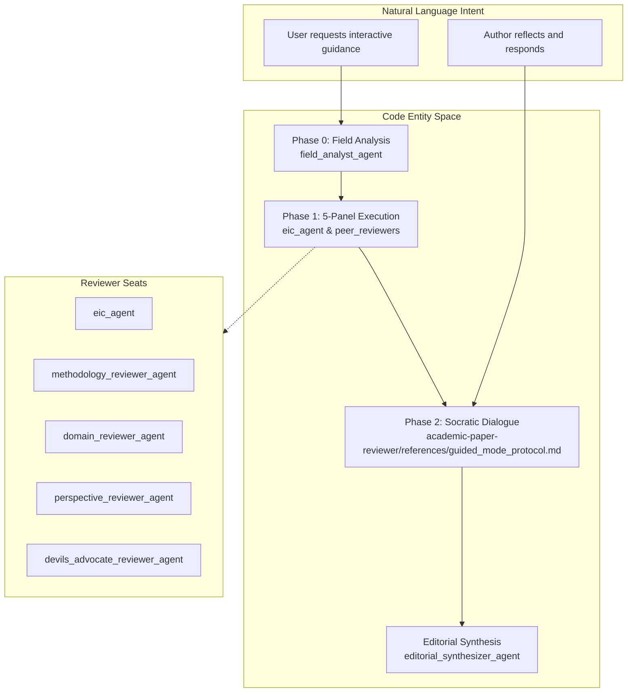
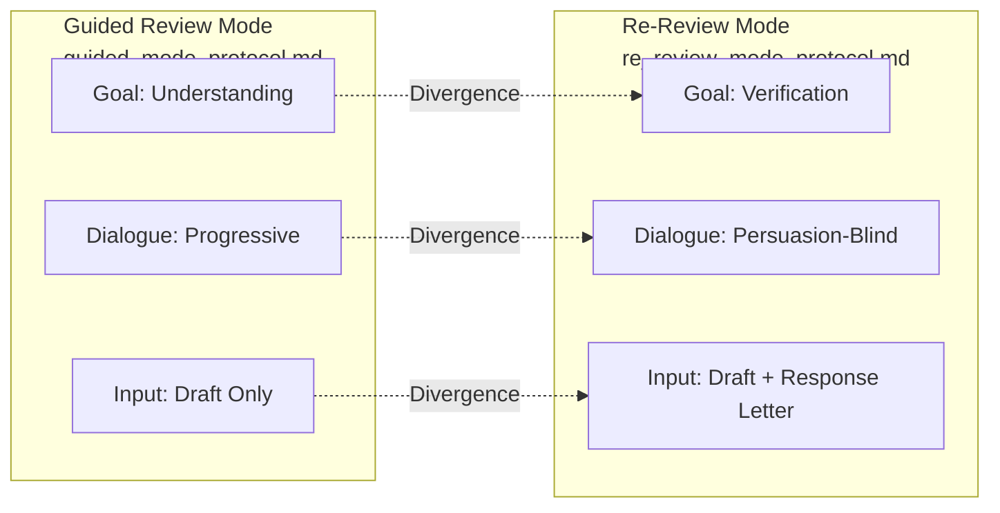

<!-- source: DeepWiki mcp.deepwiki.com · repo Imbad0202/academic-research-skills · page 5.5 Guided Review Mode · fetched 2026-10-30 -->

# Guided Review Mode

Relevant source files

The following files were used as context for generating this wiki page:

- [academic-paper-reviewer/references/calibration_mode_protocol.md](academic-paper-reviewer/references/calibration_mode_protocol.md)
- [academic-paper-reviewer/references/guided_mode_protocol.md](academic-paper-reviewer/references/guided_mode_protocol.md)
- [docs/design/2026-06-08-273-rubric-aware-calibration-note-design.md](docs/design/2026-06-08-273-rubric-aware-calibration-note-design.md)

## Purpose and Scope

Guided Review Mode is a pedagogical variant of the `academic-paper-reviewer` skill that uses Socratic dialogue to help authors understand their paper's problems themselves rather than receiving passive revision instructions. This mode executes the same 5-reviewer analysis as `full` mode—including the `eic_agent`, three peer reviewers, and the `devils_advocate_reviewer_agent`—but presents findings progressively through interactive conversation [academic-paper-reviewer/references/guided_mode_protocol.md:3-11]().

The design philosophy focuses on **progressive revelation**, ensuring authors internalize the reasoning behind critiques and research gaps before the system provides the final structured Revision Roadmap [academic-paper-reviewer/references/guided_mode_protocol.md:13-22](). Note that under v3.6.2 sprint contract rules, sprint contracts are reserved for `reviewer_full` and `reviewer_methodology_focus` only; Guided Mode runs without formal contract enforcement and retains its pre-v3.6.2 behavior [academic-paper-reviewer/references/guided_mode_protocol.md:32-34]().

Sources: [academic-paper-reviewer/references/guided_mode_protocol.md:1-34](), [academic-paper-reviewer/SKILL.md:15-22]()

---

## Activation and Intent Detection

Guided mode is activated when the system detects a user's desire for mentorship or interactive improvement rather than a static report.

| Trigger Phrase | Intent Signal | Code Route / Reference |
|----------------|---------------|------------------------|
| "guide me through the review" | Explicit request for guidance | `academic-paper-reviewer/references/guided_mode_protocol.md` |
| "walk me through the issues" | Step-by-step understanding | `academic-paper-reviewer/references/guided_mode_protocol.md` |
| "help me improve my paper" | Learning-focused improvement | `academic-paper-reviewer/SKILL.md` |
| "what's wrong with my paper" | Discovery-oriented inquiry | `academic-paper-reviewer/SKILL.md` |

The `academic-paper-reviewer` skill maps this to exploratory, template-light interaction profiles [academic-paper-reviewer/SKILL.md:69-72]().

Sources: [academic-paper-reviewer/SKILL.md:47-72](), [academic-paper-reviewer/references/guided_mode_protocol.md:1-5]()

---

## Three-Phase Execution Model

Guided mode modifies the standard review workflow to support pedagogical flow. Unlike `full` mode, Phase 2 is interactive rather than a single document generation. The diagram below bridges natural language dialogue concepts to code entities found in `academic-paper-reviewer/references/guided_mode_protocol.md` and related agent definitions.

### Diagram: Execution Architecture (Natural Language to Code Entities)

Sources: [academic-paper-reviewer/references/guided_mode_protocol.md:7-11](), [academic-paper-reviewer/SKILL.md:92-135]()

---

## Progressive Revelation Sequence

The dialogue follows a structured sequence designed to build understanding incrementally, preventing information overload [academic-paper-reviewer/references/guided_mode_protocol.md:13-22]().

| Step | Agent Source | Content Revealed | Pedagogical Purpose |
|------|-------------|------------------|---------------------|
| 1 | `eic_agent` | 1-2 core strengths | Establish trust and acknowledge genuine merit [academic-paper-reviewer/references/guided_mode_protocol.md:15]() |
| 2 | `eic_agent` | 1 critical structural issue | Focus attention on the most high-impact problem [academic-paper-reviewer/references/guided_mode_protocol.md:15]() |
| 3 | `methodology_reviewer_agent` | Research design/validity | Ground understanding in methodological rigor [academic-paper-reviewer/references/guided_mode_protocol.md:18]() |
| 4 | `domain_reviewer_agent` | Literature/Theory | Expand to domain-specific contributions [academic-paper-reviewer/references/guided_mode_protocol.md:19]() |
| 5 | `perspective_reviewer_agent` | Cross-disciplinary | Challenge broader disciplinary assumptions [academic-paper-reviewer/references/guided_mode_protocol.md:20]() |
| 6 | `devils_advocate_reviewer_agent` | Core argument challenges | Stress-test the thesis against counter-arguments [academic-paper-reviewer/references/guided_mode_protocol.md:21]() |
| 7 | `editorial_synthesizer_agent` | Revision Roadmap | Synthesize the dialogue into actionable steps [academic-paper-reviewer/references/guided_mode_protocol.md:22]() |

Sources: [academic-paper-reviewer/references/guided_mode_protocol.md:13-22](), [academic-paper-reviewer/agents/editorial_synthesizer_agent.md:35-42]()

---

## Dialogue Rules and SCR Protocol

The interaction is governed by strict Socratic constraints to ensure the user remains an active participant rather than a passive recipient of feedback [academic-paper-reviewer/references/guided_mode_protocol.md:24-31]().

### Interaction Constraints
*   **Response Length**: Limited to 200-400 words per turn [academic-paper-reviewer/references/guided_mode_protocol.md:26]().
*   **Question Taxonomy**: Uses the `socratic_mentor_agent` question types (Clarification, Assumption-testing, Evidence-probing, and Consequence-tracing) [academic-paper/SKILL.md:100]().
*   **Instruction Style**: Uses questions over commands (e.g., "How does this sampling strategy account for X?" vs "The sampling is flawed") [academic-paper-reviewer/references/guided_mode_protocol.md:27]().

### SCR (State-Challenge-Reflect) Mechanism
Guided mode leverages the SCR protocol to manage cognitive friction [deep-research/SKILL.md:116]():
1.  **State**: The agent summarizes the author's current position or claim.
2.  **Challenge**: The agent introduces a finding from the Phase 1 reports that contradicts or complicates that position.
3.  **Reflect**: The agent asks the author to reconcile the two, facilitating insight extraction [academic-paper/SKILL.md:100]().

Sources: [academic-paper-reviewer/references/guided_mode_protocol.md:24-31](), [academic-paper/SKILL.md:100](), [deep-research/SKILL.md:116]()

---

## Comparison with Re-Review Mode

While Guided Review focuses on initial understanding, **Re-Review Mode** (used in Pipeline Stage 3') focuses on verification [academic-paper-reviewer/references/re_review_mode_protocol.md:1-5]().

### Diagram: Reviewer Mode Comparison (Concept to Code Execution)

Sources: [academic-paper-reviewer/references/re_review_mode_protocol.md:1-26](), [academic-paper-reviewer/references/guided_mode_protocol.md:1-5]()

**Key Differences**:
*   **Persuasion Gate**: Re-review mode uses a **three-gate evidence-before-persuasion contract** where the author's response letter is withheld until initial evidence is verified [academic-paper-reviewer/references/re_review_mode_protocol.md:5-26](). Guided mode reveals information to the author rather than verifying author claims.
*   **Residual Coaching**: If a Re-Review results in a Major Revision, the system may activate a Socratic sub-flow called "Residual Coaching" to handle remaining gaps [academic-paper-reviewer/references/re_review_mode_protocol.md:5]—effectively a targeted version of Guided Mode.

Sources: [academic-paper-reviewer/references/re_review_mode_protocol.md:1-26](), [academic-paper-reviewer/references/guided_mode_protocol.md:1-5]()

---

## Output and Handoff

The conclusion of Guided Mode triggers the `editorial_synthesizer_agent` to produce the final **Editorial Decision Letter** and **Revision Roadmap** [academic-paper-reviewer/agents/editorial_synthesizer_agent.md:18-23]().

1.  **Arbitration**: The synthesizer identifies consensus and disagreements from the Phase 1 reports, informed by the user's responses during the guided dialogue [academic-paper-reviewer/agents/editorial_synthesizer_agent.md:37-41]().
2.  **Schema 7 Handoff**: The resulting Revision Roadmap is formatted as machine-readable JSON (Schema 7), allowing it to be consumed by `academic-paper` in `revision` or `revision-coach` modes [academic-paper-reviewer/agents/editorial_synthesizer_agent.md:42](), [academic-paper/SKILL.md:102]().

Sources: [academic-paper-reviewer/agents/editorial_synthesizer_agent.md:18-42](), [academic-paper-reviewer/references/guided_mode_protocol.md:22](), [academic-paper/SKILL.md:102]()

---

