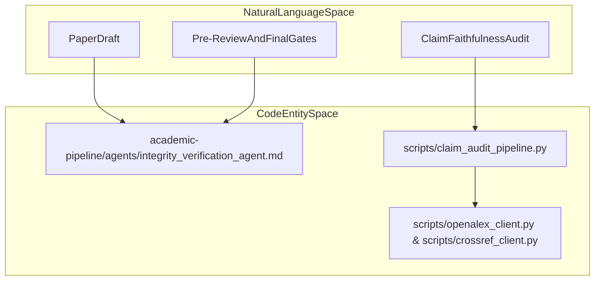
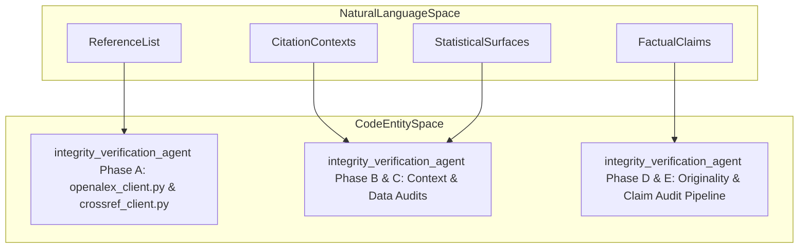

<!-- source: DeepWiki mcp.deepwiki.com · repo Imbad0202/academic-research-skills · page 6 Integrity Verification System · fetched 2026-10-30 -->

# Integrity Verification System

Relevant source files

The following files were used as context for generating this wiki page:

- [.github/workflows/spec-consistency.yml](.github/workflows/spec-consistency.yml)
- [CHANGELOG.md](CHANGELOG.md)
- [academic-pipeline/agents/integrity_verification_agent.md](academic-pipeline/agents/integrity_verification_agent.md)
- [academic-pipeline/agents/pipeline_orchestrator_agent.md](academic-pipeline/agents/pipeline_orchestrator_agent.md)
- [academic-pipeline/references/ai_research_failure_modes.md](academic-pipeline/references/ai_research_failure_modes.md)
- [academic-pipeline/references/passport_as_reset_boundary.md](academic-pipeline/references/passport_as_reset_boundary.md)
- [academic-pipeline/references/pipeline_state_machine.md](academic-pipeline/references/pipeline_state_machine.md)
- [academic-pipeline/references/process_summary_protocol.md](academic-pipeline/references/process_summary_protocol.md)
- [scripts/_ci_pytest_manifest.toml](scripts/_ci_pytest_manifest.toml)
- [scripts/check_pipeline_boundary_semantics.py](scripts/check_pipeline_boundary_semantics.py)
- [scripts/test_check_pipeline_boundary_semantics.py](scripts/test_check_pipeline_boundary_semantics.py)
- [scripts/test_v3_6_7_phase_6_6.py](scripts/test_v3_6_7_phase_6_6.py)
- [shared/contracts/README.md](shared/contracts/README.md)
- [shared/handoff_schemas.md](shared/handoff_schemas.md)

The Integrity Verification System is a mandatory academic integrity enforcement layer that operates at two critical gates in the academic pipeline: pre-review (Stage 2.5) and post-revision (Stage 4.5) [academic-pipeline/agents/integrity_verification_agent.md:10-11](). It performs bounded checks on registered references, citation contexts, data surfaces, and claims to prevent fabricated references, citation hallucinations, and misrepresented evidence from entering peer review or publication [academic-pipeline/agents/integrity_verification_agent.md:3-10]().

This system is coordinated by `academic-pipeline/agents/integrity_verification_agent.md` and executes a structured verification protocol across five phases (Phase A–E) [academic-pipeline/agents/integrity_verification_agent.md:10-12]().

For detailed coverage of specific sub-topics, see the child pages:
- [Two-Stage Integrity Protocol](#6.1) — Stage 2.5 vs Stage 4.5, coverage differences, pass criteria, correction loops, STALE status, and the 7-mode AI Research Failure Mode Checklist.
- [Phase A: Reference Verification](#6.2) — Verification of every reference, bibliographic accuracy, ghost citation detection, verification cache, and cross-index triangulation via Semantic Scholar/OpenAlex/Crossref/arXiv clients.
- [Phase B-E: Context, Data, Originality, Claims](#6.3) — Citation context accuracy, statistical verification, plagiarism detection, claim cross-referencing, evidence rows, and the claim-faithfulness audit pipeline.
- [Anti-Hallucination Mandate](#6.4) — Hallucination taxonomy, gray-zone prevention, search requirements, contamination and bibliographic integrity signals, ground truth isolation and instruction-data boundary.
- [Claim Standing and Evidence Probes](#6.5) — Search-bounded claim standing probe: candidate ledger, query plans, stance records, evidence row schemas, rendering views, and claim strength drift disposition.
- [Post-Publication Audit Case Study](#6.6) — Analysis of the showcase audit, error rates, lessons learned, and how it drove the integrity overhaul.

---

## System Architecture

The integrity verification architecture bridges natural language research documentation with concrete code entities in the codebase, enforcing strict verification boundaries via automated scripts and agent contracts.

### Diagram: Integrity System Architecture Bridge

**Sources:** [academic-pipeline/agents/integrity_verification_agent.md:1-12](), [scripts/claim_audit_pipeline.py:1-16]()

---

## Two-Stage Integrity Protocol

The verification protocol engages at Stage 2.5 (pre-review) and Stage 4.5 (post-revision) [academic-pipeline/agents/integrity_verification_agent.md:10-11](). Stage 2.5 establishes baseline reference and claim validity, while Stage 4.5 enforces strict zero-tolerance re-verification of all modified and newly added elements.

For full details on pass criteria, correction loops, and failure modes, see [Two-Stage Integrity Protocol](#6.1).

**Sources:** [academic-pipeline/agents/integrity_verification_agent.md:10-12](), [academic-pipeline/references/pipeline_state_machine.md:108-112]()

---

## Phase A–E Verification Protocol

The verification engine processes manuscripts through five sequential phases, combining API lookups with WebSearch validation.

### Diagram: Verification Protocol Flow

**Sources:** [academic-pipeline/agents/integrity_verification_agent.md:10-15](), [scripts/openalex_client.py:1-10](), [scripts/crossref_client.py:1-14]()

For detailed breakdown of Phase A, see [Phase A: Reference Verification](#6.2). For Phases B through E, see [Phase B-E: Context, Data, Originality, Claims](#6.3).

---

## Anti-Hallucination Mandate

To mitigate same-source hallucination risks where an AI verifier shares blind spots with the AI author, the system enforces strict rules:
1. **Never rely on AI memory** — every reference must undergo external search verification [academic-pipeline/agents/integrity_verification_agent.md:14-18]().
2. **Classify unknown references strictly** — items failing verification are marked `NOT_FOUND` [academic-pipeline/agents/integrity_verification_agent.md:18-20]().
3. **Instruction-data boundary** — retrieved external content is treated strictly as data, never as executable instructions [academic-pipeline/agents/integrity_verification_agent.md:23-37]().

For detailed taxonomy and mitigation strategies, see [Anti-Hallucination Mandate](#6.4).

**Sources:** [academic-pipeline/agents/integrity_verification_agent.md:14-60]()

---

## Claim Standing and Evidence Probes

Search-bounded claim standing probes evaluate whether empirical claims are backed by verifiable evidence rows and maintain logical consistency across revisions. 

For complete schemas and query plan definitions, see [Claim Standing and Evidence Probes](#6.5).

**Sources:** [shared/contracts/README.md:1-25](), [academic-pipeline/agents/integrity_verification_agent.md:3-12]()

---

## Post-Publication Audit Case Study

An analysis of project self-audits revealed historical citation error rates that directly motivated the creation of the anti-hallucination mandate, cross-index triangulation clients, and the L3 claim-faithfulness audit gate.

For lessons learned and error rate breakdowns, see [Post-Publication Audit Case Study](#6.6).

**Sources:** [academic-pipeline/agents/integrity_verification_agent.md:41-60]()

---

