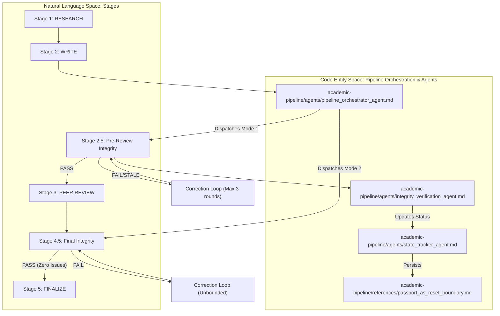
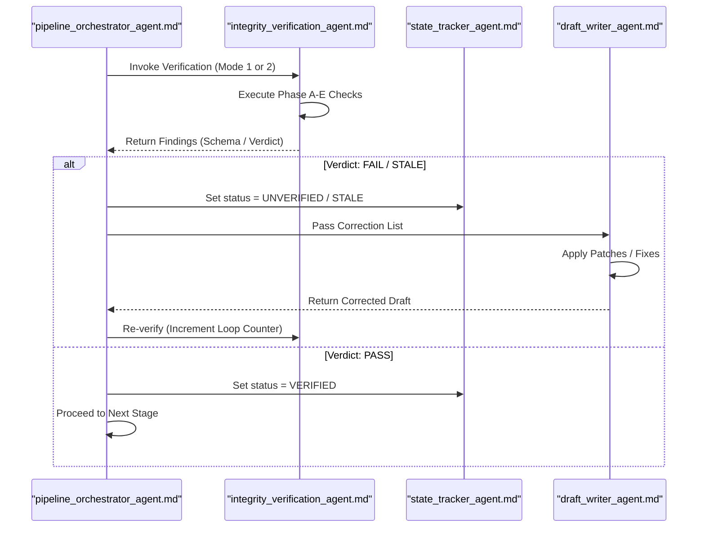
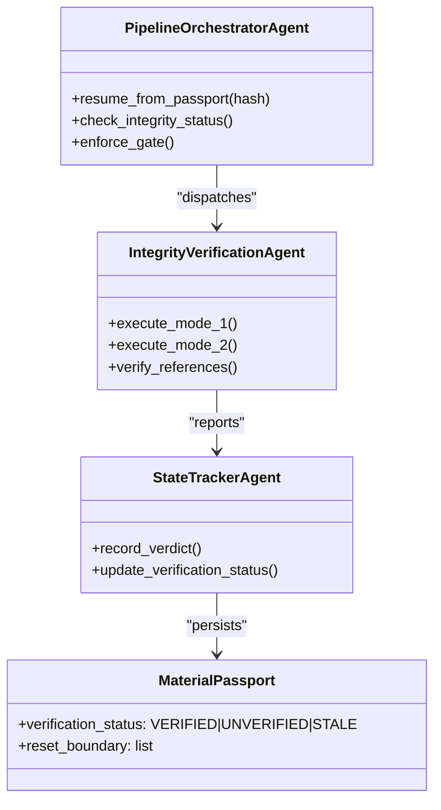

<!-- source: DeepWiki mcp.deepwiki.com · repo Imbad0202/academic-research-skills · page 6.1 Two-Stage Integrity Protocol · fetched 2026-10-30 -->

# Two-Stage Integrity Protocol

Relevant source files

The following files were used as context for generating this wiki page:

- [.github/workflows/spec-consistency.yml](.github/workflows/spec-consistency.yml)
- [CHANGELOG.md](CHANGELOG.md)
- [academic-paper/references/anti_leakage_protocol.md](academic-paper/references/anti_leakage_protocol.md)
- [academic-pipeline/agents/integrity_verification_agent.md](academic-pipeline/agents/integrity_verification_agent.md)
- [academic-pipeline/agents/pipeline_orchestrator_agent.md](academic-pipeline/agents/pipeline_orchestrator_agent.md)
- [academic-pipeline/references/ai_research_failure_modes.md](academic-pipeline/references/ai_research_failure_modes.md)
- [academic-pipeline/references/integrity_review_protocol.md](academic-pipeline/references/integrity_review_protocol.md)
- [academic-pipeline/references/passport_as_reset_boundary.md](academic-pipeline/references/passport_as_reset_boundary.md)
- [academic-pipeline/references/pipeline_state_machine.md](academic-pipeline/references/pipeline_state_machine.md)
- [academic-pipeline/references/process_summary_protocol.md](academic-pipeline/references/process_summary_protocol.md)
- [docs/design/2026-04-30-ars-v3.6.8-trust-provenance-and-drift-transparency-spec.md](docs/design/2026-04-30-ars-v3.6.8-trust-provenance-and-drift-transparency-spec.md)
- [docs/design/2026-05-12-ars-v3.7.3-claim-faithfulness-and-contaminated-source-spec.md](docs/design/2026-05-12-ars-v3.7.3-claim-faithfulness-and-contaminated-source-spec.md)
- [docs/design/2026-05-17-ars-v3.9.0-cross-index-triangulation-measurement-spec.md](docs/design/2026-05-17-ars-v3.9.0-cross-index-triangulation-measurement-spec.md)
- [examples/compliance/fixture_primary_raise_weak.yaml](examples/compliance/fixture_primary_raise_weak.yaml)
- [examples/compliance/fixture_sr_full_compliant.yaml](examples/compliance/fixture_sr_full_compliant.yaml)
- [examples/compliance/fixture_sr_missing_M4.yaml](examples/compliance/fixture_sr_missing_M4.yaml)
- [scripts/_ci_pytest_manifest.toml](scripts/_ci_pytest_manifest.toml)
- [scripts/check_pipeline_boundary_semantics.py](scripts/check_pipeline_boundary_semantics.py)
- [scripts/check_v3_6_8_cite_provenance_pipeline.py](scripts/check_v3_6_8_cite_provenance_pipeline.py)
- [scripts/test_check_pipeline_boundary_semantics.py](scripts/test_check_pipeline_boundary_semantics.py)
- [scripts/test_check_v3_6_8_cite_provenance_pipeline.py](scripts/test_check_v3_6_8_cite_provenance_pipeline.py)
- [scripts/test_v3_6_7_phase_6_6.py](scripts/test_v3_6_7_phase_6_6.py)
- [shared/compliance_checkpoint_protocol.md](shared/compliance_checkpoint_protocol.md)
- [shared/contracts/README.md](shared/contracts/README.md)
- [shared/handoff_schemas.md](shared/handoff_schemas.md)
- [shared/prisma_trAIce_protocol.md](shared/prisma_trAIce_protocol.md)
- [shared/templates/codex_audit_multifile_template.md](shared/templates/codex_audit_multifile_template.md)

## Purpose and Scope

This document specifies the two-stage integrity verification architecture executed by `academic-pipeline/agents/integrity_verification_agent.md` within the academic research-to-publication pipeline. The verification protocol executes twice during an end-to-end run: once before peer review (Stage 2.5) and once after final revisions (Stage 4.5). Each stage enforces escalating verification coverage, strict pass criteria, correction loops, and material state tracking (`STALE` / `VERIFIED` status).

The subsystem is designed to counteract same-source hallucination and bibliographic degradation via strict WebSearch triangulation mandates and the 7-mode AI research failure mode taxonomy.

**Sources:** `[academic-pipeline/agents/integrity_verification_agent.md:1-18]()`, `[academic-pipeline/references/integrity_review_protocol.md:1-7]()`

---

## Stage 2.5 vs Stage 4.5: Architecture and Coverage Differences

The integrity verification system implements a progressive quality gate strategy across pipeline transitions, managed by `academic-pipeline/agents/pipeline_orchestrator_agent.md` and evaluated by `academic-pipeline/agents/integrity_verification_agent.md`.

### Pipeline Integrity Flow (Natural Language to Code Entity Space)

**Sources:** `[academic-pipeline/agents/pipeline_orchestrator_agent.md:38-45]()`, `[academic-pipeline/agents/integrity_verification_agent.md:1-15]()`, `[academic-pipeline/references/integrity_review_protocol.md:3-45]()`

### Coverage Comparison Matrix

| Phase | Verification Domain | Stage 2.5 (Mode 1) Coverage | Stage 4.5 (Mode 2) Coverage | Escalation Rationale |
| :--- | :--- | :--- | :--- | :--- |
| **Phase A** | Reference Verification | 100% | **100% FRESH** | Independent re-verification; ignores previous cache `[academic-pipeline/references/integrity_review_protocol.md:34-34]()` |
| **Phase B** | Citation Context | ≥30% spot-check | **100%** | Complete context verification before publication `[academic-pipeline/references/integrity_review_protocol.md:35-35]()` |
| **Phase C** | Statistical / Data Surfaces | 100% | **100%** | Maintained consistency across pipeline `[academic-pipeline/references/integrity_review_protocol.md:14-14]()` |
| **Phase D** | Originality Check | ≥30% | **≥50% + 100% new** | Expanded sampling plus all revised text `[academic-pipeline/references/integrity_review_protocol.md:37-37]()` |
| **Phase E** | Claim Verification | Risk-Stratified (100% High + 10% random) | **100%** | Full claim-standing audit `[academic-pipeline/references/integrity_review_protocol.md:38-38]()` |

**Sources:** `[academic-pipeline/agents/integrity_verification_agent.md:294-313]`, `[academic-pipeline/references/integrity_review_protocol.md:3-45]()`

---

## Pass Criteria and Correction Loops

Integrity verification uses strict pass/fail criteria. If verification fails, the orchestrator triggers correction loops via `academic-paper/agents/draft_writer_agent.md` or revision handlers.

### Pass Criteria Rules
*   **Stage 2.5 (Mode 1)**: Zero `SERIOUS` or `MEDIUM` issues, and no `MAJOR_DISTORTION`. Minor formatting variances allow conditional progression with noted warnings, but unverifiable references block entry to Stage 3 `[academic-pipeline/references/integrity_review_protocol.md:18-22]()`.
*   **Stage 4.5 (Mode 2)**: **Zero-issue requirement**. Stage 4.5 does not permit "PASS WITH NOTES". Any defect, missing DOI, or unverified citation forces a `FAIL` verdict `[academic-pipeline/references/integrity_review_protocol.md:44-44]()`.

### Correction Loop Execution

**Sources:** `[academic-pipeline/agents/pipeline_orchestrator_agent.md:80-88]()`, `[academic-pipeline/agents/integrity_verification_agent.md:82-110]`, `[academic-pipeline/references/integrity_review_protocol.md:9-23]()`

---

## STALE Status and Material Passport Integration

When correction loops exceed maximum limits (e.g., 3 rounds in Stage 2.5) or when upstream materials are modified without re-verification, the session state is marked as `STALE` or `UNVERIFIED` in the Material Passport (`academic-pipeline/references/passport_as_reset_boundary.md`) `[academic-pipeline/agents/pipeline_orchestrator_agent.md:80-80]()`.

### Entity and State Management Class Structure

When `resume_from_passport` is invoked, the orchestrator inspects `verification_status`. If `STALE` or `UNVERIFIED`, execution halts with a warning requiring explicit user authorization before proceeding `[academic-pipeline/agents/pipeline_orchestrator_agent.md:84-88]()`.

**Sources:** `[academic-pipeline/agents/pipeline_orchestrator_agent.md:74-88]()`, `[academic-pipeline/references/passport_as_reset_boundary.md:59-65]()`

---

## The 7-Mode AI Research Failure Mode Checklist (M1-M7)

The `integrity_verification_agent` scans for specific citation and content failure modes documented in academic literature (e.g., GPTZero × NeurIPS 2025; Adams et al., 2026) `[academic-pipeline/agents/integrity_verification_agent.md:43-52]()`.

| Code | Failure Mode | Detection Strategy & Rules |
| :--- | :--- | :--- |
| **M1** | **Total Fabrication (TF)** | WebSearch title + author; no matching record = TF `[academic-pipeline/agents/integrity_verification_agent.md:47-47]()` |
| **M2** | **Plausible Author/Venue (PAC)** | Verify author publication lists via Semantic Scholar / Google Scholar `[academic-pipeline/agents/integrity_verification_agent.md:48-48]()` |
| **M3** | **Incomplete Hallucination (IH)** | Flag references lacking verifiable DOIs, volumes, or page ranges `[academic-pipeline/agents/integrity_verification_agent.md:49-49]()` |
| **M4** | **Partial Hallucination (PH)** | Cross-verify all metadata fields against one authoritative source `[academic-pipeline/agents/integrity_verification_agent.md:50-50]()` |
| **M5** | **Subtle Hallucination (SH)** | Compare year, initials, and venue against publisher records `[academic-pipeline/agents/integrity_verification_agent.md:51-51]()` |
| **M6** | **DOI Misdirection** | Resolve DOI to confirm target title matches cited content `[academic-pipeline/agents/integrity_verification_agent.md:59-59]()` |
| **M7** | **Author Spoofing** | Check if named active researchers actually authored the specific work `[academic-pipeline/agents/integrity_verification_agent.md:55-55]()` |

**Sources:** `[academic-pipeline/agents/integrity_verification_agent.md:43-61]()`

---

