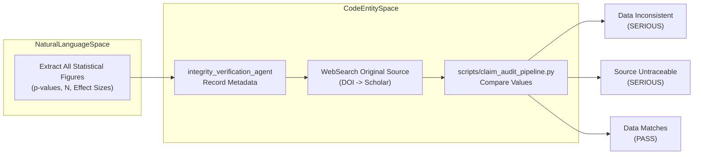
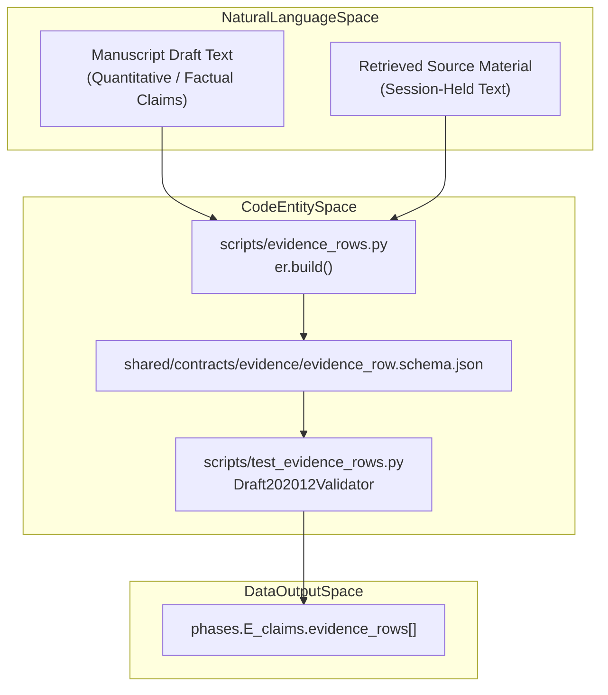
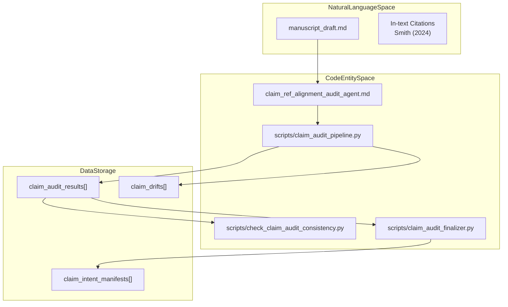

<!-- source: DeepWiki mcp.deepwiki.com · repo Imbad0202/academic-research-skills · page 6.3 Phase B-E: Context, Data, Originality, Claims · fetched 2026-10-30 -->

# Phase B-E: Context, Data, Originality, Claims

Relevant source files

The following files were used as context for generating this wiki page:

- [academic-pipeline/agents/claim_ref_alignment_audit_agent.md](academic-pipeline/agents/claim_ref_alignment_audit_agent.md)
- [academic-pipeline/references/claim_audit_calibration_protocol.md](academic-pipeline/references/claim_audit_calibration_protocol.md)
- [academic-pipeline/references/claim_verification_protocol.md](academic-pipeline/references/claim_verification_protocol.md)
- [scripts/_claim_audit_constants.py](scripts/_claim_audit_constants.py)
- [scripts/check_claim_audit_consistency.py](scripts/check_claim_audit_consistency.py)
- [scripts/check_cross_document_consistency_advisory_integration.py](scripts/check_cross_document_consistency_advisory_integration.py)
- [scripts/claim_audit_calibration.py](scripts/claim_audit_calibration.py)
- [scripts/claim_audit_finalizer.py](scripts/claim_audit_finalizer.py)
- [scripts/claim_audit_pipeline.py](scripts/claim_audit_pipeline.py)
- [scripts/evidence_rows.py](scripts/evidence_rows.py)
- [scripts/fixtures/claim_audit_calibration/gold_set.json](scripts/fixtures/claim_audit_calibration/gold_set.json)
- [scripts/test_claim_audit_calibration.py](scripts/test_claim_audit_calibration.py)
- [scripts/test_claim_audit_finalizer.py](scripts/test_claim_audit_finalizer.py)
- [scripts/test_claim_audit_pipeline.py](scripts/test_claim_audit_pipeline.py)
- [scripts/test_claim_audit_schema.py](scripts/test_claim_audit_schema.py)
- [scripts/test_evidence_rows.py](scripts/test_evidence_rows.py)
- [scripts/test_experiment_provenance.py](scripts/test_experiment_provenance.py)
- [shared/contracts/passport/experiment_provenance_entry.schema.json](shared/contracts/passport/experiment_provenance_entry.schema.json)
- [shared/references/evidence_row_protocol.md](shared/references/evidence_row_protocol.md)

## Purpose and Scope

This document details Phases B through E of the integrity verification protocol, focusing on citation context accuracy, statistical verification, plagiarism detection, claim cross-referencing, evidence rows, and the **v3.8 Claim-Faithfulness Audit Pipeline** alongside the **#656 Shared Evidence-Row Contract**. These phases perform deep integrity checks **after** Phase A confirms that all references exist and are bibliographically accurate.

The phases and audit layers serve distinct operational boundaries:
- **Phase B**: Verifies that citations accurately represent the sources they claim to reference, enforcing strict locator and argument fidelity (`claim_ref_alignment_audit_agent`) [academic-pipeline/agents/claim_ref_alignment_audit_agent.md:1-12]().
- **Phase C**: Cross-checks statistical data and numerical claims against original sources [academic-pipeline/references/claim_verification_protocol.md:4-11]().
- **Phase D**: Detects plagiarism and self-plagiarism through WebSearch sampling and four-tier matching.
- **Phase E**: Confirms that quantitative and factual claims are truthfully supported by their cited sources via `scripts/evidence_rows.py` and `evidence_row.schema.json`, including scope-conformance (E4) and novelty classification (E5) [academic-pipeline/references/claim_verification_protocol.md:12-35](), [scripts/evidence_rows.py:1-16]().
- **Claim-Faithfulness Audit (v3.8)**: An L3 audit layer (`ARS_CLAIM_AUDIT=1`) implemented by `scripts/claim_audit_pipeline.py` and `scripts/claim_audit_finalizer.py` that validates the alignment between prose claims and retrieved reference full-text [scripts/claim_audit_pipeline.py:1-16](), [scripts/claim_audit_finalizer.py:1-12]().

**Sources:** [academic-pipeline/references/claim_verification_protocol.md:1-11](), [scripts/evidence_rows.py:1-16](), [scripts/claim_audit_pipeline.py:1-16]()

---

## Phase B: Citation Context Verification

Phase B ensures that references not only exist but are used correctly in the paper's argumentation. It enforces the **L3 (Faithfulness)** requirement: does the cited paper actually say what the prose claims it says?

### B1: Citation Accuracy and Locators
Every in-text citation MUST carry a structured quote-or-locator anchor (`quote`, `page`, `section`, or `paragraph`). Bare citations without these are flagged as `MED-WARN-NO-LOCATOR` and refused by the terminal gate. The `claim_ref_alignment_audit_agent` enforces `INV-6` to surface any anchorless rows that reach the audit stage [academic-pipeline/agents/claim_ref_alignment_audit_agent.md:52-53](), [shared/references/evidence_row_protocol.md:32-40]().

| Criterion | Assessment Question | Example of SERIOUS Issue |
|-----------|---------------------|-------------------------|
| Argument fidelity | Does the citation accurately reflect the original work's viewpoint? | Paper claims "Smith (2020) found no effect" when Smith reported significant positive effect |
| Cherry-picking | Is selective evidence presented without acknowledging contradictory findings? | Citing only supportive results from a mixed-findings study |
| Locator Presence | Does the citation include a verifiable page/section/quote? | Bare citation `(Smith, 2020)` with no locator |

**Sources:** [academic-pipeline/agents/claim_ref_alignment_audit_agent.md:24-30](), [shared/references/evidence_row_protocol.md:32-40]()

---

## Phase C: Data Verification

Phase C performs **100% verification of all statistical data** cited in the paper. This is a critical gate that requires full verification regardless of the audit mode.

### C1: Statistical Data Cross-Referencing
Every numerical claim undergoes external validation against the original source. The `integrity_verification_agent` (Phase C) scope includes all percentages, counts, effect sizes, and p-values [academic-pipeline/references/claim_verification_protocol.md:7-11]().

Title: "Statistical Data Cross-Referencing Flow"

**Sources:** [academic-pipeline/references/claim_verification_protocol.md:7-26](), [scripts/claim_audit_pipeline.py:1-16]()

---

## Phase D: Originality Verification

Phase D detects plagiarism through WebSearch-based text matching using a four-tier classification system.

### Originality Grades
The system extracts characteristic sentences and searches for 8-12 word fragments in quotes to detect verbatim overlap or paraphrasing.

- **ORIGINAL**: No related matches.
- **PARAPHRASE**: Semantically similar but clearly different wording.
- **CLOSE_MATCH**: Highly similar wording; few substitutions (**MODERATE severity**).
- **VERBATIM**: 20+ consecutive identical words without quotation marks (**CRITICAL severity**).

**Sources:** [academic-pipeline/references/claim_verification_protocol.md:4]()

---

## Phase E: Claim Verification and Evidence Rows (#656)

Phase E verifies that quantitative and factual claims are truthfully supported by their cited sources [academic-pipeline/references/claim_verification_protocol.md:1-5](). The implementation relies on the closed **#656 Shared Evidence-Row Contract** managed by `scripts/evidence_rows.py` and validated against `shared/contracts/evidence/evidence_row.schema.json` [scripts/test_evidence_rows.py:33-41](), [scripts/evidence_rows.py:36-37]().

### E1-E3: Claim Extraction, Source Tracing, and Evidence Rows
1. **E1 (Claim Extraction)**: Scans the paper for numerical, categorical, trend, and causal claims, building a schema-valid `claim-registry/1.0` artifact [academic-pipeline/references/claim_verification_protocol.md:7-19]().
2. **E1.1 (Coverage Diff)**: Runs `scripts/claim_registry_coverage.py` on raw draft bytes and registered claims to identify mechanically detectable citation-bearing or quantitative sentences that lack matching registry spans [academic-pipeline/references/claim_verification_protocol.md:21-48]().
3. **E2 & E3 (Source Tracing & Cross-Referencing)**: Locates passages in cited sources (held strictly as explicit session input) and persists validated evidence rows via `scripts/evidence_rows.py` under `phases.E_claims.evidence_rows[]` [academic-pipeline/references/claim_verification_protocol.md:58-90](), [shared/references/evidence_row_protocol.md:10-21]().

Title: "Evidence-Row Pipeline Bridge"

**Sources:** [academic-pipeline/references/claim_verification_protocol.md:15-90](), [scripts/evidence_rows.py:1-40](), [scripts/test_evidence_rows.py:31-43]()

### Advisory and Special Roles (E4-E6)
- **E4 (Scope-Conformance Advisory)**: Compares audited claims against the effective scope inherited from the RQ Brief, flagging out-of-scope assertions [academic-pipeline/references/claim_verification_protocol.md:95]().
- **E5 (Novelty-Classifications)**: Assesses primacy claims against documented search strategies (`SUPPORTED_WITHIN_SEARCH` vs `UNRESOLVED`) [academic-pipeline/references/claim_verification_protocol.md:39-50]().
- **E6 (Claim-Strength Drift)**: Detects whether epistemic strength drifted across revision rounds.

**Sources:** [academic-pipeline/references/claim_verification_protocol.md:12-96](), [shared/references/evidence_row_protocol.md:1-143]()

---

## v3.8 Claim-Faithfulness Audit Pipeline

The `ARS_CLAIM_AUDIT=1` flag activates `scripts/claim_audit_pipeline.py`, implementing the Step 1-6 pipeline narrated by `claim_ref_alignment_audit_agent.md` [scripts/claim_audit_pipeline.py:1-6](), [academic-pipeline/agents/claim_ref_alignment_audit_agent.md:1-12]().

### Audit Architecture and Data Flow
The audit uses a stratified sampling strategy (`stratified_buckets_v1`) to select citations for deep verification, comparing `claim_intent_manifests` against retrieved reference text [scripts/claim_audit_pipeline.py:30-37](), [scripts/check_claim_audit_consistency.py:103]().

Title: "Claim Audit Pipeline Data Flow"

**Sources:** [scripts/claim_audit_pipeline.py:1-16](), [scripts/claim_audit_finalizer.py:1-12](), [academic-pipeline/agents/claim_ref_alignment_audit_agent.md:46-56]()

### The 8-Row Finalizer Matrix
The `scripts/claim_audit_finalizer.py` classifies audit results into a severity-tiered matrix determining whether the formatter hard gate refuses generation [scripts/claim_audit_finalizer.py:1-17]().

| Judgment | Defect Stage | Annotation | Tier | Gate Refuse |
|----------|--------------|------------|------|-------------|
| **SUPPORTED** | None | None | TIER_NONE | False |
| **UNSUPPORTED** | source_description | `[HIGH-WARN-CLAIM-NOT-SUPPORTED]` | TIER_HIGH_WARN | **True** |
| **VIOLATED** | negative_constraint | `[HIGH-WARN-NEGATIVE-CONSTRAINT-VIOLATION]` | TIER_HIGH_WARN | **True** |
| **RETRIEVAL_FAILED** | retrieval_existence | `[HIGH-WARN-FABRICATED-REFERENCE]` | TIER_HIGH_WARN | **True** |
| **RETRIEVAL_FAILED** | not_applicable (failed) | `[CLAIM-AUDIT-UNVERIFIED]` | TIER_LOW_WARN | False |
| **RETRIEVAL_FAILED** | not_applicable (timeout) | `[CLAIM-AUDIT-TOOL-FAILURE]` | TIER_MED_WARN | False |
| **AMBIGUOUS** | (any) | `[CLAIM-AUDIT-AMBIGUOUS]` | TIER_MED_WARN | False |

**Sources:** [scripts/claim_audit_finalizer.py:58-88](), [scripts/test_claim_audit_finalizer.py:155-178]()

---

## Consistency Linting and Invariants

The `scripts/check_claim_audit_consistency.py` script enforces 39 cross-field invariants (INV-1 through INV-19, M-INV, U-INV, D-INV, CV-INV, S-INV) spanning all passport audit aggregates [scripts/check_claim_audit_consistency.py:1-12](). Schema files reside under `shared/contracts/passport/` and `shared/contracts/evidence/`, guaranteeing structural and referential integrity across the verification lifecycle [scripts/check_claim_audit_consistency.py:62-75](), [scripts/test_evidence_rows.py:31-43]().

**Sources:** [scripts/check_claim_audit_consistency.py:1-33](), [scripts/test_claim_audit_schema.py:1-14](), [scripts/test_evidence_rows.py:31-43]()

---

