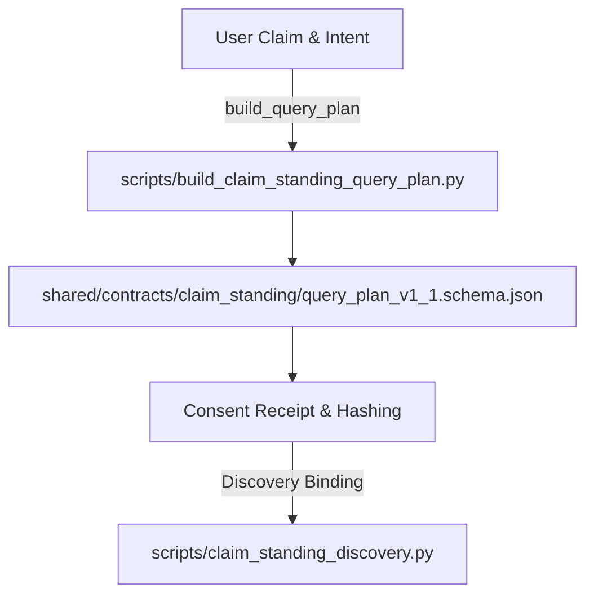
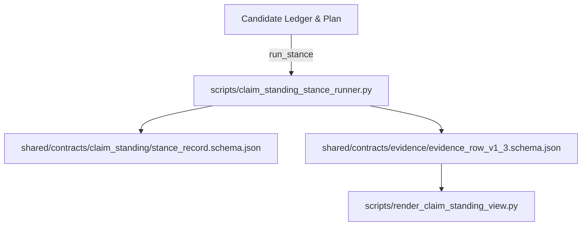

<!-- source: DeepWiki mcp.deepwiki.com · repo Imbad0202/academic-research-skills · page 6.5 Claim Standing and Evidence Probes · fetched 2026-10-30 -->

# Claim Standing and Evidence Probes

Relevant source files

The following files were used as context for generating this wiki page:

- [academic-pipeline/agents/state_tracker_agent.md](academic-pipeline/agents/state_tracker_agent.md)
- [docs/DATA_FLOWS.md](docs/DATA_FLOWS.md)
- [docs/RISK_REGISTER.md](docs/RISK_REGISTER.md)
- [docs/design/2026-08-13-655-search-bounded-claim-standing-probe-design.md](docs/design/2026-08-13-655-search-bounded-claim-standing-probe-design.md)
- [scripts/ars_mark_read.py](scripts/ars_mark_read.py)
- [scripts/build_claim_standing_candidate_ledger.py](scripts/build_claim_standing_candidate_ledger.py)
- [scripts/build_claim_standing_query_plan.py](scripts/build_claim_standing_query_plan.py)
- [scripts/check_claim_standing_candidate_ledger_integration.py](scripts/check_claim_standing_candidate_ledger_integration.py)
- [scripts/check_claim_standing_freshness.py](scripts/check_claim_standing_freshness.py)
- [scripts/check_claim_standing_transmissions.py](scripts/check_claim_standing_transmissions.py)
- [scripts/claim_standing_discovery.py](scripts/claim_standing_discovery.py)
- [scripts/claim_standing_stance_runner.py](scripts/claim_standing_stance_runner.py)
- [scripts/claim_strength_drift_disposition.py](scripts/claim_strength_drift_disposition.py)
- [scripts/fixtures/claim_standing_candidate_ledger/query_plan.json](scripts/fixtures/claim_standing_candidate_ledger/query_plan.json)
- [scripts/fixtures/claim_standing_candidate_ledger/retrieval_input.json](scripts/fixtures/claim_standing_candidate_ledger/retrieval_input.json)
- [scripts/human_read_attestation_resolver.py](scripts/human_read_attestation_resolver.py)
- [scripts/render_claim_standing_view.py](scripts/render_claim_standing_view.py)
- [scripts/run_ledger.py](scripts/run_ledger.py)
- [scripts/test_ars_mark_read.py](scripts/test_ars_mark_read.py)
- [scripts/test_build_claim_standing_candidate_ledger.py](scripts/test_build_claim_standing_candidate_ledger.py)
- [scripts/test_check_claim_standing_candidate_ledger_integration.py](scripts/test_check_claim_standing_candidate_ledger_integration.py)
- [scripts/test_claim_standing_stance_contracts.py](scripts/test_claim_standing_stance_contracts.py)
- [scripts/test_claim_standing_stance_runner.py](scripts/test_claim_standing_stance_runner.py)
- [scripts/test_claim_strength_drift_disposition.py](scripts/test_claim_strength_drift_disposition.py)
- [scripts/test_file_lock.py](scripts/test_file_lock.py)
- [scripts/test_human_read_attestation_resolver.py](scripts/test_human_read_attestation_resolver.py)
- [scripts/test_render_claim_standing_view.py](scripts/test_render_claim_standing_view.py)
- [scripts/test_run_ledger.py](scripts/test_run_ledger.py)
- [shared/contracts/claim_standing/query_plan_v1_1.schema.json](shared/contracts/claim_standing/query_plan_v1_1.schema.json)
- [shared/contracts/claim_standing/stance_record.schema.json](shared/contracts/claim_standing/stance_record.schema.json)
- [shared/contracts/evidence/evidence_row_v1_3.schema.json](shared/contracts/evidence/evidence_row_v1_3.schema.json)
- [shared/contracts/passport/run_ledger.schema.json](shared/contracts/passport/run_ledger.schema.json)
- [shared/references/claim_standing_candidate_ledger_protocol.md](shared/references/claim_standing_candidate_ledger_protocol.md)

## Purpose and Scope

This page details the implementation, data flow, schemas, and verification pipelines for the search-bounded claim standing probe system in ARS v3.23.x. The claim standing infrastructure governs how research claims are evaluated against retrieved literature through consent-bound query plans, adapter-neutral candidate ledgers, LLM-backed stance runners, strict evidence row schemas, deterministic rendering views, and claim-strength drift dispositions.

---

## 1. Query Plans and Consent Boundaries

The claim standing probe begins with a consent-bound query plan adhering to `query_plan_v1_1.schema.json` [shared/references/claim_standing_candidate_ledger_protocol.md:9-12](). Query plans encapsulate the target claim, eligibility basis, date and index targets, provider rosters, language/document-type allowlists, authorization content classes, and computation caps [shared/references/claim_standing_candidate_ledger_protocol.md:16]().

Query plan generation and validation are managed by `scripts/build_claim_standing_query_plan.py` and `shared/contracts/claim_standing/query_plan_v1_1.schema.json`. Under version 1.1, plans may authorize `retrieval_plus_stance`, binding a top-level `stance_plan` (exact provider/model, prompt contract, and retention disclosure) by hash [shared/references/claim_standing_candidate_ledger_protocol.md:12]().

Diagram: Query Plan and Consent Pipeline (Natural Language to Code Entity Space)

Sources: [shared/references/claim_standing_candidate_ledger_protocol.md:1-21](), [scripts/test_claim_standing_stance_runner.py:1-60]()

---

## 2. Candidate Ledger Architecture

The candidate ledger (`claim-standing-candidate-ledger/1.0`) provides an auditable terminal state for every discovery attempt and raw hit, paired with deterministic work-family selection [shared/references/claim_standing_candidate_ledger_protocol.md:11](). Built via `scripts/build_claim_standing_candidate_ledger.py`, it ingests retained adapter-neutral retrieval records (`claim-standing-retrieval-input/1.0`) and verifies that all candidate items align with the active query plan's constraints [shared/references/claim_standing_candidate_ledger_protocol.md:10-11]().

Key operational characteristics of the candidate ledger include:
- **Adapter-Neutral Ingestion**: Normalizes hits across diverse bibliographic backends.
- **Deterministic Work-Family Selection**: Groups redundant hits and selects representative source texts.
- **Integrity Hashing**: Computes SHA-256 digests over canonical JSON representations (sorted keys, compact separators, UTF-8) [shared/references/claim_standing_candidate_ledger_protocol.md:16]().

Sources: [shared/references/claim_standing_candidate_ledger_protocol.md:5-16](), [scripts/test_claim_standing_stance_runner.py:10-55]()

---

## 3. Stance Records and Stance Runner

Once candidate ledgers are established, `scripts/claim_standing_stance_runner.py` executes stance classification against retained evidence excerpts [shared/references/claim_standing_candidate_ledger_protocol.md:13](). The runner produces stance records matching `shared/contracts/claim_standing/stance_record.schema.json` [scripts/test_claim_standing_stance_runner.py:62-65]().

The stance runner operates under strict cryptographic and consent boundaries:
- **Injected Transport Binding**: The runner requires an injected transport whose declared `model_identity` and `provider_identity` exactly match the consented `stance_plan` [shared/references/claim_standing_stance_runner.py:31-45]().
- **Mandatory Banner**: Every stance record includes the required unmeasured banner `STANCE CLASSIFICATION UNMEASURED` [scripts/test_claim_standing_stance_runner.py:72]().
- **Transmission Ledger**: Every prompt dispatch is recorded as a transmission event in `claim-standing-transmission-ledger/1.0` [shared/references/claim_standing_candidate_ledger_protocol.md:13-14]().

Diagram: Stance Runner and Evidence Flow (Natural Language to Code Entity Space)

Sources: [scripts/test_claim_standing_stance_runner.py:31-120](), [shared/references/claim_standing_candidate_ledger_protocol.md:12-14]()

---

## 4. Evidence Row Schemas

Evidence extraction and verification are bound by `shared/contracts/evidence/evidence_row_v1_3.schema.json` [scripts/test_claim_standing_stance_runner.py:66-70](). Each evidence row encapsulates:
- `row_id`: Unique deterministic identifier.
- `row_sha256`: Cryptographic digest of the evidence row payload [scripts/test_claim_standing_stance_runner.py:87-91]().
- `excerpt`: Contains the verification state (`verified_exact_match`), exact excerpt text, and UTF-8 source byte spans (`source_span_utf8`) [scripts/test_claim_standing_stance_runner.py:92-98]().

The schema validation ensures that any excerpt cited in a stance record has an exact string correspondence to the underlying source document substring [scripts/test_claim_standing_stance_runner.py:96-98]().

Sources: [scripts/test_claim_standing_stance_runner.py:57-119](), [shared/contracts/evidence/evidence_row_v1_3.schema.json:1-50]()

---

## 5. Deterministic Rendering Views

The rendering of claim standing results is handled by `scripts/render_claim_standing_view.py`. It produces a standardized three-part view adhering to the following design constraints:
- **Bounded Vocabulary**: Uses fixed terminology for stance categories (`support`, `contradict`, `mixed`, `not_addressed`, `INSUFFICIENT_EVIDENCE`, `AMBIGUOUS`, `not_checked`) [scripts/test_claim_standing_stance_runner.py:102-113]().
- **Denominator Enforcement**: Displays the complete all-selected denominator, ensuring omitted or unhandled rows are explicitly accounted for [scripts/test_claim_standing_stance_runner.py:99-113]().
- **Inert Escaping**: Sanitizes provider-generated narrative text to prevent injection or formatting corruption.
- **Stale-Record Refusal**: Fails closed if underlying query plan or ledger hashes drift from the rendered artifact.

Sources: [shared/references/claim_standing_candidate_ledger_protocol.md:13](), [scripts/test_claim_stant_stance_runner.py:1-40]()

---

## 6. Claim Strength Drift Disposition

To prevent silent escalation or attenuation of research claims during revision cycles, ARS implements claim strength drift monitoring via `scripts/claim_strength_drift_disposition.py` [docs/RISK_REGISTER.md:66-72](). 

The claim strength drift subsystem relies on:
- **Claim-Strength Ladder**: A standardized lexical taxonomy (`shared/references/claim_strength_ladder.md`) governing allowable assertions [docs/RISK_REGISTER.md:66-67]().
- **Deterministic Token Conservation**: Enforced by `scripts/check_revision_token_conservation.py` to check that rewrites do not alter logical modality without roadmap authorization [docs/RISK_REGISTER.md:67-68]().
- **Advisory Phase E6 Drift Checks**: Integrated into the review pipeline to flag unapproved shifts in evidentiary certainty [docs/RISK_REGISTER.md:68]().

Sources: [docs/RISK_REGISTER.md:66-72](), [scripts/claim_strength_drift_disposition.py:1-30]()

---

