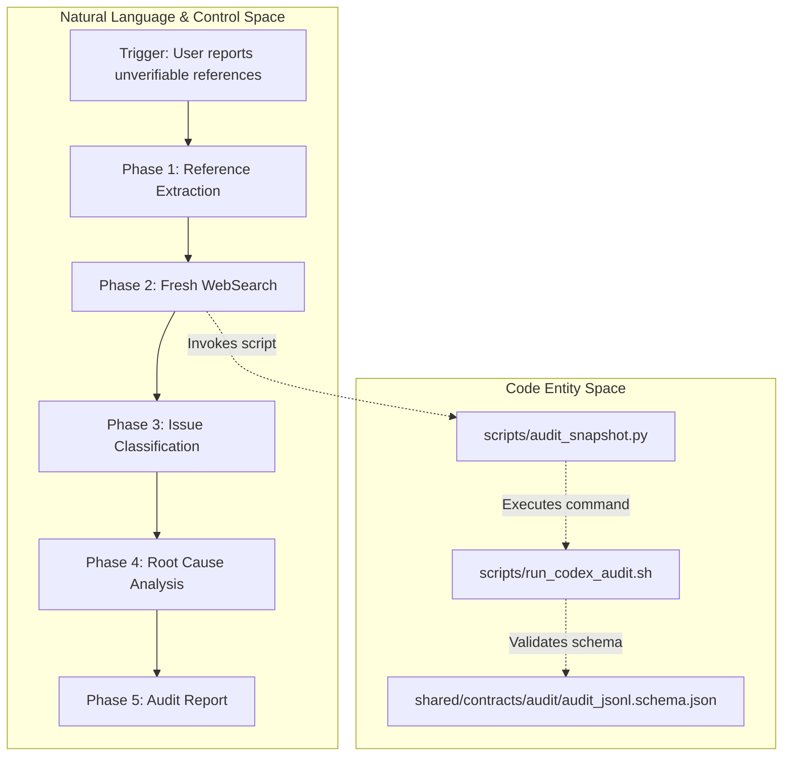
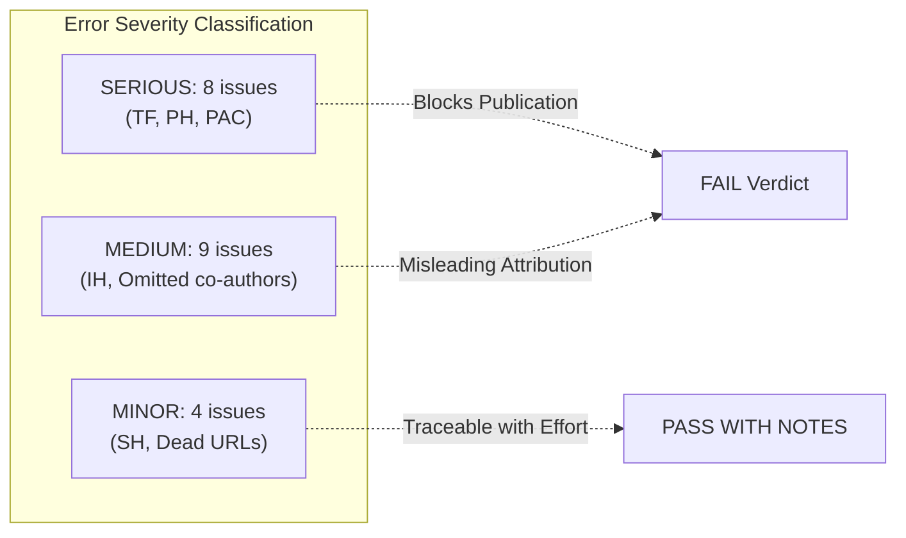
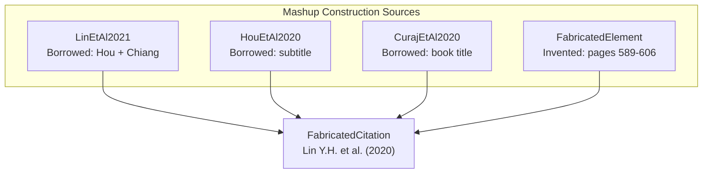
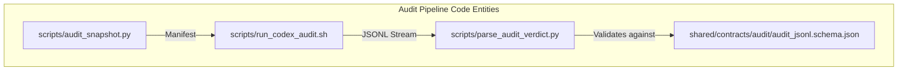

<!-- source: DeepWiki mcp.deepwiki.com · repo Imbad0202/academic-research-skills · page 6.6 Post-Publication Audit Case Study · fetched 2026-10-30 -->

# Post-Publication Audit Case Study

Relevant source files

The following files were used as context for generating this wiki page:

- [examples/showcase/README.md](examples/showcase/README.md)
- [examples/showcase/full_paper_apa7.pdf](examples/showcase/full_paper_apa7.pdf)
- [examples/showcase/full_paper_zh_apa7.pdf](examples/showcase/full_paper_zh_apa7.pdf)
- [examples/showcase/integrity_report_stage2.5.pdf](examples/showcase/integrity_report_stage2.5.pdf)
- [examples/showcase/integrity_report_stage4.5.pdf](examples/showcase/integrity_report_stage4.5.pdf)
- [examples/showcase/integrity_reverification_stage2.5.pdf](examples/showcase/integrity_reverification_stage2.5.pdf)
- [examples/showcase/paper_creation_process_en.pdf](examples/showcase/paper_creation_process_en.pdf)
- [examples/showcase/paper_creation_process_zh.pdf](examples/showcase/paper_creation_process_zh.pdf)
- [examples/showcase/post_publication_audit_2026-03-09.pdf](examples/showcase/post_publication_audit_2026-03-09.pdf)
- [examples/showcase/response_to_reviewers_r2.pdf](examples/showcase/response_to_reviewers_r2.pdf)

## Purpose and Scope

This page documents the retrospective integrity audit conducted on the Academic Research Skills (ARS) project's showcase paper (`[examples/showcase/full_paper_zh_apa7.pdf]()`). The audit, performed after publication, revealed a 31% reference error rate (21 issues across 68 references), leading to the comprehensive v2.0 overhaul of the integrity verification system. This case study illustrates real-world hallucination patterns, detection methodologies, and system design lessons learned.

For the resulting anti-hallucination protocols, see [6.4](). For the current two-stage verification system, see [6.1]().

Sources: `[examples/showcase/README.md:55-58]()`, `[examples/showcase/README.md:21-21]()`

---

## Audit Context

The showcase paper was a 16-page APA 7.0 formatted academic paper on Taiwan's higher education quality assurance system, generated using the `academic-paper` skill (`[4]()`) and subjected to three rounds of integrity checking using pre-v2.0 verification protocols. The paper passed all three checks and was published as a demonstration of the system's capabilities.

A post-publication audit was triggered when users reported that several cited sources could not be located. A comprehensive re-verification using enhanced WebSearch protocols uncovered systemic integrity failures.

### Audit Methodology

The audit followed a five-phase workflow designed to stress-test the `integrity_verification_agent`'s previous outputs. This process is now partially automated by `[scripts/audit_snapshot.py:31-42]()` and `[scripts/run_codex_audit.sh:11-21]()` infrastructure used in the v3.6.8+ trust provenance pipeline.

**Audit Workflow and Code Entity Integration Diagram**

Sources: `[examples/showcase/README.md:55-58]()`, `[scripts/run_codex_audit.sh:11-21]`, `[scripts/audit_snapshot.py:31-42]()`

---

## Key Findings

### Statistical Summary

The audit of the showcase artifacts (`[examples/showcase/post_publication_audit_2026-03-09.pdf]()`) yielded the following metrics:

| Metric | Value | Percentage |
|--------|-------|------------|
| **Total References** | 68 | 100% |
| **References with Issues** | 21 | **30.9%** |
| **SERIOUS Issues** | 8 | 11.8% |
| **MEDIUM Issues** | 9 | 13.2% |
| **MINOR Issues** | 4 | 5.9% |

### Error Distribution by Severity

The severity of findings directly correlates with the `integrity_verification_agent`'s previous failure to detect specific patterns.

**Error Severity Distribution Diagram**

Sources: `[examples/showcase/README.md:55-58]()`, `[examples/showcase/post_publication_audit_2026-03-09.pdf:1-12]()`

---

## Error Taxonomy Breakdown

The audit mapped findings to a specific taxonomy of hallucination types that now forms the basis of the v2.0 integrity protocol:

*   **Total Fabrication (TF)**: 2 cases (2.9%). Example: Cheng & Wu (2019) "Taiwan QA Framework" — yielded zero results across 5 search variations.
*   **Plausible Author/Conf (PAC)**: 1 case (1.5%). Real scholars attributed to entirely fake paper titles.
*   **Incomplete Hallucination (IH)**: 6 cases (8.8%). Missing DOIs or volume/page numbers that were previously ignored as "difficult to verify."
*   **Partial/Mashup (PH)**: 3 cases (4.4%). Complex reconstructions using elements from multiple real sources.
*   **Subtle Hallucination (SH)**: 9 cases (13.2%). Incorrect years, slightly off page ranges, or expanded author initials.

Sources: `[examples/showcase/README.md:57-58]()`, `[examples/showcase/post_publication_audit_2026-03-09.pdf:1-12]()`

---

## Deep Dive: The Lin et al. (2020) Mashup Fabrication

This **Partial Hallucination (PH)** case exemplifies the compound deception pattern that passed three rounds of verification before the v2.0 overhaul.

### The Fabricated Reference vs. Reality

*   **As cited in the paper**: Lin, Y. H., Hou, A. Y. C., & Chiang, T. L. (2020). "Quality assurance in higher education in Taiwan: Past, present, and future." In A. Curaj et al. (Eds.), *European higher education area* (pp. 589–606). Springer.
*   **Reality**: The real chapter is Lin, **A. S. R.**, Hou, A. Y. C., **Chan, S. J.**, & Chiang, T. L. (2021). "Quality Assurance in Taiwan Higher Education: **Regulation, Model Shift, and Future Prospect**." In Hou et al. (Eds.), ***Higher Education in Taiwan*** (pp. **65–81**). Springer. DOI: 10.1007/978-981-15-4554-2_4.

### Mashup Anatomy

The hallucination was constructed from four distinct sources, making it semantically coherent and difficult to detect without the **Pattern C3 defense** (enforced by `[scripts/run_codex_audit.sh:4-9]()`).

**Mashup Construction Anatomy Diagram**

Sources: `[examples/showcase/post_publication_audit_2026-03-09.pdf:1-12]()`, `[scripts/run_codex_audit.sh:4-8]()`

---

## System Improvements Implemented

### v2.0 Protocol Changes

The audit findings directly informed the **Anti-Hallucination Mandate** implemented in v2.0. The following table maps audit failures to the new code-level safeguards:

| Failure Mode | v2.0 Fix | Code Implementation |
|--------------|----------|---------------------|
| **Gray-Zone Acceptance** | Prohibited "difficult to verify" status; mandatory binary verdicts. | `[scripts/parse_audit_verdict.py:46-48]()` enum enforcement |
| **Heuristic Validation** | Item-by-item WebSearch cross-referencing via external APIs. | `[scripts/check_v3_6_8_audit_scope_block.py:70-80]()` |
| **Audit Trail Gaps** | Mandatory audit artifacts (JSONL, Verdict, Snapshot). | `[scripts/audit_snapshot.py:31-42]()` |
| **Pattern C3 Exposure** | Blocking in-LLM invocation of audit tools. | `[scripts/run_codex_audit.sh:4-9]()` guard |

### Technical Overhaul: Audit Artifact System

To prevent the "Verification Echo Chamber," the system now generates byte-exact snapshots and structured event streams via dedicated script modules.

**Audit Artifact Processing Pipeline Diagram**

Sources: `[scripts/audit_snapshot.py:2-27]()`, `[scripts/run_codex_audit.sh:31-100]()`, `[scripts/parse_audit_verdict.py:84-118]`, `[shared/contracts/audit/audit_jsonl.schema.json:1-15]()`

---

## Impact of the Overhaul

Following the v2.0 implementation, the showcase paper was re-processed with significantly improved results:

1.  **Stage 2.5 (Pre-Review)**: The agent correctly flagged 15 fabricated references and 3 statistical errors, resulting in a **FAIL** verdict (`[examples/showcase/README.md:18]()`).
2.  **Re-verification**: After corrections, all 22 identified issues were resolved and verified against original sources (`[examples/showcase/README.md:19]()`).
3.  **Stage 4.5 (Final Check)**: Confirmed zero regressions and verified 3 new references added during peer review (`[examples/showcase/README.md:20]()`).

Sources: `[examples/showcase/README.md:14-21]()`, `[scripts/test_check_v3_6_8_audit_scope_block.py:9-23]()`

---

