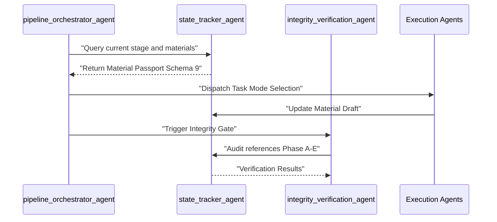

<!-- source: DeepWiki mcp.deepwiki.com · repo Imbad0202/academic-research-skills · page 7 Multi-Agent Architecture · fetched 2026-10-30 -->

# Multi-Agent Architecture

Relevant source files

The following files were used as context for generating this wiki page:

- [academic-paper/agents/draft_writer_agent.md](academic-paper/agents/draft_writer_agent.md)
- [academic-paper/agents/formatter_agent.md](academic-paper/agents/formatter_agent.md)
- [agents/report_compiler_agent.md](agents/report_compiler_agent.md)
- [agents/research_architect_agent.md](agents/research_architect_agent.md)
- [agents/synthesis_agent.md](agents/synthesis_agent.md)
- [deep-research/agents/ethics_review_agent.md](deep-research/agents/ethics_review_agent.md)
- [deep-research/agents/report_compiler_agent.md](deep-research/agents/report_compiler_agent.md)
- [deep-research/agents/research_architect_agent.md](deep-research/agents/research_architect_agent.md)
- [deep-research/agents/synthesis_agent.md](deep-research/agents/synthesis_agent.md)

## Purpose and Scope

This document provides a high-level overview of the multi-agent ecosystem that powers the Academic Research Skills (ARS) system (v3.23.x). It outlines how specialized agents are distributed across core research and publishing skills, their coordination patterns via handoff schemas and state tracking, and the unified quality alignment and cross-model verification standards that maintain manuscript integrity.

This is a **PARENT** page. For deep technical details, see the child pages:
- **[Agent Distribution Across Skills](#7.1)** — Breakdown by skill, top-level `agents/` mirror directory, and symlink structures.
- **[Socratic Mentor Agent](#7.2)** — Convergence criteria, question taxonomy, INSIGHT extraction, and probe loops.
- **[Cross-Agent Quality Alignment](#7.3)** — Unified quality standards, source tiers, verification thresholds, and data access isolation levels.
- **[Cross-Model Verification](#7.4)** — Optional second-model verification layer, `ARS_CROSS_MODEL` flags, and codex transport.

Sources: [docs/ARCHITECTURE.md:1-15](), [academic-pipeline/SKILL.md:1-25]()

---

## 35-Agent Ecosystem

The ARS architecture consists of 35 specialized agents distributed across core skills. While each skill maintains a primary team, agents are often shared or specialized for specific modes such as Socratic dialogue or PRISMA-compliant systematic reviews.

### Agent Distribution Overview

| Skill | Total Agents | Primary Role | Code Entity Directory |
|-------|--------------|--------------|-----------------------|
| `deep-research` | 13 | Systematic investigation, verification, and synthesis | `deep-research/agents/` |
| `academic-paper` | 12 | Manuscript drafting, argumentation, and formatting | `academic-paper/agents/` |
| `academic-paper-reviewer` | 7 | Multi-perspective peer review panel | `academic-paper-reviewer/agents/` |
| `academic-pipeline` | 3 | High-level orchestration, state tracking, and integrity | `academic-pipeline/agents/` |

### Natural Language to Code Entity Mapping

The following diagram bridges natural language functional roles to the exact code entities defined in the repository structure.

```mermaid
graph TB
    subgraph Skill_Pipeline ["academic-pipeline"]
        PO["pipeline_orchestrator_agent.md"]
        ST["state_tracker_agent.md"]
        IVA["integrity_verification_agent.md"]
    end

    subgraph Skill_Research ["deep-research"]
        DR_RQ["research_question_agent.md"]
        DR_Bib["bibliography_agent.md"]
        DR_Ver["source_verification_agent.md"]
        DR_Syn["synthesis_agent.md"]
        DR_Soc["socratic_mentor_agent.md"]
    end

    subgraph Skill_Paper ["academic-paper"]
        AP_Int["intake_agent.md"]
        AP_Arch["structure_architect_agent.md"]
        AP_Draft["draft_writer_agent.md"]
        AP_Form["formatter_agent.md"]
    end

    subgraph Skill_Review ["academic-paper-reviewer"]
        APR_Field["field_analyst_agent.md"]
        APR_DA["devils_advocate_reviewer_agent.md"]
        APR_EIC["eic_agent.md"]
    end

    PO -->|"Dispatches"| DR_RQ
    PO -->|"Dispatches"| AP_Int
    PO -->|"Dispatches"| APR_Field
    IVA -->|"Audits"| ST
```

**Diagram 1: Natural Language Space to Code Entity Mapping**

Sources: [docs/ARCHITECTURE.md:99-102](), [academic-pipeline/SKILL.md:103-112](), [.claude/CLAUDE.md:7-12]()

For a detailed breakdown of agent distribution, see [Agent Distribution Across Skills](#7.1).

---

## Coordination Patterns and State Persistence

Agents coordinate through formal handoff schemas and protocol-driven loops managed by the pipeline orchestrator. The `state_tracker_agent` maintains the **Material Passport (Schema 9)** as the single source of truth for tracking provenance, versioning, and reset boundaries across skills [academic-pipeline/SKILL.md:55-64]().

**Diagram 2: Coordination Sequence and State Persistence**

Sources: [academic-pipeline/SKILL.md:19-21](), [academic-pipeline/SKILL.md:55-64](), [docs/ARCHITECTURE.md:45-62]()

---

## Shared Intelligence: The Socratic Mentor

The shared `socratic_mentor_agent` provides pedagogical guidance across multiple skills, notably supporting `deep-research` (Socratic Mode) and `academic-paper` (Plan Mode). Instead of executing tasks autonomously, it uses targeted questioning, convergence criteria, and INSIGHT extraction to help users refine research questions and argument structures [MODE_REGISTRY.md:21-29]().

For detailed technical descriptions of convergence criteria, question taxonomies, and the SCR loop, see **[Socratic Mentor Agent](#7.2)**.

Sources: [docs/ARCHITECTURE.md:99-100](), [MODE_REGISTRY.md:21-29](), [.claude/CLAUDE.md:18]()

---

## Quality Alignment and Cross-Model Verification

To prevent hallucination persistence and ensure uniform output quality, ARS enforces strict cross-agent alignment and validation protocols:

- **Data Access Isolation**: Agents operate under strict isolation levels (`raw`, `redacted`, `verified_only`) to govern access to upstream materials [docs/ARCHITECTURE.md:87]().
- **Integrity Verification**: The `integrity_verification_agent` executes multi-phase citation audits and anti-hallucination checks [README.md:29-33]().
- **Cross-Model Verification**: An optional secondary model validation layer (`ARS_CROSS_MODEL` flags) provides independent verification using codex transport and grounding guards.

For quality standards, source tiers, and degradation registries, see **[Cross-Agent Quality Alignment](#7.3)**. For secondary model verification configurations, see **[Cross-Model Verification](#7.4)**.

Sources: [README.md:29-33](), [academic-pipeline/SKILL.md:25-31](), [docs/ARCHITECTURE.md:87]()

---

## Related Child Pages
- **[Agent Distribution Across Skills](#7.1)** — Breakdown by skill, top-level mirror directory, and symlink structures.
- **[Socratic Mentor Agent](#7.2)** — Socratic convergence criteria, question taxonomy, and INSIGHT extraction.
- **[Cross-Agent Quality Alignment](#7.3)** — Unified quality standards, source tiers, and data access isolation levels.
- **[Cross-Model Verification](#7.4)** — Optional second-model verification layer and flag configurations.

---

