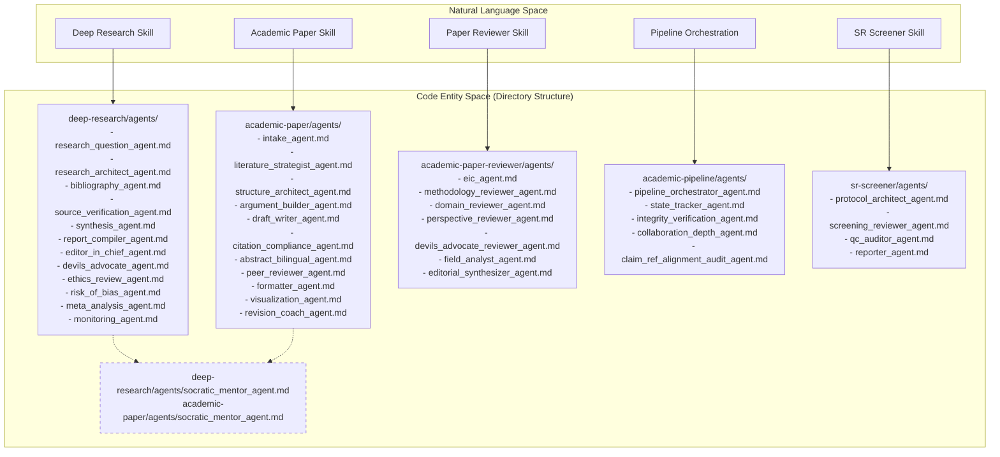
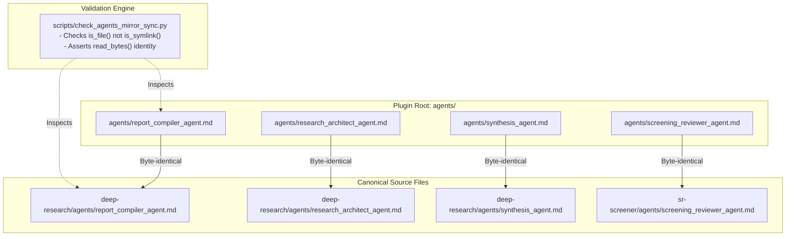

<!-- source: DeepWiki mcp.deepwiki.com · repo Imbad0202/academic-research-skills · page 7.1 Agent Distribution Across Skills · fetched 2026-10-30 -->

# Agent Distribution Across Skills

Relevant source files

The following files were used as context for generating this wiki page:

- [docs/design/2026-04-30-ars-v3.7.0-plugin-packaging-roadmap.md](docs/design/2026-04-30-ars-v3.7.0-plugin-packaging-roadmap.md)
- [hooks/hooks.json](hooks/hooks.json)
- [scripts/check_agents_mirror_sync.py](scripts/check_agents_mirror_sync.py)
- [scripts/check_v3_10_134_write_scope.py](scripts/check_v3_10_134_write_scope.py)
- [scripts/test_check_agents_mirror_sync.py](scripts/test_check_agents_mirror_sync.py)
- [scripts/test_check_v3_10_134_write_scope.py](scripts/test_check_v3_10_134_write_scope.py)

This page documents how the 35 agents in the Academic Research Skills (ARS) system are distributed across the core skills: `deep-research`, `academic-paper`, `academic-paper-reviewer`, `academic-pipeline`, and `sr-screener`. It details the top-level `agents/` mirror directory structure, the byte-identity sync verification mechanism (`check_agents_mirror_sync.py`), and the write-scope guard invariants (`check_v3_10_134_write_scope.py`).

For individual agent roles and coordination patterns, see [Multi-Agent Architecture](#7). For cross-agent quality standards, see [Cross-Agent Quality Alignment](#7.3). For the shared Socratic mentor implementation, see [Socratic Mentor Agent](#7.2).

---

## Distribution Overview

The 35 canonical agents are distributed across the skill directories and coordinated via top-level execution paths:

| Skill | Agent Count | Agent Type Distribution | Primary Function |
|-------|-------------|------------------------|------------------|
| `deep-research` | 13 | 9 core + 4 specialized | Research investigation and reporting |
| `academic-paper` | 12 | 9 core + 3 specialized | Paper writing and formatting |
| `academic-paper-reviewer` | 7 | 5 reviewers + 2 support | Multi-perspective peer review |
| `academic-pipeline` | 3 | 3 orchestration | Workflow coordination and quality gates |
| `sr-screener` | 4 | 4 screening & QC | Protocol-driven systematic study screening |
| **Total Unique Definitions** | **35** | **Core & Specialized Teams** | **Full research-to-publication pipeline** |

**Note on shared agents**: The `socratic_mentor_agent` is shared across `deep-research` and `academic-paper`, applying identical convergence dialogue structures to distinct scopes [scripts/check_v3_10_134_write_scope.py:84-85](). Furthermore, select agents are mirrored at the plugin root under `agents/` to satisfy plugin packaging requirements [scripts/check_agents_mirror_sync.py:38-49]().

Sources: [scripts/check_v3_10_134_write_scope.py:49-101](), [scripts/check_agents_mirror_sync.py:38-49]()

---

### Natural Language to Code Entity Mapping: Agent Distribution

This diagram bridges natural language skill terminology to the underlying code entities (agent markdown files) and their physical directory layout in the repository.

Sources: [scripts/check_v3_10_134_write_scope.py:49-101](), [scripts/check_agents_mirror_sync.py:38-49]()

---

## Top-Level `agents/` Mirror Directory and Byte-Identity Sync

To support Claude Code plugin loading mechanisms, selected core and review agents are mirrored at the repository root under the `agents/` directory [scripts/check_agents_mirror_sync.py:2-14](). 

### Evolution from Symlinks to Byte-Identical Copies (#413)
Historically, the root `agents/` directory maintained relative symlinks pointing into skill subdirectories (e.g., `deep-research/agents/`) [scripts/check_agents_mirror_sync.py:4-10](). However, on Windows environments lacking developer mode or `core.symlinks` configuration enabled, and within standard `.zip` archive extractions, relative symlinks materialize as static text files containing target paths, causing silent plugin load failures [scripts/check_agents_mirror_sync.py:4-8](). 

To prevent this issue (tracked under #413), symlinks were replaced with real, byte-identical physical files [scripts/check_agents_mirror_sync.py:7-13](). 

### The Mirror Sync Lint Contract (`check_agents_mirror_sync.py`)
To prevent drift between the plugin-root mirrors and their canonical sources, the test suite executes `scripts/check_agents_mirror_sync.py` [scripts/check_agents_mirror_sync.py:1-30](). The script enforces three strict invariants:

1. **Roster Set Equality**: The set of files present in `agents/*.md` must match the declared `MIRRORS` mapping exactly [scripts/check_agents_mirror_sync.py:15-19,40-49](). Unrostered additions or missing mirrors trigger validation failures [scripts/check_agents_mirror_sync.py:61-73]().
2. **No Symlinks Allowed**: Every entry in the mirror directory must be a regular file and never a symlink, guarding against the #413 regression [scripts/check_agents_mirror_sync.py:20-21,83-89]().
3. **Byte-Identity Enforcement**: The file content of each mirror must strictly match its canonical source (`read_bytes() == read_bytes()`) [scripts/check_agents_mirror_sync.py:22-24,96-100](). Developers must always edit canonical sources and propagate changes via file copying (`cp <source> <mirror>`) [scripts/check_agents_mirror_sync.py:22-24]().

The active mirror roster defined in `scripts/check_agents_mirror_sync.py` includes [scripts/check_agents_mirror_sync.py:40-49]():
- `agents/report_compiler_agent.md` → `deep-research/agents/report_compiler_agent.md`
- `agents/research_architect_agent.md` → `deep-research/agents/research_architect_agent.md`
- `agents/synthesis_agent.md` → `deep-research/agents/synthesis_agent.md`
- `agents/screening_reviewer_agent.md` → `sr-screener/agents/screening_reviewer_agent.md`

Sources: [scripts/check_agents_mirror_sync.py:1-117](), [scripts/test_check_agents_mirror_sync.py:1-142]()

---

## Write-Scope Guard and Agent Classification (`check_v3_10_134_write_scope.py`)

Agent execution is governed by deterministic write-scope hooks (`hooks/run_guard.sh` invoked via `hooks/hooks.json`) [hooks/hooks.json:13-24]() that restrict subagent file mutations to authorized phase globs. The runtime binding relies on frontmatter `name` declarations inside agent files.

To prevent fail-open security flaws where an unrostered agent or a renamed agent bypasses write-scope checks, the test harness enforces static validation via `scripts/check_v3_10_134_write_scope.py` [scripts/check_v3_10_134_write_scope.py:1-35]().

### Bucket Classification and Roster Invariants
The codebase classifies agents into strict execution buckets:
- **Bucket A (23 agents)**: Single-phase or strictly scoped agents whose writes are bounded by `scripts/ars_phase_scope_manifest.json` [scripts/check_v3_10_134_write_scope.py:16-18,49-76]().
- **Buckets B, C, and D (20 agents)**: Multi-phase or exempt agents that must not be constrained by single-phase manifests [scripts/check_v3_10_134_write_scope.py:16-29,78-101]().

The write-scope lint validates four core invariants [scripts/check_v3_10_134_write_scope.py:14-33]():
1. **I1 (Roster Size)**: Bucket A roster contains exactly 23 agent definitions [scripts/check_v3_10_134_write_scope.py:16-19]().
2. **I2 (Three-Way Name Set Equality)**: The set of Bucket A file paths, manifest keys (`scripts/ars_phase_scope_manifest.json`), and on-disk YAML frontmatter `name:` fields must be identical [scripts/check_v3_10_134_write_scope.py:20-25]().
3. **I3 (Exclusion Check)**: None of the 20 Bucket B/C/D exempt agents may appear as manifest keys [scripts/check_v3_10_134_write_scope.py:26-29]().
4. **I4 (Manifest Shape)**: Every manifest entry must declare `bucket == "A"`, a valid phase label, and non-empty `allowed_write_globs` [scripts/check_v3_10_134_write_scope.py:30-33]().

Sources: [scripts/check_v3_10_134_write_scope.py:1-137](), [scripts/test_check_v3_10_134_write_scope.py:1-160]()

---

