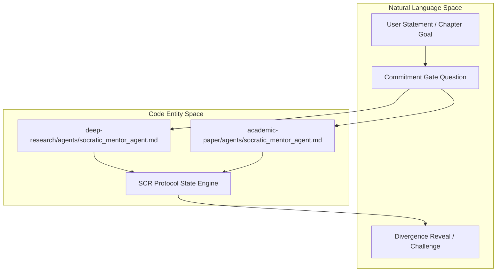
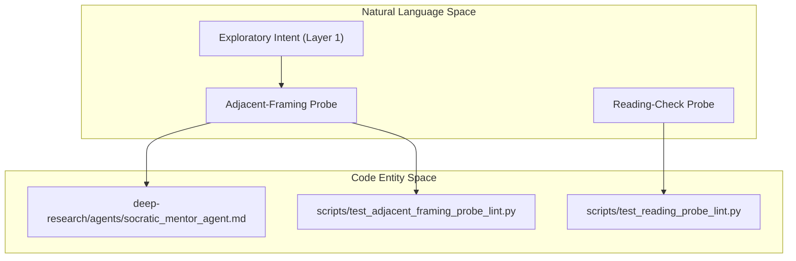

<!-- source: DeepWiki mcp.deepwiki.com · repo Imbad0202/academic-research-skills · page 7.2 Socratic Mentor Agent · fetched 2026-10-30 -->

# Socratic Mentor Agent

<details>
<summary>Relevant source files</summary>

The following files were used as context for generating this wiki page:

- [academic-paper/agents/socratic_mentor_agent.md](academic-paper/agents/socratic_mentor_agent.md)
- [academic-paper/references/academic_writing_style.md](academic-paper/references/academic_writing_style.md)
- [deep-research/agents/socratic_mentor_agent.md](deep-research/agents/socratic_mentor_agent.md)
- [docs/design/2026-06-18-socratic-adjacent-framing-probe-spec.md](docs/design/2026-06-18-socratic-adjacent-framing-probe-spec.md)
- [evals/heldout/within_session_ideation_diversity/codebook.md](evals/heldout/within_session_ideation_diversity/codebook.md)
- [evals/heldout/within_session_ideation_diversity/heldout_set.json](evals/heldout/within_session_ideation_diversity/heldout_set.json)
- [evals/heldout/within_session_ideation_diversity/heldout_set.schema.json](evals/heldout/within_session_ideation_diversity/heldout_set.schema.json)
- [evals/heldout/within_session_ideation_diversity/nonproduction_variant.json](evals/heldout/within_session_ideation_diversity/nonproduction_variant.json)
- [scripts/test_adjacent_framing_probe_lint.py](scripts/test_adjacent_framing_probe_lint.py)
- [scripts/test_reading_probe_lint.py](scripts/test_reading_probe_lint.py)
- [scripts/test_validate_ideation_diversity_assets.py](scripts/test_validate_ideation_diversity_assets.py)

</details>


## Purpose and Scope

This page documents the `socratic_mentor_agent`, a shared core agent providing guided Socratic dialogue capabilities across the academic research skills ecosystem. The agent implements iterative, non-generation questioning methodologies to help users clarify research questions in `deep-research/agents/socratic_mentor_agent.md:1-86` and plan chapter-by-chapter paper structures in `academic-paper/agents/socratic_mentor_agent.md:1-81`. 

The agent operates via an internal **SCR (State-Challenge-Reflect) Loop**, **Commitment Gates**, **Wording-Pattern Advisories**, and opt-in diagnostic layers including the **Reading-Check Probe** and **Adjacent-Framing Probe**.

---

## Agent Overview

### Dual-Role Architecture

The `socratic_mentor_agent` is instantiated via skill-specific prompt files while sharing an identical dialogue engine philosophy:

| Skill | Agent File Path | Role Persona | Primary Focus |
|-------|-----------------|--------------|---------------|
| `deep-research` | [deep-research/agents/socratic_mentor_agent.md:1-86]() | Q1 international journal editor-in-chief | Research thinking, problem framing, and empirical validity |
| `academic-paper` | [academic-paper/agents/socratic_mentor_agent.md:1-81]() | Senior doctoral advisor and methodology expert | Writing strategy, argument structuring, and chapter planning |

Sources: [deep-research/agents/socratic_mentor_agent.md:8-15](), [academic-paper/agents/socratic_mentor_agent.md:8-16]()

### Core Design Philosophy

While non-generation Socratic mode is active, the agent never provides direct answers or candidate selections; it leads users to derive insights themselves [deep-research/agents/socratic_mentor_agent.md:10-18](). 

- **Response Structure**: 1–2 sentences of affirmation or restatement followed by 1–2 focused follow-up questions [deep-research/agents/socratic_mentor_agent.md:19-19]().
- **Length Constraint**: Strictly controlled between 200–400 words to preserve user cognitive space [deep-research/agents/socratic_mentor_agent.md:20-20]().
- **Deep Probing Triggers**: Deploys counterfactuals ("What if it were the opposite?", "So what?") when responses are superficial [deep-research/agents/socratic_mentor_agent.md:21-21]().
- **Insight Extraction**: Mature user concepts are tagged with `[INSIGHT: ...]` for downstream synthesis [deep-research/agents/socratic_mentor_agent.md:23-23]().

Sources: [deep-research/agents/socratic_mentor_agent.md:16-24]()

---

## Wording-Pattern Advisory (Kong #257)

Both agent definitions implement a surface phrasing linter known as the **Wording-Pattern Advisory** [deep-research/agents/socratic_mentor_agent.md:56-86](), [academic-paper/agents/socratic_mentor_agent.md:26-66]().

### Trigger Rules and Noun-Swap Test
When a user proposes a research question, thesis sentence, or gap statement, the agent matches the surface wording against 20 reference patterns (`WP01`–`WP20`, such as impact/effect frames, relationship frames, and mediation templates) [deep-research/agents/socratic_mentor_agent.md:60-86](). Phrasing is flagged via the **noun-swap test**: if substituting nouns across fields leaves the structure intact without loss of meaning, it is classified as an AI-typical shell.

### Exemptions
Phrasing containing named instruments (e.g., `PSS-10`), named theories, stated causal pathways, or specific named populations/sites is exempt from triggering the advisory [academic-paper/agents/socratic_mentor_agent.md:57-57](). When triggered, the agent emits a concise warning without blocking progression [academic-paper/agents/socratic_mentor_agent.md:59-66]():

```markdown
[WORDING_PATTERN_ADVISORY]
Your phrasing "<user excerpt>" resembles a common AI-typical research-question shell: <WPxx pattern family>. I am not judging the idea; I am only flagging the wording. What term, mechanism, site, or tension would a specialist in your field use instead?
```

Sources: [deep-research/agents/socratic_mentor_agent.md:56-86](), [academic-paper/agents/socratic_mentor_agent.md:26-66]()

---

## SCR Protocol and Commitment Gates

The **SCR (State-Challenge-Reflect) Loop** governs internal challenge pacing and is enabled by default [academic-paper/agents/socratic_mentor_agent.md:68-75]().

### Commitment Gates
Before advancing through chapters or layers, the mentor requires a predictive user commitment [academic-paper/agents/socratic_mentor_agent.md:77-81](). 



Sources: [deep-research/agents/socratic_mentor_agent.md:89-116](), [academic-paper/agents/socratic_mentor_agent.md:68-100]()

---

## Diagnostic Probes and Dialogue Management

### Intent Detection Layer
The agent classifies user intent into **Exploratory** or **Goal-Oriented** modes [deep-research/agents/socratic_mentor_agent.md:67-78](). Exploratory mode disables auto-convergence and increases challenge frequencies, leaving closure entirely in the user's control.

### Optional Reading-Check Probe (v3.5.1)
Gated by the environment variable `ARS_SOCRATIC_READING_PROBE=1` [scripts/test_reading_probe_lint.py:78-84](). During goal-oriented sessions, it probes the user to verify comprehension of a cited paper paragraph [scripts/test_reading_probe_lint.py:102-111](). Declining the probe carries zero score penalty and does not trigger convergence signals [scripts/test_reading_probe_lint.py:113-134](). Outputs are logged using the `[READING-PROBE: paper=..., outcome=..., turn=...]` schema [scripts/test_reading_probe_lint.py:137-146]().

### Optional Adjacent-Framing Probe Layer
Designed for exploratory Layer 1 problem framing, and gated by `ARS_SOCRATIC_ADJACENT_PROBE=1` [docs/design/2026-06-18-socratic-adjacent-framing-probe-spec.md:21-105](). When activated, the mentor surfaces one unseen adjacent framing as a pure question to mitigate novice frame lock without violating non-generation boundaries [docs/design/2026-06-18-socratic-adjacent-framing-probe-spec.md:11-19]().



Sources: [scripts/test_reading_probe_lint.py:1-155](), [scripts/test_adjacent_framing_probe_lint.py:1-166](), [docs/design/2026-06-18-socratic-adjacent-framing-probe-spec.md:1-309]()

---

## Code Entity Mapping

### Primary Files and Validation Scripts

| Component Name | File Path | Functional Role |
|----------------|-----------|-----------------|
| Deep-Research Mentor | [deep-research/agents/socratic_mentor_agent.md:1-86]() | Q1 Editor-in-Chief prompt logic and Socratic rules |
| Academic-Paper Mentor | [academic-paper/agents/socratic_mentor_agent.md:1-81]() | Doctoral thesis advisor prompt logic and chapter plans |
| Reading Probe Linter | [scripts/test_reading_probe_lint.py:1-146]() | Regex structural assertions for reading probe compliance |
| Adjacent Probe Linter | [scripts/test_adjacent_framing_probe_lint.py:1-106]() | Static checks for adjacent framing constraints and banned patterns |
| Ideation Diversity Assets | [evals/heldout/within_session_ideation_diversity/heldout_set.json:1-125]() | Synthetic scholar role cards and evaluation scenarios |

Sources: [deep-research/agents/socratic_mentor_agent.md:1-4](), [academic-paper/agents/socratic_mentor_agent.md:1-4](), [scripts/test_reading_probe_lint.py:1-25](), [scripts/test_adjacent_framing_probe_lint.py:1-20](), [evals/heldout/within_session_ideation_diversity/heldout_set.json:1-20]()

---

