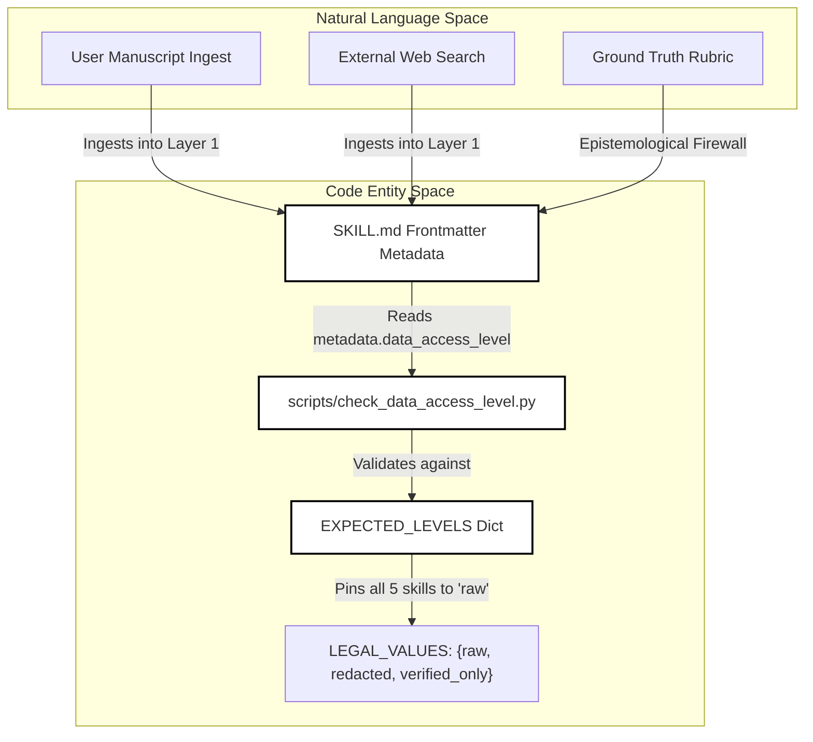
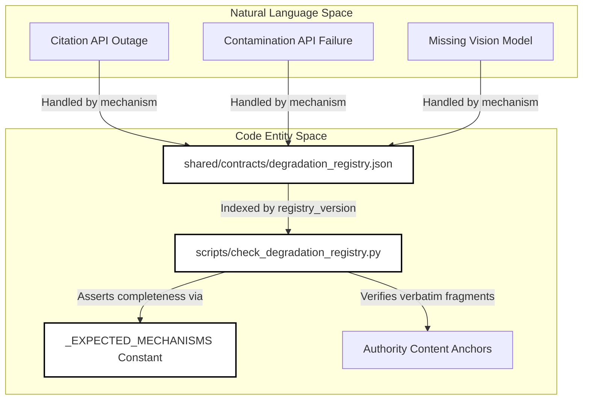

<!-- source: DeepWiki mcp.deepwiki.com · repo Imbad0202/academic-research-skills · page 7.3 Cross-Agent Quality Alignment · fetched 2026-10-30 -->

# Cross-Agent Quality Alignment

Relevant source files

The following files were used as context for generating this wiki page:

- [academic-paper-reviewer/templates/editorial_decision_template.md](academic-paper-reviewer/templates/editorial_decision_template.md)
- [academic-paper/references/workflow_phase_details.md](academic-paper/references/workflow_phase_details.md)
- [academic-paper/references/writing_quality_check.md](academic-paper/references/writing_quality_check.md)
- [scripts/check_acronyms.py](scripts/check_acronyms.py)
- [scripts/check_data_access_level.py](scripts/check_data_access_level.py)
- [scripts/check_degradation_registry.py](scripts/check_degradation_registry.py)
- [scripts/check_instruction_data_boundary.py](scripts/check_instruction_data_boundary.py)
- [scripts/test_check_acronyms.py](scripts/test_check_acronyms.py)
- [scripts/test_check_data_access_level.py](scripts/test_check_data_access_level.py)
- [scripts/test_check_instruction_data_boundary.py](scripts/test_check_instruction_data_boundary.py)
- [scripts/test_check_task_type.py](scripts/test_check_task_type.py)
- [shared/contracts/degradation_registry.json](shared/contracts/degradation_registry.json)
- [shared/ground_truth_isolation_pattern.md](shared/ground_truth_isolation_pattern.md)
- [tests/test_helpers.py](tests/test_helpers.py)

## Purpose and Scope

This document specifies the **unified quality standards**, **source tiers**, **verification thresholds**, **data access isolation levels**, and **graceful degradation mechanisms** governing the 35-agent ecosystem in the Academic Research Skills (ARS) system (v3.23.x). These standards prevent contradictory quality judgments, eliminate "reward hacking" against evaluation rubrics, and ensure research outputs remain grounded in verifiable evidence rather than LLM parametric memory. 

Key architectural components include the **Ground Truth Isolation Pattern** [shared/ground_truth_isolation_pattern.md:1-5](), the **Degradation Registry** [shared/contracts/degradation_registry.json:1-4](), and automated linter frameworks like `scripts/check_data_access_level.py` [scripts/check_data_access_level.py:1-45]() and `scripts/check_degradation_registry.py` [scripts/check_degradation_registry.py:1-36]().

**Sources:** [shared/ground_truth_isolation_pattern.md:1-5](), [shared/contracts/degradation_registry.json:1-4](), [scripts/check_data_access_level.py:1-45]()

---

## Unified Quality Standards and Source Tiers

Quality in ARS is structured around an epistemological three-layer model defined in `shared/ground_truth_isolation_pattern.md`. Artifacts move strictly upward through explicit integrity gates and can never flow backward.

| Layer | Trust Classification | Definition & Scope |
| :--- | :--- | :--- |
| **Layer 1** | `raw` | Unverified user queries, web/database search returns, and uninspected drafts. Treated as untrusted and potentially adversarial. |
| **Layer 2** | `verified` | Artifacts that have successfully cleared an integrity gate (e.g., Semantic Scholar existence checks, `integrity_verification_agent` audits). |
| **Layer 3** | `ground_truth` | Evaluation rubrics, gold labels, calibration sets, and answer keys. Strictly isolated from Layer 1/2 process contexts. |

### Contamination and Temporal Integrity Rules (v3.10)
Under the **Firm Rules** (`shared/references/firm_rules.md`), temporal and contamination signals govern data handling:
*   **R-L3-2-A (Default-Advisory):** Contamination metrics (such as `preprint_post_llm_inflection`) default to advisory status rather than hard-blocking emission [shared/references/firm_rules.md:21-23]().
*   **R-L3-2-D (No API Inference):** Agents are strictly barred from using external API-inferred metadata fields (e.g., Crossref publication types) for internal structural routing or logic execution [shared/references/firm_rules.md:33-35]().
*   **R-L3-2-E (Terminal Gate):** The `formatter_agent` acts strictly as a stamp checker, comparing policy hashes against the passport without re-running policy evaluations [shared/references/firm_rules.md:37-39]().

**Sources:** [shared/ground_truth_isolation_pattern.md:59-108](), [shared/references/firm_rules.md:17-48]()

---

## Data Access Isolation Levels

To enforce epistemic boundaries, every top-level skill declares a `data_access_level` in its `SKILL.md` frontmatter. This is statically enforced by `scripts/check_data_access_level.py` [scripts/check_data_access_level.py:1-45]().

Per the dirtiest-input rule (#756 / #773), all five core skills (`academic-paper`, `academic-paper-reviewer`, `academic-pipeline`, `deep-research`, and `sr-screener`) are pinned to `raw` because each skill can legitimately ingest ungated user materials, pasted drafts, or third-party web feeds across its various modes [scripts/check_data_access_level.py:11-42]().

### Data Access Architecture (Code Entity Mapping)

**Sources:** [scripts/check_data_access_level.py:1-68](), [shared/ground_truth_isolation_pattern.md:94-108]()

---

## Degradation Registry and Graceful Failures

Rather than utilizing arbitrary scalar score caps, ARS relies on a machine-readable degradation registry (`shared/contracts/degradation_registry.json`) and a dedicated linter (`scripts/check_degradation_registry.py`) to manage runtime component outages and API degradation [shared/contracts/degradation_registry.json:1-35](), [scripts/check_degradation_registry.py:1-36]().

Each degradation mechanism documents its failure class, degraded state emitted, diagnostic marker, downstream consumer, and terminal policy effect.

### Key Degradation Mechanisms Index
*   `citation_resolver_outage`: When all lookup APIs are unreachable during citation verification, status drops to `unresolvable` rather than false or true [shared/contracts/degradation_registry.json:6-27]().
*   `contamination_signal_api_degradation`: When an API fails during contamination checks, the corresponding field is omitted rather than defaulting to false [shared/contracts/degradation_registry.json:29-56]().
*   `vlm_unavailable`: Skips multimodal figure verification and logs a note without failing the integrity check [shared/contracts/degradation_registry.json:58-75]().
*   `submission_package_incompleteness`: Emits status `not_checked` and exit code 3 during packaging verification [shared/contracts/degradation_registry.json:77-83]().

### Degradation Architecture (Code Entity Mapping)

**Sources:** [shared/contracts/degradation_registry.json:1-83](), [scripts/check_degradation_registry.py:1-98]()

---

## Acronym Discipline and Text Quality Checks

To maintain scholarly prose standards, ARS implements deterministic manuscript text inspection via `scripts/check_acronyms.py` (#849) [scripts/check_acronyms.py:1-12](). 

### Acronym Rules
The script operates across three distinct scopes (body, English abstract, Chinese abstract) without model inference, enforcing three structural rules:
1.  **`undefined`**: An acronym is used in a scope that never defines it [scripts/check_acronyms.py:8-8]().
2.  **`defined_after_use`**: The first appearance of an acronym in a scope occurs prior to its formal parenthetical definition [scripts/check_acronyms.py:9-11]().
3.  **`defined_again`**: A scope defines the same acronym more than once [scripts/check_acronyms.py:11-12]().

Complementary prose checks like `academic-paper/references/writing_quality_check.md` guard against overused expressions (e.g., *delve*, *tapestry*, *pivotal*) and throat-clearing openers [academic-paper/references/writing_quality_check.md:15-94]().

**Sources:** [scripts/check_acronyms.py:1-63](), [academic-paper/references/writing_quality_check.md:1-103]()

---

## Ground-Truth Isolation and Instruction-Data Boundary

The **Instruction-Data Boundary** pattern ensures that external retrieved texts (web pages, fetched PDFs, third-party user inputs) are strictly treated as **data** and never interpreted as **system or agent instructions** [shared/ground_truth_isolation_pattern.md:111-130]().

This principle is guarded by `scripts/check_instruction_data_boundary.py`, which statically verifies that the canonical text blocks and backpoints are embedded verbatim across all designated hotspot agent files and cross-model prompts [scripts/check_instruction_data_boundary.py:1-40]().

**Sources:** [shared/ground_truth_isolation_pattern.md:111-130](), [scripts/check_instruction_data_boundary.py:1-101]()

---

