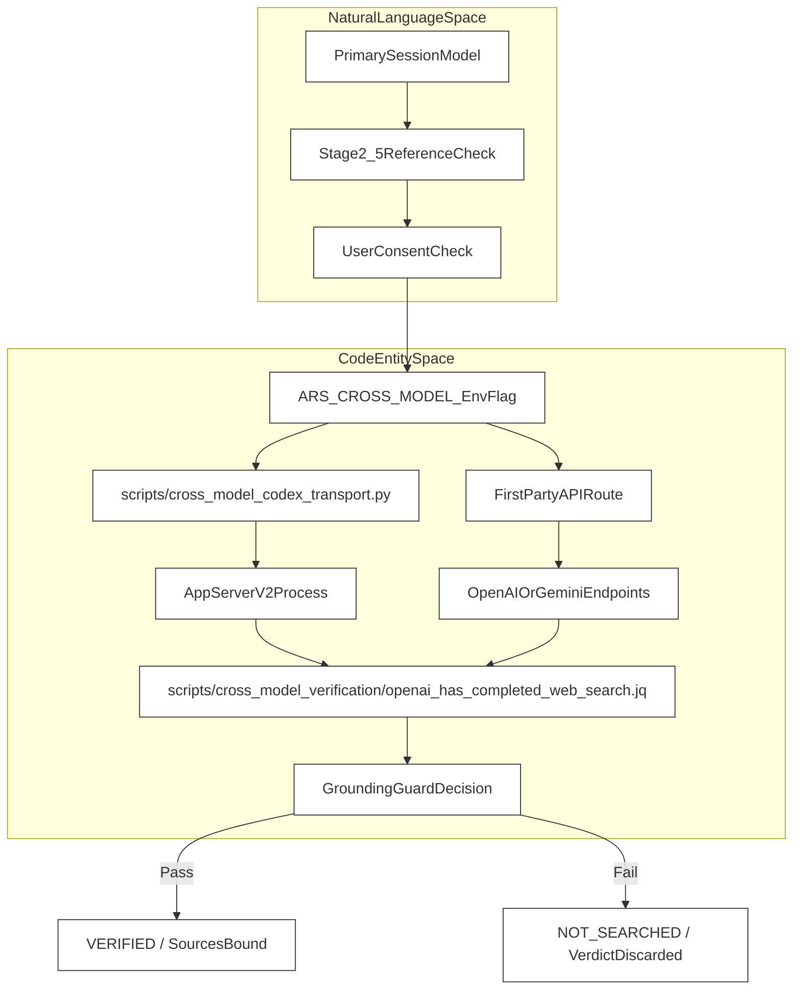

<!-- source: DeepWiki mcp.deepwiki.com · repo Imbad0202/academic-research-skills · page 7.4 Cross-Model Verification · fetched 2026-10-30 -->

# Cross-Model Verification

Relevant source files

The following files were used as context for generating this wiki page:

- [audits/harness-retirement-2026-09-model-update.md](audits/harness-retirement-2026-09-model-update.md)
- [docs/PERFORMANCE.md](docs/PERFORMANCE.md)
- [docs/PERFORMANCE.zh-TW.md](docs/PERFORMANCE.zh-TW.md)
- [docs/SETUP.md](docs/SETUP.md)
- [docs/SETUP.zh-TW.md](docs/SETUP.zh-TW.md)
- [scripts/cross_model_codex_transport.py](scripts/cross_model_codex_transport.py)
- [scripts/cross_model_smoke_test.sh](scripts/cross_model_smoke_test.sh)
- [scripts/cross_model_verification/gemini_is_grounded.jq](scripts/cross_model_verification/gemini_is_grounded.jq)
- [scripts/cross_model_verification/gemini_sources.jq](scripts/cross_model_verification/gemini_sources.jq)
- [scripts/cross_model_verification/openai_has_completed_web_search.jq](scripts/cross_model_verification/openai_has_completed_web_search.jq)
- [scripts/cross_model_verification/openai_sources.jq](scripts/cross_model_verification/openai_sources.jq)
- [scripts/cross_model_verification/openai_text.jq](scripts/cross_model_verification/openai_text.jq)
- [scripts/test_cross_model_codex_transport.py](scripts/test_cross_model_codex_transport.py)
- [scripts/test_cross_model_verification_guards.py](scripts/test_cross_model_verification_guards.py)
- [shared/cross_model_verification.md](shared/cross_model_verification.md)

## Purpose and Scope

Cross-Model Verification (ARS v3.0+) provides an optional second-model validation layer designed to catch shared-frame blind spots and hallucination patterns that primary models (such as Claude session models) systematically miss [shared/cross_model_verification.md:1-7](). Because generative models trained on overlapping data distributions can share the same reasoning errors, introducing a structurally distinct model family via bounded API calls or a contained subscription transport adds substrate diversity to high-stakes integrity checks, peer review calibration, and adversarial challenges [shared/cross_model_verification.md:32-38](). 

This page documents the technical implementation of the cross-model verification subsystem, covering environment flags (`ARS_CROSS_MODEL`), the specialized Codex subscription transport for citation verification, canonical JQ grounding guards, and testing harness scripts.

Sources: [shared/cross_model_verification.md:1-38]()

---

## 1. Architecture and Verification Data Flow

The cross-model verification framework operates as an asynchronous, optional interception layer invoked during critical checkpoints (such as Stage 2.5 and Stage 4.5 reference checks, or adversarial review challenges). When enabled, bounded payloads are serialized and dispatched to an external verifier while ensuring strict consent boundaries and fail-closed grounding checks.

**Figure 1**: Natural Language Space to Code Entity Space mapping for Cross-Model Verification orchestration, showing execution routing from environment flags through transport adapters and JQ grounding filters.

Sources: [shared/cross_model_verification.md:1-65](), [scripts/cross_model_codex_transport.py:1-40]()

---

## 2. Configuration Flags and Supported Model Tiers

Cross-model verification is controlled by explicit environment variables. By default, verification relies solely on the primary session model [shared/cross_model_verification.md:7](). 

### Core Environment Flags

- `ARS_CROSS_MODEL`: Specifies the verifier model ID (e.g., `gpt-6-astra`, `gpt-5.6-sol`, `gemini-4-argon`, or `gemini-3.1-pro-preview`) [docs/SETUP.md:125-131]().
- `ARS_CROSS_MODEL_TRANSPORT`: Selects the transport mode. Setting this to `codex` activates the ChatGPT-subscription container transport for citation integrity calls [docs/SETUP.md:134](). Unset or `api` defaults to direct API routes [shared/cross_model_verification.md:16-24]().
- `ARS_OPENAI_COMPAT_BASE_URL` and `ARS_OPENAI_COMPAT_API_KEY`: Configures custom OpenAI-compatible endpoints (such as Xiaomi MiMo or DeepSeek) [shared/cross_model_verification.md:52-59](). Note that third-party compatible providers are ungrounded and positive verdicts are automatically downgraded to `NOT_SEARCHED` [shared/cross_model_verification.md:60]().

### Supported First-Party Models

| Model | API ID | Provider | Status & Role |
| :--- | :--- | :--- | :--- |
| Claude (Session) | _(Inherited session model)_ | Anthropic | Primary model for all ARS skills [shared/cross_model_verification.md:44]() |
| GPT-6 Astra | `gpt-6-astra` | OpenAI | Current flagship verifier (provisional pending full bakeoff) [shared/cross_model_verification.md:45]() |
| GPT-5.6 Sol | `gpt-5.6-sol` | OpenAI | Validated for ChatGPT-subscription citation transport [shared/cross_model_verification.md:46]() |
| Gemini 4 Argon | `gemini-4-argon` | Google | Current Google flagship verifier (provisional) [shared/cross_model_verification.md:47]() |
| Gemini 3.1 Pro | `gemini-3.1-pro-preview` | Google | Validated, fully supported factual verifier [shared/cross_model_verification.md:48]() |

Sources: [docs/SETUP.md:125-143](), [shared/cross_model_verification.md:40-64]()

---

## 3. The Codex Subscription Transport (`scripts/cross_model_codex_transport.py`)

To support users with ChatGPT subscriptions rather than direct API billing, ARS includes a specialized containerized transport (`scripts/cross_model_codex_transport.py`) restricted strictly to one-reference citation-integrity checks in Stages 2.5 and 4.5 [shared/cross_model_verification.md:16-24]().

```mermaid
graph TD
    subgraph "CodeEntitySpace"
        A["scripts/cross_model_codex_transport.py"] --> B["_make_auth_home"]
        B --> C["SpawnCodexAppServerProcess"]
        C --> D["SendClosedJSONRequest"]
        D --> E["ReadStdoutEventStream"]
        E --> F["scripts/cross_model_codex_transport.py:parse_app_server_messages"]
        F --> G["ValidateForbiddenEventScan"]
        G --> H["ExtractReceiptAndSources"]
    end

    classDef default fill:#fff,stroke:#333,stroke-width:1px;
```

**Figure 2**: Data flow and execution lifecycle within the Codex subscription transport (`scripts/cross_model_codex_transport.py`), illustrating ephemeral auth setup, app-server subprocess communication, and receipt validation.

### Key Implementation Mechanics

- **Restricted Scope**: The Codex transport forbids general multi-agent delegation, code execution, MCP tools, and shell tool use [scripts/cross_model_codex_transport.py:74-85](). `DISABLED_FEATURES` explicitly turns off workspaces, hooks, and browser execution [scripts/cross_model_codex_transport.py:96-125]().
- **App-Server Protocol v2**: Because `codex exec --json` drops standalone search results, the transport drives the `codex app-server` RPC protocol over standard input/output streams [scripts/cross_model_codex_transport.py:3-8]().
- **Schema Validation**: Requests and receipts are validated against strict JSON schemas (`codex_citation_request.schema.json` and `codex_citation_receipt.schema.json`) [scripts/test_cross_model_codex_transport.py:22-27]().

Sources: [scripts/cross_model_codex_transport.py:1-126](), [scripts/test_cross_model_codex_transport.py:1-69]()

---

## 4. Grounding Guards and JQ Response Extractors (`scripts/cross_model_verification/`)

To prevent ungrounded LLM hallucination from passing integrity gates, cross-model verification relies on canonical JQ filter scripts located in `scripts/cross_model_verification/`. These filters inspect raw JSON payloads returned by APIs to verify that a live web search actually executed before a verdict is accepted [scripts/cross_model_verification/openai_has_completed_web_search.jq:1-7]().

### Canonical JQ Filters

- **`openai_has_completed_web_search.jq`**: Normalizes the `.output` array, checking for an object where `.type == "web_search_call"` and `.status == "completed"` [scripts/cross_model_verification/openai_has_completed_web_search.jq:9-15](). If missing, `jq -e` exits non-zero, causing the calling script to downgrade the verdict to `NOT_SEARCHED` [scripts/cross_model_verification/openai_has_completed_web_search.jq:1-7]().
- **`openai_text.jq`**: Safely extracts and joins `output_text` segments from message nodes [scripts/cross_model_verification/openai_text.jq:1-11]().
- **`openai_sources.jq`**: Extracts `url_citation` annotations attached to model outputs.
- **`gemini_is_grounded.jq` & `gemini_sources.jq`**: Inspects Gemini responses for `groundingMetadata`, verifying web search queries and chunks [scripts/test_cross_model_verification_guards.py:163-178]().

Sources: [scripts/cross_model_verification/openai_has_completed_web_search.jq:1-15](), [scripts/cross_model_verification/openai_text.jq:1-11]()

---

## 5. Verification Testing and Smoke Test Harnesses

To guarantee that grounding guards and transport adapters fail closed under anomalous conditions, ARS maintains a test suite and a live smoke test script [scripts/cross_model_smoke_test.sh:1-38](), [scripts/test_cross_model_verification_guards.py:1-18]().

- **Behavioral Guard Tests (`scripts/test_cross_model_verification_guards.py`)**: Runs synthetic JSON payloads (grounded vs. from-memory responses) through the JQ filters to assert that ungrounded models are consistently rejected [scripts/test_cross_model_verification_guards.py:1-18]().
- **Codex Transport Tests (`scripts/test_cross_model_codex_transport.py`)**: Uses hermetic mock app-server binaries to test timeout handling, malformed event streams, and authentication failures [scripts/test_cross_model_codex_transport.py:1-102]().
- **Live Smoke Test (`scripts/cross_model_smoke_test.sh`)**: Issues a single live API request against a stable reference (`Vaswani et al., 2017`) to validate HTTP transport health, grounding guard execution, and single-verdict compliance before production use [scripts/cross_model_smoke_test.sh:1-38]().

Sources: [scripts/cross_model_smoke_test.sh:1-65](), [scripts/test_cross_model_verification_guards.py:1-51]()

---

