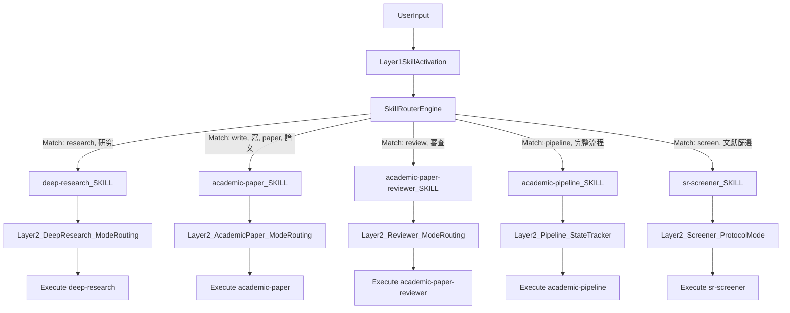
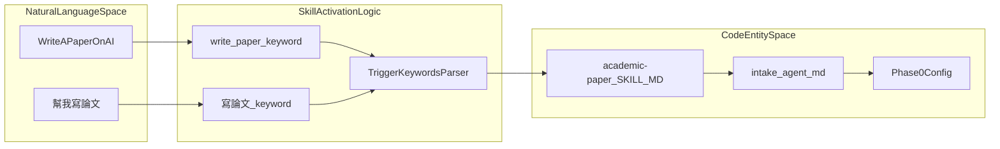
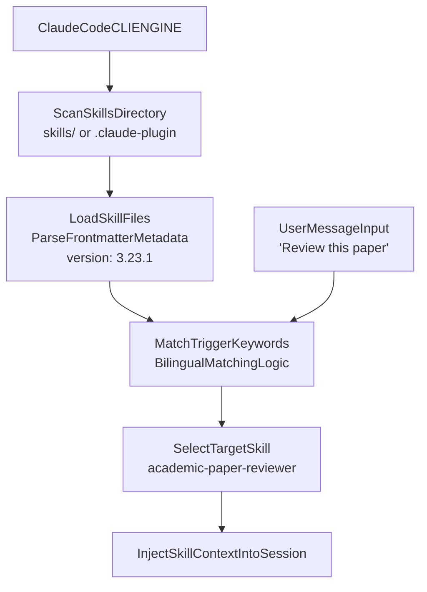

<!-- source: DeepWiki mcp.deepwiki.com · repo Imbad0202/academic-research-skills · page 8.1 Layer 1: Skill Activation Keywords · fetched 2026-10-30 -->

# Layer 1: Skill Activation Keywords

Relevant source files

The following files were used as context for generating this wiki page:

- [.claude-plugin/marketplace.json](.claude-plugin/marketplace.json)
- [.claude-plugin/plugin.json](.claude-plugin/plugin.json)
- [.claude/CLAUDE.md](.claude/CLAUDE.md)
- [MODE_REGISTRY.md](MODE_REGISTRY.md)
- [README.ja-JP.md](README.ja-JP.md)
- [README.ko-KR.md](README.ko-KR.md)
- [README.md](README.md)
- [README.zh-CN.md](README.zh-CN.md)
- [README.zh-TW.md](README.zh-TW.md)
- [academic-pipeline/SKILL.md](academic-pipeline/SKILL.md)
- [docs/ARCHITECTURE.md](docs/ARCHITECTURE.md)
- [scripts/_skill_lint.py](scripts/_skill_lint.py)
- [scripts/check_method_weaknesses_sync.py](scripts/check_method_weaknesses_sync.py)
- [scripts/check_review_form_note_sync.py](scripts/check_review_form_note_sync.py)
- [scripts/check_routing_core_sync.py](scripts/check_routing_core_sync.py)
- [scripts/check_spec_consistency.py](scripts/check_spec_consistency.py)
- [scripts/test_check_method_weaknesses_sync.py](scripts/test_check_method_weaknesses_sync.py)
- [scripts/test_check_review_form_note_sync.py](scripts/test_check_review_form_note_sync.py)
- [scripts/test_check_routing_core_sync.py](scripts/test_check_routing_core_sync.py)
- [scripts/test_skill_lint_marker_block.py](scripts/test_skill_lint_marker_block.py)

## Purpose and Scope

This document covers the **Layer 1 keyword-based activation system** that determines which of the five core skills (`deep-research`, `academic-paper`, `academic-paper-reviewer`, `academic-pipeline`, `sr-screener`) should be invoked based on user input. Layer 1 uses **bilingual trigger keywords** (English and Traditional/Simplified Chinese, Japanese, Korean) to improve matching confidence at the skill level.

For information about how modes within a skill are selected (e.g., `socratic` vs `full` mode), see [8.2 Layer 2: Intent-Based Mode Routing](). For the complete two-layer routing architecture overview, see [8. Mode Selection and Intent Detection]().

**Key distinction**: Layer 1 determines **which skill**, Layer 2 determines **which mode within that skill**. As of v3.23.1, the system manages **35 modes** across these 5 skills as defined in `MODE_REGISTRY.md` [MODE_REGISTRY.md:1-10]().

Sources: `[MODE_REGISTRY.md:1-10]`, `[.claude/CLAUDE.md:5-14]()`

---

## Two-Layer Routing Architecture

The system uses a two-layer routing architecture to separate skill activation from mode selection. This is primarily governed by the metadata and trigger sections defined in each skill's `SKILL.md` file and coordinated by the routing core.

### Title: Skill Selection Architecture

Sources: `[academic-pipeline/SKILL.md:19-42]`, `[.claude/CLAUDE.md:5-14]`, `[MODE_REGISTRY.md:1-10]()`

---

## Keyword Structure and Format

### SKILL.md Trigger Keywords Section

Each skill defines its trigger keywords in its metadata or description sections within its `SKILL.md` file. The structure follows a bilingual format to support English and multiple Asian languages.

### Title: Natural Language to Code Entity Space Mapping

Sources: `[academic-pipeline/SKILL.md:1-15]`, `[MODE_REGISTRY.md:1-10]()`

---

## Skill-Specific Trigger Keywords

The `MODE_REGISTRY.md` serves as the single source of truth for all 35 modes across the 5 skills, specifying triggers, oversight levels, and outputs [MODE_REGISTRY.md:1-10]().

| Skill | Modes Count | English Trigger Keywords | Localized / Multi-lang Triggers | Source |
|-------|-------------|--------------------------|---------------------------------|--------|
| `deep-research` | 8 | research, deep research, academic analysis | 研究, 深度研究, 文獻回顧 | `[MODE_REGISTRY.md:11-23]()` |
| `academic-paper` | 11 | write a paper, academic paper, research paper | 寫論文, 學術論文, 論文大綱 | `[MODE_REGISTRY.md:24-39]()` |
| `academic-paper-reviewer` | 6 | review paper, peer review, manuscript review | 審查論文, 同儕審查, 審查意見 | `[MODE_REGISTRY.md:40-50]()` |
| `academic-pipeline` | 2 | academic pipeline, research to paper, full paper workflow | 完整流程, 全流程, 학술 파이프라인 | `[academic-pipeline/SKILL.md:3-3]()`, `[MODE_REGISTRY.md:51-57]()` |
| `sr-screener` | 8 | screening protocol, screen these abstracts, PRISMA flow numbers | 文獻篩選, 系統綜述篩選 | `[MODE_REGISTRY.md:58-70]()` |

### Detailed Activation Mapping

| Skill | Code-Level Mode | Trigger Phrase Examples | Oversight Level |
|-------|----------------|-------------------------|-----------------|
| `deep-research` | `socratic` | "guide my research", "help me think through" | Very High |
| `deep-research` | `systematic-review` | "systematic review", "PRISMA" | Medium |
| `academic-paper` | `plan` | "guide my paper", "step by step paper" | Very High |
| `academic-paper` | `revision-coach` | "parse reviews", "I got reviewer comments" | Medium |
| `academic-paper-reviewer` | `calibration` | "calibrate reviewer", "measure reviewer accuracy" | Medium |
| `academic-pipeline` | `resume_from_passport` | "resume from passport", "continue pipeline" | High |
| `sr-screener` | `protocol` | "turn my proposal into a screening protocol" | Very High |

Sources: `[MODE_REGISTRY.md:11-70]`, `[academic-pipeline/SKILL.md:3-3]()`

---

## Skill Activation Integration

The trigger keywords integrate with Claude Code's native skill activation system through frontmatter parsing and marketplace manifests.

### Title: Claude Code Skill Loading Flow

Sources: `[.claude-plugin/plugin.json:1-23]`, `[.claude-plugin/marketplace.json:1-24]`, `[.claude/CLAUDE.md:5-14]()`

---

## Troubleshooting Activation Issues

### Common Problems and Solutions

| Problem | Diagnosis | Solution |
|---------|-----------|----------|
| **Skill not activating** | Keywords omitted from `### Trigger Keywords` or skill metadata. | Verify the specific `SKILL.md` frontmatter trigger list or check `MODE_REGISTRY.md`. |
| **Wrong skill activating** | Ambiguous input matching overlapping domains across skills. | Use explicit prefix tokens like `[direct-mode]` or specialized keywords (`"screen these abstracts"` vs `"review paper"`). |
| **Mode mismatch** | Skill activates but defaults to wrong operational mode. | Specify exact mode triggers listed in `MODE_REGISTRY.md`. |
| **Bilingual failure** | Localized variant not mapping to standard triggers. | Ensure localized README translations and frontmatter descriptions are synchronized. |

Sources: `[MODE_REGISTRY.md:1-10]`, `[scripts/check_spec_consistency.py:77-89]`, `[academic-pipeline/SKILL.md:19-42]()`

---

