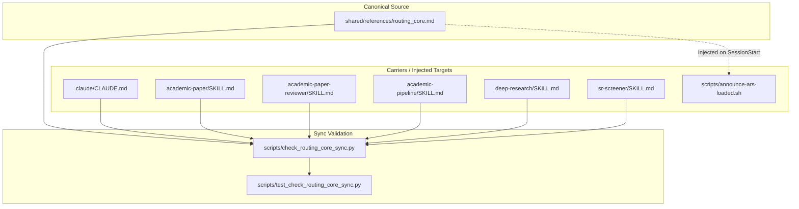
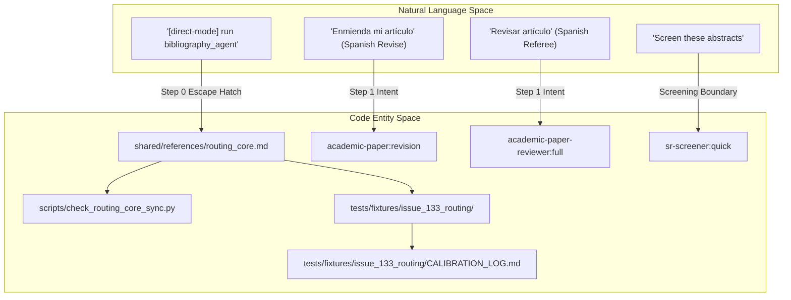

<!-- source: DeepWiki mcp.deepwiki.com · repo Imbad0202/academic-research-skills · page 8.2 Layer 2: Intent-Based Mode Routing · fetched 2026-10-30 -->

# Layer 2: Intent-Based Mode Routing

Relevant source files

The following files were used as context for generating this wiki page:

- [academic-paper-reviewer/SKILL.md](academic-paper-reviewer/SKILL.md)
- [academic-paper/SKILL.md](academic-paper/SKILL.md)
- [deep-research/SKILL.md](deep-research/SKILL.md)
- [docs/CONTROL_AVAILABILITY.md](docs/CONTROL_AVAILABILITY.md)
- [scripts/_skill_lint.py](scripts/_skill_lint.py)
- [scripts/check_method_weaknesses_sync.py](scripts/check_method_weaknesses_sync.py)
- [scripts/check_review_form_note_sync.py](scripts/check_review_form_note_sync.py)
- [scripts/check_routing_core_sync.py](scripts/check_routing_core_sync.py)
- [scripts/test_check_method_weaknesses_sync.py](scripts/test_check_method_weaknesses_sync.py)
- [scripts/test_check_review_form_note_sync.py](scripts/test_check_review_form_note_sync.py)
- [scripts/test_check_routing_core_sync.py](scripts/test_check_routing_core_sync.py)
- [scripts/test_skill_lint_marker_block.py](scripts/test_skill_lint_marker_block.py)
- [shared/references/routing_core.md](shared/references/routing_core.md)
- [tests/fixtures/issue_133_routing/11_spanish_revision_not_review/expected.yaml](tests/fixtures/issue_133_routing/11_spanish_revision_not_review/expected.yaml)
- [tests/fixtures/issue_133_routing/11_spanish_revision_not_review/input.md](tests/fixtures/issue_133_routing/11_spanish_revision_not_review/input.md)
- [tests/fixtures/issue_133_routing/12_spanish_review_not_revision/expected.yaml](tests/fixtures/issue_133_routing/12_spanish_review_not_revision/expected.yaml)
- [tests/fixtures/issue_133_routing/12_spanish_review_not_revision/input.md](tests/fixtures/issue_133_routing/12_spanish_review_not_revision/input.md)
- [tests/fixtures/issue_133_routing/CALIBRATION_LOG.md](tests/fixtures/issue_133_routing/CALIBRATION_LOG.md)
- [tests/fixtures/issue_133_routing/README.md](tests/fixtures/issue_133_routing/README.md)

## Purpose and Scope

This page documents Layer 2 of the Academic Research Skills (ARS) routing architecture: **Intent-Based Mode Routing**. While Layer 1 handles framework-level skill activation via bilingual trigger keywords (see section 8.1), Layer 2 governs how incoming natural language requests are classified into specific operational modes within a skill. 

This mechanism relies on a shared **Routing Core** (`shared/references/routing_core.md`), an escape hatch protocol (`[direct-mode]`), structured clarification triggers for ambiguous or cross-phase materials, and an extensive suite of calibration fixtures (`issue_133_routing`) designed to prevent phase scope inflation and ensure stable cross-model routing behavior.

**Sources:** [shared/references/routing_core.md:1-12](), [tests/fixtures/issue_133_routing/README.md:1-10]()

---

## The Shared Routing Core and Sync Architecture

To ensure consistent routing across all execution channels (plugin installs, skills copies, repo clones, and wrapper environments), ARS centralizes its routing logic in a single canonical file: `shared/references/routing_core.md`. 

Because Claude Code plugin installs do not automatically load repository-level configuration files like `.claude/CLAUDE.md`, the routing core block (bounded by `<!-- routing-core:begin -->` and `<!-- routing-core:end -->`) is injected into the `SKILL.md` of every core skill and announced at session start [shared/references/routing_core.md:1-10]().

Integrity between the canonical source and all embedded copies is strictly enforced by the CI validation script `scripts/check_routing_core_sync.py` and tested via `scripts/test_check_routing_core_sync.py`.

Title: Routing Core Synchronization Architecture

**Sources:** [shared/references/routing_core.md:1-12](), [scripts/test_check_routing_core_sync.py:1-40]()

---

## Step 0 Escape Hatch and Clarification Protocol

Before classifying any natural language input into skills or modes, the routing core executes **Step 0 — Escape Hatch Check**, followed by classification steps for explicit intent, cross-phase materials, and ambiguity [shared/references/routing_core.md:13-32]().

### Step 0: The `[direct-mode]` Escape Hatch
If a user's message begins with the case-insensitive token `[direct-mode]` (optionally preceded by whitespace or newlines that are stripped during parsing), the system records the token, strips it and surrounding whitespace from the message, and jumps directly to **Step 1 explicit-intent handling** on the remaining content [shared/references/routing_core.md:14-15]().
- The literal string `[direct-mode]` is **never** passed downstream to the dispatched agent [shared/references/routing_core.md:14-15]().
- The escape hatch bypasses **cross-phase clarification (Step 2)**, but it does **not** bypass required input verification: if the named agent requires inputs that are missing, the agent prompts for them in its own terms [shared/references/routing_core.md:14-15]().
- A `[direct-mode]` token appearing *after* any non-whitespace character is ignored; the message is processed normally through Steps 1–3 [shared/references/routing_core.md:14-15]().

### Steps 1–3: Classification Rules
When no valid escape hatch token is present at byte-0, input is classified as follows:
1. **Explicit Clear Intent**: User invokes a specific skill via `/ars-*` slash command or uses unambiguous trigger keywords mapping to a single skill. Routes directly without clarification or orchestrator detours [shared/references/routing_core.md:18-21]().
2. **Cross-Phase Materials Detected**: User provides artifacts spanning $\ge 2$ pipeline phases without naming a specific skill (e.g., pre-written abstract plus pre-collected literature). The system **clarifies**, presenting candidate workflows as markdown options rather than auto-routing to a single-phase agent [shared/references/routing_core.md:22-25]().
3. **Ambiguous Intent, No Materials**: User provides no artifacts and no clear request. The system triggers clarification per the intent clarification protocol [shared/references/routing_core.md:26-28]().

**Sources:** [shared/references/routing_core.md:13-32]()

---

## Routing Calibration Fixtures (`issue_133_routing`)

To guard against regressions in intent detection and phase scope inflation (originally reported in Issue #133), ARS maintains a behavioral smoke test suite located in `tests/fixtures/issue_133_routing/` [tests/fixtures/issue_133_routing/README.md:1-10]().

### Fixture Structure and Scope
Each test fixture directory contains an `input.md`, an `expected.yaml` configuration schema, and a `rationale.md` explaining the routing decision [tests/fixtures/issue_133_routing/README.md:55-65](). 

The suite currently covers 21 distinct test cases, including:
- Cross-phase ambiguity checks (Fixture 01, 08) [tests/fixtures/issue_133_routing/README.md:31-38]().
- Escape hatch honoring vs. rejection (Fixtures 05, 06, 07) [tests/fixtures/issue_133_routing/README.md:35-37]().
- Multilingual intent disambiguation (Korean and Spanish localization boundaries between editing (`revision`) and refereeing (`reviewer`)) (Fixtures 09–12) [tests/fixtures/issue_133_routing/README.md:39-42]().
- Systematic review vs. screening boundaries (`sr-screener`) (Fixtures 17–21) [tests/fixtures/issue_133_routing/README.md:47-51]().

### Calibration and Execution Log
As documented in `tests/fixtures/issue_133_routing/CALIBRATION_LOG.md`, these fixtures serve as human-monitored calibration targets across model generations (e.g., Claude Opus and Fable variants) [tests/fixtures/issue_133_routing/CALIBRATION_LOG.md:1-20](). Because LLM routing behavior can vary across temperature or cache states, the target is 100% pass rates on primary sessions, ensuring that ambiguities are consistently intercepted by the clarification protocol [tests/fixtures/issue_133_routing/README.md:11-26]().

**Sources:** [tests/fixtures/issue_133_routing/README.md:1-54](), [tests/fixtures/issue_133_routing/CALIBRATION_LOG.md:1-50]()

---

## Natural Language Space to Code Entity Space

The following diagram bridges natural language expressions and user commands to their corresponding routing logic, fixtures, and code components in the codebase.

Title: Layer 2 Natural Language to Code Entity Architecture

**Sources:** [shared/references/routing_core.md:1-32](), [tests/fixtures/issue_133_routing/README.md:30-52](), [scripts/test_check_routing_core_sync.py:20-30]()

---

