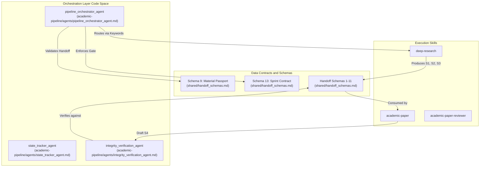
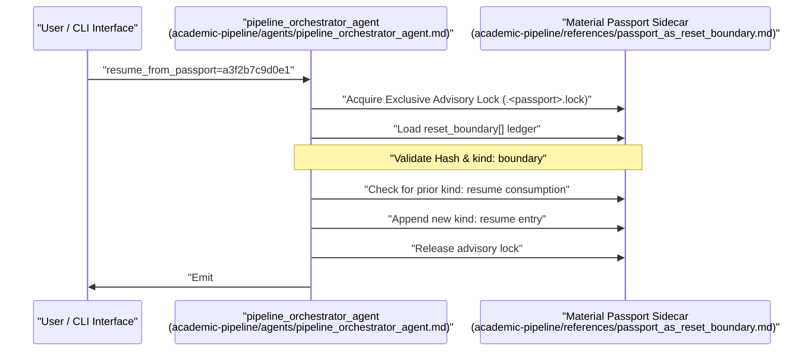

<!-- source: DeepWiki mcp.deepwiki.com · repo Imbad0202/academic-research-skills · page 9 Integration and Handoffs · fetched 2026-10-30 -->

# Integration and Handoffs

Relevant source files

The following files were used as context for generating this wiki page:

- [.github/workflows/spec-consistency.yml](.github/workflows/spec-consistency.yml)
- [CHANGELOG.md](CHANGELOG.md)
- [academic-pipeline/agents/integrity_verification_agent.md](academic-pipeline/agents/integrity_verification_agent.md)
- [academic-pipeline/agents/pipeline_orchestrator_agent.md](academic-pipeline/agents/pipeline_orchestrator_agent.md)
- [academic-pipeline/references/ai_research_failure_modes.md](academic-pipeline/references/ai_research_failure_modes.md)
- [academic-pipeline/references/passport_as_reset_boundary.md](academic-pipeline/references/passport_as_reset_boundary.md)
- [academic-pipeline/references/pipeline_state_machine.md](academic-pipeline/references/pipeline_state_machine.md)
- [academic-pipeline/references/process_summary_protocol.md](academic-pipeline/references/process_summary_protocol.md)
- [scripts/_ci_pytest_manifest.toml](scripts/_ci_pytest_manifest.toml)
- [scripts/check_pipeline_boundary_semantics.py](scripts/check_pipeline_boundary_semantics.py)
- [scripts/test_check_pipeline_boundary_semantics.py](scripts/test_check_pipeline_boundary_semantics.py)
- [scripts/test_v3_6_7_phase_6_6.py](scripts/test_v3_6_7_phase_6_6.py)
- [shared/contracts/README.md](shared/contracts/README.md)
- [shared/handoff_schemas.md](shared/handoff_schemas.md)

This document describes how the core skills (`deep-research`, `academic-paper`, `academic-paper-reviewer`, `academic-pipeline`, and `sr-screener`) integrate through standardized handoff protocols, schema validation, material auto-detection, and corpus adapters. It covers the data contracts enabling inter-skill communication, mechanisms for detecting and reusing upstream materials via the Material Passport, and ecosystem integrations.

**Scope**: This is a high-level parent page for integration mechanics.
- For technical data contracts and validation rules, see [Handoff Schemas](#9.1).
- For auto-detection, intake ingestion, and skip logic, see [Auto-Detection and Skip Logic](#9.2).
- For reference adapters (Zotero, Obsidian, folder scan), see [Literature Corpus Adapters](#9.3).
- For plugin packaging and external distributions, see [External Skill Integrations](#9.4).

---

## Integration Architecture Overview

The system implements a loosely coupled, schema-validated integration model. Skills communicate via structured Markdown artifacts or JSON-based ledger entries defined in `shared/handoff_schemas.md` [shared/handoff_schemas.md:1-9](). The `pipeline_orchestrator_agent` coordinates these transitions by detecting user intent, tracking state via `state_tracker_agent`, and verifying data integrity [academic-pipeline/agents/pipeline_orchestrator_agent.md:10-32]().

**Diagram: Integration Control Plane and Code Entities**

*Sources: [shared/handoff_schemas.md:1-15](), [academic-pipeline/agents/pipeline_orchestrator_agent.md:10-30](), [academic-pipeline/agents/integrity_verification_agent.md:8-14]()*

---

## Handoff Schemas (Schema 1–13)

Inter-skill communication is governed by robust data contracts defined in `shared/handoff_schemas.md` [shared/handoff_schemas.md:3-9](). All agents producing or consuming pipeline artifacts must validate required fields; missing mandatory fields trigger a `HANDOFF_INCOMPLETE` failure path [shared/handoff_schemas.md:9-10](). 

Key handoff schemas include:
- **Schema 1 (RQ Brief):** Research question, FINER scores, and sub-question bindings passed from `deep-research` to `academic-paper` [shared/handoff_schemas.md:25-38]().
- **Schema 2 (Bibliography):** Annotated sources with evidence tiers and search strategies [shared/handoff_schemas.md:89-102]().
- **Schema 9 (Material Passport):** Provenance ledger and `literature_corpus[]` entries [shared/handoff_schemas.md:342-360]().
- **Schema 13 (Sprint Contract):** Hard-gate protocol for reviewer pre-commitments [shared/handoff_schemas.md:435-450]().

For details, see [Handoff Schemas](#9.1).

*Sources: [shared/handoff_schemas.md:1-12]*

---

## Material Passport and Reset Boundaries

The **Material Passport (Schema 9)** acts as a reset boundary when `ARS_PASSPORT_RESET=1` is active, allowing execution states to be frozen and resumed cleanly in fresh sessions [academic-pipeline/references/passport_as_reset_boundary.md:1-15](). Users resume execution using the `resume_from_passport=<hash>` command [academic-pipeline/agents/pipeline_orchestrator_agent.md:45-47]().

**Diagram: Resume Acknowledgment and Lock Protocol**

*Sources: [academic-pipeline/agents/pipeline_orchestrator_agent.md:45-83](), [academic-pipeline/references/passport_as_reset_boundary.md:1-68]()*

For details, see [Auto-Detection and Skip Logic](#9.2).

---

## Literature Corpus Adapters

To ingest user-owned libraries into the pipeline, the system utilizes reference adapters for Zotero, Obsidian, and folder scans [academic-pipeline/references/adapters/overview.md:1-16](). These adapters parse bibliographic metadata, normalize citation keys, and emit items conforming to `literature_corpus_entry.schema.json` [shared/contracts/README.md:1-10](). Items failing validation are isolated in a `rejection_log.yaml` [CHANGELOG.md:31-34]().

For details, see [Literature Corpus Adapters](#9.3).

*Sources: [shared/contracts/README.md:1-10](), [CHANGELOG.md:31-34]*

---

## External Skill Integrations

The architecture supports packaging via `.claude-plugin/plugin.json` and integration with external research execution channels [academic-pipeline/references/integrity_review_protocol.md:1-6](). The `integrity_verification_agent` serves as a mandatory verification gate prior to peer review stages, while anti-leakage guidelines ensure manuscripts are generated strictly from verified user research materials [academic-pipeline/agents/integrity_verification_agent.md:1-10]().

For details, see [External Skill Integrations](#9.4).

*Sources: [academic-pipeline/agents/integrity_verification_agent.md:1-10]()*

---

