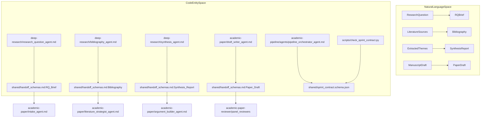
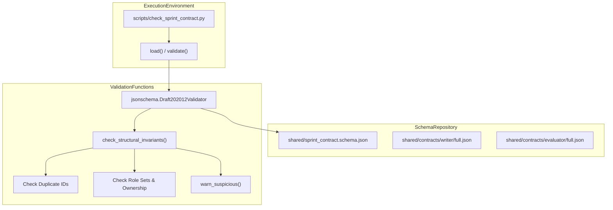

<!-- source: DeepWiki mcp.deepwiki.com · repo Imbad0202/academic-research-skills · page 9.1 Handoff Schemas · fetched 2026-10-30 -->

# Handoff Schemas

Relevant source files

The following files were used as context for generating this wiki page:

- [.github/workflows/spec-consistency.yml](.github/workflows/spec-consistency.yml)
- [CHANGELOG.md](CHANGELOG.md)
- [academic-pipeline/agents/integrity_verification_agent.md](academic-pipeline/agents/integrity_verification_agent.md)
- [academic-pipeline/agents/pipeline_orchestrator_agent.md](academic-pipeline/agents/pipeline_orchestrator_agent.md)
- [academic-pipeline/references/ai_research_failure_modes.md](academic-pipeline/references/ai_research_failure_modes.md)
- [academic-pipeline/references/passport_as_reset_boundary.md](academic-pipeline/references/passport_as_reset_boundary.md)
- [academic-pipeline/references/pipeline_state_machine.md](academic-pipeline/references/pipeline_state_machine.md)
- [academic-pipeline/references/process_summary_protocol.md](academic-pipeline/references/process_summary_protocol.md)
- [scripts/_ci_pytest_manifest.toml](scripts/_ci_pytest_manifest.toml)
- [scripts/check_pipeline_boundary_semantics.py](scripts/check_pipeline_boundary_semantics.py)
- [scripts/check_sprint_contract.py](scripts/check_sprint_contract.py)
- [scripts/test_check_pipeline_boundary_semantics.py](scripts/test_check_pipeline_boundary_semantics.py)
- [scripts/test_check_sprint_contract.py](scripts/test_check_sprint_contract.py)
- [scripts/test_v3_6_7_phase_6_6.py](scripts/test_v3_6_7_phase_6_6.py)
- [shared/contracts/README.md](shared/contracts/README.md)
- [shared/contracts/reviewer/full.json](shared/contracts/reviewer/full.json)
- [shared/contracts/reviewer/methodology_focus.json](shared/contracts/reviewer/methodology_focus.json)
- [shared/handoff_schemas.md](shared/handoff_schemas.md)
- [shared/sprint_contract.schema.json](shared/sprint_contract.schema.json)

This wiki page defines the technical specifications, data structures, and validation rules for inter-skill data transfers in the Academic Research Skills (ARS) system (v3.23.x). Handoff schemas serve as structured data contracts governing the exchange of research artifacts between independent skills and internal pipeline agents.

Sources: [shared/handoff_schemas.md:1-9]()

---

## Purpose and Architecture

Handoff schemas enforce strict type constraints, required fields, and provenance tracking across pipeline stages. The authoritative definitions reside in `shared/handoff_schemas.md`, while validation logic and runtime enforcement are handled by Python scripts within the `scripts/` directory and specialized orchestrator agents.

### Diagram: Natural Language Space to Code Entity Space — Inter-Skill Handoffs

This diagram bridges conceptual data flows in natural language space with concrete code entities (`agents/`, `schemas/`, and orchestrator functions) across the multi-skill ecosystem.

Sources: [shared/handoff_schemas.md:13-37](), [shared/handoff_schemas.md:71-115](), [academic-pipeline/agents/pipeline_orchestrator_agent.md:10-12](), [scripts/check_sprint_contract.py:1-20]()

---

## Core Handoff Schemas

### Schema 1: RQ Brief
* **Producer**: `deep-research/research_question_agent` or `deep-research/socratic_mentor_agent` [shared/handoff_schemas.md:27-27]()
* **Consumer**: `deep-research/research_architect_agent` or `academic-paper/intake_agent` [shared/handoff_schemas.md:28-28]()
* **Required Fields**: `research_question` (string), `sub_questions` (list[string]), `finer_scores` (object containing feasible, interesting, novel, ethical, relevant scaled 1-5 with average >= 3.0), and `scope` (object defining in/out of scope, domain, timeframe, geography, population) [shared/handoff_schemas.md:32-37]().
* **Optional Fields**: `methodology_type`, `theoretical_framework`, `keywords`, `socratic_insights`, `hypothesis`, `exclusion_criteria`, `sub_question_bindings` (per-sub-question inherited scope constraints under #547), `stakeholders`, and `ethical_flags` [shared/handoff_schemas.md:41-52]().

Sources: [shared/handoff_schemas.md:25-53]()

### Schema 2: Bibliography
* **Producer**: `deep-research/bibliography_agent` [shared/handoff_schemas.md:91-91]()
* **Consumer**: `deep-research/synthesis_agent`, `deep-research/source_verification_agent`, or `academic-paper/literature_strategist_agent` [shared/handoff_schemas.md:92-92]()
* **Required Fields**: `sources` (list of source objects, minimum 15 for full mode, 5 for quick mode), `search_strategy` (object with databases, keywords, inclusion/exclusion criteria, date range, and optional `last_searched_at` timestamp), `coverage_assessment` (string), and `minimum_sources` (integer) [shared/handoff_schemas.md:96-102]().
* **Source Object Attributes**: `id`, `title`, `authors`, `year`, `doi` (required for journals), `citation`, `type` (enum), `evidence_tier` (1-7), and `quality_tier` (tier_1 to tier_4) [shared/handoff_schemas.md:105-115]().

Sources: [shared/handoff_schemas.md:89-115]()

### Schema 3: Synthesis Report & Schema 4: Paper Draft
* **Synthesis Report Producer/Consumer**: Produced by `deep-research/synthesis_agent` and consumed by `academic-paper/argument_builder_agent` to establish thematic foundations and research gaps.
* **Paper Draft Producer/Consumer**: Produced by `academic-paper/draft_writer_agent` and consumed by review tiers. In Stage 4 revisions, drafts may be transmitted as patch/diff documents.

Sources: [shared/handoff_schemas.md:136-150](), [academic-paper/agents/draft_writer_agent.md:14-15]()

### Schema 5: Integrity Report
* **Producer**: `integrity_verification_agent` [academic-pipeline/agents/integrity_verification_agent.md:2-3]()
* **Consumer**: `pipeline_orchestrator_agent` [academic-pipeline/agents/pipeline_orchestrator_agent.md:10-12]()
* **Purpose**: Captures 100% reference verification results, ghost citation detection, and claim-faithfulness metrics across revision cycles.

Sources: [academic-pipeline/agents/integrity_verification_agent.md:10-15]()

---

## Pipeline Control Schemas

### Material Passport (Schema 9)
The Material Passport acts as the reset boundary and cross-stage provenance ledger. It tracks pipeline state transitions, data lineage, and supports resumption via `resume_from_passport=<12-hex>` processed by `pipeline_orchestrator_agent` under an exclusive advisory lock on adjacent sidecars (`.<passport-basename>.lock`) [academic-pipeline/agents/pipeline_orchestrator_agent.md:47-54]().

Sources: [shared/contracts/README.md:47-61](), [academic-pipeline/agents/pipeline_orchestrator_agent.md:47-58]()

### Sprint Contract (Schema 13)
Governed by `shared/sprint_contract.schema.json` and validated by `scripts/check_sprint_contract.py`, the Sprint Contract enforces hard gates, role eligibility, and failure conditions on evaluation agents [scripts/check_sprint_contract.py:1-12]().

Sources: [shared/sprint_contract.schema.json:1-20](), [scripts/check_sprint_contract.py:1-15]()

---

## Validation and Data Integrity

The validation subsystem checks compliance across JSON contracts, pipeline states, and prompt boundary semantics.

### Diagram: Contract Validation Logic — Code Entity Space

This diagram maps the script validation pipeline in `scripts/check_sprint_contract.py` against its underlying schemas and invariant checks.

Sources: [scripts/check_sprint_contract.py:30-47](), [scripts/check_sprint_contract.py:44-131](), [scripts/check_sprint_contract.py:154-174]()

Sources: [scripts/check_sprint_contract.py:30-174]()

---

