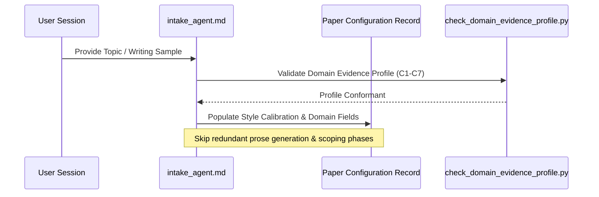

<!-- source: DeepWiki mcp.deepwiki.com · repo Imbad0202/academic-research-skills · page 9.2 Auto-Detection and Skip Logic · fetched 2026-10-30 -->

# Auto-Detection and Skip Logic

<details>
<summary>Relevant source files</summary>

The following files were used as context for generating this wiki page:

- [academic-paper/agents/intake_agent.md](academic-paper/agents/intake_agent.md)
- [academic-paper/references/domain_evidence_profiles.md](academic-paper/references/domain_evidence_profiles.md)
- [docs/design/2026-05-29-kong-259-domain-evidence-profiles-spec.md](docs/design/2026-05-29-kong-259-domain-evidence-profiles-spec.md)
- [docs/design/2026-05-30-kong-259-domain-evidence-profiles-plan.md](docs/design/2026-05-30-kong-259-domain-evidence-profiles-plan.md)
- [scripts/adapters/tests/test_check_literature_corpus_schema.py](scripts/adapters/tests/test_check_literature_corpus_schema.py)
- [scripts/check_392_citation_verification_intake.py](scripts/check_392_citation_verification_intake.py)
- [scripts/check_domain_evidence_profile.py](scripts/check_domain_evidence_profile.py)
- [scripts/check_literature_corpus_schema.py](scripts/check_literature_corpus_schema.py)
- [scripts/check_v3_10_policy.py](scripts/check_v3_10_policy.py)
- [scripts/test_check_392_citation_verification_intake.py](scripts/test_check_392_citation_verification_intake.py)
- [scripts/test_check_394_submission_policy.py](scripts/test_check_394_submission_policy.py)
- [scripts/test_check_domain_evidence_profile.py](scripts/test_check_domain_evidence_profile.py)
- [scripts/test_check_v3_10_policy.py](scripts/test_check_v3_10_policy.py)
- [scripts/test_citation_existence_policy.py](scripts/test_citation_existence_policy.py)
- [shared/contracts/passport/terminal_policies.schema.json](shared/contracts/passport/terminal_policies.schema.json)

</details>


## Purpose and Scope

This page documents the automated material detection, domain evidence profiling, citation verification configuration, and stage-skipping mechanisms that prevent redundant work when research artifacts pass between skills in the Academic Research Skills (ARS) system. It details the **corpus-first, search-fills-gap** flow for literature ingestion, the **Material Passport** provenance tracking, domain evidence profiles (`scripts/check_domain_evidence_profile.py`), citation verification intake rules (`scripts/check_392_citation_verification_intake.py`), and the logic used by configuration agents to bypass redundant pipeline phases.

Sources: [academic-paper/agents/intake_agent.md:1-21](), [shared/contracts/passport/terminal_policies.schema.json:1-15]()

---

## System Overview & Code Entity Mapping

The auto-detection framework bridges high-level user intentions and pre-existing research assets into concrete code structures, schema contracts, and lint validators.

```mermaid
graph TB
    subgraph "NaturalLanguageSpace"
        UserDirect[""User Direct Entry (No Upstream Assets)""]
        UserHandoff[""Deep Research Handoff Detected""]
        UserCorpus[""Existing Zotero / Obsidian Corpus""]
    end
    
    subgraph "CodeEntitySpace"
        IntakeAgent[""academic-paper/agents/intake_agent.md""]
        CheckProfile[""scripts/check_domain_evidence_profile.py""]
        CheckCitIntake[""scripts/check_392_citation_verification_intake.py""]
        LitEntrySchema[""shared/contracts/passport/literature_corpus_entry.schema.json""]
        TerminalPolicySchema[""shared/contracts/passport/terminal_policies.schema.json""]
    end
    
    UserDirect --> IntakeAgent
    UserHandoff --> IntakeAgent
    UserCorpus --> LitEntrySchema
    
    IntakeAgent --> CheckProfile
    IntakeAgent --> CheckCitIntake
    LitEntrySchema --> TerminalPolicySchema
```
**Diagram: Natural Language to Code Entity Architecture for Auto-Detection**

Sources: [academic-paper/agents/intake_agent.md:23-78](), [scripts/check_domain_evidence_profile.py:1-30](), [scripts/check_392_citation_verification_intake.py:1-42](), [shared/contracts/passport/literature_corpus_entry.schema.json:1-10]()

---

## `intake_agent` Detection Mechanism and Upstream Handoffs

The `intake_agent` executes **Step 0** prior to launching the configuration interview to detect if upstream artifacts from `deep-research` are present in the conversation context [academic-paper/agents/intake_agent.md:23-28]().

### Detection Markers and Validation
The agent scans for trigger markers indicating prior deep research execution:
* Research Question Brief
* Methodology Blueprint
* Annotated Bibliography (APA 7.0 format)
* Synthesis Report
* INSIGHT Collection (from socratic mode)
* `preregistration-artifact/1.0` sidecar with `status=provided` and its explicitly named companion [academic-paper/agents/intake_agent.md:29-37]()

When handoff materials are detected, the agent strict-validates the sidecar schema and canonical `record_digest` before auto-populating fields like the Research Question, discipline, and research method, allowing the pipeline to skip duplicate literature searches and scoping interviews [academic-paper/agents/intake_agent.md:39-68](). If no materials are detected, it falls back to the full Phase 0 interview flow [academic-paper/agents/intake_agent.md:74-78]().

Sources: [academic-paper/agents/intake_agent.md:23-78]()

---

## Corpus-First Search-Fills-Gap Flow and Material Passport

When a user initializes a writing task with an existing reference corpus (via Zotero, Obsidian, or folder adapters), the system engages a **corpus-first, search-fills-gap** flow governed by entries in the Material Passport [shared/contracts/passport/literature_corpus_entry.schema.json:1-20]().

### Entry Schema Requirements
Each entry inside `literature_corpus[]` must conform to strict schema boundaries to be recognized by downstream citation and research agents:
* `citation_key`: Unique string identifier matching `^[A-Za-z][A-Za-z0-9_:-]*$` [shared/contracts/passport/literature_corpus_entry.schema.json:16-20]()
* `title`: Primary title string used for text matching [shared/contracts/passport/literature_corpus_entry.schema.json:22-25]()
* `authors`: CSL-JSON structured author mapping [shared/contracts/passport/literature_corpus_entry.schema.json:26-33]()
* `year`: Four-digit integer publication year [shared/contracts/passport/literature_corpus_entry.schema.json:34-39]()
* `source_pointer`: Stable URI referencing the local record (`zotero://`, `file:///`) [shared/contracts/passport/literature_corpus_entry.schema.json:40-44]()

Sources: [shared/contracts/passport/literature_corpus_entry.schema.json:1-50]()

---

## Domain Evidence Profiles and Skip Logic

Domain evidence profiles allow the intake system and downstream literature strategists to adjust screening criteria based on the field of study. The documentation and behavior are strictly governed by `scripts/check_domain_evidence_profile.py` [scripts/check_domain_evidence_profile.py:1-30]().

### Ship and Reserved Enums
The linter enforces a closed set of active shipping profiles (`SHIP_ENUM`) and reserves specialized profiles (`RESERVED`) that trigger custom evaluation pathways:
* **`SHIP_ENUM`**: `general_social_science`, `cs_ml`, `humanities_interpretive`, `unknown_user_defined` [scripts/check_domain_evidence_profile.py:22]()
* **`RESERVED`**: `clinical`, `wet_lab`, `materials_physics`, `legal_case_based`, `education` [scripts/check_domain_evidence_profile.py:23]()

When a reserved profile is requested, the intake records it with a fallback display form `(requested: <reserved>)` and applies the `[PROFILE-OVERRIDE-NO-RESCREEN]` advisory if literature screening was previously executed upstream [scripts/check_domain_evidence_profile.py:90-115]().

Sources: [scripts/check_domain_evidence_profile.py:1-120](), [academic-paper/agents/intake_agent.md:74-90]()

---

## Citation Verification Level Intake & Terminal Policies

Step 13 of the intake interview configures the `terminal_policies.citation_existence` policy behavior, enforced by `scripts/check_392_citation_verification_intake.py` [scripts/check_392_citation_verification_intake.py:1-42]().

### Invariants for Citation Verification Intake
1. **Orphaning Prevention (`I2`)**: The no-handoff configuration directive must affirmatively reference Step 13 (`then Step 13`) so the question is never bypassed in full mode [scripts/check_392_citation_verification_intake.py:81-94]().
2. **Byte-Equivalence (`I4`)**: Selecting advisory mode or leaving the answer blank enforces the **write-nothing rule** (`write nothing to the passport`), preserving byte-equivalence with legacy passports. Selecting strict mode seeds `terminal_policies.citation_existence: strict` [scripts/check_392_citation_verification_intake.py:102-115]().

```json
{
  "citation_existence": {
    "type": "string",
    "enum": ["advisory", "strict"],
    "description": "v3.11 deterministic citation-existence signal policy mapping."
  }
}
```

Sources: [scripts/check_392_citation_verification_intake.py:1-122](), [shared/contracts/passport/terminal_policies.schema.json:18-25]()

---

## Style Calibration and Skip Logic Implementation


**Diagram: Style Calibration and Profile Resolution Dataflow**

Sources: [academic-paper/agents/intake_agent.md:90-140](), [scripts/check_domain_evidence_profile.py:35-115]()

---

