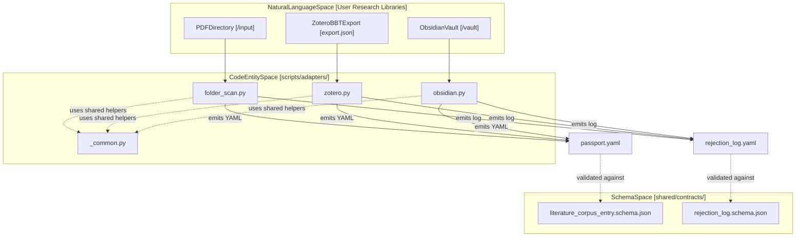
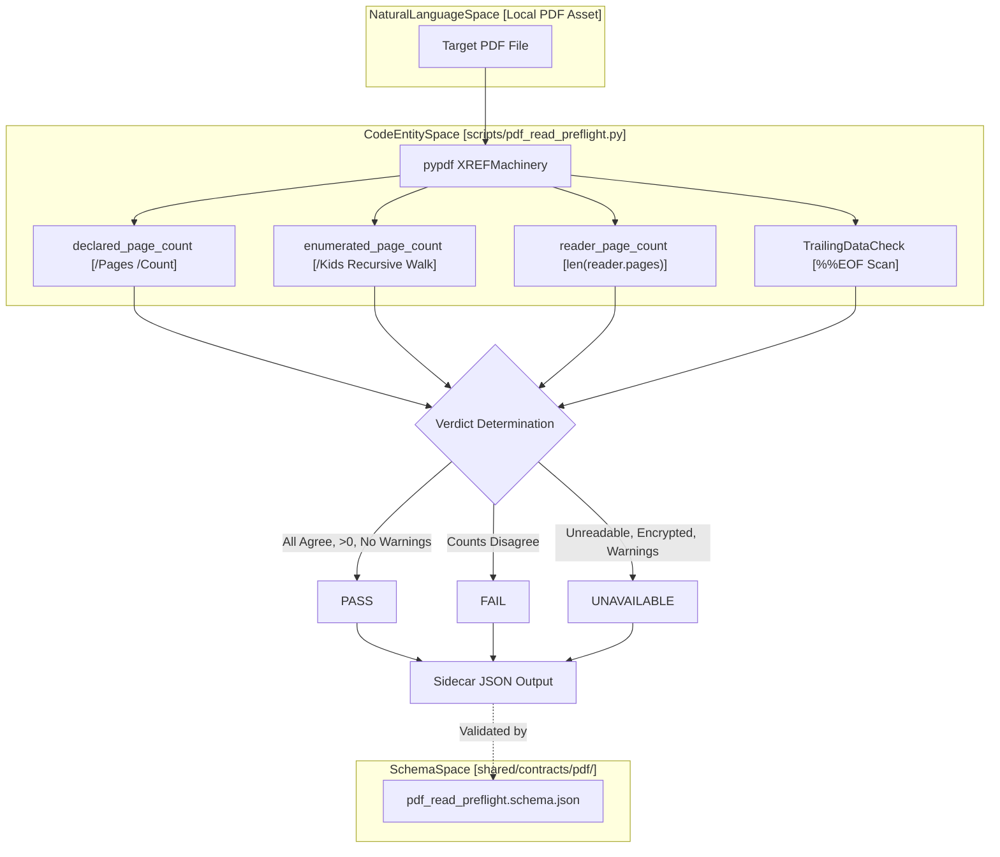

<!-- source: DeepWiki mcp.deepwiki.com · repo Imbad0202/academic-research-skills · page 9.3 Literature Corpus Adapters · fetched 2026-10-30 -->

# Literature Corpus Adapters

Relevant source files

The following files were used as context for generating this wiki page:

- [docs/design/2026-07-20-512-pdf-read-preflight-spec.md](docs/design/2026-07-20-512-pdf-read-preflight-spec.md)
- [docs/design/2026-08-13-512-pdf-content-classification-sandbox-spec.md](docs/design/2026-08-13-512-pdf-content-classification-sandbox-spec.md)
- [requirements-pdf-content-classifier.txt](requirements-pdf-content-classifier.txt)
- [scripts/adapters/examples/obsidian/expected_passport.yaml](scripts/adapters/examples/obsidian/expected_passport.yaml)
- [scripts/adapters/examples/obsidian/expected_rejection_log.yaml](scripts/adapters/examples/obsidian/expected_rejection_log.yaml)
- [scripts/adapters/examples/obsidian/input_fixture/vault/.obsidian/app.json](scripts/adapters/examples/obsidian/input_fixture/vault/.obsidian/app.json)
- [scripts/adapters/examples/obsidian/input_fixture/vault/_templates/tmpl.md](scripts/adapters/examples/obsidian/input_fixture/vault/_templates/tmpl.md)
- [scripts/adapters/examples/obsidian/input_fixture/vault/chen2024ai.md](scripts/adapters/examples/obsidian/input_fixture/vault/chen2024ai.md)
- [scripts/adapters/examples/obsidian/input_fixture/vault/invalid.md](scripts/adapters/examples/obsidian/input_fixture/vault/invalid.md)
- [scripts/adapters/examples/obsidian/input_fixture/vault/wang2023formative.md](scripts/adapters/examples/obsidian/input_fixture/vault/wang2023formative.md)
- [scripts/adapters/examples/zotero/expected_passport.yaml](scripts/adapters/examples/zotero/expected_passport.yaml)
- [scripts/adapters/examples/zotero/expected_rejection_log.yaml](scripts/adapters/examples/zotero/expected_rejection_log.yaml)
- [scripts/adapters/examples/zotero/input_fixture/export.json](scripts/adapters/examples/zotero/input_fixture/export.json)
- [scripts/adapters/folder_scan.py](scripts/adapters/folder_scan.py)
- [scripts/adapters/obsidian.py](scripts/adapters/obsidian.py)
- [scripts/adapters/tests/test_folder_scan.py](scripts/adapters/tests/test_folder_scan.py)
- [scripts/adapters/tests/test_obsidian.py](scripts/adapters/tests/test_obsidian.py)
- [scripts/adapters/tests/test_zotero.py](scripts/adapters/tests/test_zotero.py)
- [scripts/adapters/zotero.py](scripts/adapters/zotero.py)
- [scripts/bootstrap_timeline_yaml.py](scripts/bootstrap_timeline_yaml.py)
- [scripts/migrate_literature_corpus_to_v3_9_0.py](scripts/migrate_literature_corpus_to_v3_9_0.py)
- [scripts/pdf_content_classifier_worker.py](scripts/pdf_content_classifier_worker.py)
- [scripts/pdf_read_preflight.py](scripts/pdf_read_preflight.py)
- [scripts/test_bootstrap_timeline_yaml.py](scripts/test_bootstrap_timeline_yaml.py)
- [scripts/test_migrate_literature_corpus_to_v3_9_0.py](scripts/test_migrate_literature_corpus_to_v3_9_0.py)
- [scripts/test_pdf_read_preflight.py](scripts/test_pdf_read_preflight.py)
- [shared/contracts/pdf/pdf_content_classifier_diagnostic.schema.json](shared/contracts/pdf/pdf_content_classifier_diagnostic.schema.json)
- [shared/contracts/pdf/pdf_content_classifier_worker.schema.json](shared/contracts/pdf/pdf_content_classifier_worker.schema.json)

Literature Corpus Adapters are specialized ingestion tools designed to bridge a researcher's existing reference library with the **Material Passport** (Schema 9). These adapters consume local PDFs, Zotero Better BibTeX JSON exports, or Obsidian vaults as ground truth literature, enabling the `intake_agent` to bypass redundant searches and analyze pre-verified user materials.

---

### Adapter Architecture and CLI Contract

All adapters implement a standardized language-neutral command-line interface (CLI) contract, ensuring that outputs remain consistent and verifiable by CI validation suites `[scripts/adapters/folder_scan.py:15-18]`, `[scripts/adapters/obsidian.py:12-15]`, `[scripts/adapters/zotero.py:10-13]()`.

**Sources:** `[scripts/adapters/folder_scan.py:15-18]`, `[scripts/adapters/obsidian.py:12-15]`, `[scripts/adapters/zotero.py:10-13]`, `[scripts/adapters/_common.py:1-40]()`

---

### Reference Implementation Details

#### 1. Folder Scan Adapter (`folder_scan.py`)
Scans a directory of files (typically PDFs) and derives citation metadata using regex patterns `[scripts/adapters/folder_scan.py:2-4]()`. It operates strictly on filename conventions without parsing PDF content:
* `RE_FAMILY_UNDERSCORE`: Matches `{Family}_{Year}_{title_slug}.ext` `[scripts/adapters/folder_scan.py:44-46]()`.
* `RE_FAMILY_YEAR`: Matches `{Family}{Year}{optional_title_slug}.ext` `[scripts/adapters/folder_scan.py:48-50]()`.
* Fallback: Extracts the first capitalized Latin word before any recognized 4-digit year `[scripts/adapters/folder_scan.py:51-53]()`.

Files with non-ASCII filenames or unparseable metadata are diverted to the rejection log `[scripts/adapters/folder_scan.py:55-57]`, `[scripts/adapters/folder_scan.py:169-176]()`. Source pointers are formatted as RFC 8089 file URIs (`file://`) with percent-encoded spaces `[scripts/adapters/tests/test_folder_scan.py:118-136]()`.

**Sources:** `[scripts/adapters/folder_scan.py:40-110]`, `[scripts/adapters/tests/test_folder_scan.py:118-156]()`

#### 2. Zotero Adapter (`zotero.py`)
Consumes Better BibTeX (BBT) JSON exports `[scripts/adapters/zotero.py:2-4]()`. It maps Zotero item types to normalized `venue_type` values using `ZOTERO_ITEM_TYPE_TO_VENUE_TYPE` (e.g., `journalArticle` maps to `journal-article`) `[scripts/adapters/zotero.py:39-53]()`. 
* **Authors:** Extracts personal names (`lastName`, `firstName`) or corporate author `name` fields (`extract_authors`) `[scripts/adapters/zotero.py:89-118]()`. Blank corporate names are rejected `[scripts/adapters/zotero.py:102-107]()`.
* **Dates:** Parses strings or CSL `issued` dictionaries via `extract_year`, rejecting ambiguous month-leading or seasonal strings (`_SEASONAL_PREFIXES`) `[scripts/adapters/zotero.py:72-80]`, `[scripts/adapters/zotero.py:121-157]()`.
* **Source Pointers:** Formats source pointers as `zotero://select/items/...` URIs.

**Sources:** `[scripts/adapters/zotero.py:39-169]`, `[scripts/adapters/tests/test_zotero.py:56-121]()`

#### 3. Obsidian Adapter (`obsidian.py`)
Parses Markdown vaults while ignoring structural directories such as `_templates/` and `.obsidian/` `[scripts/adapters/obsidian.py:2-10]`, `[scripts/adapters/obsidian.py:45]()`.
* **Convention A (Preferred):** Parses YAML frontmatter for `citekey`, `title`, `authors`, and `year` `[scripts/adapters/obsidian.py:4-5]()`.
* **Convention B (Karpathy-style):** Uses the filename stem as the citation key, extracts an H1 title, and reads metadata from `**Authors**` and `**Year**` lines `[scripts/adapters/obsidian.py:5-7]`, `[scripts/adapters/obsidian.py:71-74]()`.
* **Source Pointers:** Generates deterministic `obsidian://open?vault=NAME&file=REL_PATH` URIs `[scripts/adapters/obsidian.py:103-114]()`.

**Sources:** `[scripts/adapters/obsidian.py:40-114]`, `[scripts/adapters/tests/test_obsidian.py:42-119]()`

---

### PDF Read-Integrity Preflight (`pdf_read_preflight.py`)

To prevent poisoning downstream citations with truncated or mispaginated PDF reads (`#512`), the system runs `scripts/pdf_read_preflight.py` upstream of text extraction `[docs/design/2026-07-20-512-pdf-read-preflight-spec.md:5-13]`, `[scripts/pdf_read_preflight.py:1-9]()`.

**Sources:** `[docs/design/2026-07-20-512-pdf-read-preflight-spec.md:20-54]`, `[scripts/pdf_read_preflight.py:11-30]`

#### Three Independent Signals
1. `declared_page_count`: Read directly from the raw root page tree `/Count` object `[docs/design/2026-07-20-512-pdf-read-preflight-spec.md:31-32]`, `[scripts/pdf_read_preflight.py:14]()`.
2. `enumerated_page_count`: Computed via a cycle-guarded, node-budgeted recursive walk of `/Kids` nodes counting `/Type /Page` leaves `[docs/design/2026-07-20-512-pdf-read-preflight-spec.md:33-34]`, `[scripts/pdf_read_preflight.py:15-16]()`.
3. `reader_page_count`: Evaluated from `len(reader.pages)` via `pypdf` flattening `[docs/design/2026-07-20-512-pdf-read-preflight-spec.md:35]`, `[scripts/pdf_read_preflight.py:17]()`.

#### Verdicts
* `PASS`: All three counts agree, count > 0, no parser-repair warnings, and no non-whitespace trailing data after the final `%%EOF` `[docs/design/2026-07-20-512-pdf-read-preflight-spec.md:51]()`.
* `FAIL`: Parse completed successfully, but page counts disagree (the primary truncation signal) `[docs/design/2026-07-20-512-pdf-read-preflight-spec.md:52]()`.
* `UNAVAILABLE`: Unreadable file, encryption, missing page tree, node budget overflow, or presence of parser repair warnings / trailing data `[docs/design/2026-07-20-512-pdf-read-preflight-spec.md:53]()`.

**Sources:** `[docs/design/2026-07-20-512-pdf-read-preflight-spec.md:20-54]`, `[scripts/pdf_read_preflight.py:11-26]`

---

### Rejection Log and Quality Gate

Adapters enforce strict quality control by logging unparseable records to `rejection_log.yaml` rather than dropping them silently `[scripts/adapters/folder_scan.py:170-176]`, `[scripts/adapters/zotero.py:93-98]()`.

| Rejection Reason | Trigger Condition |
| :--- | :--- |
| `missing_required_field` | Mandatory fields (such as citation key, title, or authors) are missing or blank `[scripts/adapters/zotero.py:126-150]()`. |
| `authors_unparseable` | Creators list lacks valid author records or personal name tokens `[scripts/adapters/folder_scan.py:170-176]`, `[scripts/adapters/zotero.py:89-118]()`. |
| `year_unparseable` | Date cannot be resolved to a 4-digit integer (e.g., "forthcoming") `[scripts/adapters/zotero.py:101-120]()`. |
| `other` | Structural violations like symlinks resolving outside the input root `[scripts/adapters/folder_scan.py:156-167]()`. |

**Sources:** `[scripts/adapters/folder_scan.py:156-176]`, `[scripts/adapters/zotero.py:89-120]()`

---

### Contamination Triangulation and Migrations

To maintain bibliographic integrity, passports incorporate contamination signals and cross-index verification backfills `[scripts/migrate_literature_corpus_to_v3_9_0.py:2-11]()`.

* **v3.7.3 Migration:** Computes preprint status (`preprint_post_llm_inflection`) and Semantic Scholar match state (`semantic_scholar_unmatched`) `[scripts/migrate_literature_corpus_to_v3_9_0.py:5-10]()`.
* **v3.9.0 Migration (`scripts/migrate_literature_corpus_to_v3_9_0.py`):** Daisy-chains from v3.7.3 to backfill `openalex_unmatched` and `crossref_unmatched` flags using parallel worker threads `[scripts/migrate_literature_corpus_to_v3_9_0.py:11-21]()`.
* **Timeline Bootstrapping (`scripts/bootstrap_timeline_yaml.py`):** Optionally queries the Crossref API using quoted DOI paths and scans local PDF text using `pdftotext` to construct version timeline skeletons (`timeline.yaml`) `[scripts/bootstrap_timeline_yaml.py:2-12]`, `[scripts/bootstrap_timeline_yaml.py:32-68]()`.

**Sources:** `[scripts/migrate_literature_corpus_to_v3_9_0.py:1-24]`, `[scripts/bootstrap_timeline_yaml.py:1-68]()`

---

