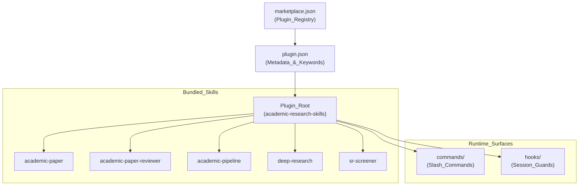
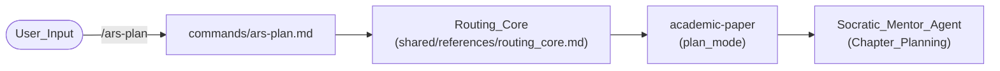
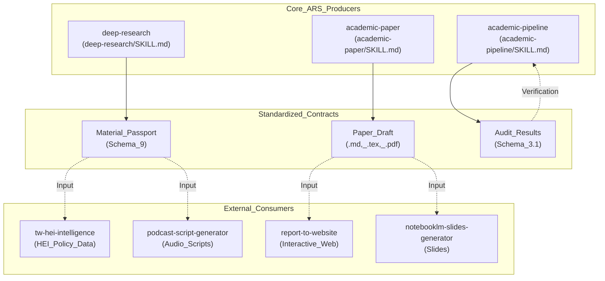
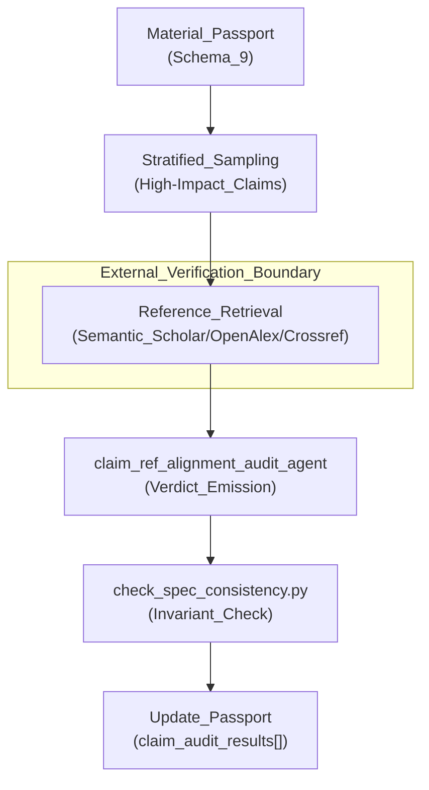

<!-- source: DeepWiki mcp.deepwiki.com · repo Imbad0202/academic-research-skills · page 9.4 External Skill Integrations · fetched 2026-10-30 -->

# External Skill Integrations

Relevant source files

The following files were used as context for generating this wiki page:

- [.claude-plugin/marketplace.json](.claude-plugin/marketplace.json)
- [.claude-plugin/plugin.json](.claude-plugin/plugin.json)
- [.claude/CLAUDE.md](.claude/CLAUDE.md)
- [MODE_REGISTRY.md](MODE_REGISTRY.md)
- [README.ja-JP.md](README.ja-JP.md)
- [README.ko-KR.md](README.ko-KR.md)
- [README.md](README.md)
- [README.zh-CN.md](README.zh-CN.md)
- [README.zh-TW.md](README.zh-TW.md)
- [academic-pipeline/SKILL.md](academic-pipeline/SKILL.md)
- [commands/ars-abstract.md](commands/ars-abstract.md)
- [commands/ars-citation-check.md](commands/ars-citation-check.md)
- [commands/ars-disclosure.md](commands/ars-disclosure.md)
- [commands/ars-format-convert.md](commands/ars-format-convert.md)
- [commands/ars-full.md](commands/ars-full.md)
- [commands/ars-lit-review.md](commands/ars-lit-review.md)
- [commands/ars-outline.md](commands/ars-outline.md)
- [commands/ars-plan.md](commands/ars-plan.md)
- [commands/ars-reviewer.md](commands/ars-reviewer.md)
- [commands/ars-revision-coach.md](commands/ars-revision-coach.md)
- [commands/ars-revision.md](commands/ars-revision.md)
- [docs/ARCHITECTURE.md](docs/ARCHITECTURE.md)
- [docs/design/2026-04-30-ars-v3.7.0-plugin-packaging-roadmap.md](docs/design/2026-04-30-ars-v3.7.0-plugin-packaging-roadmap.md)
- [hooks/hooks.json](hooks/hooks.json)
- [scripts/announce-ars-loaded.sh](scripts/announce-ars-loaded.sh)
- [scripts/check_spec_consistency.py](scripts/check_spec_consistency.py)

## Purpose and Scope

This page documents how external skills, distributions, and packaging systems integrate with the Academic Research Skills (ARS v3.23.1) ecosystem. Integration occurs across three main boundaries: **plugin packaging and distribution manifests** (`.claude-plugin/plugin.json`, `marketplace.json`), **the commands/ slash-command surface**, and **inter-skill functional handoffs** with sibling and downstream skills.

This page covers:
1. **Plugin Infrastructure & Manifests** — Implementation of `.claude-plugin/plugin.json` and `.claude-plugin/marketplace.json` for marketplace deployment [.claude-plugin/plugin.json:1-23](), [.claude-plugin/marketplace.json:1-24]().
2. **Commands & Slash-Command Surface** — Integration with Claude Code via the `commands/` directory surface (`commands/ars-plan.md`, `commands/ars-lit-review.md`, etc.).
3. **Sibling Skills and Distributions** — Cross-platform wrappers and integrations (Pi platform wrapper [`pi/README.md`](), Codex CLI distribution [`Imbad0202/academic-research-skills-codex`](), and Claude Science imports).
4. **Claim-Faithfulness & Audit Integrations** — Integration with the v3.8 L3 audit pipeline and external verification gateways.

Sources: [.claude-plugin/plugin.json:1-23](), [.claude-plugin/marketplace.json:1-24](), [README.md:74-78]()

---

## Plugin Infrastructure and Packaging

As of v3.7.0+, ARS is packaged as a production-grade Claude Code plugin, enabling single-line installation via marketplace registries while maintaining the repository as the single source of truth [.claude-plugin/marketplace.json:1-24]().

### Plugin Manifests
The system uses two primary manifest files to declare its identity, capabilities, and contained skills:
- **`.claude-plugin/plugin.json`**: Declares plugin metadata, version (`3.23.1`), author profile (`Cheng-I Wu`), license (`CC-BY-NC-4.0`), and indexing keywords for the Claude Code ecosystem [.claude-plugin/plugin.json:1-23]().
- **`.claude-plugin/marketplace.json`**: Defines the marketplace schema, registering the `academic-research-skills` package source `./`, version, and its five core bundled skills (`./academic-paper`, `./academic-paper-reviewer`, `./academic-pipeline`, `./deep-research`, `./sr-screener`) [.claude-plugin/marketplace.json:1-24]().

**Plugin Packaging Architecture**

Sources: [.claude-plugin/plugin.json:1-23](), [.claude-plugin/marketplace.json:1-24]()

---

## Commands and Slash-Command Surface

The `commands/` directory exposes ARS functionality directly to the Claude Code slash-command interface. These markdown command definitions serve as lightweight entry points that map user commands to specific skill modes.

### Key Slash-Command Endpoints
- `/ars-plan`: Invokes `academic-paper` in `plan` mode for Socratic chapter planning [commands/ars-plan.md](), [MODE_REGISTRY.md:29-29]().
- `/ars-lit-review`: Invokes `deep-research` or `academic-paper` in literature review mode [commands/ars-lit-review.md](), [MODE_REGISTRY.md:18-18]().
- `/ars-citation-check`: Invokes citation verification routines [.claude/CLAUDE.md:27-27](), [commands/ars-citation-check.md]().
- `/ars-revision-coach`: Invokes the revision coaching workflow [commands/ars-revision-coach.md](), [MODE_REGISTRY.md:32-32]().

**Command Dispatch Flow**

Sources: [MODE_REGISTRY.md:28-39](), [commands/ars-plan.md]()

---

## Sibling Skills and Platform Distributions

ARS supports distribution across alternative runtimes and companion platforms via dedicated wrappers and adapters.

### Distribution Channels
1. **Claude Science Import**: Users can import ARS skills directly via **Skills → Import from GitHub** by pasting the repository URL (`https://github.com/Imbad0202/academic-research-skills`) [README.md:74-78](). The importer reads the marketplace manifest to load methodology specs, while Claude Code-specific orchestrations run natively [README.md:74-78]().
2. **Pi Platform Wrapper (`pi/`)**: Provides compatibility for running ARS inside Pi via `pi install git:github.com/Imbad0202/academic-research-skills` [README.md:76-76](). It maintains core ARS content fidelity while adapting to Pi runtime constraints [README.md:76-76]().
3. **Codex CLI Distribution**: Maintained as a sibling distribution (`Imbad0202/academic-research-skills-codex`), packaging the workflow into a single `$academic-research-suite` skill with `ars-*` aliases [README.md:78-78]().

Sources: [README.md:74-78]()

---

## Downstream Ecosystem and Producer-Consumer Architecture

The ARS suite functions as a high-fidelity academic producer, exposing standardized markdown, LaTeX, and JSON contract artifacts that downstream integrations consume.

**Producer-Consumer Data Flow**

**Integration Principles:**
1. **Unidirectional Consumption:** External consumers parse ARS artifacts without altering internal state machines.
2. **Schema Validation:** Data exchange strictly adheres to `shared/contracts/` JSON schemas.
3. **Isolation:** Plugin boundaries ensure environment variable safety and scoped execution.

Sources: [academic-pipeline/SKILL.md:1-15](), [docs/ARCHITECTURE.md:95-105]()

---

## Claim-Faithfulness Audit Integration (v3.8+)

Integration with external verification layers is enforced through the v3.8 L3 claim-faithfulness audit architecture [README.md:33-33]().

### Audit Integration Pipeline
When `ARS_CLAIM_AUDIT=1` is configured, the orchestrator dispatches the `claim_ref_alignment_audit_agent` after the Cite-Time Provenance Finalizer [academic-pipeline/SKILL.md:48-49]().

| Component | Role | File Citation |
|-----------|------|---|
| **Audit Agent** | Evaluates claim-citation alignment | `agents/claim_ref_alignment_audit_agent.md` [academic-pipeline/SKILL.md:48-49]() |
| **Integrity Gate** | Stage 4.5 final verification | [docs/ARCHITECTURE.md:38-42]() |
| **Formatter Hard Gate** | Blocks output on HIGH-WARN failures | [README.md:33-33]() |

**Audit Verification Flow**

Sources: [academic-pipeline/SKILL.md:48-49](), [README.md:33-33](), [docs/ARCHITECTURE.md:38-42]()

---

