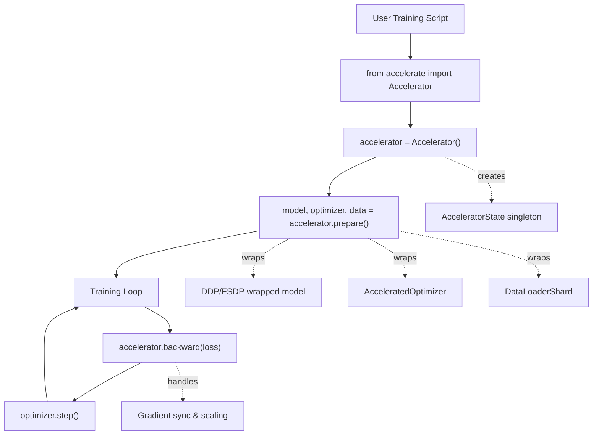
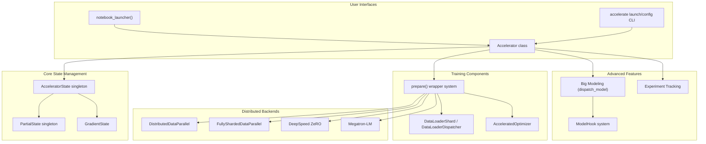

<!-- source: DeepWiki mcp.deepwiki.com · repo huggingface/accelerate · page 1 Overview · fetched 2026-10-21 -->

# Overview

<details>
<summary>Relevant source files</summary>

The following files were used as context for generating this wiki page:

- [README.md](README.md)
- [docs/source/basic_tutorials/overview.md](docs/source/basic_tutorials/overview.md)
- [docs/source/basic_tutorials/troubleshooting.md](docs/source/basic_tutorials/troubleshooting.md)
- [docs/source/concept_guides/deferring_execution.md](docs/source/concept_guides/deferring_execution.md)
- [docs/source/concept_guides/fsdp_and_deepspeed.md](docs/source/concept_guides/fsdp_and_deepspeed.md)
- [docs/source/concept_guides/performance.md](docs/source/concept_guides/performance.md)
- [docs/source/concept_guides/training_tpu.md](docs/source/concept_guides/training_tpu.md)
- [docs/source/index.md](docs/source/index.md)
- [docs/source/usage_guides/training_zoo.md](docs/source/usage_guides/training_zoo.md)
- [examples/README.md](examples/README.md)
- [setup.py](setup.py)
- [src/accelerate/__init__.py](src/accelerate/__init__.py)

</details>


This document provides a high-level introduction to the Accelerate library, explaining its purpose, design philosophy, and core architecture. Accelerate is a PyTorch library that enables distributed training across multiple hardware platforms (GPUs, TPUs, CPUs) with minimal modifications to standard training scripts.

For detailed information on specific subsystems:
- Configuration and launching scripts: see [Command Line Interface](#6)
- The main API class: see [The Accelerator Class](#2)
- Training very large models: see [Big Model Support](#5)
- Distributed training frameworks: see [Distributed Training Backends](#3)

---

## Purpose and Scope

Accelerate is a thin wrapper library that abstracts the boilerplate code required for distributed training in PyTorch. It allows users to write training scripts once and run them on any hardware configuration—single CPU, single GPU, multi-GPU, TPU, or multi-node clusters—without modifying the training logic [README.md:43-46]().

The library is designed for PyTorch users who:
- Want to write their own training loops rather than using high-level frameworks [README.md:43-44]().
- Need to run the same code across different hardware environments [README.md:84-87]().
- Want to avoid managing complex distributed training setup code [README.md:45-46]().
- Require full control over their training process while delegating hardware-specific concerns [README.md:45-46]().

**Sources:** [README.md:41-46](), [README.md:84-87]()

---

## Design Philosophy

Accelerate follows a "thin wrapper" philosophy that distinguishes it from high-level training frameworks:

| Design Principle | Description |
|-----------------|-------------|
| **Minimal Code Changes** | Integrate distributed training with ~5 lines of code changes [README.md:84-85](). |
| **Hardware Agnostic** | Same script runs on CPU, GPU, TPU, or distributed setups [README.md:84-87](). |
| **Full Control** | Users retain complete control over their training loop [README.md:43-45](). |
| **Backend Transparent** | Automatically selects appropriate distributed backend (DDP, FSDP, DeepSpeed) [README.md:129-140](). |
| **Optional Features** | Advanced features (checkpointing, tracking, offloading) are opt-in [src/accelerate/__init__.py:17-47](). |

The library does not impose a training paradigm. Instead, it wraps PyTorch objects via the `prepare()` method to handle device placement, gradient synchronization, and distributed communication automatically [README.md:65-82]().

**Sources:** [README.md:43-46](), [README.md:65-87](), [src/accelerate/__init__.py:16-47]()

---

## Core Integration Pattern

### The Five-Line Integration

Accelerate enables distributed training by adding key changes to a standard PyTorch training script [README.md:49-82]():

```python
# 1. Import Accelerator
from accelerate import Accelerator

# 2. Create Accelerator instance
accelerator = Accelerator()

# 3. Use accelerator device instead of manual device selection
device = accelerator.device 

# 4. Wrap training objects with prepare()
model, optimizer, dataloader = accelerator.prepare(model, optimizer, dataloader)

# 5. Replace loss.backward() with accelerator.backward()
accelerator.backward(loss)
```

### Integration Flow with Method Names



**Sources:** [README.md:49-82](), [src/accelerate/accelerator.py:1-100]()

### Automatic Device Placement

With `device_placement=True` (default), Accelerate automatically moves tensors to the correct device, eliminating manual `.to(device)` calls [README.md:88-123]().

---

## System Architecture

### High-Level Component Organization



**Sources:** [src/accelerate/__init__.py:16-47](), [src/accelerate/state.py:1-50]()

### Core Classes and Their Roles

| Class | Location | Purpose |
|-------|----------|---------|
| `Accelerator` | [src/accelerate/__init__.py:16]() | Main orchestration class; user-facing API for all features. |
| `PartialState` | [src/accelerate/__init__.py:30]() | Singleton managing distributed state (rank, world size, backend). |
| `DeepSpeedPlugin` | [src/accelerate/__init__.py:35]() | Configuration for DeepSpeed ZeRO integration. |
| `FullyShardedDataParallelPlugin` | [src/accelerate/__init__.py:38]() | Configuration for PyTorch FSDP integration. |

**Sources:** [src/accelerate/__init__.py:1-47]()

---

## Supported Hardware and Backends

### Hardware Platform Support

| Platform | DistributedType | Backend |
|----------|-----------------|---------|
| Single CPU/GPU | `NO` | N/A |
| Multi-CPU | `MULTI_CPU` | gloo/mpi [README.md:162-178]() |
| Multi-GPU | `MULTI_GPU` | nccl [README.md:74-83]() |
| TPU | `XLA` | xla [README.md:100-108]() |

**Sources:** [README.md:29-35](), [examples/README.md:29-35]()

### Mixed Precision Support

| Precision | Configuration | Hardware Requirements |
|-----------|--------------|----------------------|
| FP16 | `mixed_precision='fp16'` | CUDA GPUs [README.md:54-61]() |
| BF16 | `mixed_precision='bf16'` | Ampere+ GPUs, TPUs [docs/source/concept_guides/training_tpu.md:131-142]() |
| FP8 | `mixed_precision='fp8'` | Hopper GPUs (via `torchao`) [setup.py:40]() |

**Sources:** [README.md:54-61](), [setup.py:40]()

---

## Installation and Dependencies

### Core Dependencies

Defined in [setup.py:79-88]():
- **Python**: ≥3.10.0
- **PyTorch**: ≥2.0.0
- **numpy**: ≥1.17
- **safetensors**: ≥0.4.3
- **huggingface_hub**: ≥0.21.0

### Optional Dependencies

Additional features via `pip install accelerate[feature]` [setup.py:18-51]():
- `deepspeed`: DeepSpeed integration.
- `test_trackers`: WandB, TensorBoard, CometML, etc.
- `test_fp8`: `torchao` for FP8 support.

**Sources:** [setup.py:18-88]()

---

## Key Component Subsystems

### Launch System
The `accelerate launch` command provides a unified interface to start distributed training without manually calling `torch.distributed.run` [README.md:129-140](). For details, see [Installation and Quick Start](#1.1).

### Big Model Support
The `big_modeling` module enables training and inference with models exceeding single-device memory using `init_empty_weights`, `dispatch_model`, and offloading [src/accelerate/__init__.py:17-25](). For details, see [Big Model Support](#5).

### Checkpointing
The system saves complete training state including models, optimizers, and RNG states [examples/README.md:37](). For details, see [Checkpointing and State Management](#7).

---

## Architecture: State Management Pattern

Accelerate uses a singleton pattern for state management to ensure consistent distributed configuration. All components query the `PartialState` singleton to determine their behavior based on the distributed configuration [src/accelerate/__init__.py:30]().

For details, see [Core Concepts and Architecture](#1.2).

**Sources:** [src/accelerate/__init__.py:30]()

---

## Version and Compatibility

Current version: **1.15.0.dev0** [src/accelerate/__init__.py:14]().

**Sources:** [src/accelerate/__init__.py:14](), [setup.py:58]()

---

