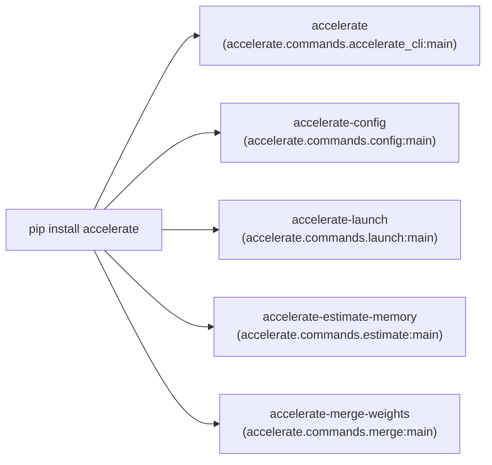
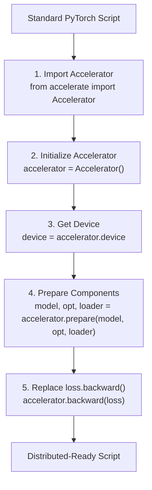
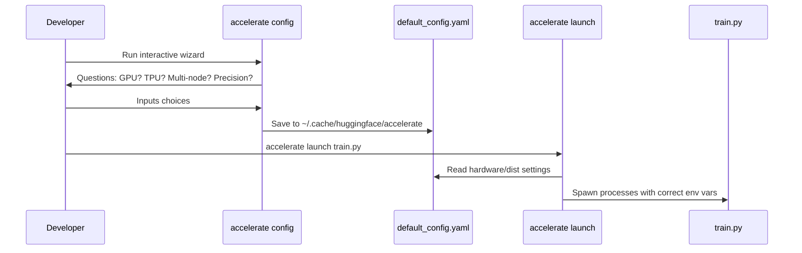

<!-- source: DeepWiki mcp.deepwiki.com · repo huggingface/accelerate · page 1.1 Installation and Quick Start · fetched 2026-10-21 -->

# Installation and Quick Start

<details>
<summary>Relevant source files</summary>

The following files were used as context for generating this wiki page:

- [docs/source/basic_tutorials/install.md](docs/source/basic_tutorials/install.md)
- [docs/source/basic_tutorials/launch.md](docs/source/basic_tutorials/launch.md)
- [docs/source/basic_tutorials/migration.md](docs/source/basic_tutorials/migration.md)
- [docs/source/basic_tutorials/notebook.md](docs/source/basic_tutorials/notebook.md)
- [docs/source/quicktour.md](docs/source/quicktour.md)
- [docs/source/usage_guides/big_modeling.md](docs/source/usage_guides/big_modeling.md)
- [docs/source/usage_guides/quantization.md](docs/source/usage_guides/quantization.md)
- [examples/cv_example.py](examples/cv_example.py)
- [examples/nlp_example.py](examples/nlp_example.py)
- [setup.py](setup.py)
- [src/accelerate/__init__.py](src/accelerate/__init__.py)

</details>


This page guides you through installing Accelerate and running your first distributed training script. It covers the basic installation process, dependencies, minimal code changes needed to enable distributed training, and the launch workflow using the CLI or programmatic approach.

---

## System Requirements

Accelerate requires a specific environment to function properly. The library is tested on **Python 3.10+** and relies on the following core dependencies:

| Requirement | Version | Purpose |
|------------|---------|---------|
| Python | >= 3.10.0 | Base language requirement [setup.py:78]() |
| PyTorch | >= 2.0.0 | Core tensor library [setup.py:84]() |
| NumPy | >= 1.17 | Numerical operations [setup.py:80]() |
| Packaging | >= 20.0 | Version management [setup.py:81]() |
| PyYAML | Required | Configuration file parsing [setup.py:83]() |
| psutil | Required | System monitoring [setup.py:82]() |
| huggingface_hub | >= 0.21.0 | Model/checkpoint access [setup.py:85]() |
| safetensors | >= 0.4.3 | Efficient weight loading [setup.py:86]() |

**Sources:** [setup.py:78-87](), [docs/source/basic_tutorials/install.md:18]()

---

## Installation

### Basic Installation

To install Accelerate from PyPI:

```bash
pip install accelerate
```

For Conda environments:

```bash
conda install -c conda-forge accelerate
```

To install the latest development version from source:

```bash
pip install git+https://github.com/huggingface/accelerate
```

**Sources:** [docs/source/basic_tutorials/install.md:24-45]()

### Optional Dependencies

Accelerate provides several `extras` for extended functionality. These can be installed using the `pip install accelerate[extra_name]` syntax.

| Extra | Purpose | Key Dependencies |
|-------|---------|------------------|
| `deepspeed` | DeepSpeed distributed backend | `deepspeed` [setup.py:37]() |
| `rich` | Enhanced CLI output and logging | `rich` [setup.py:38]() |
| `testing` | Development and CI tools | `pytest`, `transformers`, `tqdm` [setup.py:22-36]() |
| `sagemaker` | AWS SageMaker integration | `sagemaker` [setup.py:52-54]() |
| `test_trackers`| Experiment tracking tools | `wandb`, `tensorboard`, `dvclive` [setup.py:41-49]() |

**Sources:** [setup.py:18-54]()

### CLI Command Registration

The installation process registers several entry points in the console.



**Sources:** [setup.py:69-77]()

---

## Quick Start: Minimal Code Changes

Accelerate is a thin wrapper around PyTorch. It allows you to write standard PyTorch code and scale it to multiple GPUs or TPUs by adding a few lines.

### Migration Flow



**Sources:** [docs/source/quicktour.md:64-83](), [docs/source/basic_tutorials/migration.md:38-84]()

### Implementation Example

The following code snippet (based on `nlp_example.py`) demonstrates the integration:

```python
from accelerate import Accelerator
from torch.optim import AdamW
from torch.utils.data import DataLoader

def training_function(model, dataset):
    # Initialize the main orchestration class
    accelerator = Accelerator() # [src/accelerate/accelerator.py:84]()
    
    optimizer = AdamW(model.parameters(), lr=1e-5)
    train_dataloader = DataLoader(dataset, batch_size=32)

    # Prepare wraps the objects for the distributed backend
    model, optimizer, train_dataloader = accelerator.prepare(
        model, optimizer, train_dataloader
    ) # [src/accelerate/accelerator.py:1260]()

    for batch in train_dataloader:
        # No need for manual batch.to(device) if device_placement=True (default)
        outputs = model(**batch)
        loss = outputs.loss
        
        # Scales loss and handles distributed backward pass
        accelerator.backward(loss) # [src/accelerate/accelerator.py:1960]()
        
        optimizer.step()
        optimizer.zero_grad()
```

**Sources:** [examples/nlp_example.py:113-171](), [docs/source/quicktour.md:64-118]()

---

## Configuration and Launch Workflow

Accelerate provides a unified launcher that handles the specifics of `torchrun`, `mpirun` (DeepSpeed), or XLA spawning.

### CLI Launch Flow



**Sources:** [docs/source/quicktour.md:26-54](), [docs/source/basic_tutorials/launch.md:67-94]()

### Step 1: Configuration

Run the configuration wizard to detect your hardware:
```bash
accelerate config
```
This generates a YAML file containing settings for `distributed_type` (MULTI_GPU, TPU, etc.), `mixed_precision`, and `num_processes`. [docs/source/basic_tutorials/install.md:57-78]()

### Step 2: Launching Training

Once configured, launch your script without hardware-specific flags:
```bash
accelerate launch path_to_script.py --args_for_the_script
```

Alternatively, override configuration on the fly:
```bash
# Launch on 2 GPUs with FP16 precision
accelerate launch --multi_gpu --num_processes 2 --mixed_precision fp16 train.py
```

**Sources:** [docs/source/quicktour.md:48-52](), [docs/source/basic_tutorials/launch.md:124]()

---

## Specialized Features

### Big Model Inference
Accelerate allows loading models that exceed a single device's VRAM using the `init_empty_weights` context manager and `load_checkpoint_and_dispatch` function. This uses a "Parameterless" initialization to save RAM.

```python
from accelerate import init_empty_weights, load_checkpoint_and_dispatch

with init_empty_weights():
    model = MyHugeModel() # No memory used here

model = load_checkpoint_and_dispatch(
    model, checkpoint="path/to/weights", device_map="auto"
)
```
**Sources:** [docs/source/usage_guides/big_modeling.md:34-57](), [src/accelerate/__init__.py:17-25]()

### Notebook Launching
For Jupyter/Colab/Kaggle environments, use the `notebook_launcher` to spawn distributed processes (especially useful for TPUs).

```python
from accelerate import notebook_launcher

def train():
    # ... training code ...

notebook_launcher(train, num_processes=8)
```
**Sources:** [docs/source/basic_tutorials/notebook.md:183-195](), [src/accelerate/__init__.py:28]()

### Quantization Support
Accelerate integrates with `bitsandbytes` to load models in 8-bit or 4-bit precision.

```python
from accelerate.utils import BnbQuantizationConfig, load_and_quantize_model

bnb_config = BnbQuantizationConfig(load_in_4bit=True, bnb_4bit_compute_dtype=torch.bfloat16)
model = load_and_quantize_model(empty_model, weights_location=weights, bnb_quantization_config=bnb_config)
```
**Sources:** [docs/source/usage_guides/quantization.md:71-89]()

---

## Verification

To check your current environment and Accelerate configuration:

```bash
accelerate env
```
To run a diagnostic test on your distributed setup:
```bash
accelerate test
```
**Sources:** [docs/source/basic_tutorials/install.md:74-78](), [setup.py:118]()

---

