<!-- source: DeepWiki mcp.deepwiki.com · repo huggingface/accelerate · page 1.2 Core Concepts and Architecture · fetched 2026-10-21 -->

# Core Concepts and Architecture

<details>
<summary>Relevant source files</summary>

The following files were used as context for generating this wiki page:

- [docs/source/concept_guides/internal_mechanism.md](docs/source/concept_guides/internal_mechanism.md)
- [src/accelerate/accelerator.py](src/accelerate/accelerator.py)
- [src/accelerate/state.py](src/accelerate/state.py)
- [src/accelerate/utils/__init__.py](src/accelerate/utils/__init__.py)
- [src/accelerate/utils/dataclasses.py](src/accelerate/utils/dataclasses.py)
- [src/accelerate/utils/imports.py](src/accelerate/utils/imports.py)

</details>


This page explains the fundamental concepts and architecture of the Accelerate library. It covers the core abstractions (`AcceleratorState`, `PartialState`, `GradientState`), the distributed training system (`DistributedType`), and the plugin architecture that enables flexible integration with various training frameworks.

## Architectural Overview

Accelerate uses a layered architecture that separates concerns between state management, execution environment configuration, and framework integration. The core design principle is the singleton pattern for state management, ensuring all parts of the training code see consistent distributed environment information.

**High-Level System Layers**

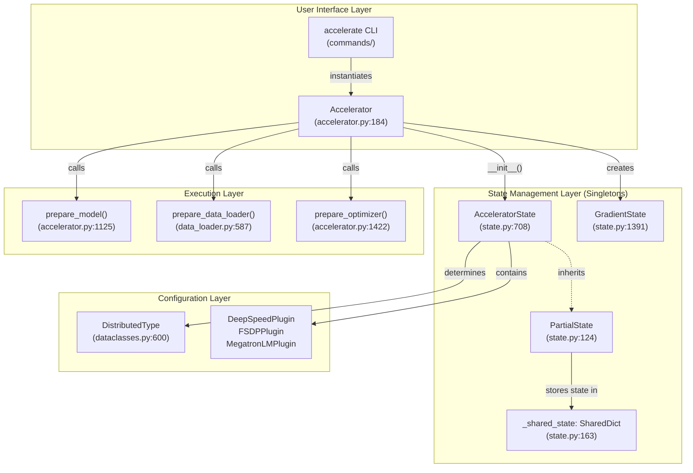

Sources: [src/accelerate/accelerator.py:184-637](), [src/accelerate/state.py:124-1371](), [src/accelerate/utils/dataclasses.py:600-633]()

The architecture provides clear separation of concerns:
- **User Interface Layer**: Entry points via `Accelerator.__init__()` and CLI commands.
- **State Management Layer**: Singleton objects using `_shared_state` dict to track distributed environment state.
- **Configuration Layer**: `DistributedType` enum and plugin objects that define training behavior.
- **Execution Layer**: `prepare_*()` methods that wrap PyTorch objects for distributed execution.

## State Management System

Accelerate uses singleton classes to maintain shared state about the training environment. The singleton pattern is implemented through a class-level `_shared_state` dictionary that all instances share, ensuring consistent behavior across multiple `Accelerator` instations.

**State Management Class Hierarchy and Singleton Pattern**

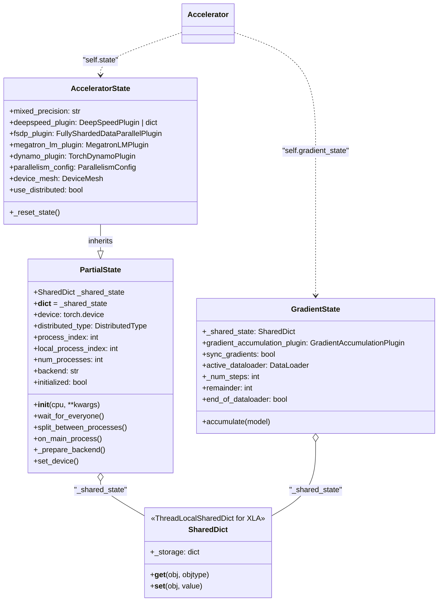

Sources: [src/accelerate/state.py:92-163](), [src/accelerate/state.py:124-706](), [src/accelerate/state.py:708-1371](), [src/accelerate/state.py:1371]()

### The Singleton Pattern Implementation

The singleton pattern is implemented through the `_shared_state` class variable and Python's descriptor protocol. For TPU/XLA environments using PJRT, a `ThreadLocalSharedDict` is used to support multithreading [src/accelerate/state.py:92-120]().

```python
# Simplified implementation from state.py:163
class PartialState:
    _shared_state = SharedDict()  # Shared across all instances
    
    def __init__(self, cpu: bool = False, **kwargs):
        self.__dict__ = self._shared_state  # All instances share the same __dict__
        if not self.initialized:
            # Only initialize once
            self._cpu = cpu
            self.backend = None
            self.device = None
            # ... initialization code ...
```

**Key aspects of the singleton implementation:**

1. **`SharedDict`**: A descriptor that holds the shared dictionary. It defaults to `dict` but becomes `ThreadLocalSharedDict` if `is_torch_xla_available()` is true [src/accelerate/state.py:119-122]().
2. **`__dict__ = _shared_state`**: Every instance shares the same `__dict__`, so all attribute assignments affect all instances [src/accelerate/state.py:178]().
3. **`initialized` property**: Checks if `_shared_state != {}` to prevent re-initialization [src/accelerate/state.py:337-339]().
4. **`_reset_state()` method**: Clears the shared state, used primarily in testing [src/accelerate/state.py:332-334]().

**Initialization Flow**

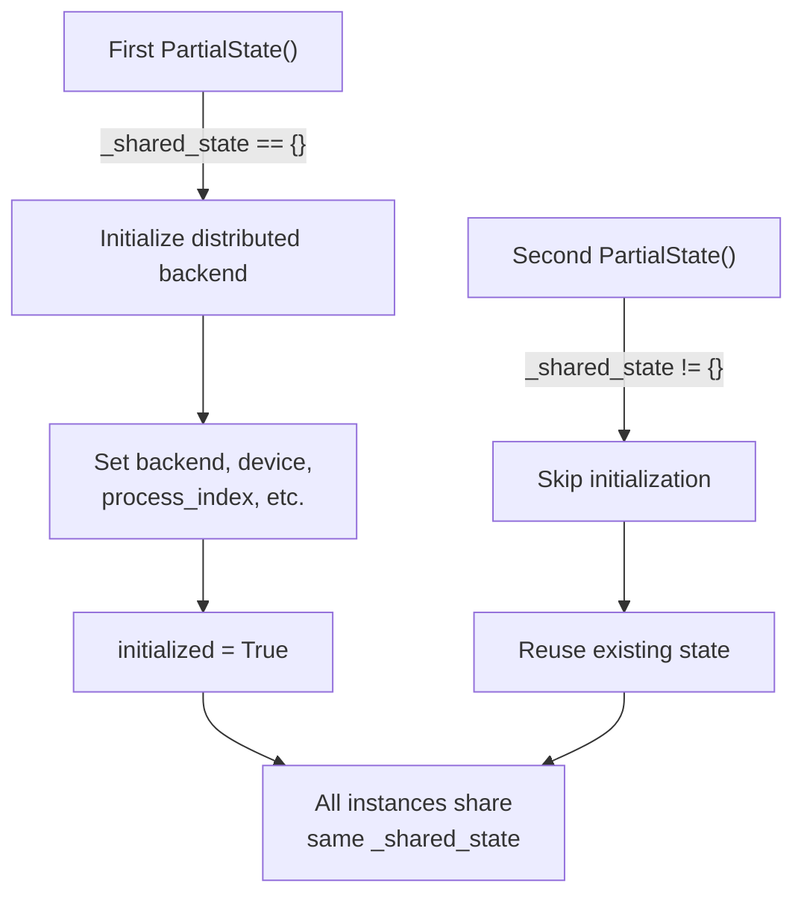

Sources: [src/accelerate/state.py:178-320]()

### PartialState

`PartialState` is a lightweight singleton that can be used independently of `Accelerator`. It handles the distributed environment setup and provides process control utilities.

**Attributes and Methods** [src/accelerate/state.py:124-706]():

| Category | Members | Description |
|----------|---------|-------------|
| **Process Info** | `process_index`, `local_process_index`, `num_processes` | Process identification in distributed setup. |
| **Device** | `device`, `default_device` | Target device for tensors (`cuda`, `xpu`, `mlu`, `npu`, `cpu`, etc.). |
| **Backend** | `backend`, `distributed_type` | PyTorch distributed backend (`nccl`, `gloo`, `xla`) and type. |
| **State** | `initialized`, `_shared_state` | Singleton state management. |
| **Sync** | `wait_for_everyone()` | Barrier synchronization across processes [src/accelerate/state.py:369-406](). |
| **Context Managers** | `main_process_first()`, `local_main_process_first()`, `split_between_processes()` | Control execution order and data splitting [src/accelerate/state.py:507-548](). |
| **Decorators** | `on_main_process()`, `on_local_main_process()`, `on_process()` | Execute functions on specific processes [src/accelerate/state.py:549-670](). |

**Backend Selection Logic** [src/accelerate/state.py:746-812]():

The `_prepare_backend()` method determines the backend based on:
1. **XLA detection**: If `torch_xla` available → `backend="xla"`.
2. **Hardware detection**: Based on `LOCAL_RANK` env var and available accelerators.
3. **CPU fallback**: Check for MPI environment variables for multi-CPU training.

### AcceleratorState

`AcceleratorState` inherits from `PartialState` and adds training-specific configuration. It is initialized by `Accelerator.__init__()` with the `_from_accelerator=True` flag.

**Additional Attributes** [src/accelerate/state.py:708-1371]():

| Attribute | Type | Description |
|-----------|------|-------------|
| `mixed_precision` | `str` | Precision type: `"no"`, `"fp16"`, `"bf16"`, `"fp8"`. |
| `deepspeed_plugin` | `DeepSpeedPlugin \| dict` | DeepSpeed configuration(s). |
| `fsdp_plugin` | `FullyShardedDataParallelPlugin` | FSDP configuration. |
| `megatron_lm_plugin` | `MegatronLMPlugin` | Megatron-LM configuration. |
| `dynamo_plugin` | `TorchDynamoPlugin` | TorchDynamo configuration. |
| `parallelism_config` | `ParallelismConfig` | N-dimensional parallelism config (TP/DP/CP). |
| `device_mesh` | `DeviceMesh` | PyTorch device mesh for FSDP2. |

**Distributed Type Refinement** [src/accelerate/state.py:911-1029]():

After `PartialState` initializes the basic distributed type, `AcceleratorState` may refine it:
- If `deepspeed_plugin` is set → `DistributedType.DEEPSPEED`.
- If `fsdp_plugin` is set → `DistributedType.FSDP`.
- If `megatron_lm_plugin` is set → `DistributedType.MEGATRON_LM`.

### GradientState

`GradientState` is a separate singleton that manages gradient accumulation and synchronization. It uses its own `_shared_state` to track accumulation across the training loop.

**Core Functionality** [src/accelerate/state.py:1371]():

| Property/Method | Description |
|-----------------|-------------|
| `sync_gradients` | Boolean indicating if gradients should sync this step [src/accelerate/state.py:1371](). |
| `accumulate(model)` | Context manager that temporarily disables gradient sync [src/accelerate/state.py:1371](). |
| `end_of_dataloader` | Boolean indicating if at the end of the dataloader [src/accelerate/state.py:1371](). |
| `_num_steps` | Total accumulation steps configured. |
| `remainder` | Steps remaining before synchronization. |

**How Gradient Accumulation Works**:

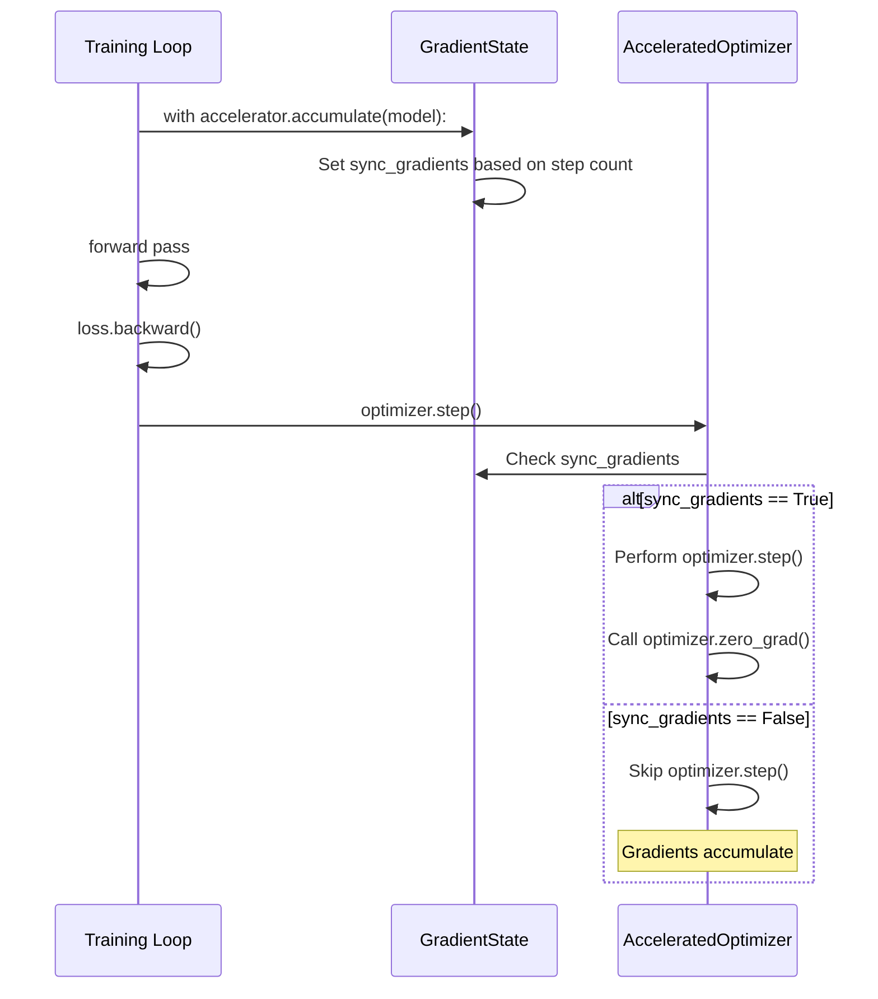

Sources: [src/accelerate/state.py:1371](), [src/accelerate/optimizer.py:158-213]()

## DistributedType Enum

The `DistributedType` enum defines the training environment and determines how models, optimizers, and data loaders are prepared.

**DistributedType Values and Selection**

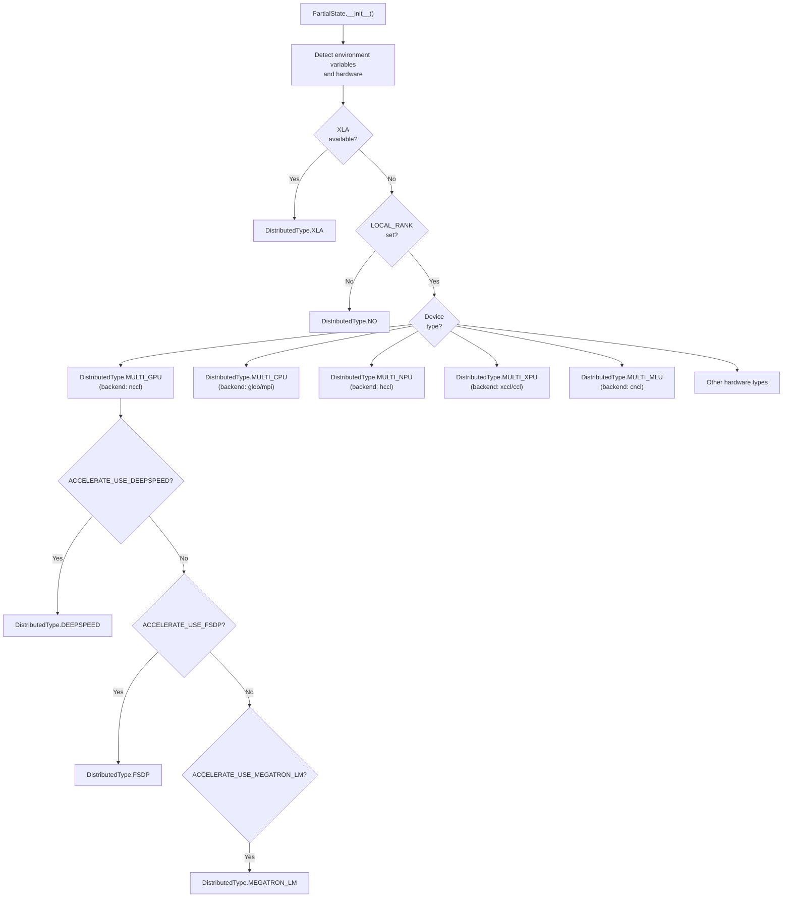

Sources: [src/accelerate/utils/dataclasses.py:570-603](), [src/accelerate/state.py:178-318]()

### DistributedType Values

The enum defines these values [src/accelerate/utils/dataclasses.py:570-603]():

| Value | Description | Backend |
|-------|-------------|---------|
| `NO` | Single process, no distributed training | N/A |
| `MULTI_GPU` | Standard DDP across GPUs | `nccl` |
| `MULTI_CPU` | DDP across CPU nodes | `gloo`, `mpi` |
| `MULTI_NPU` | DDP on Ascend NPUs | `hccl` |
| `MULTI_XPU` | DDP on Intel XPUs | `xccl`, `ccl` |
| `MULTI_MLU` | DDP on Cambricon MLUs | `cncl` |
| `MULTI_MUSA` | DDP on Moore Threads GPUs | `mccl` |
| `MULTI_SDAA` | DDP on SiEngine SDAAs | `tccl` |
| `MULTI_HPU` | DDP on Habana Gaudi HPUs | `hccl` |
| `DEEPSPEED` | DeepSpeed with ZeRO optimization | `nccl` |
| `FSDP` | PyTorch Fully Sharded Data Parallel | `nccl` |
| `XLA` | TPU training via PyTorch/XLA | `xla` |
| `MEGATRON_LM` | Megatron-LM for tensor/pipeline parallelism | `nccl` |

## The Accelerator Class

`Accelerator` is the main user-facing class that orchestrates distributed training. It initializes the state singletons and provides the `prepare()` method to wrap PyTorch objects.

**Accelerator Initialization Flow**

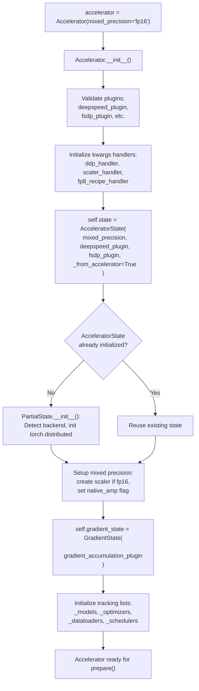

Sources: [src/accelerate/accelerator.py:279-637]()

**Key Responsibilities**:

1. **State Initialization**: Creates `AcceleratorState` and `GradientState` singletons [src/accelerate/accelerator.py:462-553]().
2. **Plugin Configuration**: Validates and stores plugin configurations (DeepSpeed, FSDP, etc.) [src/accelerate/accelerator.py:336-413]().
3. **Mixed Precision Setup**: Configures `GradScaler` and autocast contexts [src/accelerate/accelerator.py:562-613]().
4. **Object Tracking**: Maintains lists of prepared models, optimizers, dataloaders [src/accelerate/accelerator.py:617-622]().

## Mixed Precision Configuration

Accelerate supports multiple precision types through the `mixed_precision` parameter passed to `Accelerator.__init__()`.

**Mixed Precision Types**

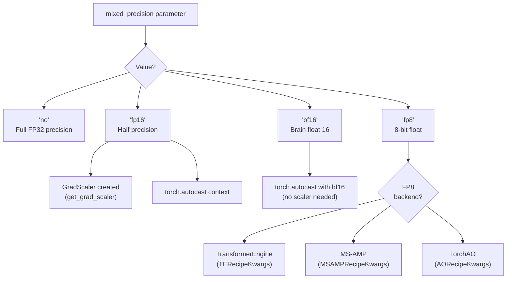

Sources: [src/accelerate/utils/dataclasses.py:738-752](), [src/accelerate/accelerator.py:477-613]()

### Precision Types

| Type | Description | GradScaler | Hardware Requirements |
|------|-------------|------------|----------------------|
| `no` | Full FP32 precision | No | Any |
| `fp16` | Half precision (16-bit) | Yes (except XLA) | GPUs with FP16 support |
| `bf16` | Brain float 16 | No | Newer GPUs, TPUs |
| `fp8` | 8-bit float | Backend-dependent | H100+ or specific accelerators |

### Implementation Details

- **FP16**: Uses `torch.cuda.amp.GradScaler` (or `torch.amp.GradScaler` for PyTorch 2.4+) to scale gradients and prevent underflow.
- **BF16**: Uses `torch.autocast` without gradient scaling (BF16 has better numerical stability).
- **FP8**: Requires additional recipe configuration through `TERecipeKwargs`, `MSAMPRecipeKwargs`, or `AORecipeKwargs` [src/accelerate/utils/dataclasses.py:738-752]().

The `native_amp` flag is set to `True` when using FP16 or BF16, which enables `torch.autocast` in the training loop [src/accelerate/accelerator.py:562-613]().

## Plugin Architecture

Accelerate uses plugins to integrate with specialized training frameworks. Plugins are configuration objects that customize how models, optimizers, and data are prepared.

**Plugin System Overview**

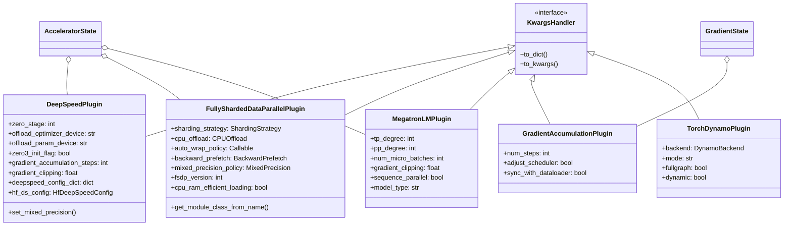

Sources: [src/accelerate/utils/dataclasses.py:70-89](), [src/accelerate/utils/dataclasses.py:1205-1654](), [src/accelerate/utils/dataclasses.py:1656-2302]()

### Core Plugins

- **DeepSpeedPlugin** ([src/accelerate/utils/dataclasses.py:1205-1654]()): Configures ZeRO stages, offloading, and DeepSpeed-specific settings.
- **FullyShardedDataParallelPlugin** ([src/accelerate/utils/dataclasses.py:1656-2302]()): Supports FSDP v1 and v2, sharding strategies, and RAM-efficient loading.
- **MegatronLMPlugin** ([src/accelerate/utils/dataclasses.py:2305-2636]()): Configures tensor/pipeline parallelism degrees and micro-batching.
- **GradientAccumulationPlugin** ([src/accelerate/utils/dataclasses.py:1015-1111]()): Controls accumulation steps and scheduler synchronization.
- **TorchDynamoPlugin** ([src/accelerate/utils/dataclasses.py:2639-2694]()): Configures `torch.compile` backends and modes.

## Configuration System

Accelerate supports configuration through three mechanisms with a clear precedence order.

**Configuration Precedence**

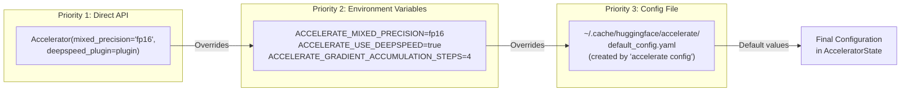

Sources: [src/accelerate/accelerator.py:278-554]()

### Configuration Dataclasses

- **DataLoaderConfiguration** ([src/accelerate/utils/dataclasses.py:787-919]()): Handles sharding, dispatching, and stateful dataloader settings.
- **ProjectConfiguration** ([src/accelerate/utils/dataclasses.py:922-1012]()): Manages logging directories and checkpoint naming/limits.

### Environment Variable Detection

Common environment variables checked by Accelerate:

| Variable | Effect | Parsed In |
|----------|--------|-----------|
| `ACCELERATE_MIXED_PRECISION` | Sets mixed precision mode | [src/accelerate/accelerator.py:310-315]() |
| `ACCELERATE_USE_DEEPSPEED` | Enables DeepSpeed | [src/accelerate/accelerator.py:344-347]() |
| `ACCELERATE_USE_FSDP` | Enables FSDP | [src/accelerate/accelerator.py:380-390]() |
| `ACCELERATE_USE_MEGATRON_LM` | Enables Megatron-LM | [src/accelerate/accelerator.py:401-408]() |
| `ACCELERATE_GRADIENT_ACCUMULATION_STEPS` | Sets accumulation steps | [src/accelerate/accelerator.py:545-547]() |
| `LOCAL_RANK` | Indicates distributed training | [src/accelerate/state.py:203-237]() |
| `RANK`, `WORLD_SIZE` | Process rank and total processes | [src/accelerate/state.py:241-257]() |

## DataLoader Preparation Overview

`prepare_data_loader()` adapts PyTorch DataLoaders for distributed training. The key decision is whether to use sharding (each process independently iterates its shard) or dispatching (main process distributes data).

**DataLoader Wrapper Selection**

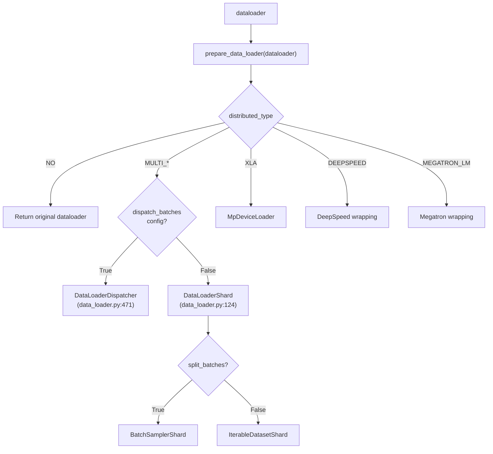

**Core Wrappers**:

- **`DataLoaderShard`** [src/accelerate/data_loader.py:124-415](): Wraps sampler/dataset to shard data across processes.
- **`DataLoaderDispatcher`** [src/accelerate/data_loader.py:471-585](): Main process fetches and broadcasts batches.
- **`skip_first_batches()`** [src/accelerate/data_loader.py:42-122](): Utility for resuming from checkpoints by skipping batches.

Sources: [src/accelerate/data_loader.py:587-747](), [src/accelerate/utils/dataclasses.py:817-919]()

## Integration with PyTorch and Other Frameworks

Accelerate acts as an abstraction layer over PyTorch's distributed training APIs and integrates with specialized frameworks.

**Integration Architecture**

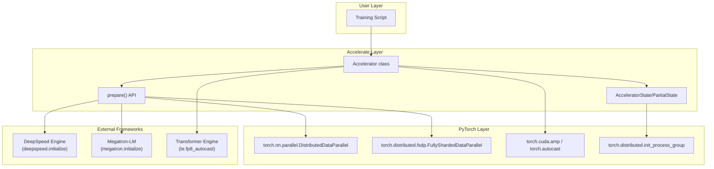

Sources: [src/accelerate/accelerator.py:183-637]()

### PyTorch Integration Points

| Component | PyTorch API | Accelerate Wrapper |
|-----------|-------------|-------------------|
| Model | `torch.nn.Module` | `DistributedDataParallel` or plugin wrapper |
| Optimizer | `torch.optim.Optimizer` | `AcceleratedOptimizer` [src/accelerate/optimizer.py:44-213]() |
| Scheduler | `torch.optim.lr_scheduler` | `AcceleratedScheduler` [src/accelerate/scheduler.py:31-98]() |
| DataLoader | `torch.utils.data.DataLoader` | `DataLoaderShard` / `DataLoaderDispatcher` |
| Mixed Precision | `torch.autocast` | `get_mixed_precision_context_manager()` |
| Gradient Scaling | `torch.amp.GradScaler` | `get_grad_scaler()` |

Sources: [src/accelerate/accelerator.py:1125-1422](), [src/accelerate/utils/__init__.py:148-210]()

---

