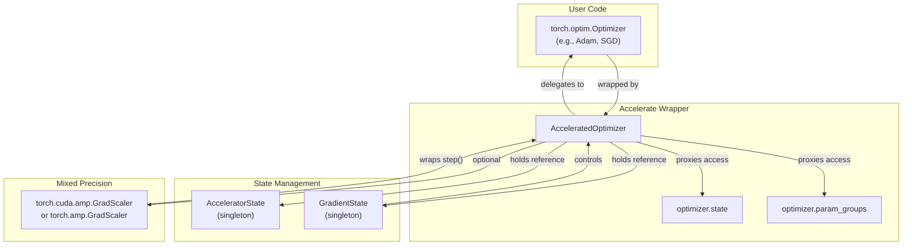
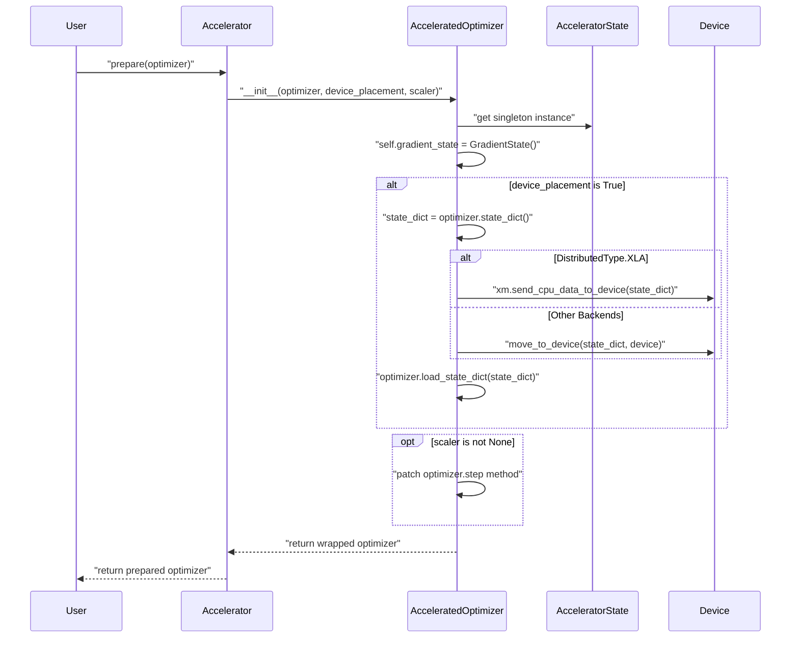
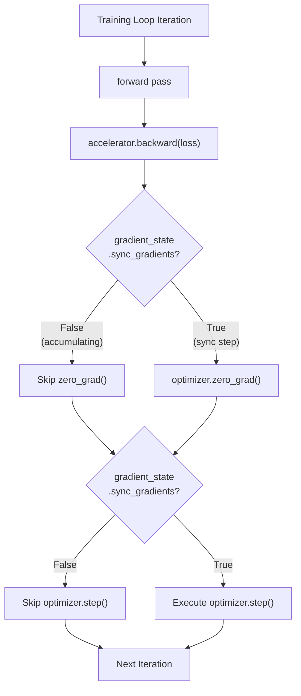
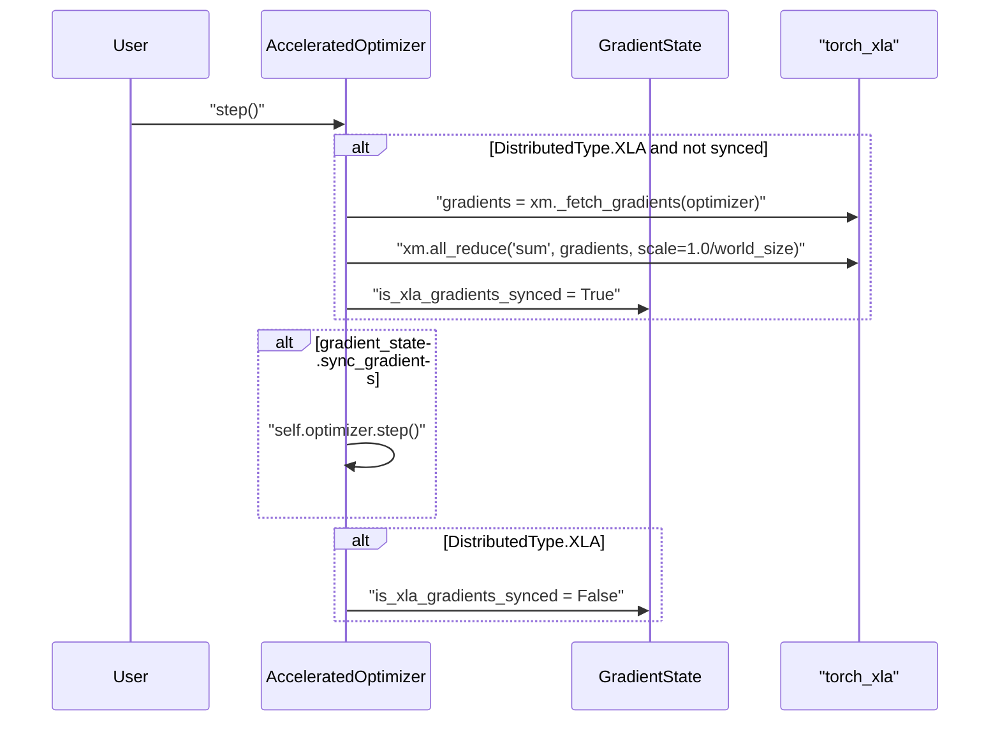
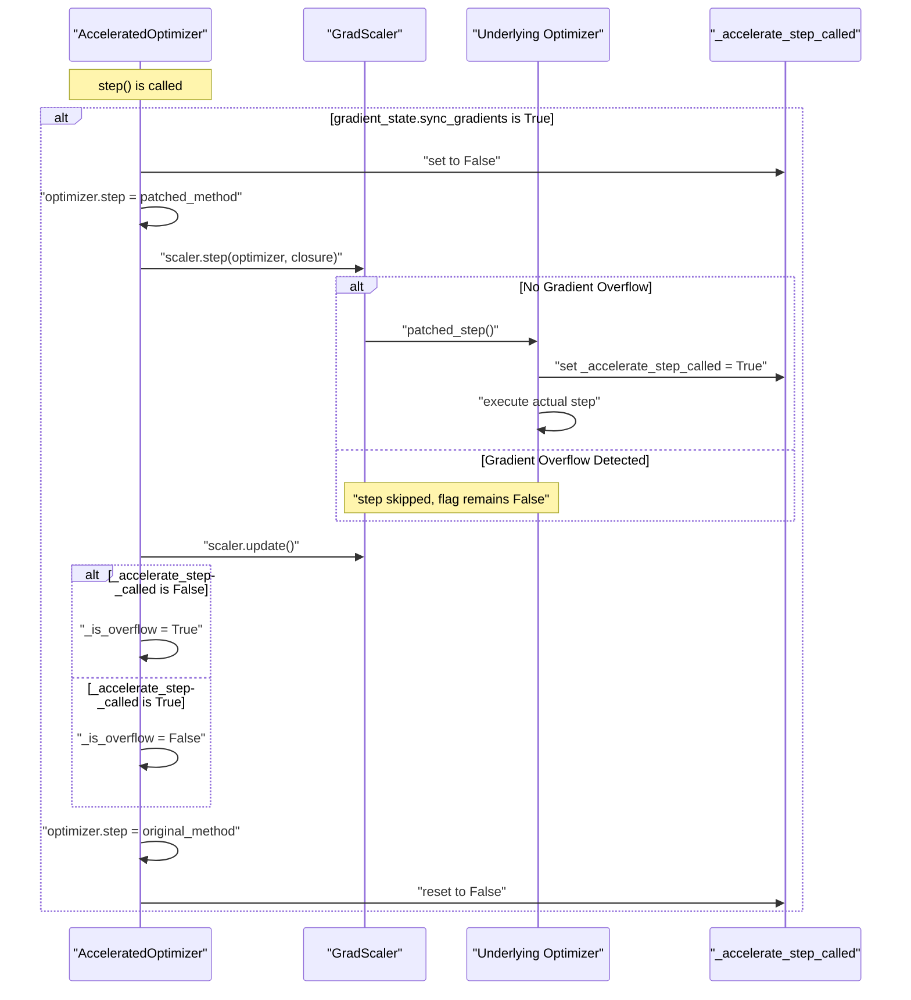

<!-- source: DeepWiki mcp.deepwiki.com · repo huggingface/accelerate · page 10 Optimizer Integration · fetched 2026-10-21 -->

# Optimizer Integration

Relevant source files

The following files were used as context for generating this wiki page:

- [src/accelerate/commands/test.py](src/accelerate/commands/test.py)
- [src/accelerate/optimizer.py](src/accelerate/optimizer.py)
- [src/accelerate/test_utils/scripts/external_deps/test_checkpointing.py](src/accelerate/test_utils/scripts/external_deps/test_checkpointing.py)
- [src/accelerate/test_utils/scripts/external_deps/test_metrics.py](src/accelerate/test_utils/scripts/external_deps/test_metrics.py)
- [tests/test_grad_sync.py](tests/test_grad_sync.py)
- [tests/test_kwargs_handlers.py](tests/test_kwargs_handlers.py)
- [tests/test_metrics.py](tests/test_metrics.py)
- [tests/test_optimizer.py](tests/test_optimizer.py)
- [tests/test_tpu.py](tests/test_tpu.py)

## Purpose and Scope

This document explains how Accelerate wraps and manages PyTorch optimizers to enable distributed training, gradient accumulation, and mixed precision training. The optimizer integration layer ensures that optimizer operations (`step()`, `zero_grad()`) are synchronized correctly across distributed processes and work seamlessly with gradient accumulation strategies.

For details about the core `Accelerator` class and its `prepare()` method, see [The Accelerator Class](#2). For information about gradient accumulation workflow and `GradientState`, see [Gradient Accumulation](#10.2). For the detailed API of the optimizer wrapper, see [AcceleratedOptimizer](#10.1).

Sources: [src/accelerate/optimizer.py:1-21]()

## Overview

When users call `accelerator.prepare(optimizer)`, Accelerate wraps the optimizer in an `AcceleratedOptimizer` instance [src/accelerate/optimizer.py:38](). This wrapper serves several critical functions:

1. **Conditional Execution**: `step()` and `zero_grad()` are only executed when `gradient_state.sync_gradients` is `True`, enabling gradient accumulation [src/accelerate/optimizer.py:113](), [src/accelerate/optimizer.py:162]().
2. **Device Placement**: Optimizer state tensors are automatically moved to the correct device [src/accelerate/optimizer.py:69-76]().
3. **Mixed Precision Integration**: Integrates with `GradScaler` for FP16/BF16 training [src/accelerate/optimizer.py:163-177]().
4. **XLA Gradient Synchronization**: Handles gradient reduction for TPU training [src/accelerate/optimizer.py:149-155]().
5. **State Persistence**: Provides serialization support for checkpointing via standard PyTorch `state_dict` and `load_state_dict` methods [src/accelerate/optimizer.py:104-110]().

The wrapper maintains the same interface as standard PyTorch optimizers by proxying properties like `state`, `param_groups`, and `defaults` [src/accelerate/optimizer.py:77-102]().

Sources: [src/accelerate/optimizer.py:38-110](), [src/accelerate/optimizer.py:113](), [src/accelerate/optimizer.py:149-155](), [src/accelerate/optimizer.py:162-177]()

## Architecture and Data Flow

### Component Relationships

Sources: [src/accelerate/optimizer.py:38-61]()

### Initialization Flow

Sources: [src/accelerate/optimizer.py:55-76](), [src/accelerate/optimizer.py:208-213]()

## Device Placement

The `AcceleratedOptimizer` automatically handles device placement of optimizer state tensors during initialization and when loading checkpoints. This ensures that optimizer momentum buffers and other state are located on the correct device.

### Device Placement Logic

The `move_to_device()` function [src/accelerate/optimizer.py:28-35]() recursively processes optimizer state dictionaries:

- **Lists and tuples**: Recursively process each element.
- **Dictionaries**: Recursively process each value.
- **Tensors**: Move to target device using `.to(device)`.
- **Other types**: Return unchanged.

For XLA/TPU environments, the wrapper uses `xm.send_cpu_data_to_device()` [src/accelerate/optimizer.py:72]() instead of the standard `.to()` method to ensure proper data transfer to TPU devices.

### State Dictionary Proxying

The wrapper exposes optimizer properties as proxies [src/accelerate/optimizer.py:77-99]():

| Property | Description | Proxied To |
|----------|-------------|------------|
| `state` | Optimizer state dict | `self.optimizer.state` |
| `param_groups` | Parameter groups list | `self.optimizer.param_groups` |
| `defaults` | Default hyperparameters | `self.optimizer.defaults` |

This ensures that code accessing these properties works identically whether using a wrapped or unwrapped optimizer.

Sources: [src/accelerate/optimizer.py:28-35](), [src/accelerate/optimizer.py:69-102]()

## Training Loop Integration

### Conditional Step Execution

The core innovation of `AcceleratedOptimizer` is conditional execution based on `gradient_state.sync_gradients`:

The `zero_grad()` method [src/accelerate/optimizer.py:112-122]() checks `self.gradient_state.sync_gradients` before calling the underlying optimizer's `zero_grad()`. When gradient accumulation is in progress, this method becomes a no-op.

The `step()` method [src/accelerate/optimizer.py:145-181]() has additional logic:

1. **XLA Gradient Reduction**: If using XLA and gradients haven't been synced, explicitly reduce gradients across devices [src/accelerate/optimizer.py:149-155]().
2. **LOMO Optimizer Handling**: Skip step for LOMO optimizers which update in-place during backward [src/accelerate/optimizer.py:157-160]().
3. **Gradient Sync Check**: Only execute step when `gradient_state.sync_gradients` is `True` [src/accelerate/optimizer.py:162]().
4. **Mixed Precision**: Integrate with `GradScaler` if present [src/accelerate/optimizer.py:163-177]().

Sources: [src/accelerate/optimizer.py:112-181]()

### XLA Gradient Synchronization

For TPU training, XLA requires explicit gradient synchronization:

The XLA gradient reduction [src/accelerate/optimizer.py:153-155]() fetches gradients from the optimizer, performs an all-reduce sum operation, and scales by the world size to compute the average gradient across all TPU cores.

Sources: [src/accelerate/optimizer.py:149-155](), [src/accelerate/optimizer.py:180-181]()

## Mixed Precision Integration

### GradScaler Workflow

When a `GradScaler` is provided during initialization, `AcceleratedOptimizer` patches the optimizer's `step` method to track whether the step was executed or skipped due to gradient overflow [src/accelerate/optimizer.py:63-66]():

The patching mechanism [src/accelerate/optimizer.py:208-213]() wraps the optimizer's step method to set a flag indicating the step was executed. The wrapper can then detect gradient overflow by checking if the flag was set [src/accelerate/optimizer.py:169-172]().

Users can query the `step_was_skipped` property [src/accelerate/optimizer.py:187-190]() to determine if the most recent step was skipped due to overflow.

Sources: [src/accelerate/optimizer.py:63-66](), [src/accelerate/optimizer.py:163-177](), [src/accelerate/optimizer.py:187-190](), [src/accelerate/optimizer.py:208-213]()

## Special Optimizer Support

### Schedule-Free Optimizers

The wrapper provides `train()` and `eval()` methods [src/accelerate/optimizer.py:124-143]() to support schedule-free optimizers that require mode switching. The implementation delegates to the underlying optimizer, including support for DeepSpeed's nested optimizer structure [src/accelerate/optimizer.py:130-136]().

### LOMO Optimizers

LOMO (Low-Memory Optimization) optimizers update parameters during the backward pass. The `step()` method [src/accelerate/optimizer.py:157-160]() detects LOMO optimizers and returns early to prevent redundant updates.

Sources: [src/accelerate/optimizer.py:124-160]()

## API Summary

### Core Methods

| Method | Conditional | Purpose |
|--------|-------------|---------|
| `step(closure=None)` | Yes (checks `sync_gradients`) | Execute optimizer step, handle XLA sync [src/accelerate/optimizer.py:145-181]() |
| `zero_grad(set_to_none=None)` | Yes (checks `sync_gradients`) | Zero gradients [src/accelerate/optimizer.py:112-123]() |
| `state_dict()` | No | Return optimizer state dictionary [src/accelerate/optimizer.py:109-110]() |
| `load_state_dict(state_dict)` | No | Load optimizer state, handle XLA device placement [src/accelerate/optimizer.py:104-107]() |

### Properties

| Property | Read/Write | Description |
|----------|------------|-------------|
| `state` | Both | Access to optimizer state dict [src/accelerate/optimizer.py:77-83]() |
| `param_groups` | Both | Access to parameter groups [src/accelerate/optimizer.py:85-91]() |
| `step_was_skipped` | Read-only | Whether last step was skipped due to overflow [src/accelerate/optimizer.py:187-190]() |

Sources: [src/accelerate/optimizer.py:38-213]()

---

