<!-- source: DeepWiki mcp.deepwiki.com · repo huggingface/accelerate · page 10.1 AcceleratedOptimizer · fetched 2026-10-21 -->

# AcceleratedOptimizer

<details>
<summary>Relevant source files</summary>

The following files were used as context for generating this wiki page:

- [src/accelerate/commands/test.py](src/accelerate/commands/test.py)
- [src/accelerate/optimizer.py](src/accelerate/optimizer.py)
- [src/accelerate/test_utils/scripts/external_deps/test_checkpointing.py](src/accelerate/test_utils/scripts/external_deps/test_checkpointing.py)
- [src/accelerate/test_utils/scripts/external_deps/test_metrics.py](src/accelerate/test_utils/scripts/external_deps/test_metrics.py)
- [tests/test_grad_sync.py](tests/test_grad_sync.py)
- [tests/test_kwargs_handlers.py](tests/test_kwargs_handlers.py)
- [tests/test_metrics.py](tests/test_metrics.py)
- [tests/test_optimizer.py](tests/test_optimizer.py)
- [tests/test_tpu.py](tests/test_tpu.py)

</details>


## Purpose and Scope

The `AcceleratedOptimizer` class is an internal wrapper around PyTorch optimizers that handles distributed training coordination, mixed precision integration, and gradient accumulation. This wrapper is automatically applied when optimizers are passed through `Accelerator.prepare()` and provides conditional execution of `step()` and `zero_grad()` methods based on gradient synchronization state.

**Related Pages:**
- For gradient accumulation details, see [Gradient Accumulation](#10.2)
- For mixed precision training configuration, see [FP16 and BF16 Training](#8.1)
- For saving and loading optimizer state, see [Saving and Loading State](#7.1)
- For the Accelerator prepare system, see [Preparing Training Components](#2.2)

---

## Class Structure and Architecture

The `AcceleratedOptimizer` wraps a standard PyTorch optimizer and coordinates with Accelerate's state management system to enable distributed training features.

### Core Components Diagram

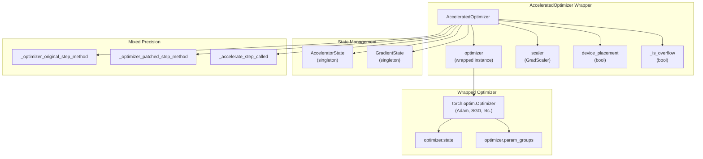

**Sources:** [src/accelerate/optimizer.py:38-76]()

### Initialization Parameters

The `AcceleratedOptimizer` constructor accepts three parameters:

| Parameter | Type | Default | Description |
|-----------|------|---------|-------------|
| `optimizer` | `torch.optim.Optimizer` | Required | The PyTorch optimizer instance to wrap |
| `device_placement` | `bool` | `True` | Whether to automatically move optimizer state to the correct device |
| `scaler` | `GradScaler` | `None` | Optional gradient scaler for mixed precision training |

**Initialization Process:**

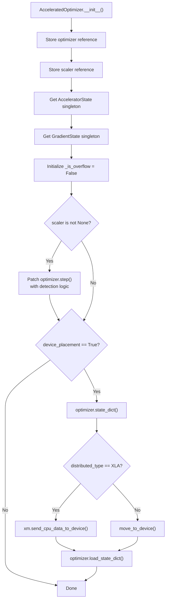

**Sources:** [src/accelerate/optimizer.py:55-76]()

---

## Property Forwarding

The `AcceleratedOptimizer` exposes the wrapped optimizer's interface through property forwarding, allowing it to act as a drop-in replacement.

### Forwarded Properties

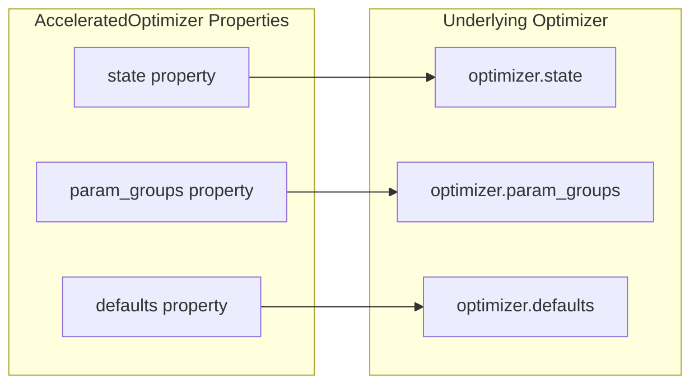

| Property | Access | Description |
|----------|--------|-------------|
| `state` | Read/Write | Forward to `optimizer.state` |
| `param_groups` | Read/Write | Forward to `optimizer.param_groups` |
| `defaults` | Read/Write | Forward to `optimizer.defaults` |

**Additional Methods:**
- `add_param_group()`: Forward to `optimizer.add_param_group()` [src/accelerate/optimizer.py:101-102]()
- `state_dict()`: Forward to `optimizer.state_dict()` [src/accelerate/optimizer.py:109-110]()
- `load_state_dict()`: Forward with device placement handling [src/accelerate/optimizer.py:104-107]()

**Sources:** [src/accelerate/optimizer.py:77-110]()

---

## Conditional Execution with Gradient State

The core feature of `AcceleratedOptimizer` is conditional execution of optimizer operations based on gradient synchronization state. This enables gradient accumulation across multiple steps.

### Zero Gradient Conditional Logic

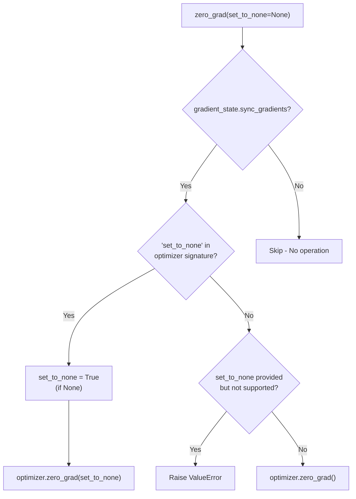

The `zero_grad()` method only executes when `GradientState.sync_gradients` is `True`. During gradient accumulation steps, this flag is `False`, preventing premature gradient clearing.

**Sources:** [src/accelerate/optimizer.py:112-122]()

### Step Execution Flow

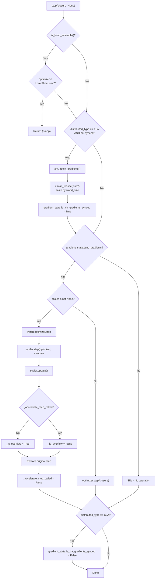

**Key Behaviors:**
1. **LOMO Optimizers:** Step is a no-op for LOMO/AdaLomo optimizers [src/accelerate/optimizer.py:157-160]()
2. **XLA Gradient Sync:** Gradients are synchronized across TPU cores before stepping [src/accelerate/optimizer.py:150-155]()
3. **Conditional Execution:** Step only executes when `gradient_state.sync_gradients` is `True` [src/accelerate/optimizer.py:162-179]()
4. **XLA State Reset:** After stepping on XLA, the sync flag is reset [src/accelerate/optimizer.py:180-181]()

**Sources:** [src/accelerate/optimizer.py:145-181]()

---

## Mixed Precision Integration

When a `GradScaler` is provided, `AcceleratedOptimizer` patches the optimizer's `step()` method to detect whether the step was actually executed (not skipped due to gradient overflow).

### GradScaler Patching Mechanism

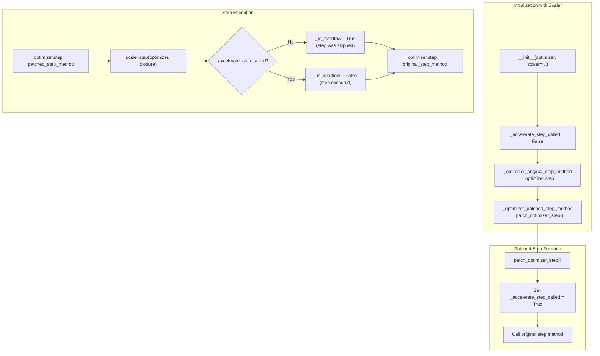

**Overflow Detection:**

The `step_was_skipped` property exposes whether the last optimizer step was skipped due to gradient overflow:

```python
@property
def step_was_skipped(self):
    """Whether or not the optimizer step was skipped."""
    return self._is_overflow
```

**Sources:** [src/accelerate/optimizer.py:63-66](), [src/accelerate/optimizer.py:163-177](), [src/accelerate/optimizer.py:188-190](), [src/accelerate/optimizer.py:208-213]()

---

## XLA-Specific Handling

For TPU training with XLA, `AcceleratedOptimizer` includes special handling for gradient synchronization and device placement.

### XLA Gradient Synchronization

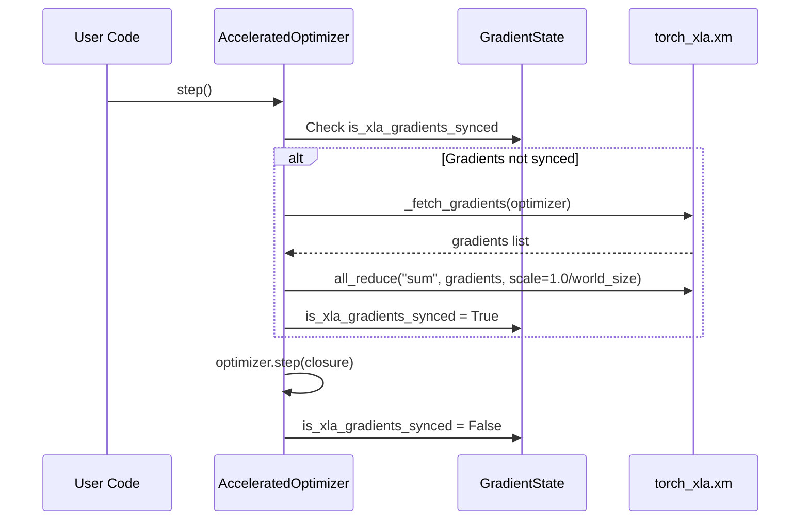

**XLA Device Placement:**

When `device_placement=True` and `distributed_type=DistributedType.XLA`, optimizer state is moved using XLA-specific methods:

- **During initialization:** `xm.send_cpu_data_to_device(state_dict, device)` [src/accelerate/optimizer.py:71-72]()
- **During load_state_dict:** Same XLA transfer method [src/accelerate/optimizer.py:105-106]()

**Sources:** [src/accelerate/optimizer.py:23-24](), [src/accelerate/optimizer.py:71-75](), [src/accelerate/optimizer.py:104-107](), [src/accelerate/optimizer.py:150-155](), [src/accelerate/optimizer.py:180-181]()

---

## Device Placement

The `device_placement` feature automatically moves optimizer state tensors to the appropriate device during initialization and state loading.

### Device Placement Logic

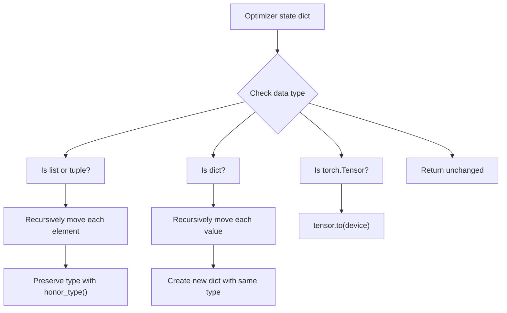

The `move_to_device()` helper function recursively traverses nested data structures (lists, tuples, dicts) and moves all `torch.Tensor` objects to the target device.

**Sources:** [src/accelerate/optimizer.py:28-35](), [src/accelerate/optimizer.py:69-75]()

---

## State Management and Checkpointing

`AcceleratedOptimizer` integrates with Accelerate's checkpointing system to save and restore optimizer state across training sessions.

### Checkpoint Integration Flow

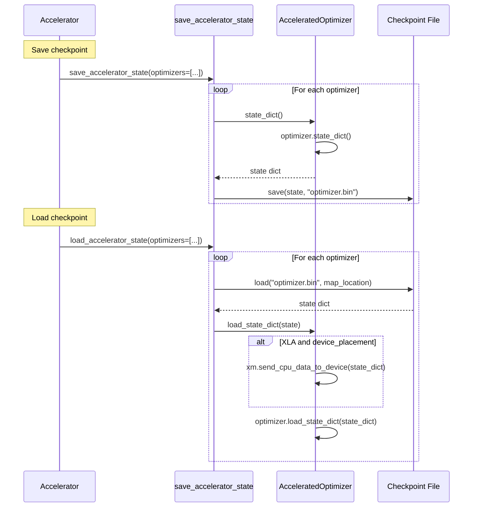

**Map Location Options:**

The `map_location` parameter controls where optimizer state is loaded:

| Value | Behavior |
|-------|----------|
| `None` or `"cpu"` | Load optimizer state to CPU |
| `"on_device"` | Load optimizer state to current accelerator device |
| Other | Raises `TypeError` |

**Sources:** [src/accelerate/optimizer.py:104-107]() (Note: The actual `save_accelerator_state` and `load_accelerator_state` functions are in `src/accelerate/checkpointing.py`, but the `AcceleratedOptimizer`'s `load_state_dict` method handles the XLA-specific device placement during loading.)

---

## Special Optimizer Support

`AcceleratedOptimizer` includes special handling for optimizers with non-standard interfaces.

### LOMO Optimizer Support

LOMO (LOw-Memory Optimization) optimizers handle gradient computation and parameter updates differently. The `step()` method is a no-op for these optimizers:

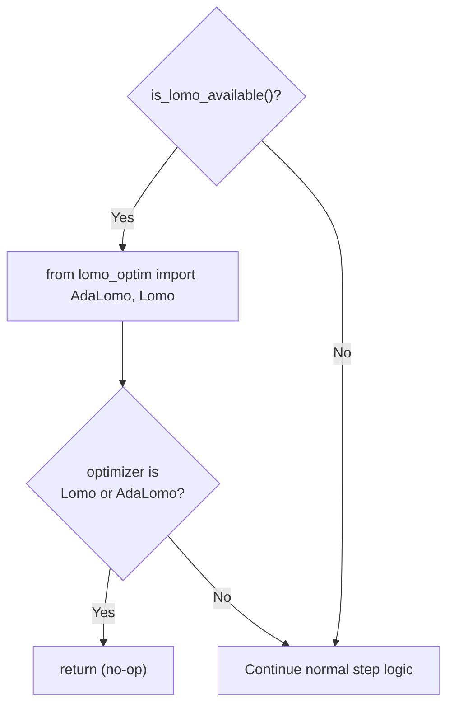

**Sources:** [src/accelerate/optimizer.py:146-160]()

### Schedule-Free Optimizer Support

Schedule-free optimizers (e.g., from the `schedulefree` library) have `train()` and `eval()` modes. `AcceleratedOptimizer` forwards these method calls:

```python
def train(self):
    """Sets the optimizer to "train" mode."""
    if hasattr(self.optimizer, "train") and callable(self.optimizer.train):
        self.optimizer.train()
    elif (
        hasattr(self.optimizer, "optimizer")
        and hasattr(self.optimizer.optimizer, "train")
        and callable(self.optimizer.optimizer.train)
    ):
        # DeepSpeed optimizer further wraps the optimizer
        self.optimizer.optimizer.train()
```

The `eval()` method has similar logic for switching to evaluation mode.

**Sources:** [src/accelerate/optimizer.py:124-143]()

---

## Serialization and Deserialization

`AcceleratedOptimizer` customizes serialization to handle the patched step method correctly.

### Serialization Flow

```mermaid
flowchart TD
    subgraph "Saving (__getstate__)"
        GetState["__getstate__()"]
        FilterKeys["Filter out patched method keys:<br/>- _accelerate_step_called<br/>- _optimizer_original_step_method<br/>- _optimizer_patched_step_method"]
        ReturnState["Return filtered __dict__"]
    end
    
    subgraph "Loading (__setstate__)"
        SetState["__setstate__(state)"]
        UpdateDict["Update __dict__ with state"]
        CheckScaler{"scaler is not None?"}
        RecreateFlag["_accelerate_step_called = False"]
        RecreateSaved["_optimizer_original_step_method<br/>= optimizer.step"]
        RecreatePatch["_optimizer_patched_step_method<br/>= patch_optimizer_step()"]
        Done["Done"]
    end
    
    GetState --> FilterKeys
    FilterKeys --> ReturnState
    
    SetState --> UpdateDict
    UpdateDict --> CheckScaler
    CheckScaler -->|Yes| RecreateFlag
    RecreateFlag --> RecreateSaved
    RecreateSaved --> RecreatePatch
    RecreatePatch --> Done
    CheckScaler -->|No| Done
```

**Filtered Keys During Serialization:**

The following attributes are not serialized because they reference methods that cannot be pickled:
- `_accelerate_step_called`: Temporary flag
- `_optimizer_original_step_method`: Original unpatched method
- `_optimizer_patched_step_method`: Patched method closure

These are recreated during deserialization if a `scaler` exists.

**Sources:** [src/accelerate/optimizer.py:192-206]()

---

## Integration with Accelerator Prepare

The `AcceleratedOptimizer` is automatically created when optimizers pass through `Accelerator.prepare()`.

### Prepare Integration Diagram

```mermaid
sequenceDiagram
    participant User as User Code
    participant Acc as Accelerator
    participant Prep as prepare()
    participant AO as AcceleratedOptimizer
    participant Opt as PyTorch Optimizer
    
    User->>Acc: accelerator = Accelerator(mixed_precision="fp16")
    Note over Acc: GradScaler created if FP16
    
    User->>Acc: optimizer = torch.optim.Adam(...)
    User->>Prep: prepare(model, optimizer, ...)
    
    Prep->>Prep: Detect optimizer type
    Prep->>AO: AcceleratedOptimizer(<br/>optimizer=optimizer,<br/>device_placement=True,<br/>scaler=accelerator.scaler)
    AO->>Opt: Move state to device
    AO-->>Prep: Wrapped optimizer
    Prep-->>User: model, optimizer, ...
    
    Note over User: Training loop
    User->>AO: optimizer.zero_grad()
    Note over AO: Conditional based on GradientState
    User->>AO: optimizer.step()
    Note over AO: XLA sync + conditional execution
```

**Sources:** [src/accelerate/optimizer.py:38-76]()

---

## Usage Example from Codebase

The test suite demonstrates typical usage patterns for checkpointing with `AcceleratedOptimizer`:

```python
# Create model and optimizer
model = torch.nn.Linear(10, 10) # Simplified from DummyModel for clarity
optimizer = torch.optim.SGD(model.parameters(), 0.1) # Simplified from Adam for clarity

# Prepare with Accelerator (creates AcceleratedOptimizer)
accelerator = Accelerator()
model, optimizer = accelerator.prepare(
    model, optimizer
)

# Training loop - conditional execution happens automatically
# (Example from test_optimizer.py, not a full training loop)
loss = model(torch.randn(2, 5, device=accelerator.device)).sum()
accelerator.backward(loss)
for p in model.parameters():
    # Fake the gradients, as if there's no overflow
    p.grad.fill_(0.01)

optimizer.step()  # Only executes when sync_gradients=True
assert optimizer.step_was_skipped is False

# Example of skipped step due to overflow (simulated)
loss = model(torch.randn(2, 5, device=accelerator.device)).sum()
accelerator.backward(loss)
for p in model.parameters():
    p.grad.fill_(0.01)
    # Manually set the gradients to be NaN, as if there's an overflow
    p.grad[0] = torch.tensor(float("nan"))

optimizer.step()
assert optimizer.step_was_skipped is True
```

**Sources:** [tests/test_optimizer.py:40-82]()

---

## Implementation Summary Table

| Feature | Method/Attribute | Condition | Behavior |
|---------|-----------------|-----------|----------|
| Device Placement | `__init__` | `device_placement=True` | Moves optimizer state to accelerator device |
| Gradient Clear | `zero_grad()` | `gradient_state.sync_gradients` | Only clears when `True` |
| Optimizer Step | `step()` | `gradient_state.sync_gradients` | Only steps when `True` |
| XLA Sync | `step()` | `distributed_type=XLA` | All-reduces gradients before step |
| Mixed Precision | `step()` | `scaler is not None` | Uses `scaler.step()` with overflow detection |
| LOMO Skip | `step()` | `optimizer is Lomo/AdaLomo` | Returns immediately (no-op) |
| State Save | `state_dict()` | Always | Forwards to wrapped optimizer |
| State Load | `load_state_dict()` | `distributed_type=XLA` | Uses XLA device transfer |
| Train/Eval Mode | `train()`/`eval()` | Optimizer supports it | Forwards to optimizer or nested optimizer |

**Sources:** [src/accelerate/optimizer.py:38-213]()

---

