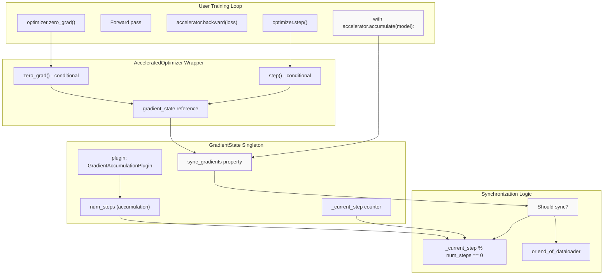
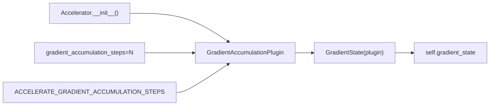
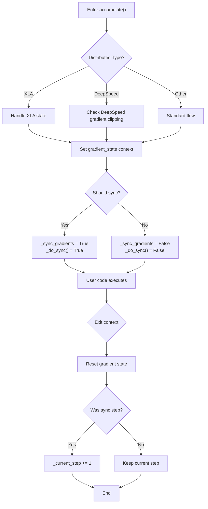
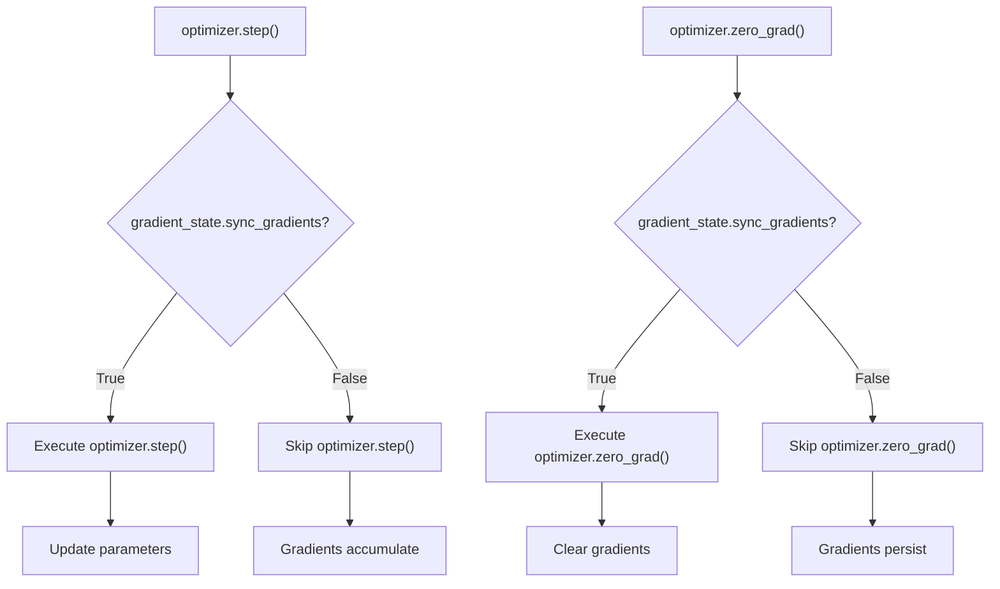

<!-- source: DeepWiki mcp.deepwiki.com · repo huggingface/accelerate · page 10.2 Gradient Accumulation · fetched 2026-10-21 -->

# Gradient Accumulation

<details>
<summary>Relevant source files</summary>

The following files were used as context for generating this wiki page:

- [examples/by_feature/automatic_gradient_accumulation.py](examples/by_feature/automatic_gradient_accumulation.py)
- [src/accelerate/accelerator.py](src/accelerate/accelerator.py)
- [src/accelerate/commands/test.py](src/accelerate/commands/test.py)
- [src/accelerate/optimizer.py](src/accelerate/optimizer.py)
- [src/accelerate/state.py](src/accelerate/state.py)
- [src/accelerate/test_utils/scripts/external_deps/test_checkpointing.py](src/accelerate/test_utils/scripts/external_deps/test_checkpointing.py)
- [src/accelerate/test_utils/scripts/external_deps/test_metrics.py](src/accelerate/test_utils/scripts/external_deps/test_metrics.py)
- [src/accelerate/utils/dataclasses.py](src/accelerate/utils/dataclasses.py)
- [tests/test_grad_sync.py](tests/test_grad_sync.py)
- [tests/test_kwargs_handlers.py](tests/test_kwargs_handlers.py)
- [tests/test_metrics.py](tests/test_metrics.py)
- [tests/test_optimizer.py](tests/test_optimizer.py)
- [tests/test_tpu.py](tests/test_tpu.py)

</details>


## Purpose and Scope

This document describes the gradient accumulation system in Accelerate, which allows training with effective batch sizes larger than what GPU memory permits by accumulating gradients over multiple forward/backward passes before performing an optimizer step. This page covers the `GradientState` singleton, `GradientAccumulationPlugin` configuration, and the `accumulate()` context manager API.

For information about the optimizer wrapper that implements gradient synchronization control, see [AcceleratedOptimizer](#10.1). For information about the `backward()` method used within accumulation loops, see [Training Loop Integration](#2.3).

## Overview

Gradient accumulation divides each logical training step into multiple micro-steps. During micro-steps, gradients accumulate without optimizer updates or gradient synchronization across distributed processes. On the final micro-step of each accumulation cycle, gradients are synchronized and the optimizer performs a single update.

**Key Components:**

| Component | Location | Purpose |
|-----------|----------|---------|
| `GradientState` | [src/accelerate/state.py:19-21]() | Singleton tracking accumulation state and sync status |
| `GradientAccumulationPlugin` | [src/accelerate/utils/dataclasses.py:63-63]() | Configuration for accumulation behavior |
| `Accelerator.accumulate()` | [src/accelerate/accelerator.py:861-927]() | Context manager controlling gradient sync |
| `AcceleratedOptimizer` | [src/accelerate/optimizer.py:38-182]() | Wraps optimizer to conditionally skip steps |

Sources: [src/accelerate/accelerator.py:197-201](), [src/accelerate/state.py:19-21]()

## System Architecture



**Figure 1: Gradient Accumulation Control Flow**

The `accumulate()` context manager temporarily modifies the `sync_gradients` flag in `GradientState`, which the `AcceleratedOptimizer` checks before executing optimizer operations [src/accelerate/optimizer.py:113-122]().

Sources: [src/accelerate/accelerator.py:861-927](), [src/accelerate/optimizer.py:38-182](), [src/accelerate/state.py:19-21]()

## GradientState Singleton

The `GradientState` class is a singleton that maintains gradient accumulation state across the entire training process. It is initialized once and shared across all components.

### Initialization



**Figure 2: GradientState Initialization Flow**

The `GradientState` is created in `Accelerator.__init__()` [src/accelerate/accelerator.py:539-553]() with a `GradientAccumulationPlugin` instance. If the plugin is not provided, it's created with `num_steps` from either the constructor parameter or environment variable [src/accelerate/accelerator.py:197-201]().

Sources: [src/accelerate/accelerator.py:539-553](), [src/accelerate/state.py:19-21]()

### Key Properties and Methods

| Property/Method | Type | Description |
|-----------------|------|-------------|
| `num_steps` | `int` | Number of accumulation steps before sync |
| `sync_gradients` | `bool` | Whether gradients should sync on current step |
| `adjust_scheduler` | `bool` | Whether scheduler should step every `num_steps` |
| `sync_with_dataloader` | `bool` | Whether to sync at dataloader end |

The `sync_gradients` property is the central control flag that `AcceleratedOptimizer` uses to decide whether to execute a step [src/accelerate/optimizer.py:162-162]().

Sources: [src/accelerate/state.py:19-21](), [src/accelerate/optimizer.py:59-59]()

### Step Tracking

```mermaid
sequenceDiagram
    participant User as Training Loop
    participant Ctx as accumulate() Context
    participant GS as GradientState
    participant Opt as AcceleratedOptimizer
    
    User->>Ctx: Enter accumulate()
    Ctx->>GS: Check if sync step
    
    alt Is Sync Step
        GS->>GS: _sync_gradients = True
    else Not Sync Step
        GS->>GS: _sync_gradients = False
    end
    
    User->>User: Forward pass
    User->>User: backward(loss)
    User->>Opt: optimizer.step()
    
    Opt->>GS: Check sync_gradients
    
    alt sync_gradients == True
        Opt->>Opt: Perform optimizer step
    else sync_gradients == False
        Opt->>Opt: Skip optimizer step
    end
    
    User->>Opt: optimizer.zero_grad()
    Opt->>GS: Check sync_gradients
    
    alt sync_gradients == True
        Opt->>Opt: Zero gradients
        Ctx->>GS: _current_step += 1
    else sync_gradients == False
        Opt->>Opt: Skip zero_grad
    end
    
    User->>Ctx: Exit accumulate()
```

**Figure 3: Gradient Accumulation Step Sequence**

Sources: [src/accelerate/accelerator.py:861-927](), [src/accelerate/optimizer.py:145-182]()

## The accumulate() Context Manager

The `accumulate()` context manager is the primary API for gradient accumulation. It temporarily sets the `sync_gradients` flag based on the current accumulation step [src/accelerate/accelerator.py:861-927]().

### Basic Usage

```python
accelerator = Accelerator(gradient_accumulation_steps=4)
model, optimizer = accelerator.prepare(model, optimizer)

for batch in dataloader:
    with accelerator.accumulate(model):
        outputs = model(batch)
        loss = compute_loss(outputs)
        accelerator.backward(loss)
        optimizer.step()
        optimizer.zero_grad()
```

Sources: [src/accelerate/accelerator.py:861-927]()

### Implementation Details

The context manager handles multiple scenarios:

| Scenario | Behavior |
|----------|----------|
| Regular step (not sync) | Sets `sync_gradients=False`, skips optimizer step/zero_grad |
| Sync step (every N steps) | Sets `sync_gradients=True`, performs optimizer step/zero_grad |
| XLA/TPU | Special handling for XLA gradient synchronization [src/accelerate/optimizer.py:150-155]() |



**Figure 4: accumulate() Context Manager Logic**

Sources: [src/accelerate/accelerator.py:861-927]()

### Distributed Type Handling

Different distributed backends require special handling:

**XLA/TPU:**
- Tracks `is_xla_gradients_synced` flag.
- Performs explicit gradient reduction via `xm.all_reduce()` in the optimizer step [src/accelerate/optimizer.py:150-155]().
- Sources: [src/accelerate/optimizer.py:150-155](), [src/accelerate/accelerator.py:897-903]()

**DeepSpeed:**
- Checks if gradient clipping is enabled in the DeepSpeed config.
- Bypasses Accelerate's clipping if DeepSpeed handles it.
- Sources: [src/accelerate/accelerator.py:905-913]()

**Standard (DDP, FSDP, etc.):**
- Uses PyTorch's built-in gradient synchronization control (e.g., `no_sync()`).
- Sources: [src/accelerate/accelerator.py:915-927]()

## GradientAccumulationPlugin Configuration

The `GradientAccumulationPlugin` provides fine-grained control over gradient accumulation behavior [src/accelerate/utils/dataclasses.py:63-63]().

### Configuration Options

| Parameter | Type | Default | Description |
|-----------|------|---------|-------------|
| `num_steps` | `int` | 1 | Number of steps to accumulate before sync |
| `adjust_scheduler` | `bool` | `True` | Whether to adjust scheduler to step every `num_steps` |
| `sync_with_dataloader` | `bool` | `True` | Whether to sync at end of dataloader |

Sources: [src/accelerate/utils/dataclasses.py:63-63]()

### Initialization Example

```python
from accelerate import Accelerator
from accelerate.utils import GradientAccumulationPlugin

# Method 1: Pass num_steps to Accelerator
accelerator = Accelerator(gradient_accumulation_steps=4)

# Method 2: Create plugin explicitly
plugin = GradientAccumulationPlugin(
    num_steps=4,
    adjust_scheduler=True,
    sync_with_dataloader=True
)
accelerator = Accelerator(gradient_accumulation_plugin=plugin)
```

Sources: [src/accelerate/accelerator.py:539-553](), [src/accelerate/utils/dataclasses.py:63-63]()

## AcceleratedOptimizer Integration

The `AcceleratedOptimizer` wrapper is where gradient accumulation is actually enforced. It wraps the user's optimizer and conditionally executes `step()` and `zero_grad()` based on the `sync_gradients` flag [src/accelerate/optimizer.py:113-122]().

### Conditional Execution



**Figure 5: Conditional Optimizer Operations**

Sources: [src/accelerate/optimizer.py:113-122](), [src/accelerate/optimizer.py:145-182]()

### Implementation in AcceleratedOptimizer

The `zero_grad()` method [src/accelerate/optimizer.py:112-123]():

```python
def zero_grad(self, set_to_none=None):
    if self.gradient_state.sync_gradients:
        # Only zero gradients when syncing
        accept_arg = "set_to_none" in inspect.signature(self.optimizer.zero_grad).parameters
        if accept_arg:
            if set_to_none is None:
                set_to_none = True
            self.optimizer.zero_grad(set_to_none=set_to_none)
        else:
            self.optimizer.zero_grad()
```

The `step()` method [src/accelerate/optimizer.py:145-182]():

```python
def step(self, closure=None):
    # ... XLA gradient sync handling ...
    
    if self.gradient_state.sync_gradients:
        if self.scaler is not None:
            # Mixed precision path
            self.scaler.step(self.optimizer, closure)
            self.scaler.update()
        else:
            # Standard path
            self.optimizer.step(closure)
```

Sources: [src/accelerate/optimizer.py:112-123](), [src/accelerate/optimizer.py:145-182]()

## Mixed Precision Considerations

When using gradient accumulation with mixed precision (FP16/BF16), the `GradScaler` is automatically handled by the `AcceleratedOptimizer`. The scaler only updates on sync steps [src/accelerate/optimizer.py:163-178]():

```python
def step(self, closure=None):
    if self.gradient_state.sync_gradients:
        if self.scaler is not None:
            self.optimizer.step = self._optimizer_patched_step_method
            self.scaler.step(self.optimizer, closure)
            self.scaler.update()
            
            if not self._accelerate_step_called:
                # Gradient overflow detected, step was skipped
                self._is_overflow = True
```

Sources: [src/accelerate/optimizer.py:163-178](), [src/accelerate/accelerator.py:562-584]()

---

