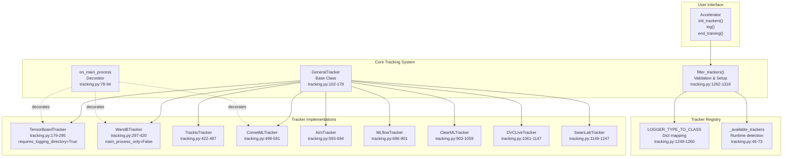
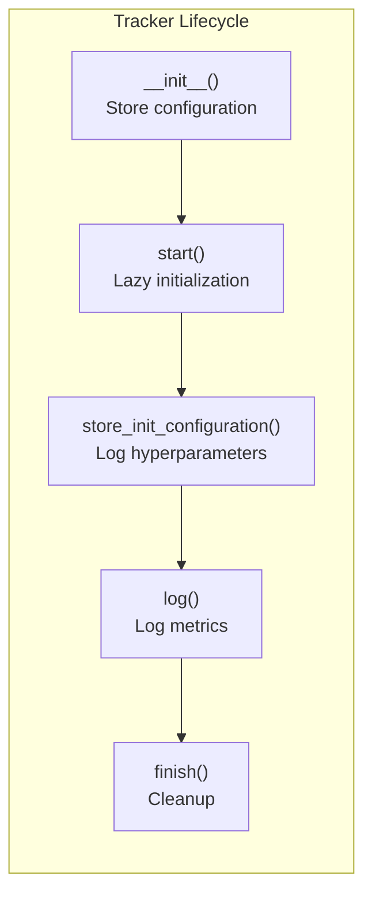
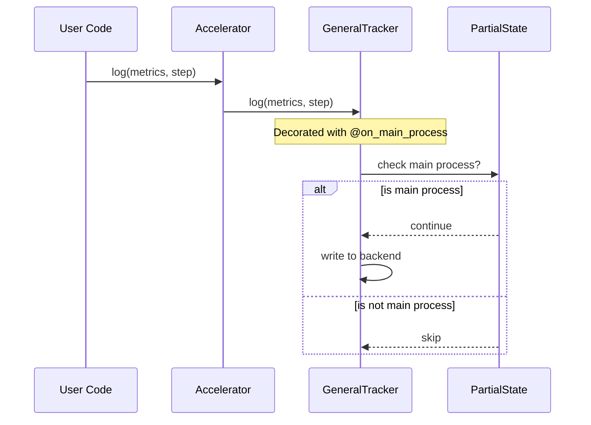
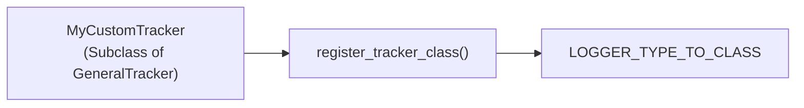

<!-- source: DeepWiki mcp.deepwiki.com · repo huggingface/accelerate · page 11 Experiment Tracking · fetched 2026-10-21 -->

# Experiment Tracking

Relevant source files

The following files were used as context for generating this wiki page:

- [docs/source/package_reference/tracking.md](docs/source/package_reference/tracking.md)
- [docs/source/usage_guides/tracking.md](docs/source/usage_guides/tracking.md)
- [examples/by_feature/README.md](examples/by_feature/README.md)
- [src/accelerate/tracking.py](src/accelerate/tracking.py)
- [tests/test_examples.py](tests/test_examples.py)
- [tests/test_tracking.py](tests/test_tracking.py)

This page documents the experiment tracking system in Accelerate, which provides a unified interface for logging metrics, hyperparameters, and artifacts to various tracking platforms. The tracking system supports TensorBoard, Weights & Biases, CometML, MLflow, Aim, ClearML, DVCLive, SwanLab, and trackio through a common API.

For information about how the Accelerator class manages trackers, see [The Accelerator Class](#2). For details on the `log_with` parameter during initialization, see [Initialization and Configuration](#2.1).

---

## Purpose and Scope

The tracking system enables users to:
- Initialize one or more experiment tracking platforms with a single API call
- Log metrics, hyperparameters, images, and tables during training
- Coordinate logging across distributed processes (main process only by default)
- Create custom tracker integrations by extending the base class

The tracking system is designed to work seamlessly with distributed training, automatically handling multi-process coordination and ensuring that logging operations don't interfere with training performance.

Sources: [src/accelerate/tracking.py:1-43]()

---

## System Architecture

The tracking system follows a plugin-based architecture where each tracking platform is implemented as a subclass of `GeneralTracker`. The `Accelerator` class manages tracker lifecycle and provides the user-facing API.

### Component Diagram

Sources: [src/accelerate/tracking.py:1-1318](), [src/accelerate/tracking.py:46-73](), [src/accelerate/tracking.py:1249-1260]()

---

## GeneralTracker Base Class

All tracker implementations inherit from `GeneralTracker`, which defines the standard interface for experiment tracking platforms. For detailed implementation guides, see [Tracker Integration](#11.1).

### Required Attributes and Properties

| Attribute | Type | Description |
|-----------|------|-------------|
| `name` | `str` | String identifier for the tracker (e.g., "tensorboard", "wandb") |
| `requires_logging_directory` | `bool` | Whether the tracker needs a filesystem directory for logs |
| `tracker` | `property` | Returns the underlying tracker object (e.g., `SummaryWriter`, `wandb.run`) |
| `main_process_only` | `bool` | Whether operations should only run on the main process (default: `True`) |

### Core Methods

**Method Signatures:**

- `__init__(self, _blank=False)` - Constructor that validates required attributes [src/accelerate/tracking.py:121-141]()
- `start(self)` - Lazy initialization called by Accelerator after distributed setup [src/accelerate/tracking.py:143-147]()
- `store_init_configuration(self, values: dict)` - Log hyperparameters at experiment start [src/accelerate/tracking.py:149-159]()
- `log(self, values: dict, step: Optional[int], **kwargs)` - Log metrics during training [src/accelerate/tracking.py:161-171]()
- `finish(self)` - Clean up resources and finalize logging [src/accelerate/tracking.py:173-177]()

Sources: [src/accelerate/tracking.py:102-178]()

---

## Supported Trackers

Accelerate supports nine experiment tracking platforms out of the box. For usage instructions, see [Tracker Integration](#11.1).

### Tracker Comparison Table

| Tracker | Class Name | Requires Logging Dir | Main Process Only | Special Features |
|---------|-----------|---------------------|-------------------|------------------|
| TensorBoard | `TensorBoardTracker` | ✓ | ✓ | Writes to local filesystem, supports scalars/text/images |
| Weights & Biases | `WandBTracker` | ✗ | ✗ | Cloud-based, supports tables, all processes can log |
| trackio | `TrackioTracker` | ✗ | ✗ | Lightweight alternative to WandB |
| CometML | `CometMLTracker` | ✗ | ✓ | Supports offline mode, experiment resumption |
| Aim | `AimTracker` | ✓ | ✓ | Local-first tracking, custom visualizations |
| MLflow | `MLflowTracker` | ✗ | ✓ | Supports artifacts, model logging, figure logging |
| ClearML | `ClearMLTracker` | ✗ | ✓ | Auto-detects existing tasks, supports tables/images |
| DVCLive | `DVCLiveTracker` | ✗ | ✓ | Integrates with DVC, Git-based versioning |
| SwanLab | `SwanLabTracker` | ✗ | ✗ | Local or cloud, supports images |

Sources: [src/accelerate/tracking.py:46-73](), [src/accelerate/tracking.py:179-1247]()

---

## Logging and Multi-Process Coordination

The tracking system ensures that logging operations only occur on the main process (process 0) by default to avoid duplicate logs and race conditions. This is managed via the `on_main_process` decorator and the `main_process_only` attribute.

For a deep dive into synchronization and deferred initialization, see [Logging and Multi-Process Coordination](#11.2).

### Coordination Mechanism

Sources: [src/accelerate/tracking.py:78-94](), [src/accelerate/tracking.py:119]()

---

## Custom Trackers

Users can create custom tracker integrations by subclassing `GeneralTracker` and registering them with the system. This allows for integrating proprietary or niche logging systems into the standard `Accelerator.log()` workflow.

For a guide on implementation and registration, see [Custom Trackers](#11.3).

### Registration Flow

Sources: [src/accelerate/tracking.py:102-117](), [src/accelerate/tracking.py:1262-1265]()

---

