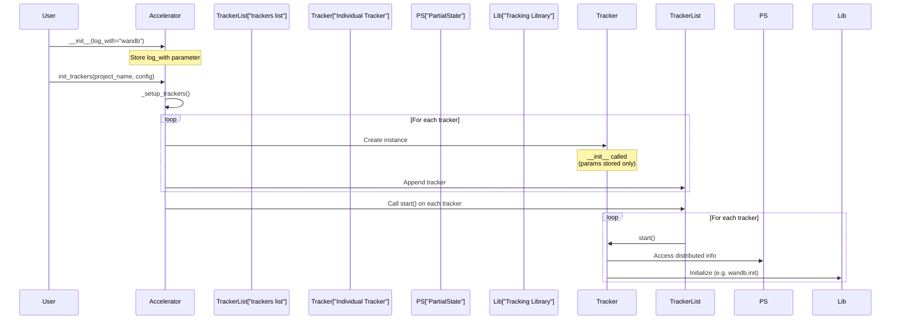
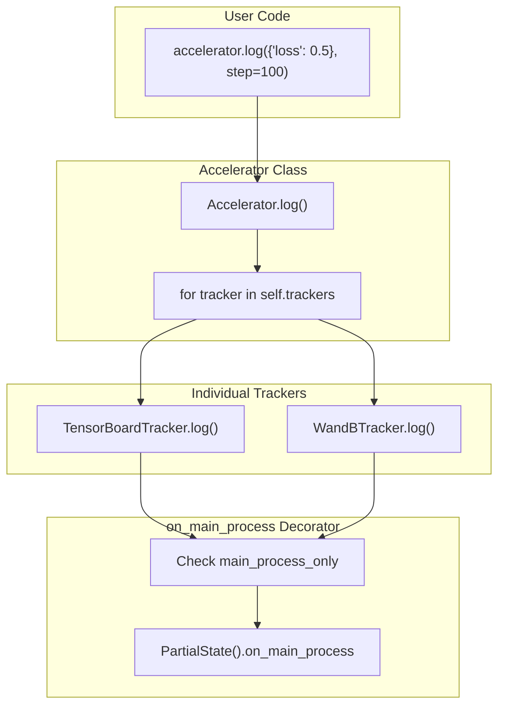

<!-- source: DeepWiki mcp.deepwiki.com · repo huggingface/accelerate · page 11.1 Tracker Integration · fetched 2026-10-21 -->

# Tracker Integration

<details>
<summary>Relevant source files</summary>

The following files were used as context for generating this wiki page:

- [docs/source/package_reference/tracking.md](docs/source/package_reference/tracking.md)
- [docs/source/usage_guides/tracking.md](docs/source/usage_guides/tracking.md)
- [examples/by_feature/README.md](examples/by_feature/README.md)
- [src/accelerate/tracking.py](src/accelerate/tracking.py)
- [tests/test_examples.py](tests/test_examples.py)
- [tests/test_tracking.py](tests/test_tracking.py)

</details>


## Purpose and Scope

Tracker integration provides a unified interface for logging experiments to various tracking services (TensorBoard, WandB, MLflow, etc.) in distributed training environments. This document covers the `GeneralTracker` interface, available tracker implementations, initialization workflow, and how trackers coordinate with multi-process execution.

For information about general logging patterns and multi-process coordination, see [Logging and Multi-Process Coordination](#11.2). For information about using trackers in training scripts via the `Accelerator` API, see [The Accelerator Class](#2).

## Architecture Overview

The tracker integration system is built around a base `GeneralTracker` class that defines a common interface for all tracking services. Each tracker implementation inherits from this base class and adapts a specific tracking library's API to work seamlessly in distributed environments.

### GeneralTracker Base Class

The `GeneralTracker` class at [src/accelerate/tracking.py:102-177]() defines the core interface that all trackers must implement:

**Required Properties:**
- `name` (`str`): Unique identifier for the tracker (e.g., `"tensorboard"`, `"wandb"`) [src/accelerate/tracking.py:111-111]()
- `requires_logging_directory` (`bool`): Whether the tracker needs a directory for storing logs [src/accelerate/tracking.py:111-112]()
- `tracker` (`@property`): Returns the underlying tracking library's object (e.g., TensorBoard's `SummaryWriter`, WandB's `run`) [src/accelerate/tracking.py:112-113]()

**Required Methods:**
- `start()`: Lazy initialization of the tracker, called after `Accelerator` initializes distributed state [src/accelerate/tracking.py:143-147]()
- `store_init_configuration(values: dict)`: Logs initial hyperparameters/configuration [src/accelerate/tracking.py:149-158]()
- `log(values: dict, step: Optional[int], **kwargs)`: Logs metrics during training [src/accelerate/tracking.py:160-170]()
- `finish()`: Cleanup and finalization when training ends [src/accelerate/tracking.py:172-177]()

**Multi-Process Control:**
- `main_process_only` (`bool`, default `True`): Whether tracker operations should only execute on the main process [src/accelerate/tracking.py:119-119]()

Sources: [src/accelerate/tracking.py:102-177]()

### Tracker Architecture Diagram

```mermaid
graph TB
    subgraph "Base Interface"
        GT["GeneralTracker<br/>(base class)"]
    end
    
    subgraph "Tracker Implementations"
        TBT["TensorBoardTracker<br/>name='tensorboard'<br/>requires_logging_directory=True"]
        WBT["WandBTracker<br/>name='wandb'<br/>requires_logging_directory=False"]
        COMET["CometMLTracker<br/>name='comet_ml'<br/>requires_logging_directory=False"]
        AIM["AimTracker<br/>name='aim'<br/>requires_logging_directory=True"]
        MLF["MLflowTracker<br/>name='mlflow'<br/>requires_logging_directory=False"]
        CLEAR["ClearMLTracker<br/>name='clearml'<br/>requires_logging_directory=False"]
        DVC["DVCLiveTracker<br/>name='dvclive'<br/>requires_logging_directory=True"]
        SWAN["SwanLabTracker<br/>name='swanlab'<br/>requires_logging_directory=False"]
        TRACKIO["TrackioTracker<br/>name='trackio'<br/>requires_logging_directory=False"]
    end
    
    subgraph "Required Interface"
        START["start()"]
        STORE["store_init_configuration(values)"]
        LOG["log(values, step, **kwargs)"]
        FINISH["finish()"]
        PROP["@property tracker"]
    end
    
    GT --> TBT
    GT --> WBT
    GT --> COMET
    GT --> AIM
    GT --> MLF
    GT --> CLEAR
    GT --> DVC
    GT --> SWAN
    GT --> TRACKIO
    
    GT -.implements.-> START
    GT -.implements.-> STORE
    GT -.implements.-> LOG
    GT -.implements.-> FINISH
    GT -.implements.-> PROP
```



Sources: [src/accelerate/tracking.py:102-177](), [src/accelerate/tracking.py:179-295](), [src/accelerate/tracking.py:297-429](), [src/accelerate/tracking.py:1134-1195]()

### The on_main_process Decorator

The `on_main_process` decorator at [src/accelerate/tracking.py:78-94]() is critical for multi-process coordination. It checks the tracker's `main_process_only` attribute at execution time to determine whether to run the decorated function using `PartialState().on_main_process`:

```python
@on_main_process
def log(self, values: dict, step: Optional[int] = None, **kwargs):
    # This only executes if main_process_only=True and we're on the main process
    # OR if main_process_only=False (executes on all processes)
```

This design prevents premature initialization of `PartialState` before the `Accelerator` has configured the distributed environment [src/accelerate/tracking.py:83-85]().

Sources: [src/accelerate/tracking.py:78-94](), [tests/test_tracking.py:779-871]()

## Available Trackers

Accelerate provides nine built-in tracker implementations. The system automatically detects which trackers are available based on installed packages [src/accelerate/tracking.py:46-73]().

### Tracker Feature Matrix

| Tracker | Class Name | Requires Directory | Main Process Only | Special Features |
|---------|-----------|-------------------|-------------------|------------------|
| TensorBoard | `TensorBoardTracker` | Yes | Yes | Stores hparams as YAML [src/accelerate/tracking.py:193-244]() |
| WandB | `WandBTracker` | No | False | Table logging, image logging [src/accelerate/tracking.py:310-410]() |
| Trackio | `TrackioTracker` | No | False | Track.io integration [src/accelerate/tracking.py:431-482]() |
| CometML | `CometMLTracker` | No | Yes | Version-aware initialization [src/accelerate/tracking.py:535-566]() |
| Aim | `AimTracker` | Yes | Yes | Image logging with captions [src/accelerate/tracking.py:610-670]() |
| MLflow | `MLflowTracker` | No | Yes | Figure/artifact logging, parameter batching [src/accelerate/tracking.py:705-910]() |
| ClearML | `ClearMLTracker` | No | Yes | Table logging, automatic categorization [src/accelerate/tracking.py:912-1034]() |
| DVCLive | `DVCLiveTracker` | Yes | Yes | DVC integration, Git support [src/accelerate/tracking.py:1036-1132]() |
| SwanLab | `SwanLabTracker` | No | Yes | Hardware monitoring, image logging [src/accelerate/tracking.py:1134-1195]() |

Sources: [src/accelerate/tracking.py:179-1195]()

### Tracker Discovery

The available trackers are detected at import time using utility functions:

```python
_available_trackers = []

if is_tensorboard_available():
    _available_trackers.append(LoggerType.TENSORBOARD)
# ... similar checks for other trackers
```

The `get_available_trackers()` function at [src/accelerate/tracking.py:97-99]() returns the list of currently available trackers in the system.

Sources: [src/accelerate/tracking.py:46-73](), [src/accelerate/tracking.py:97-99]()

### TensorBoardTracker

`TensorBoardTracker` at [src/accelerate/tracking.py:179-295]() integrates with TensorBoard:

**Initialization Parameters:**
- `run_name`: Experiment run name [src/accelerate/tracking.py:184-185]()
- `logging_dir`: Location for TensorBoard logs [src/accelerate/tracking.py:186-187]()
- `**kwargs`: Passed to `SummaryWriter` [src/accelerate/tracking.py:188-189]()

**Special Behaviors:**
- Stores hyperparameters both via `add_hparams` and as a separate `hparams.yml` file [src/accelerate/tracking.py:228-244]()
- Falls back to `tensorboardX` if `torch.utils.tensorboard` is missing [src/accelerate/tracking.py:204-207]()

Sources: [src/accelerate/tracking.py:179-295]()

### WandBTracker

`WandBTracker` at [src/accelerate/tracking.py:297-429]() provides WandB integration:

**Special Behaviors:**
- `main_process_only = False`: WandB handles multi-process coordination internally [src/accelerate/tracking.py:310-310]()
- Supports table logging via `log_table` [src/accelerate/tracking.py:383-410]()
- Offline mode detection via `WANDB_MODE` environment variable [src/accelerate/tracking.py:330-335]()

Sources: [src/accelerate/tracking.py:297-429]()

## Initialization Workflow

The tracker initialization process is deferred to avoid premature initialization of distributed state.

### Initialization Sequence Diagram



Sources: [src/accelerate/tracking.py:143-147](), [docs/source/usage_guides/tracking.md:44-48]()

### Two-Phase Initialization

The tracker initialization follows a two-phase pattern:

1. **Phase 1: Construction** (`__init__`): Store parameters without accessing distributed state [src/accelerate/tracking.py:195-200]().
2. **Phase 2: Start** (`start()`): Called after `Accelerator` has configured the distributed environment. Safe to access `PartialState` [src/accelerate/tracking.py:202-220]().

Sources: [src/accelerate/tracking.py:143-147](), [tests/test_tracking.py:779-871]()

## Logging Workflow

### Log Call Flow



Sources: [src/accelerate/tracking.py:78-94](), [docs/source/usage_guides/tracking.md:50-54]()

### Value Type Handling

**TensorBoardTracker** [src/accelerate/tracking.py:246-268]():
- `int`/`float` → `add_scalar`
- `str` → `add_text`
- `dict` → `add_scalars`

**MLflowTracker** [src/accelerate/tracking.py:825-847]():
- Only numeric values logged as metrics.
- Strings/others logged as parameters or skipped.

Sources: [src/accelerate/tracking.py:246-268](), [src/accelerate/tracking.py:825-847]()

## Custom Tracker Implementation

To implement a new tracker, inherit from `GeneralTracker` and implement the required properties and methods [src/accelerate/tracking.py:102-117]().

```python
from accelerate.tracking import GeneralTracker, on_main_process

class MyCustomTracker(GeneralTracker):
    name = "my_tracker"
    requires_logging_directory = False

    @on_main_process
    def __init__(self, run_name: str):
        self.run_name = run_name

    @property
    def tracker(self):
        return self.run

    @on_main_process
    def start(self):
        # Initialize library here
        pass

    @on_main_process
    def log(self, values: dict, step: Optional[int] = None):
        # Log values here
        pass
```

Sources: [docs/source/usage_guides/tracking.md:104-156](), [src/accelerate/tracking.py:102-177]()

### Registering Custom Trackers

Custom trackers can be registered by name using `register_tracker_class(tracker_class)` at [src/accelerate/tracking.py:1210-1215](). This allows them to be used via the `log_with` string parameter in the `Accelerator` [docs/source/usage_guides/tracking.md:173-185]().

Sources: [src/accelerate/tracking.py:1210-1215](), [docs/source/usage_guides/tracking.md:173-185]()

---

