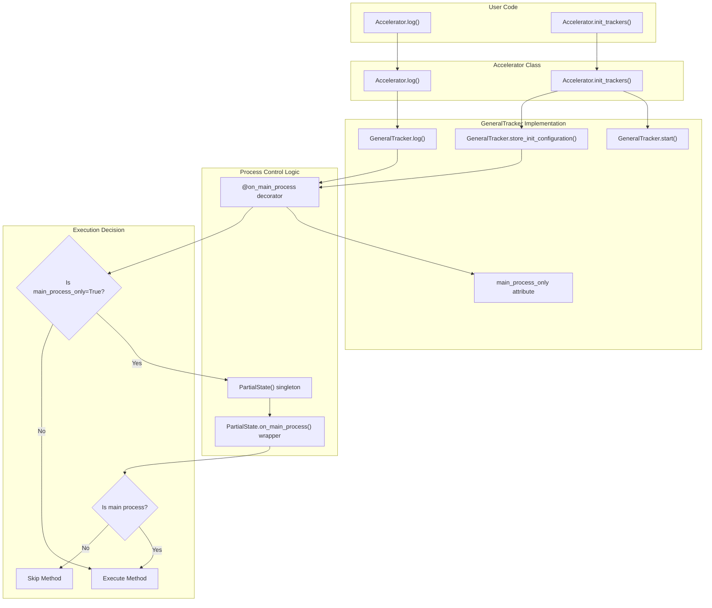
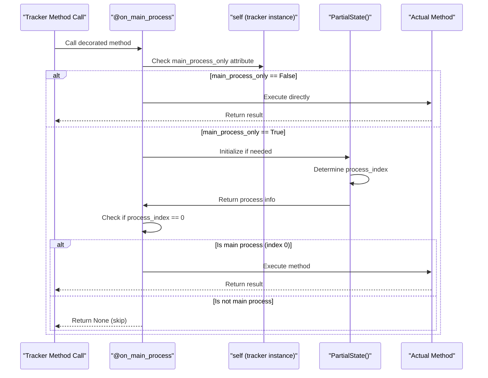
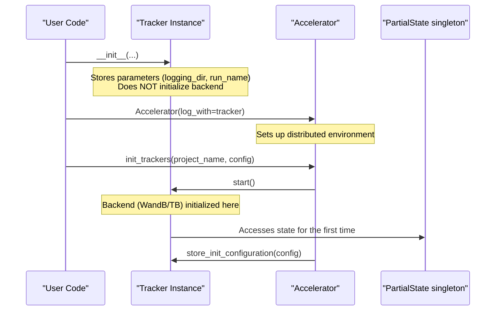

<!-- source: DeepWiki mcp.deepwiki.com · repo huggingface/accelerate · page 11.2 Logging and Multi-Process Coordination · fetched 2026-10-21 -->

# Logging and Multi-Process Coordination

<details>
<summary>Relevant source files</summary>

The following files were used as context for generating this wiki page:

- [docs/source/package_reference/tracking.md](docs/source/package_reference/tracking.md)
- [docs/source/usage_guides/tracking.md](docs/source/usage_guides/tracking.md)
- [examples/by_feature/README.md](examples/by_feature/README.md)
- [src/accelerate/logging.py](src/accelerate/logging.py)
- [src/accelerate/scheduler.py](src/accelerate/scheduler.py)
- [src/accelerate/tracking.py](src/accelerate/tracking.py)
- [tests/test_examples.py](tests/test_examples.py)
- [tests/test_logging.py](tests/test_logging.py)
- [tests/test_scheduler.py](tests/test_scheduler.py)
- [tests/test_tracking.py](tests/test_tracking.py)

</details>


This page documents how Accelerate's experiment tracking system coordinates logging operations across multiple processes in distributed training. When training across multiple GPUs, TPUs, or nodes, Accelerate ensures that logging operations occur efficiently without duplication or race conditions.

For general tracker integration and initialization, see [Tracker Integration](#11.1). For implementing custom trackers, see [Custom Trackers](#11.3).

## Purpose and Scope

In distributed training environments, multiple processes run simultaneously—one per GPU, TPU core, or compute node. Without coordination, each process would write logs independently, resulting in:

- **Duplicate metrics**: The same metric logged N times (once per process).
- **Conflicting writes**: Multiple processes writing to the same file simultaneously (e.g., TensorBoard).
- **Initialization races**: Distributed state initialized before proper configuration (e.g., before `InitProcessGroupKwargs` are applied).

This document explains the mechanisms Accelerate provides to solve these problems through selective execution decorators, process-aware attributes, and deferred initialization patterns.

## Multi-Process Coordination Architecture



**Multi-Process Coordination Flow**

The system uses a decorator pattern that checks two conditions before executing tracker methods: whether the tracker requires single-process execution (the `main_process_only` attribute) and whether the current process is the main process (via `PartialState`).

Sources: [src/accelerate/tracking.py:78-180](), [src/accelerate/state.py:29-30]()

## The `on_main_process` Decorator

The `on_main_process` decorator is the core mechanism for selective execution. It wraps tracker methods to conditionally execute them based on the tracker's configuration and the current process's identity.



**Decorator Execution Flow**

The decorator checks at function execution time rather than initialization time. This is critical because it prevents triggering the initialization of `PartialState` before the user has had a chance to configure distributed settings via `Accelerator` or `InitProcessGroupKwargs`.

### Implementation Details

The decorator is defined at [src/accelerate/tracking.py:78-94]():

```python
def on_main_process(function):
    @wraps(function)
    def execute_on_main_process(self, *args, **kwargs):
        if getattr(self, "main_process_only", False):
            return PartialState().on_main_process(function)(self, *args, **kwargs)
        else:
            return function(self, *args, **kwargs)

    return execute_on_main_process
```

Key characteristics:
- **Timing**: Checks `main_process_only` at execution time.
- **Attribute Access**: Uses `getattr(self, "main_process_only", False)` to allow flexibility in custom implementations.
- **Delegation**: If restricted, it wraps the call in `PartialState().on_main_process(function)`, which performs the rank check.

Sources: [src/accelerate/tracking.py:78-94]()

## The `main_process_only` Attribute

Each tracker class defines a `main_process_only` attribute. This toggles whether relevant logging, initialization, and other functions should occur only on the main process or across all processes. By default, `GeneralTracker` sets this to `True`.

### Configuration by Tracker

| Tracker Class | `main_process_only` | Rationale |
|---------------|---------------------|-----------|
| `GeneralTracker` | `True` | Safe default for most trackers [src/accelerate/tracking.py:119]() |
| `TensorBoardTracker` | `True` | Writes to local filesystem; concurrent writes cause corruption [src/accelerate/tracking.py:192]() |
| `WandBTracker` | `False` | WandB SDK handles multi-process synchronization internally [src/accelerate/tracking.py:310]() |
| `TrackioTracker` | `False` | TrackIO handles process coordination [src/accelerate/tracking.py:437]() |
| `SwanLabTracker` | `False` | SwanLab manages its own process synchronization [src/accelerate/tracking.py:1162]() |
| `CometMLTracker` | `True` | CometML typically expects single-process logging [src/accelerate/tracking.py:494]() |
| `AimTracker` | `True` | Aim writes to a local repository [src/accelerate/tracking.py:598]() |
| `MLflowTracker` | `True` | MLflow tracks a single experiment per process [src/accelerate/tracking.py:688]() |
| `ClearMLTracker` | `True` | ClearML manages per-process experiments [src/accelerate/tracking.py:825]() |
| `DVCLiveTracker` | `True` | DVCLive writes to the local filesystem [src/accelerate/tracking.py:943]() |

Sources: [src/accelerate/tracking.py:119-1162]()

## Logging and Configuration Methods

### `store_init_configuration(values: dict)`

This method logs hyperparameters for the run. Implementations use the experiment configuration functionality of the specific tracking API (e.g., `wandb.config`).

- **Decorator**: Always decorated with `@on_main_process` in concrete implementations.
- **Behavior**: If `main_process_only` is `True`, only the main process logs the config. If `False`, all processes log it (allowing the backend to aggregate).

Sources: [src/accelerate/tracking.py:149-158](), [src/accelerate/tracking.py:222-243]()

### `log(values: dict, step: Optional[int] = None, **kwargs)`

Logs metrics to the current run. 

- **Decorator**: Always decorated with `@on_main_process`.
- **Data Types**: Values should typically be `str`, `float`, or `int`. Accelerate handles converting `torch.Tensor` to scalars if necessary within the specific tracker implementation.

Sources: [src/accelerate/tracking.py:160-170](), [src/accelerate/tracking.py:246-269]()

## Deferred Initialization Pattern

Trackers implement a deferred initialization pattern using the `start()` method. This prevents premature initialization of `PartialState`.



**Deferred Initialization Timeline**

### Why Deferred Initialization Matters
If a tracker initialized its backend in `__init__`, it might call `PartialState()` before the user has configured the `Accelerator`. This could lead to the distributed backend being initialized with default settings rather than the user's specific requirements (like custom `NCCL` timeouts or `device_placement`).

- **`__init__`**: Should only store configuration parameters [src/accelerate/tracking.py:195-200]().
- **`start()`**: Overridden by subclasses to perform the actual backend initialization (e.g., `wandb.init` or `SummaryWriter`) [src/accelerate/tracking.py:202-215](), [src/accelerate/tracking.py:317-325]().

Sources: [src/accelerate/tracking.py:143-147](), [src/accelerate/tracking.py:202-215](), [src/accelerate/tracking.py:317-325]()

## Multi-Process Logging Adapter

Outside of experiment trackers, Accelerate provides a `MultiProcessAdapter` for standard Python logging. This adapter ensures that logs are coordinated across processes.

### `MultiProcessAdapter.log()`
This method takes an additional `main_process_only` kwarg (defaulting to `True`).

- **`main_process_only=True`**: Only the main process emits the log.
- **`in_order=True`**: Processes log one by one in rank order. This is achieved by iterating through processes and using `state.wait_for_everyone()` to synchronize.

Sources: [src/accelerate/logging.py:23-31](), [src/accelerate/logging.py:49-80]()

```python
# Example from accelerate/logging.py
def log(self, level, msg, *args, **kwargs):
    # ...
    in_order = kwargs.pop("in_order", False)
    if in_order:
        state = PartialState()
        for i in range(state.num_processes):
            if i == state.process_index:
                self.logger.log(level, msg, *args, **kwargs)
            state.wait_for_everyone()
```
Sources: [src/accelerate/logging.py:74-79]()

## Testing Coordination
The `tests/test_tracking.py` file includes specific tests to ensure that trackers do not initialize the distributed state prematurely.

```python
# From tests/test_tracking.py
def test_tensorboard_deferred_init(self):
    with tempfile.TemporaryDirectory() as dirpath:
        PartialState._reset_state()
        tracker = TensorBoardTracker("test_project", dirpath)
        # Check that PartialState was not initialized
        self.assertEqual(PartialState._shared_state, {})
        accelerator = Accelerator(log_with=tracker, project_dir=dirpath)
        # Now it should be initialized
        self.assertNotEqual(PartialState._shared_state, {})
```
Sources: [tests/test_tracking.py:788-795]()

## Summary of Key Coordination Entities

| Entity | Role | Source |
|--------|------|--------|
| `on_main_process` | Decorator that filters execution based on rank and `main_process_only`. | [src/accelerate/tracking.py:78]() |
| `GeneralTracker.start()` | Lazy initialization hook called after distributed setup. | [src/accelerate/tracking.py:143]() |
| `MultiProcessAdapter` | Logger adapter that handles `main_process_only` and `in_order` logging. | [src/accelerate/logging.py:23]() |
| `PartialState` | Singleton providing `process_index` and `is_main_process` flags. | [src/accelerate/state.py:29]() |

Sources: [src/accelerate/tracking.py:78-147](), [src/accelerate/logging.py:23-80](), [src/accelerate/state.py:29-30]()

---

