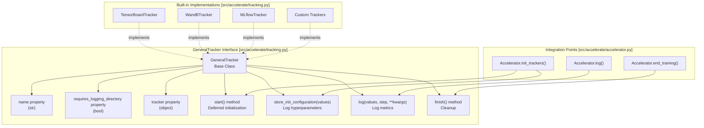
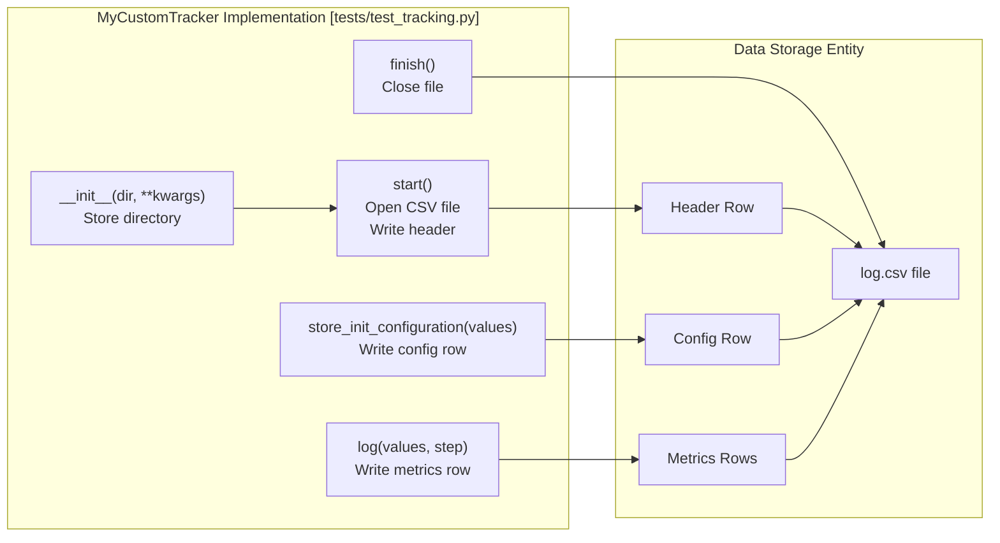

<!-- source: DeepWiki mcp.deepwiki.com · repo huggingface/accelerate · page 11.3 Custom Trackers · fetched 2026-10-21 -->

# Custom Trackers

<details>
<summary>Relevant source files</summary>

The following files were used as context for generating this wiki page:

- [docs/source/package_reference/tracking.md](docs/source/package_reference/tracking.md)
- [docs/source/usage_guides/tracking.md](docs/source/usage_guides/tracking.md)
- [examples/by_feature/README.md](examples/by_feature/README.md)
- [src/accelerate/tracking.py](src/accelerate/tracking.py)
- [tests/test_examples.py](tests/test_examples.py)
- [tests/test_tracking.py](tests/test_tracking.py)

</details>


This page documents how to implement custom experiment tracking integrations by extending the `GeneralTracker` base class. For general information about using built-in trackers, see [Tracker Integration](#11.1). For details on multi-process logging coordination, see [Logging and Multi-Process Coordination](#11.2).

## Overview

Accelerate provides a `GeneralTracker` base class that allows users to integrate any experiment tracking platform not natively supported by the library. By implementing this interface, custom trackers can be used seamlessly with the `Accelerator.init_trackers()` and `Accelerator.log()` methods alongside built-in trackers.

**Sources:** [src/accelerate/tracking.py:102-117]()

## GeneralTracker Base Class

The `GeneralTracker` class defines the interface that all experiment trackers must implement. It provides a standardized way to initialize tracking experiments, log metrics, and perform cleanup operations.

Title: GeneralTracker Architecture and Integration


**Sources:** [src/accelerate/tracking.py:102-179]()

## Required Attributes and Methods

### Required Properties

All custom trackers must define three properties:

| Property | Type | Description |
|----------|------|-------------|
| `name` | `str` | String identifier for the tracker (e.g., `"tensorboard"`, `"wandb"`) |
| `requires_logging_directory` | `bool` | Whether the tracker needs a directory to store logs |
| `tracker` | `object` | The underlying tracking object (e.g., `tensorboard.SummaryWriter`, `wandb.run`) |

The `__init__` method validates these properties and raises `NotImplementedError` if any are missing:

[src/accelerate/tracking.py:121-141]()

### Required Methods

Custom trackers should implement the following methods:

#### `start()`

Called during `Accelerator.init_trackers()` to perform lazy initialization. This method should initialize the underlying tracking client and avoid initializing `PartialState` before the `Accelerator` has configured the distributed environment.

[src/accelerate/tracking.py:143-147]()

#### `store_init_configuration(values: dict)`

Logs initial hyperparameters and configuration values. Called once at the beginning of training.

[src/accelerate/tracking.py:149-159]()

#### `log(values: dict, step: Optional[int], **kwargs)`

Logs metrics during training. Called by `Accelerator.log()`.

[src/accelerate/tracking.py:160-171]()

#### `finish()`

Performs cleanup operations when training ends. Called by `Accelerator.end_training()`.

[src/accelerate/tracking.py:173-177]()

## Multi-Process Coordination

### The `main_process_only` Attribute

Custom trackers can set the `main_process_only` class attribute to control whether operations should only execute on the main process:

[src/accelerate/tracking.py:119]()

When `main_process_only=True`, methods decorated with `@on_main_process` will only execute on the main process (process with `local_rank=0`). When `False`, all processes execute the methods.

**Examples:**
- `TensorBoardTracker.main_process_only = True` [src/accelerate/tracking.py:193]()
- `WandBTracker.main_process_only = False` [src/accelerate/tracking.py:310]()

### The `on_main_process` Decorator

The `@on_main_process` decorator checks the `main_process_only` attribute at function execution time:

[src/accelerate/tracking.py:78-94]()

Apply this decorator to methods that should respect the `main_process_only` setting, such as `start` or `log`.

**Sources:** [src/accelerate/tracking.py:78-94](), [src/accelerate/tracking.py:201-202](), [src/accelerate/tracking.py:228-229]()

## Registering Custom Trackers

Instead of passing an instance of a tracker, you can register a tracker class so it can be selected by its `name` string. This is useful for CLI-based configuration.

```python
from accelerate.tracking import register_tracker_class

register_tracker_class(MyCustomTracker)
```

**Sources:** [src/accelerate/tracking.py:1251-1259]()

## Complete Implementation Example

Title: Custom Tracker Logic Flow


**Implementation (Based on `tests/test_tracking.py`):**

[tests/test_tracking.py:645-687]()

## Using Custom Trackers with Accelerator

Title: Tracker Lifecycle in Accelerator

```mermaid
graph TB
    subgraph "Initialization Flow"
        Create["tracker = MyCustomTracker(dir='/tmp/logs')"]
        AccelInit["accelerator = Accelerator(log_with=tracker)"]
        InitTrackers["accelerator.init_trackers('project_name', config)"]
        FilterCheck["filter_trackers() validates tracker"]
        StartCall["tracker.start() called"]
        StoreConfig["tracker.store_init_configuration(config)"]
    end
    
    subgraph "Training Loop"
        LogMetrics["accelerator.log(values, step=i)"]
        TrackerLog["tracker.log(values, step=i)"]
    end
    
    subgraph "Cleanup"
        EndTraining["accelerator.end_training()"]
        TrackerFinish["tracker.finish()"]
    end
    
    Create --> AccelInit
    AccelInit --> InitTrackers
    InitTrackers --> FilterCheck
    FilterCheck --> StartCall
    StartCall --> StoreConfig
    
    LogMetrics --> TrackerLog
    
    EndTraining --> TrackerFinish
```


### Combining with Built-in Trackers

Custom trackers can be combined with built-in trackers by passing a list to `log_with`. The `filter_trackers` function handles the validation of both string identifiers and custom instances.

[src/accelerate/tracking.py:1262-1317]()

## Deferred Initialization Pattern

The `start()` method implements deferred initialization to prevent premature initialization of `PartialState` (and thus `torch.distributed`) before the `Accelerator` has configured the distributed environment with `InitProcessGroupKwargs`.

### Implementation Guidelines

1. **In `__init__`**: Only store configuration, don't access `PartialState` or initialize clients.
2. **In `start()`**: Initialize the tracking client, create connections, access `PartialState` if needed.

**Sources:** [src/accelerate/tracking.py:143-147](), [tests/test_tracking.py:779-870]()

## Summary Table

| Component | Purpose | Required | Key Methods |
|-----------|---------|----------|-------------|
| `name` | Tracker identifier | Yes | Property |
| `requires_logging_directory` | Directory requirement flag | Yes | Property |
| `tracker` | Underlying client object | Yes | Property |
| `start()` | Deferred initialization | Recommended | Called by `init_trackers()` |
| `store_init_configuration()` | Log hyperparameters | Recommended | Called by `init_trackers()` |
| `log()` | Log metrics | Required | Called by `log()` |
| `finish()` | Cleanup | Optional | Called by `end_training()` |
| `main_process_only` | Multi-process control | Optional | Attribute (default: `True`) |

**Sources:** [src/accelerate/tracking.py:102-180](), [src/accelerate/tracking.py:78-94]()

---

