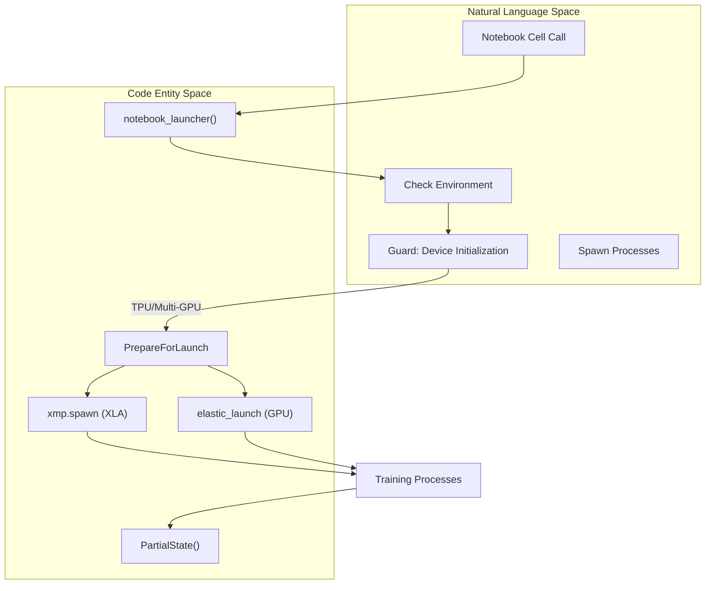
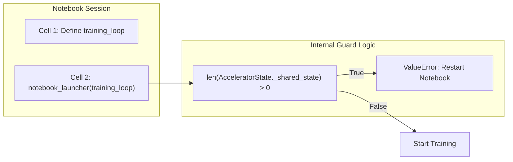

<!-- source: DeepWiki mcp.deepwiki.com · repo huggingface/accelerate · page 12 Notebook Support · fetched 2026-10-21 -->

# Notebook Support

<details>
<summary>Relevant source files</summary>

The following files were used as context for generating this wiki page:

- [docs/source/basic_tutorials/install.md](docs/source/basic_tutorials/install.md)
- [docs/source/basic_tutorials/launch.md](docs/source/basic_tutorials/launch.md)
- [docs/source/basic_tutorials/migration.md](docs/source/basic_tutorials/migration.md)
- [docs/source/basic_tutorials/notebook.md](docs/source/basic_tutorials/notebook.md)
- [docs/source/quicktour.md](docs/source/quicktour.md)
- [docs/source/usage_guides/big_modeling.md](docs/source/usage_guides/big_modeling.md)
- [docs/source/usage_guides/quantization.md](docs/source/usage_guides/quantization.md)
- [src/accelerate/launchers.py](src/accelerate/launchers.py)
- [src/accelerate/test_utils/scripts/test_notebook.py](src/accelerate/test_utils/scripts/test_notebook.py)
- [src/accelerate/utils/environment.py](src/accelerate/utils/environment.py)

</details>


This page documents Accelerate's support for running distributed training from interactive notebook environments such as Jupyter, Google Colab, and Kaggle notebooks. It primarily covers the `notebook_launcher` function, which enables multi-process distributed training to be initiated from within a single notebook cell.

For information about launching training from the command line, see [accelerate launch](#6.1). For general Accelerator usage patterns, see [The Accelerator Class](#2).

## Overview

The `notebook_launcher` function provides a way to run distributed training code from interactive Python environments where traditional multi-process launchers (like `torch.distributed.run`) cannot be used. This is particularly valuable for:

- Training on Google Colab or Kaggle TPU instances using `torch_xla` [src/accelerate/launchers.py:138-142]().
- Multi-GPU training in notebook environments using `torch.distributed.launcher` [src/accelerate/launchers.py:170-171]().
- Rapid prototyping and debugging in local Jupyter notebooks.

The notebook launcher handles the complexity of spawning multiple processes from within a single Python interpreter session, coordinating their execution, and ensuring that hardware is not initialized prematurely in the parent process [src/accelerate/launchers.py:64-68]().

## Core Functionality

### The notebook_launcher Function

The primary entry point for notebook-based distributed training is the `notebook_launcher` function, defined in `src/accelerate/launchers.py` [src/accelerate/launchers.py:43-59]().

```python
from accelerate import notebook_launcher

notebook_launcher(training_function, args=(), num_processes=None, mixed_precision="fp16")
```

The function wraps a user-defined training function and executes it across multiple processes. It performs environment detection to identify if it is running in Colab, Kaggle, or a standard Jupyter environment [src/accelerate/launchers.py:123-130]().

### Child Pages

For more detailed technical information on the launcher's parameters and internal mechanics, see the following child page:

- [notebook_launcher Function](#12.1) — Documents parameters, TPU-specific `xla_spawn` integration, device re-initialization checks, and `debug_launcher` for CPU testing.

## Architecture and Execution Flow

### Launcher Selection Logic

The `notebook_launcher` determines the appropriate distributed backend based on the environment and requested resources.

| Environment | Detected Hardware | Backend Used | Code Entity |
| :--- | :--- | :--- | :--- |
| Colab/Kaggle | TPU | XLA | `torch_xla.distributed.xla_multiprocessing.spawn` [src/accelerate/launchers.py:142-153]() |
| Any | Multi-GPU | PyTorch Elastic | `torch.distributed.launcher.api.elastic_launch` [src/accelerate/launchers.py:170-188]() |
| Colab | Single GPU/CPU | Direct | `function(*args)` [src/accelerate/launchers.py:160]() |

### From Notebook to Distributed Processes

The following diagram illustrates how `notebook_launcher` bridges the gap between the interactive notebook session and the distributed execution environment.

**Diagram: Notebook Launcher Execution Flow**

**Sources:** [src/accelerate/launchers.py:43-188](), [src/accelerate/test_utils/scripts/test_notebook.py:24-31]()

## Constraints and Best Practices

### Device Initialization Guard
A critical constraint of the notebook launcher is that **zero calls to a device** (CUDA, XPU, or TPU) must be made in the notebook session before calling the launcher [src/accelerate/launchers.py:64-68](). If a device is initialized in the parent process, forking children will result in a "bad fork" state [src/accelerate/test_utils/scripts/test_notebook.py:53-57]().

Accelerate provides a safety check: setting `ACCELERATE_DEBUG_MODE="1"` runs a test before launching to ensure no device calls have been made [src/accelerate/launchers.py:69-71]().

### State Management
The `Accelerator` should only be initialized **inside** the training function [src/accelerate/launchers.py:144-149](). If the `AcceleratorState` is detected as already initialized in the notebook session, the launcher will raise a `ValueError` [src/accelerate/launchers.py:174-179]().

**Diagram: State Initialization Guard**

**Sources:** [src/accelerate/launchers.py:144-149](), [src/accelerate/launchers.py:174-179](), [docs/source/basic_tutorials/notebook.md:39-43]()

## Comparison with CLI Launch

| Feature | `accelerate launch` (CLI) | `notebook_launcher` |
| :--- | :--- | :--- |
| **Configuration** | Uses `default_config.yaml` or CLI flags [docs/source/quicktour.md:28-37]() | Uses function arguments like `num_processes` [src/accelerate/launchers.py:46]() |
| **Process Model** | Subprocess management via shell [docs/source/basic_tutorials/launch.md:79-81]() | Fork/Spawn from current Python process [src/accelerate/launchers.py:153]() |
| **Debugging** | Standard CLI output | Integrated notebook cell output |
| **Device Detection** | Uses `get_current_device_type` [src/accelerate/utils/environment.py:101-112]() | Direct detection of Colab/Kaggle environments [src/accelerate/launchers.py:123-130]() |

**Sources:** [src/accelerate/launchers.py:43-188](), [docs/source/basic_tutorials/launch.md:79-111](), [src/accelerate/utils/environment.py:101-112]()

---

