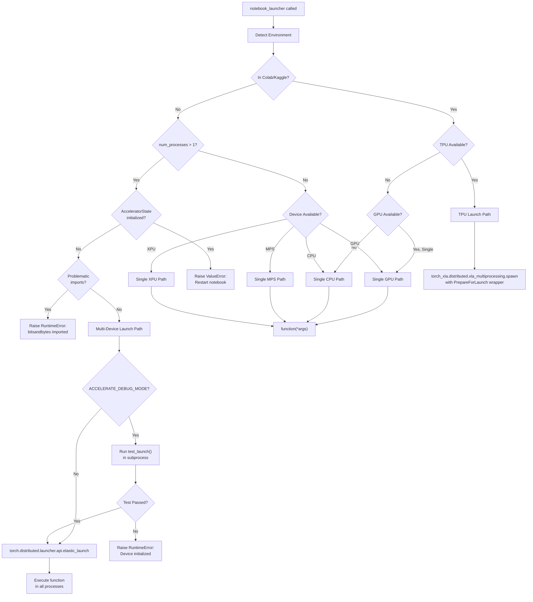
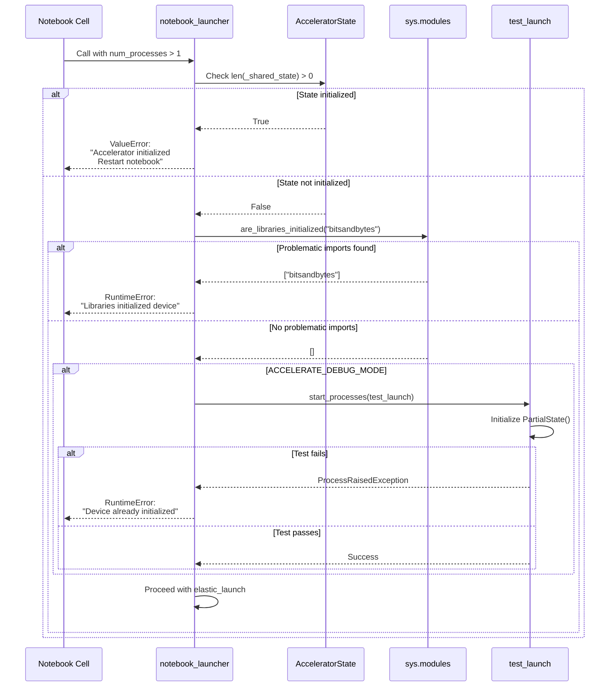
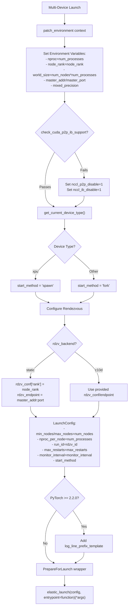
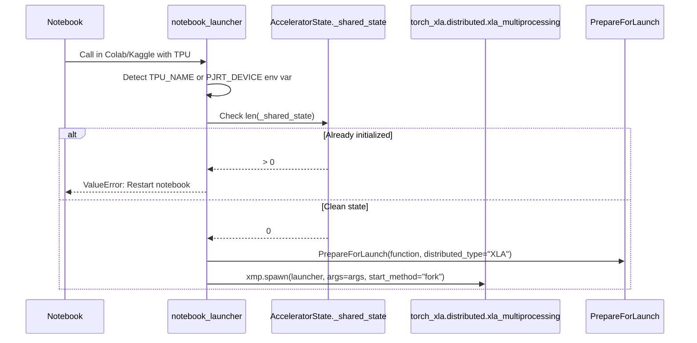

<!-- source: DeepWiki mcp.deepwiki.com · repo huggingface/accelerate · page 12.1 notebook_launcher Function · fetched 2026-10-21 -->

# notebook_launcher Function

<details>
<summary>Relevant source files</summary>

The following files were used as context for generating this wiki page:

- [src/accelerate/launchers.py](src/accelerate/launchers.py)
- [src/accelerate/test_utils/scripts/test_notebook.py](src/accelerate/test_utils/scripts/test_notebook.py)
- [src/accelerate/utils/environment.py](src/accelerate/utils/environment.py)

</details>


The `notebook_launcher` function provides a specialized mechanism for launching distributed training from interactive notebook environments (Jupyter, Google Colab, Kaggle). It handles the complexities of multi-process execution in notebook contexts, particularly for TPU environments, and includes safeguards against common initialization errors that break forked subprocesses.

For general command-line launching, see **accelerate launch** ([6.1]()). For low-level distributed configuration, see **Distributed Operations and Utilities** ([9]()).

## Overview and Purpose

The `notebook_launcher` abstracts the complexity of starting distributed training processes from within a notebook cell. Unlike command-line scripts where you can simply use `accelerate launch`, notebooks require special handling because:

1.  **Device Initialization**: Notebooks often initialize CUDA/TPU devices before the launcher runs, which breaks fork-based multiprocessing.
2.  **TPU Environments**: Colab/Kaggle TPU environments require XLA-specific spawning mechanisms via `torch_xla.distributed.xla_multiprocessing`.
3.  **Import Side Effects**: Some libraries (e.g., `bitsandbytes`) initialize devices on import, causing fork failures.

The function detects the environment, validates that no device initialization has occurred, and dispatches to the appropriate launcher (XLA spawn, elastic launch, or direct execution).

Sources: [src/accelerate/launchers.py:43-122]()

## Function Signature and Parameters

```python
def notebook_launcher(
    function,
    args=(),
    num_processes=None,
    mixed_precision="no",
    use_port="29500",
    master_addr="127.0.0.1",
    node_rank=0,
    num_nodes=1,
    rdzv_backend="static",
    rdzv_endpoint="",
    rdzv_conf=None,
    rdzv_id="none",
    max_restarts=0,
    monitor_interval=0.1,
    log_line_prefix_template=None,
)
```

| Parameter | Type | Default | Description |
| :--- | :--- | :--- | :--- |
| `function` | `Callable` | Required | Training function to execute; first argument should be process index if it accepts arguments. |
| `args` | `Tuple` | `()` | Arguments passed to `function` via `*args` unpacking. |
| `num_processes` | `int` | `None` | Number of processes to use; defaults to 8 for TPU, device count otherwise. **Required** for non-TPU multi-device scenarios. |
| `mixed_precision` | `str` | `"no"` | Mixed precision mode: `"no"`, `"fp16"`, or `"bf16"`. |
| `use_port` | `str` | `"29500"` | Port for inter-process communication. |
| `master_addr` | `str` | `"127.0.0.1"` | Master address for distributed coordination. |
| `node_rank` | `int` | `0` | Rank of current node in multi-node setup. |
| `num_nodes` | `int` | `1` | Total number of nodes. |
| `rdzv_backend` | `str` | `"static"` | Rendezvous method: `"static"` or `"c10d"`. |
| `rdzv_endpoint` | `str` | `""` | Rendezvous endpoint for synchronization storage. |
| `rdzv_conf` | `Dict` | `None` | Additional rendezvous configuration. |
| `rdzv_id` | `str` | `"none"` | Unique job run identifier. |
| `max_restarts` | `int` | `0` | Maximum worker restarts for fault tolerance. |
| `monitor_interval` | `float` | `0.1` | Worker monitoring interval in seconds. |
| `log_line_prefix_template` | `str` | `None` | Logging prefix template (PyTorch ≥2.2.0). |

Sources: [src/accelerate/launchers.py:43-107]()

## Environment Detection and Launch Paths

The `notebook_launcher` determines which execution strategy to use based on the detected environment:



**Detection Logic**:

1.  **Colab/Kaggle Detection**: Checks for environment variables like `KAGGLE_*` or IPython module with `google.colab` [src/accelerate/launchers.py:124-130]().
2.  **TPU Detection**: Checks `TPU_NAME` or `PJRT_DEVICE` environment variables [src/accelerate/launchers.py:138-140]().
3.  **Device Type Detection**: Uses `get_current_device_type()` to identify hardware without initializing devices [src/accelerate/launchers.py:207-210]().

Sources: [src/accelerate/launchers.py:124-210](), [src/accelerate/utils/environment.py:101-149]()

## Pre-Launch Validation

Before launching multi-device training, the function performs critical validation to prevent fork failures:



**Validation Steps**:

1.  **AcceleratorState Check**: Ensures no prior `Accelerator` initialization via `AcceleratorState._shared_state` [src/accelerate/launchers.py:174-177]().
2.  **Library Import Check**: Detects libraries that initialize devices on import (e.g., `bitsandbytes`) using `are_libraries_initialized()` [src/accelerate/launchers.py:179-187]().
3.  **Debug Mode Test**: Optionally runs a test subprocess using `test_launch()` to catch fork errors before training if `ACCELERATE_DEBUG_MODE` is set [src/accelerate/launchers.py:211-225]().

Sources: [src/accelerate/launchers.py:174-225](), [src/accelerate/utils/environment.py:94-98]()

## Multi-Device Launch Flow

When `num_processes > 1` and validation passes, the launcher sets up the distributed environment and uses PyTorch's elastic launcher:



**Environment Setup**:
The `patch_environment` context manager sets up distributed training environment variables like `WORLD_SIZE`, `MASTER_ADDR`, and `MASTER_PORT` [src/accelerate/launchers.py:189-205]().

**CUDA P2P/IB Check**:
If consumer GPUs (e.g., RTX 40 series) are detected, P2P and IB are disabled to avoid communication issues [src/accelerate/launchers.py:198-201]().

**Start Method Selection**:
The launcher selects `spawn` for XPU and ROCm devices to avoid fork issues, defaulting to `fork` for others [src/accelerate/launchers.py:207-210]().

Sources: [src/accelerate/launchers.py:189-250](), [src/accelerate/utils/environment.py:197-222]()

## TPU Launch Path

For Colab/Kaggle environments with TPU access, the launcher uses XLA's multiprocessing:



**Key Characteristics**:
- **XLA Backend**: Uses `torch_xla.distributed.xla_multiprocessing.spawn` [src/accelerate/launchers.py:153]().
- **Validation**: Requires `AcceleratorState` to be uninitialized in the main process [src/accelerate/launchers.py:144-149]().
- **Wrapper**: Uses `PrepareForLaunch` with `distributed_type="XLA"` [src/accelerate/launchers.py:151]().

Sources: [src/accelerate/launchers.py:138-153]()

## debug_launcher Function

For pure CPU-based debugging of distributed logic, Accelerate provides `debug_launcher`.

**Implementation Details**:
- **Rendezvous**: Creates a temporary file for rendezvous [src/accelerate/launchers.py:285]().
- **Environment**: Sets `ACCELERATE_USE_CPU="yes"` and `ACCELERATE_DEBUG_RDV_FILE` [src/accelerate/launchers.py:293-300]().
- **Execution**: Uses `torch.multiprocessing.start_processes` with `PrepareForLaunch(debug=True)` [src/accelerate/launchers.py:307-309]().

Sources: [src/accelerate/launchers.py:276-309]()

## Common Issues and Solutions

### CUDA Fork Regression (#3925)
A critical fix ensures that `notebook_launcher` does not load the CUDA driver in the parent process before forking, which previously caused "Cannot re-initialize CUDA" errors in children [src/accelerate/test_utils/scripts/test_notebook.py:53-65]().

### Problematic Imports
Libraries like `bitsandbytes` must be imported inside the training function because they initialize devices upon import, which breaks the fork process [src/accelerate/launchers.py:179-187](), [src/accelerate/test_utils/scripts/test_notebook.py:121-127]().

Sources: [src/accelerate/launchers.py:179-187](), [src/accelerate/test_utils/scripts/test_notebook.py:53-127]()

---

